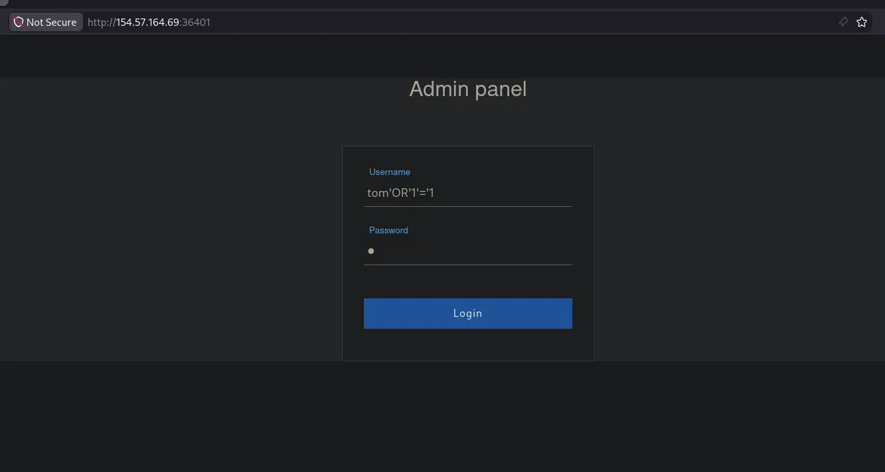
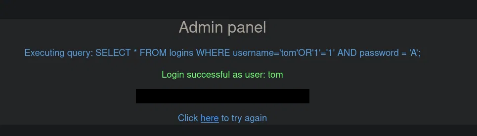

## Exercises

### Question 1 — Try to log in as the user 'tom'. What is the flag value shown after you successfully log in?

The target was `154.57.164.69:36401`, an admin panel login form.

#### Building the Payload

I used an `OR` injection against the username field, with `tom` in place of the usual `admin`, since the question asks to log in as `tom` specifically rather than bypassing with an arbitrary account.



I entered `tom'OR'1'='1` as the username, with an arbitrary password.

**Breakdown:**

- `tom` is the literal username to match
- `'` closes the quote the application wraps around the username field, ending it early
- `OR` joins an always-true condition onto the query
- `'1'='1` is the start of a quoted comparison that is always true, left with one quote missing so the application's own closing quote completes it

This follows the same construction as `admin' or '1'='1`, with `admin` swapped for `tom`.

#### Result



The page shows the executed query:

```sql
SELECT * FROM logins WHERE username='tom'OR'1'='1' AND password = 'A';
```

**Breakdown:**

- `SELECT * FROM logins` returns every column of every matching record
- `WHERE username='tom'` is the original condition on the username, now closed early by the injected quote
- `OR'1'='1'` is the injected condition, always true. It sits directly against the closing quote, with no space, since none was typed between `tom` and `OR`
- `AND password = 'A'` is the rest of the original query, now attached to the injected condition rather than the username condition. The arbitrary password entered appears here as `A`

The `AND` between `'1'='1'` and the password check evaluates first and is false, since the password is wrong, but the `OR` between `username='tom'` and that result only needs one side to be true. Because `tom` exists in the table, the `OR` makes the whole query true, and the login succeeds as `tom`.

The page confirmed `Login successful as user: tom` and displayed the flag.

**Answer:** `—REDACTED—`