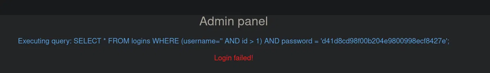
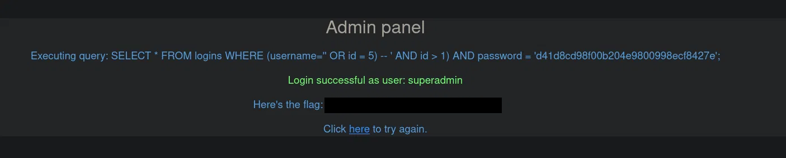

## Exercises

### Question 1 — Login as the user with the id 5 to get the flag.

The target was `154.57.164.76:35531`, an admin panel login form.

#### Checking the Query First

Before attempting an injection, I submitted the login form with nothing entered, to see the query structure.



```sql
SELECT * FROM logins WHERE (username='' AND id > 1) AND password = 'd41d8cd98f00b204e9800998ecf8427e';
```

**Breakdown:**

- `SELECT * FROM logins` returns every column of every matching record
- `WHERE (username='' AND id > 1)` is the parenthesised condition: the username must match (here, empty) and the `id` must be greater than 1
- `AND password = 'd41d8cd98f00b204e9800998ecf8427e'` requires the password to match a hash. The password is hashed before being placed in the query, which rules out injecting through that field
- `;` terminates the query

This showed the query's structure: a parenthesised `AND` on username and `id`, followed by a separate `AND` on a hashed password. The question asks for the user with `id` 5 specifically, so the injection needed to replace the `id > 1` condition with something that matches `id = 5` instead, rather than just bypassing the `id` check with an always-true condition.

#### Building the Payload

Since the password field is hashed before use, injecting there would not work, so I injected through the username field, with a payload that closes the parenthesis and comments out the rest of the query.

I entered `' OR id = 5) -- -` as the username.

**Breakdown:**

- `'` closes the quote the application wraps around the username field, ending it early
- `OR id = 5` is the injected condition, replacing the username check with a check on `id` directly
- `)` closes the parenthesis that the original query opens around `(username=...`
- `-- -` is a comment, with the trailing dash added to show the required space after the two dashes clearly, so the rest of the original query is discarded

#### Result



```sql
SELECT * FROM logins WHERE (username='' OR id = 5) -- ' AND id > 1) AND password = 'd41d8cd98f00b204e9800998ecf8427e';
```

**Breakdown:**

- `SELECT * FROM logins` returns every column of every matching record
- `WHERE (username='' OR id = 5)` is the surviving condition. The empty username matches nothing on its own, but `OR id = 5` makes the whole parenthesised expression true for the record whose `id` is 5
- `-- ' AND id > 1) AND password = 'd41d8cd98f00b204e9800998ecf8427e';` is everything after the injection point, now inside a comment and ignored, including the original `id > 1` restriction, the extra closing parenthesis, and the hashed password check

The query as a whole returns only the record with `id = 5`, and the login succeeded as `superadmin`, the user holding that `id`. No semicolon survives in the executed logic, because the comment discards everything after the injection point, and the database does not require one for a single statement.

**Answer:** `—REDACTED—`