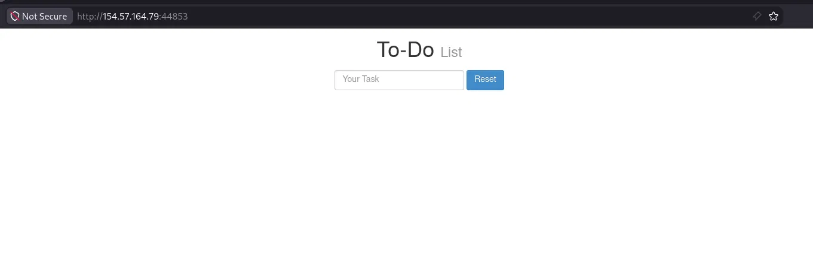
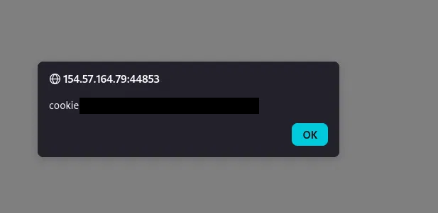

## Exercises

### Question 1 — To get the flag, use the same payload we used above, but change its JavaScript code to show the cookie instead of showing the url.

Hint: `document.cookie`

Target accessed at `http://154.57.164.79:44853`, the same To-Do List app from the course page.



Submitted the following payload into the task input field:

```html
<script>alert(document.cookie)</script>
```

**Breakdown:**

- `<script>` and `</script>` wrap the JavaScript to execute
- `alert()` pops up a dialog box showing whatever value is passed into it
- `document.cookie` is a JavaScript property holding the cookie string set for the current page, and it's the value passed into `alert()`

Where the earlier test used `window.origin` to confirm the vulnerable origin, this swaps it for `document.cookie` to pull the actual cookie value instead.

The payload fired and the alert displayed the cookie, which contained the flag:



**Answer:** `—REDACTED—`