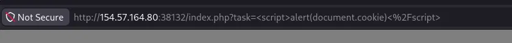
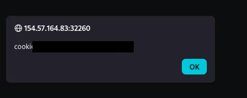

## Exercises

### Question 1 — To get the flag, use the same payload we used above, but change its JavaScript code to show the cookie instead of showing the url.

Target accessed at `154.57.164.83:32260`.

Submitted the following payload via the URL parameter:

```
http://SERVER_IP:PORT/index.php?task=<script>alert(document.cookie)</script>
```



**Breakdown:**

- `index.php` is the vulnerable page's address
- `?task=` is the URL query parameter that carries the task input to the server
- `<script>alert(document.cookie)</script>` is the payload, with `document.cookie` in place of `window.origin` to retrieve the cookie value instead of the page's origin
- `%2F` in the address bar's encoded version is the URL-encoded form of `/`, used by the browser to represent the closing `</script>` tag's slash within the query string

The payload fired and the alert displayed the cookie, which contained the flag:



**Answer:** `—REDACTED—`