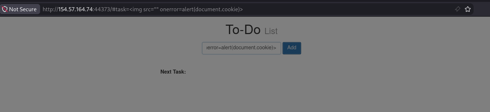
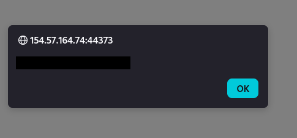

## Exercises

### Question 1 — To get the flag, use the same payload we used above, but change its JavaScript code to show the cookie instead of showing the url.

Target accessed at `154.57.164.74:44373`.

Submitted the following payload via the URL fragment:

```
http://154.57.164.74:44373/#task=
```



**Breakdown:**

- `#task=` is the client-side URL fragment used as the Source, read directly from `document.URL` and never sent to the server
- `` creates an image element with an empty source, so it always fails to load
- `onerror=alert(document.cookie)` runs when the image fails to load, with `document.cookie` in place of `window.origin` to retrieve the cookie value instead of the page's origin

The payload fired and the alert displayed the cookie, which contained the flag:



**Answer:** `—REDACTED—`