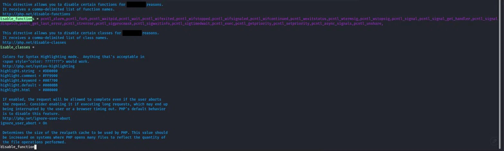
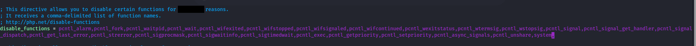

## Exercises

### Question 1 — What is the full path to the php.ini file for Apache?

Connected to the target over SSH:

```shell
┌──(—REDACTED—㉿kali)-[~]
└─$ ssh htb-student@10.129.29.112                                              
—SNIP—

The list of available updates is more than a week old.
To check for new updates run: sudo apt update

Last login: Mon Nov  9 20:03:47 2020
htb-student@lfi-harden:~$ 
```

Located the Apache PHP config directory and confirmed the file's presence:

```shell
htb-student@lfi-harden:~$ cd —REDACTED—/
htb-student@lfi-harden:—REDACTED—$ ls

conf.d  php.ini
htb-student@lfi-harden:—REDACTED—$ pwd

—REDACTED—
```

**Answer:** `—REDACTED—`

### Question 2 — Edit the php.ini file to block system(), then try to execute PHP Code that uses system. Read the /var/log/apache2/error.log file and fill in the blank: system() has been disabled for ________ reasons.

Edited `php.ini` with `sudo vim`:

```shell
htb-student@lfi-harden:—REDACTED—$ sudo vim php.ini
```

Added `system` to the `disable_functions` directive





```
disable_functions = pcntl_alarm,pcntl_fork,pcntl_waitpid,pcntl_wait,pcntl_wifexited,pcntl_wifstopped,pcntl_wifsignaled,pcntl_wifcontinued,pcntl_wexitstatus,pcntl_wtermsig,pcntl_wstopsig,pcntl_signal,pcntl_signal_get_handler,pcntl_signal_dispatch,pcntl_get_last_error,pcntl_strerror,pcntl_sigprocmask,pcntl_sigwaitinfo,pcntl_sigtimedwait,pcntl_exec,pcntl_getpriority,pcntl_setpriority,pcntl_async_signals,pcntl_unshare,system,
```

Restarted Apache for the updated `php.ini` to take effect:

```shell
htb-student@lfi-harden:/var/log/apache2$ sudo systemctl restart apache2
```

**Breakdown:**

- `sudo systemctl restart apache2` restarts the Apache service, forcing it to reload `php.ini` — edits to the file aren't picked up by an already-running instance

Wrote a small test script into the webroot to trigger a call to `system()`:

```shell
htb-student@lfi-harden:/var/log/apache2$ echo '<?php system($_GET["cmd"]); ?>' | sudo tee /var/www/html/test.php

<?php system($_GET["cmd"]); ?>
```

**Breakdown:**

- `echo '<?php system($_GET["cmd"]); ?>'` prints the test PHP code
- `| sudo tee /var/www/html/test.php` pipes that output into `tee`, which writes it to the named file (and echoes it back to the terminal) with root privileges, needed since the webroot isn't writable by `htb-student` directly

Requested the script with a command parameter:

```shell
htb-student@lfi-harden:/var/log/apache2$ curl "http://10.129.29.112/test.php?cmd=id"
```

**Breakdown:**

- `?cmd=id` the command intended for `system()` to run — the request returned no output, consistent with `system()` now being blocked rather than silently failing or erroring at the HTTP layer

Read the Apache error log to confirm the block and see the exact message:

```shell
htb-student@lfi-harden:/var/log/apache2$ sudo tail -n 20 /var/log/apache2/error.log

[Sun Nov 01 14:14:33.853876 2026] [mpm_prefork:notice] [pid 891] AH00163: Apache/2.4.41 (Ubuntu) configured -- resuming normal operations
[Sun Nov 01 14:14:33.853960 2026] [core:notice] [pid 891] AH00094: Command line: '/usr/sbin/apache2'
[Sun Nov 01 14:35:41.018576 2026] [mpm_prefork:notice] [pid 891] AH00169: caught SIGTERM, shutting down
[Sun Nov 01 14:35:41.086778 2026] [mpm_prefork:notice] [pid 1971] AH00163: Apache/2.4.41 (Ubuntu) configured -- resuming normal operations
[Sun Nov 01 14:35:41.086820 2026] [core:notice] [pid 1971] AH00094: Command line: '/usr/sbin/apache2'
[Sun Nov 01 14:35:51.616414 2026] [php7:warn] [pid 1973] [client 10.129.29.112:53108] PHP Warning:  system() has been disabled for —REDACTED— reasons in /var/www/html/test.php on line 1
```

**Breakdown:**

- `sudo tail -n 20 /var/log/apache2/error.log` shows the last 20 lines of the Apache error log

The final log line confirms the `disable_functions` directive took effect: PHP raised a warning stating `system()` had been disabled, rather than executing the command.

**Answer:** `—REDACTED—`