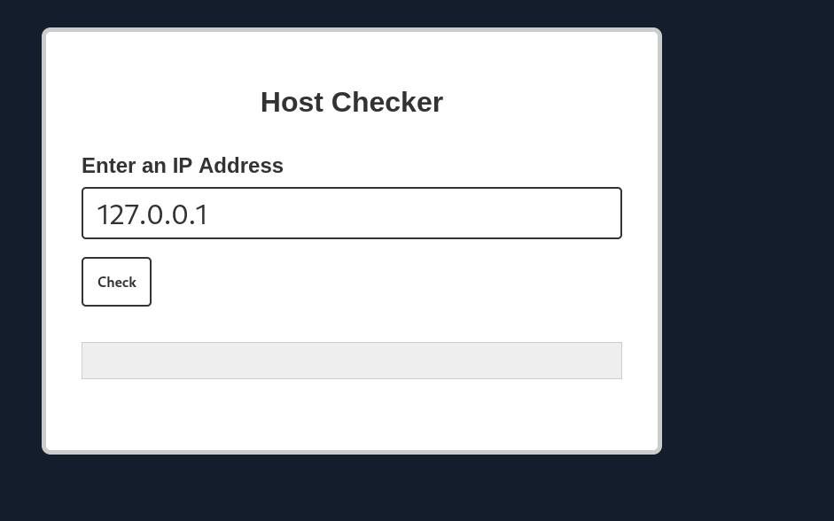
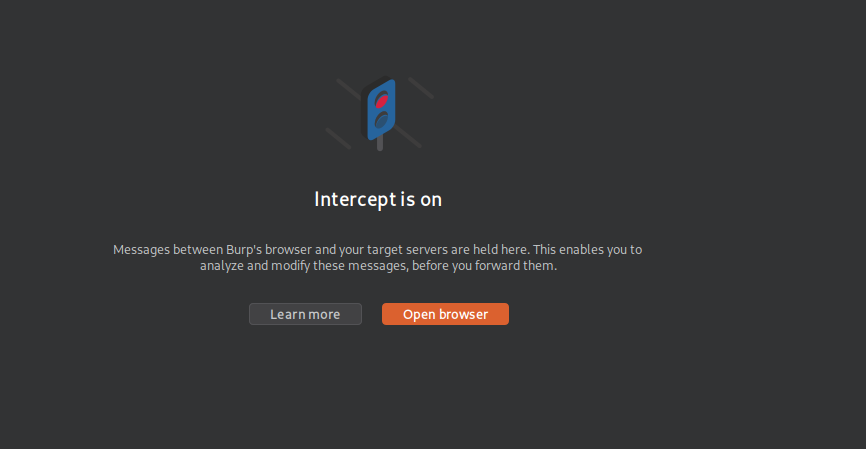
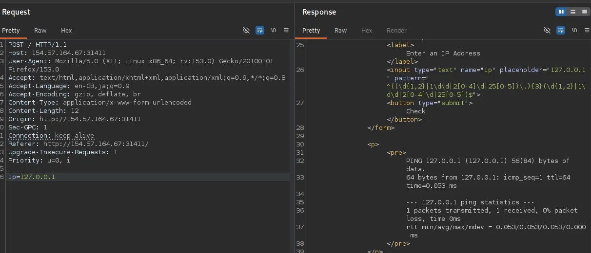
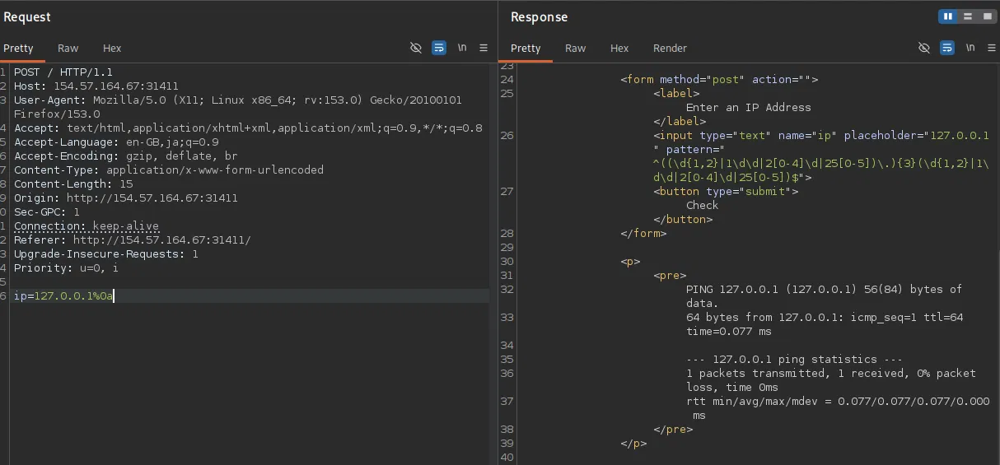
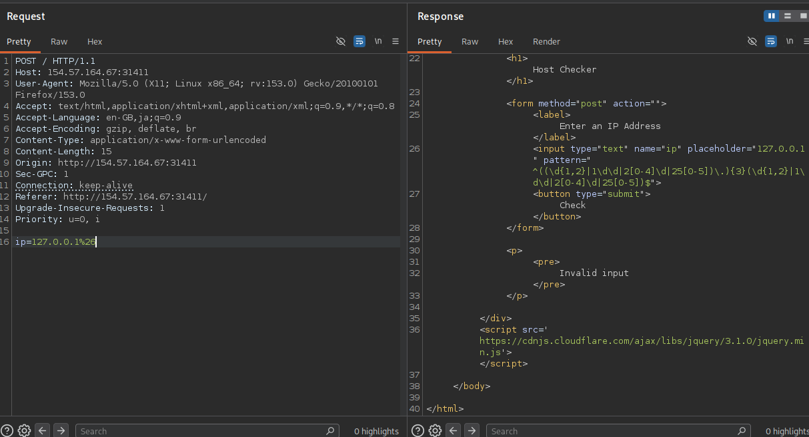
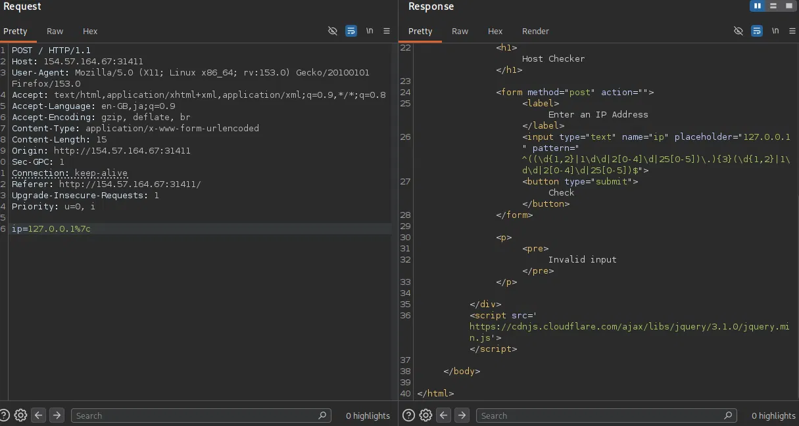

## Exercises

### Question 1 — Try all other injection operators to see if any of them is not blacklisted. Which of (—REDACTED—, &, |) is not blacklisted by the web application?





With Burp's intercept switched on, I first sent the plain baseline request, `ip=127.0.0.1`, to confirm the connection and response format before testing anything:



The response came back as ordinary ping output, confirming nothing was blocked yet. From there I tested each of the three remaining operators on its own, with nothing appended after it, so I could see purely whether the character itself triggered the filter.

**—REDACTED—**, URL-encoded as `%0a`:

```
ip=127.0.0.1%0a
```

**Breakdown:**

- `ip=127.0.0.1` is the baseline IP value the form expects
- `%0a` is the URL-encoded form of the character being tested, appended directly after the IP with nothing following it



The response was the usual ping output, with no "Invalid input" message, so the —REDACTED— character isn't blacklisted.

**Background**, URL-encoded as `%26`:

```
ip=127.0.0.1%26
```

**Breakdown:**

- `ip=127.0.0.1` is the baseline IP value
- `%26` is the URL-encoded form of `&`, appended with nothing after it



This one came back with "Invalid input", so `&` is blacklisted.

**Pipe**, URL-encoded as `%7c`:

```
ip=127.0.0.1%7c
```

**Breakdown:**

- `ip=127.0.0.1` is the baseline IP value
- `%7c` is the URL-encoded form of `|`, appended with nothing after it



This was also rejected with "Invalid input", so `|` is blacklisted too.

Out of the three, only the —REDACTED— character got through without triggering the filter.

**Answer:** `—REDACTED—`